# Framework Veriq

## Phạm vi và nguồn đối chiếu

Tài liệu này mô tả hành vi đang có trong mã nguồn Veriq tại thời điểm tạo tài liệu

Nó không coi ảnh tham khảo là tài liệu kiến trúc và không suy diễn thêm chức năng từ ảnh đó

Các điểm được đối chiếu gồm

- Định nghĩa services và route trong `docker-compose.yml`
- Router Testing trong `backend/testing/src/main.py`
- Router Requirements trong `backend/testing/src/modules/requirements`
- Router AI và graph điều phối trong `backend/ai/src/api` và `backend/ai/src/agents/runner`
- Luồng evidence trong `backend/ai/src/knowledge`
- Worker và hàng đợi trong `backend/worker/src/main.py`

## Nguyên tắc nghiệp vụ

- Mọi đối tượng nghiệp vụ nằm trong một dự án và được kiểm tra quyền dự án trước khi đọc hoặc thay đổi
- Tài liệu nguồn giữ quyền truy cập riêng và cờ cho phép AI sử dụng riêng
- Requirement import tạo bản xem trước trước khi xác nhận nhập
- Template chỉ hỗ trợ thu thập và chuẩn hóa Requirements Không tạo test case trong luồng template
- Test case được xử lý tại giai đoạn Thiết kế kiểm thử sau khi Requirement đã được xác nhận
- Thay đổi do AI đề xuất không được áp dụng khi chưa có quyết định phê duyệt
- Kết quả AI chỉ được coi là hoàn tất khi vượt qua kiểm tra phạm vi bằng chứng và kết quả áp dụng nếu có

## Luồng nghiệp vụ tổng quát

Sơ đồ này dùng các điểm kiểm tra làm mốc quay lại Khi một bước không đạt điều kiện hệ thống không đi tiếp xuống bước sau và cũng không tự bỏ qua lỗi

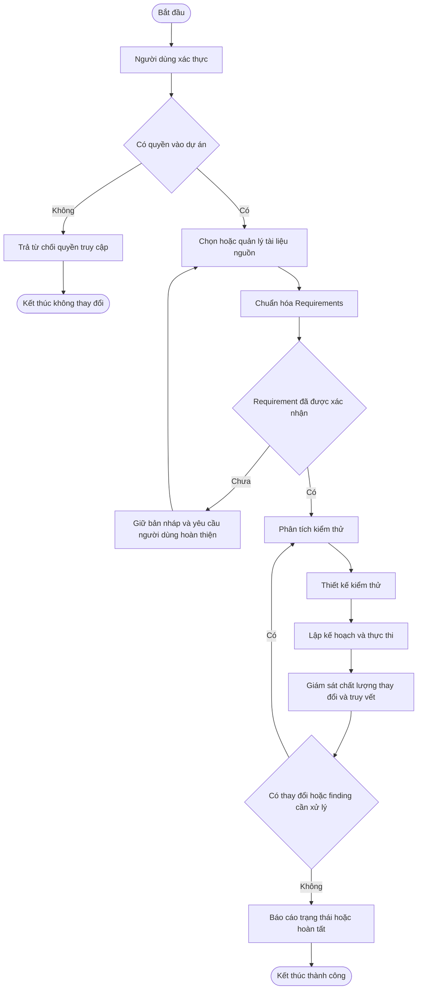

### Luồng điều khiển cho một thao tác có thay đổi dữ liệu

Mỗi hình thoi là một quyết định có nhánh Có và Không rõ ràng Mỗi nhánh phải đi đến một kết thúc hoặc quay về đúng checkpoint Không có nhánh lỗi nào tự rơi xuống nhánh thành công

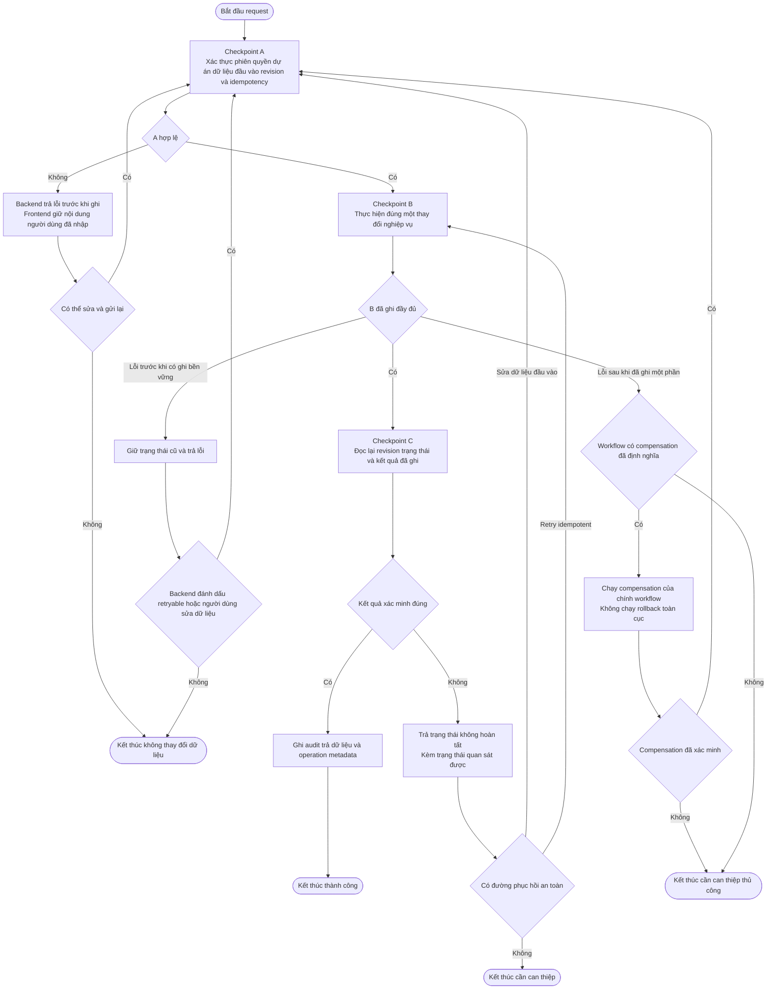

Không có một cơ chế compensation chung cho toàn hệ thống Mỗi workflow phải tự xác định trạng thái có thể phục hồi và thao tác đảo ngược tương ứng Mã hiện có các rollback riêng cho vòng đời Requirement phiên bản Test Case kết quả AI áp dụng vào Requirement và lệnh thực thi tự động Các workflow không có rollback riêng phải trả lỗi có cấu trúc và giữ trạng thái quan sát được thay vì tuyên bố đã hoàn tác

### Luồng Requirements chi tiết

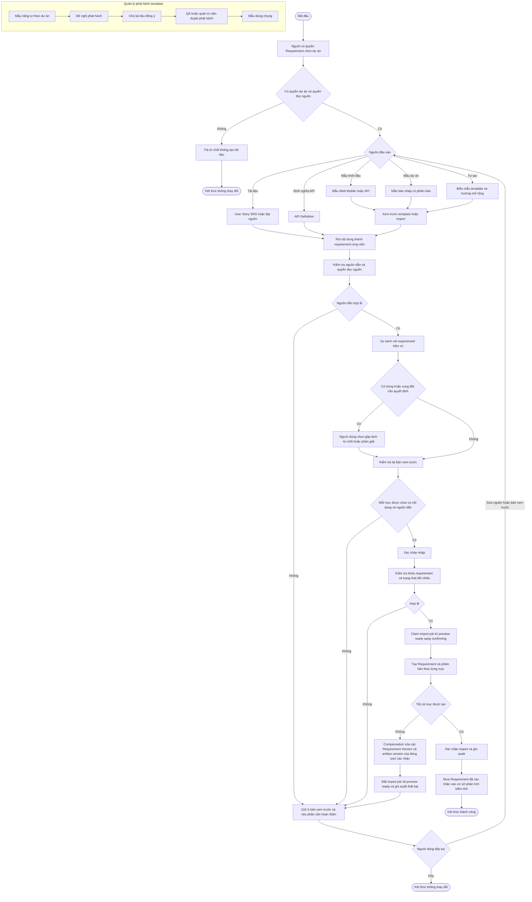

### Điểm dừng của template

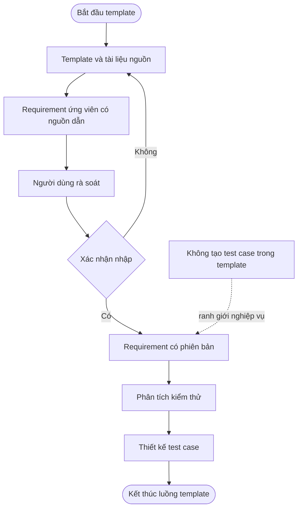

## Luồng từ Requirement đến báo cáo

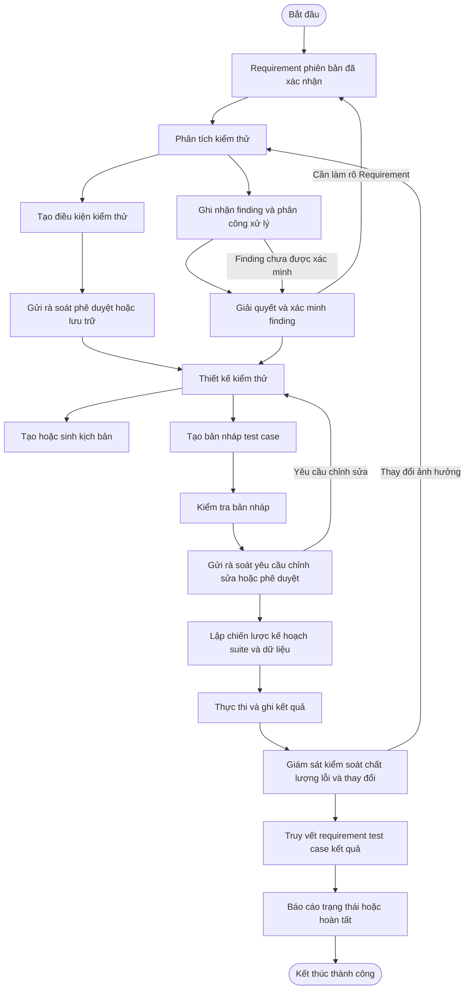

## Luồng hoạt động AI agent

AI agent hiện là một workflow điều phối duy nhất cho mỗi lượt chạy Không có cơ chế nhiều agent tự chạy song song trên cùng một lượt

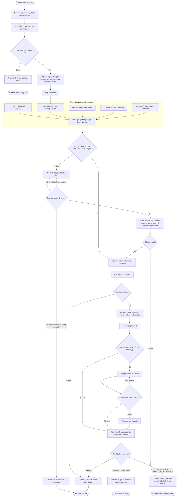

### Các ràng buộc AI đang thực thi

- Capability trả về giao diện chỉ là capability mà vai trò hiện tại có quyền dùng
- Evidence phải cùng `project_id` với lượt chạy
- Bằng chứng từ vector và graph chỉ được giữ khi tham chiếu khớp artifact có thẩm quyền từ nguồn dự án
- Plan và tool call bị kiểm tra schema tham số quyền tool phạm vi dự án và định danh trước khi thực thi
- Workflow giới hạn một task được xử lý cho một lượt chạy
- Tool cần phê duyệt chỉ tạo đề xuất trước khi quyết định duyệt
- Khi áp dụng có xác minh lại kết quả áp dụng
- Kết quả hoàn tất phải có kiểm tra evidence phạm vi project và số lượng hành động được áp dụng
- Bộ nhớ dài hạn chỉ ghi khi lượt chạy hoàn tất và xác minh thành công

### Hai lớp trạng thái của lượt chạy AI

`run.status` mô tả workflow có chạy đến điểm kết thúc hay không còn `agent_results[].status` mô tả chất lượng của từng kết quả

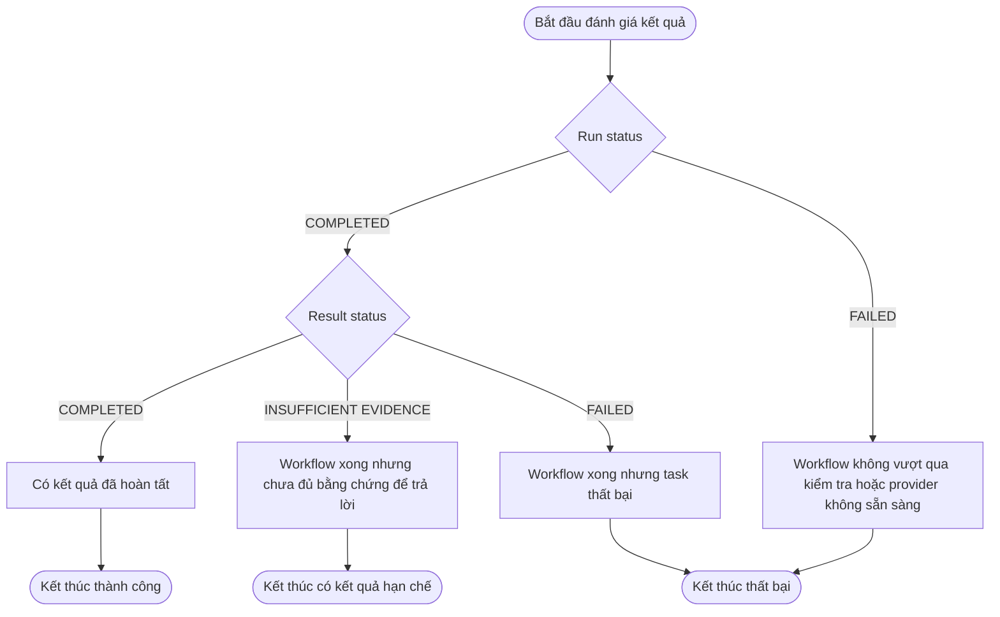

Vì vậy frontend không được chỉ hiển thị `run.status` như kết luận chất lượng câu trả lời Nó cần thể hiện đồng thời result status warnings và verification để người dùng phân biệt hoàn tất xử lý với có đủ bằng chứng

## Luồng kiểm soát frontend đến backend

Frontend là điểm khởi tạo thao tác và hiển thị trạng thái Backend mới là nơi quyết định quyền trạng thái dữ liệu idempotency retry fallback và compensation

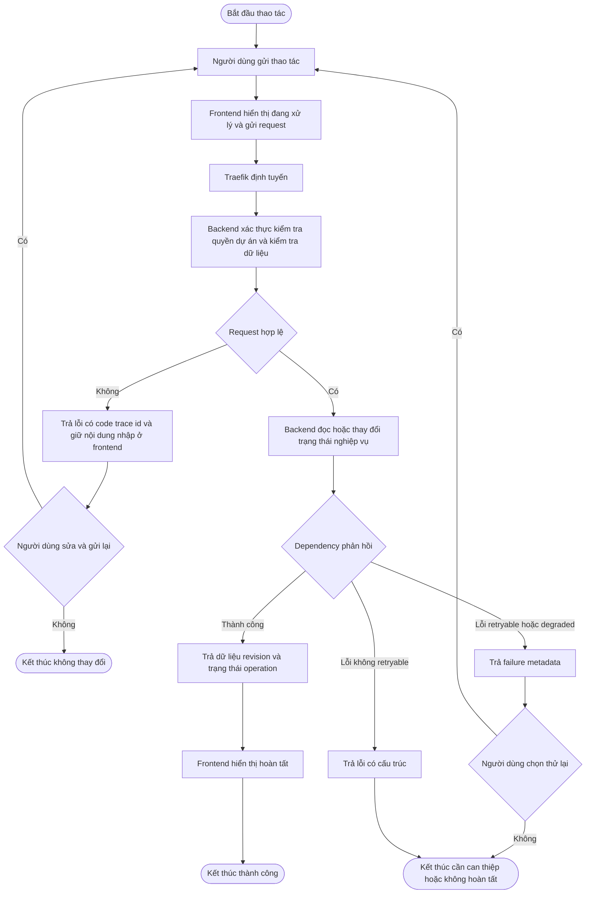

### Expected path

Đường thành công của backend phải đi qua các lớp sau trước khi thay đổi dữ liệu

- Xác thực phiên và xác định người dùng
- Kiểm tra tư cách thành viên hoặc quyền được cấp trong project
- Kiểm tra trạng thái hiện tại của entity và dữ liệu đầu vào
- Kiểm tra `revision` hoặc cơ chế idempotency ở các luồng có hỗ trợ
- Thực hiện thay đổi nghiệp vụ
- Trả dữ liệu cùng metadata operation để frontend hiển thị
- Ghi audit khi nghiệp vụ đó có audit

Frontend không được tự kết luận thao tác thành công trước response Backend Frontend chỉ chuyển trạng thái `streaming` `complete` hoặc `failed` dựa trên response hay stream nhận được

### Rejection không phải rollback

Các tình huống như không đủ quyền dữ liệu sai `revision` không khớp entity đã đổi trạng thái hoặc idempotency key xung đột được backend từ chối trước khi thay đổi thành công

Đây là cơ chế bảo toàn trạng thái hiện có không phải rollback Sau khi nhận lỗi frontend phải giữ dữ liệu người dùng đã nhập và hiển thị error code trace id cùng khả năng retry nếu response đánh dấu retryable

### Fallback và degradation hiện có

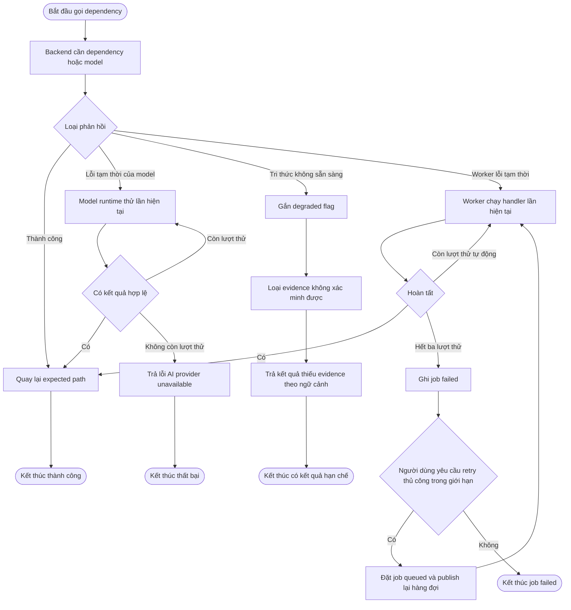

Các fallback được xác nhận trong mã nguồn

- Model runtime thử lại tối đa ba lần với backoff trước khi báo lỗi
- Structured output có vòng sửa dữ liệu đầu ra trước khi coi là không hợp lệ
- Retrieval ghi degraded flags khi tri thức hoặc graph không sẵn sàng và không coi evidence không xác minh được là nguồn có thẩm quyền
- Worker thử lại handler tối đa ba lần rồi ghi job failed Người dùng có thể yêu cầu retry thủ công cho job failed trong giới hạn đã định
- API Testing trả metadata `retryable` `state_after_failure` và `user_action_required` cho lỗi có cấu trúc

Điều chưa có là fallback frontend tự gửi lại mọi request Việc tự gửi lại các thao tác ghi có thể tạo nhân bản hoặc làm sai ý người dùng Vì vậy frontend chỉ hiển thị retry theo ý người dùng và backend vẫn là nơi xác định thao tác có retry được hay không

### Rollback và compensation hiện có

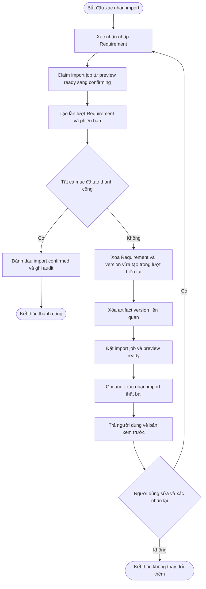

Rollback thật sự đã có trong luồng xác nhận Requirement import Khi một mục tạo thất bại hệ thống xóa các Requirement và version đã được tạo trong chính lượt xác nhận đó gỡ artifact version liên quan rồi trả import job về `PREVIEW_READY`

Ngoài luồng này hệ thống không có một rollback phân tán toàn cục bao phủ tất cả microservice Điều đó không được phép mô tả như đã có

Các luồng còn lại chủ yếu bảo vệ bằng state machine revision idempotency immutable snapshot archive và retry Các cơ chế này ngăn thay đổi sai hoặc phục hồi thao tác có kiểm soát nhưng không tương đương transaction xuyên service

### Cần được bổ sung nếu mở rộng nghiệp vụ có side effect nhiều service

Khi một thao tác mới ghi dữ liệu ở nhiều service phải xác định rõ trước khi build

- Expected state sau từng bước
- Idempotency key và revision dùng để chống gửi lại
- Side effect nào có thể retry và side effect nào phải yêu cầu người dùng xác nhận lại
- Compensation cụ thể của từng bước khi bước sau thất bại
- Trạng thái lỗi cuối cùng có thể quan sát được
- Chủ thể được phép retry resume cancel hoặc discard

Không được dùng rollback giả bằng cách xóa toàn bộ dữ liệu hoặc tự chạy lại thao tác ghi mà chưa xác định idempotency và compensation

## Khung triển khai hệ thống

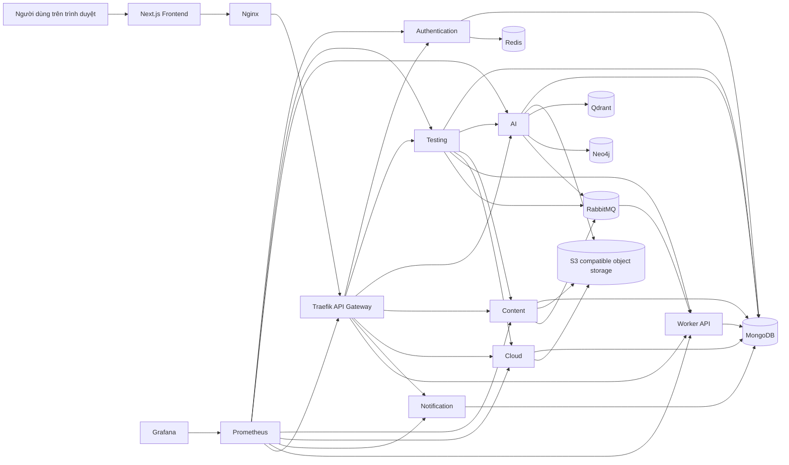

### Phân định trách nhiệm service

| Thành phần | Trách nhiệm đã đối chiếu |
| --- | --- |
| Frontend và Nginx | Hiển thị giao diện và phục vụ frontend |
| Traefik | Cổng vào API và định tuyến theo path |
| Authentication | Phiên xác thực khóa bảo mật Google OAuth và quản trị hệ thống |
| Testing | Dự án Requirements thiết kế thực thi chất lượng tích hợp và vận hành kiểm thử |
| AI | Inference agent indexing retrieval tri thức và phê duyệt agent |
| Content | Tài liệu phiên bản metadata và cấu trúc tài liệu |
| Cloud | Tệp thư mục tải lên tải về chia sẻ tìm kiếm và phân đoạn tệp |
| Worker và RabbitMQ | Xếp hàng và xử lý tác vụ nền |
| MongoDB | Dữ liệu nghiệp vụ theo database service |
| Redis | Cache phiên và dữ liệu tạm |
| Qdrant | Vector retrieval |
| Neo4j | Quan hệ artifact và truy vết đồ thị |
| Object storage | Đối tượng tệp |
| Prometheus và Grafana | Thu thập và quan sát metrics |

## Ranh giới không được suy diễn

- Sơ đồ không khẳng định tất cả capability AI đều thành công với mọi dữ liệu đầu vào
- Sơ đồ không coi thông tin chưa được xác nhận là evidence
- Sơ đồ không coi template là test case template
- Sơ đồ không nói AI được quyền tự thay đổi dữ liệu nghiệp vụ
- Sơ đồ không thay thế kiểm thử tích hợp và kiểm thử hồi quy khi có thay đổi mã nguồn
