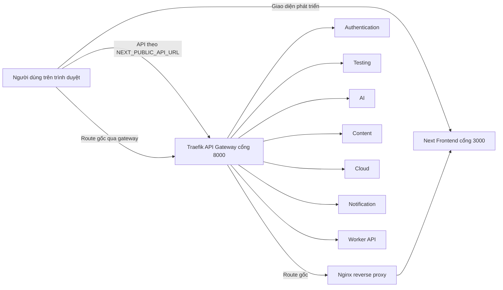
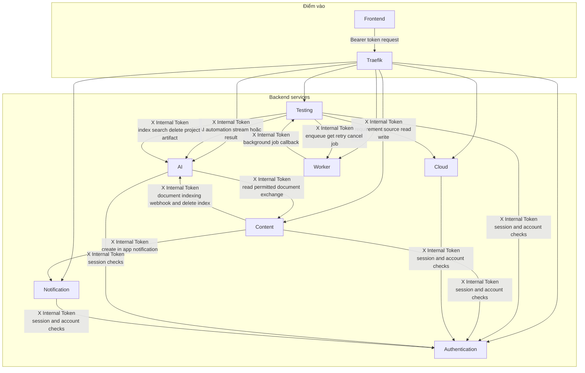
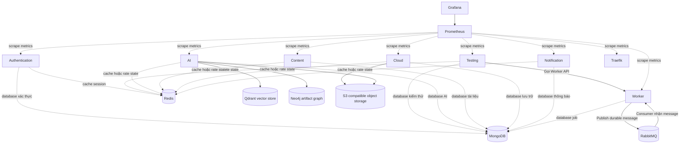
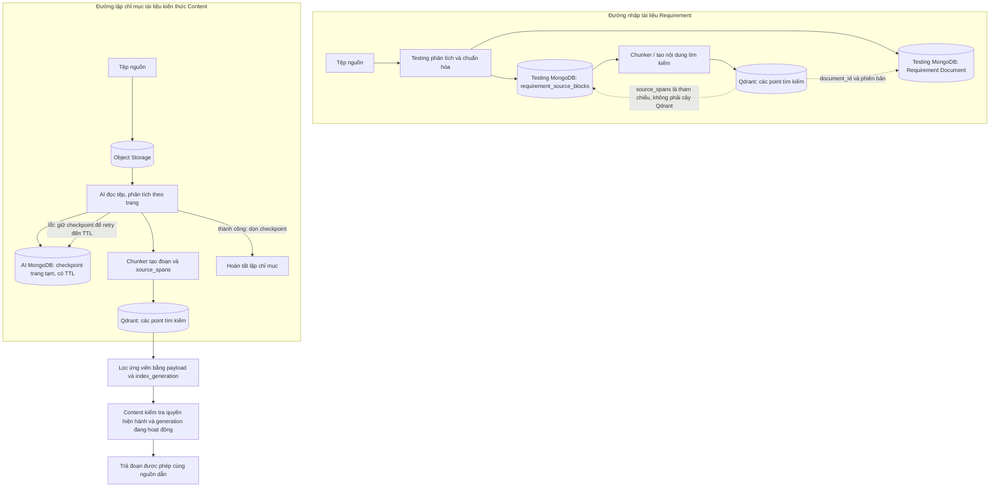
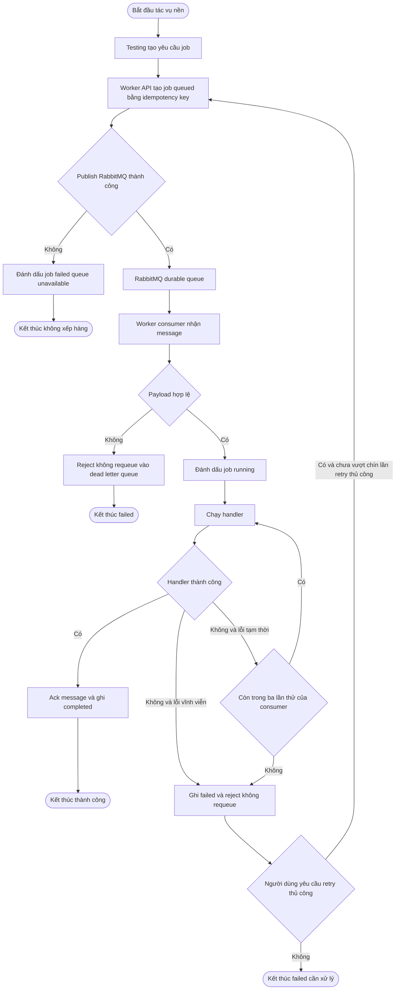
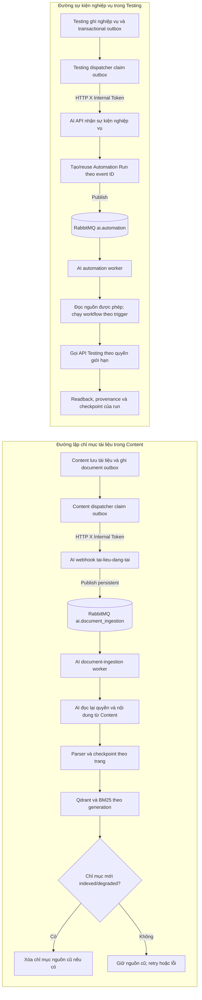
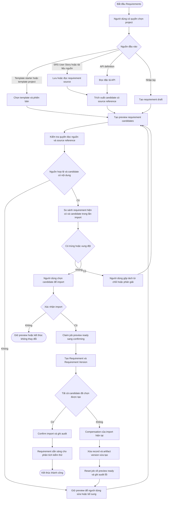
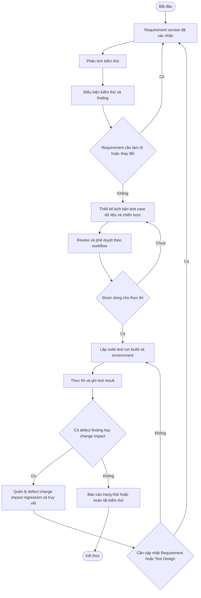
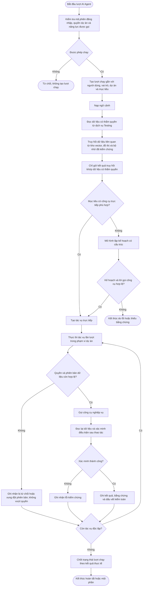

# Framework Veriq

## Mục đích và căn cứ

Tài liệu này thay thế bản framework trước và chỉ mô tả hành vi đã đối chiếu trong mã nguồn Veriq

Nó không suy diễn từ tên service  từ ảnh vẽ hay từ một dependency được khai báo trong Docker

Các nguồn đối chiếu chính

- `docker-compose.yml` và `nginx.conf`
- `frontend/shared/services/api-client.js`
- `backend/testing/src/main.py` và `backend/testing/src/clients`
- `backend/ai/src/main.py`  `backend/ai/src/agents/runner/graph.py` và `backend/ai/src/knowledge/hybrid.py`
- `backend/content/src/clients`
- `backend/worker/src/main.py`  `backend/worker/src/services.py` và `backend/worker/src/jobs/task.py`
- `backend/testing/src/modules/requirements/services/requirement_import_workflow.py`

Tài liệu tách riêng bốn vấn đề để tránh lẫn lộn

- Kiến trúc microservice
- Vòng đời nghiệp vụ kiểm thử
- Hoạt động AI
- Retry  fallback  compensation và các điểm kết thúc

## Quy ước sơ đồ

| Ký hiệu | Ý nghĩa |
| --- | --- |
| Hình bo tròn | Bắt đầu hoặc kết thúc |
| Hình chữ nhật | Hoạt động có chủ thể chịu trách nhiệm |
| Hình thoi | Quyết định  phải có các nhánh đầy đủ |
| Mũi tên liền | Lời gọi hoặc chuyển trạng thái được mã nguồn xác nhận |
| Mũi tên nét đứt | Quan sát  giám sát hoặc quan hệ dữ liệu |
| Không thay đổi | Request bị dừng trước khi có thay đổi bền vững |
| Cần can thiệp | Không có compensation tự động cho tình huống đó |

## Sự thật không được vẽ sai

1  Frontend có cổng trực tiếp `3000`

2  Traefik nhận API ở cổng `8000`

3  Nginx chỉ reverse proxy Frontend khi đi qua route gốc của Traefik  Nginx không nằm trên mọi request API

4  Testing sở hữu Projects  Requirements  Design  Execution  Quality  Integrations và Operations

5  Testing gọi AI qua API nội bộ  Testing không truy cập trực tiếp Qdrant hay Neo4j

6  Luồng tác vụ nền được xác nhận là Testing → Worker API → RabbitMQ → Worker consumer → Testing internal callback

7  Content lập chỉ mục tài liệu qua outbox của Content → HTTP webhook có X Internal Token → AI publish vào RabbitMQ bền vững `ai.document_ingestion` → AI document-ingestion worker → Content authorization/read và Qdrant/BM25

8  Không có distributed transaction hoặc rollback chung cho toàn hệ thống

9  Các service dùng cùng MongoDB deployment nhưng có database logic riêng  Không service nào tự sở hữu dữ liệu của service khác

10  Luồng AI sự kiện tài liệu hiện có thể tự chốt chuẩn Requirement và công bố Test Case sau các kiểm tra nguồn, chất lượng, trạng thái và quyền trong dự án; người dùng không phải bấm duyệt để luồng tiếp tục. Thao tác đi qua API Testing bằng quyền QA được ủy quyền và giới hạn theo lượt chạy, không phải quyền Admin hay đường vòng phân quyền. API đánh giá chất lượng Requirement chỉ cho phép gọi nội bộ; giao diện chỉ đọc kết quả do event ghi. Các nghiệp vụ khác chỉ tự ghi khi có tool, permission và hậu kiểm tương ứng; không suy rộng rằng AI có thể archive hoặc tự quyết mọi thay đổi.

## 1  Bối cảnh triển khai và điểm vào



Không được vẽ đường Frontend → Nginx → Traefik → Backend như một đường bắt buộc  Frontend gọi API qua URL cấu hình và Traefik định tuyến API theo path

## 2  Luồng microservice đã xác nhận



Mỗi mũi tên trên là client nội bộ hoặc callback có trong mã nguồn

Không thêm mũi tên giữa hai service chỉ vì chúng cùng dùng Docker network  MongoDB hoặc Redis

## 3  Hai loại xác thực


Bearer token và X Internal Token là hai cơ chế khác nhau  Không được gộp thành một ô JWT chung

## 4  Sở hữu dữ liệu và hạ tầng



Qdrant và Neo4j thuộc đường tri thức AI  Object storage giữ bytes của tệp còn Cloud quản lý thao tác và metadata file

### 4.1 Cấu trúc đoạn tài liệu trong Qdrant

Qdrant **không phải kho cây tài liệu**. Mỗi điểm Qdrant là một vector độc lập có ID, vector embedding và payload; quan hệ cha–con được biểu diễn bằng metadata tham chiếu, không phải bằng cấu trúc cây native của Qdrant. Luồng hiện tại tạo điểm theo đoạn nội dung; có thể tạo thêm một điểm tóm tắt. ID điểm được xác định theo nội dung trong một thế hệ lập chỉ mục, nhưng thế hệ mới được tạo khi lập chỉ mục lại nên ID không ổn định xuyên lần lập chỉ mục.

| Trường payload | Ý nghĩa trong luồng hiện tại |
|---|---|
| `text` | Nội dung đoạn được nhúng và tìm kiếm. Đây là payload của điểm, không phải đường dẫn tới file gốc. |
| `document_id`, `source_version`, `source_hash`, `normalized_content_hash` | Tài liệu, phiên bản, hash bytes nguồn nếu Content/parser cung cấp và hash văn bản chuẩn hóa toàn đầu vào. Hai hash khác mục đích, không dùng hash text thay cho hash tệp. |
| `project_id`, `artifact_type`, `artifact_id`, `artifact_version_id`, `module`, `status` | Đối tượng nghiệp vụ và phạm vi phiên bản mà tài liệu phục vụ. |
| `creator_id`, `owner_id`, `shared_with`, `visibility` | Thuộc tính để lọc quyền truy cập; khi truy xuất vẫn phải kiểm tra quyền hiện hành ở Content, không tin riêng payload cũ. |
| `title`, `author`, `source`, `source_name`, `source_url`, `publisher`, `book_title`, `collector_version` | Thông tin mô tả nguồn khi tài liệu cung cấp. Trường không có dữ liệu giữ rỗng/không có, không tự suy đoán. |
| `source_created_at`, `source_updated_at`, `indexed_at` | Thời điểm tạo/cập nhật do Content cung cấp và thời điểm Veriq lập chỉ mục. Thời gian nguồn không có hoặc sai định dạng thì để trống; không lấy thời điểm index thay cho thời điểm tài liệu. |
| `parser_name`, `parser_version`, `ocr_enabled`, `ocr_language`, `page_count`, `source_block_count`, `extraction_status`, `unprocessed_block_count`, `extraction_warning_count`, `extraction_warning_codes`, `extraction_method` | Cách phân tích/OCR, số trang/khối parser báo về, phần chưa trích xuất và cảnh báo độ tin cậy. `ocr_enabled=true` chỉ xác nhận OCR được bật, không xác nhận văn bản nhận dạng chính xác. |
| `index_generation`, `indexing_attempt_id`, `indexed_at`, `embedding_model`, `embedding_input_mode`, `embedding_input_hash` | Thế hệ/lần xử lý chỉ mục, thời điểm lập chỉ mục, phiên bản mô hình và cách ghép đầu vào embedding (`TEXT` hoặc `TITLE_AND_TEXT`), kèm hash để phát hiện metadata không khớp văn bản đã nhúng. Thế hệ giúp thay chỉ mục có kiểm soát và dọn đúng điểm cũ; mã lần xử lý chỉ có khi pipeline cấp mã. |
| `chunk_id`, `logical_chunk_id`, `chunk_hash`, `chunk_index`, `char_count`, `word_count`, `chunk_type`, `structure_types` | `chunk_id` nhận diện đoạn trong thế hệ chỉ mục; `logical_chunk_id` ổn định qua lần lập chỉ mục lại khi nguồn, vị trí và nội dung đoạn không đổi. `chunk_hash` so nội dung đoạn, thứ tự, kích thước và loại cấu trúc; nó không thay `source_hash` của toàn tệp. |
| `source_spans` | Các khối nguồn nằm trong đoạn: `block_id`, `parent_block_id`, thứ tự khối, loại nội dung, đường dẫn đề mục, vị trí trang/toạ độ nếu parser có, offset trong khối và offset trong đoạn. Đây là liên kết cha–con hiện được giữ trong payload. |
| `page_numbers`, `page_start`, `page_end` | Tập trang nguồn và khoảng trang bao quanh đoạn, chỉ suy ra từ vị trí parser cung cấp; nếu không có trang thì để trống. |
| `summary_scope`, `summary_sample_chunk_ids`, `summary_sample_page_numbers`, `summary_sample_char_count`, `document_chunk_count` | Chỉ có ở điểm tóm tắt; nêu rõ tóm tắt dựa trên toàn bộ đoạn hay mẫu phân tán. Tóm tắt không thay thế nội dung nguồn. |

#### Metadata của một đoạn, giải thích theo nhóm dữ liệu

Để người dùng và giảng viên có thể lần từ kết quả tìm kiếm về đúng tài liệu, metadata cần được hiểu thành các nhóm sau. Bảng trên mô tả payload đang được tạo ở luồng hiện tại; cột cuối phân biệt dữ liệu đã có trong code với dữ liệu cần bổ sung, tránh hiểu nhầm rằng mọi trường đề xuất đã được lưu.

| Nhóm | Trường cụ thể | Dùng để làm gì | Trạng thái hiện tại |
|---|---|---|---|
| Khóa tài liệu | `document_id`, `source_version`, `source_hash` | Xác định tệp nguồn và đúng phiên bản; hash phân biệt nội dung tệp đã thay đổi hay chưa. | Đã có trong metadata ingestion; ID phiên bản phụ thuộc nguồn cung cấp. |
| Khóa đối tượng Veriq | `project_id`, `artifact_type`, `artifact_id`, `artifact_version_id`, `module` | Xác định tài liệu thuộc dự án nào và gắn với Requirement, Test Case hay đối tượng nào. | Đã có; giá trị có thể rỗng nếu Content không gửi liên kết. Không được tự gán theo phỏng đoán. |
| Quyền truy cập | `owner_id`, `creator_id`, `shared_with`, `visibility` | Giúp lọc ứng viên theo phạm vi; trước khi trả nội dung hoặc dùng làm căn cứ vẫn phải hỏi dịch vụ Content kiểm tra quyền hiện hành. | Đã có trong payload. Quyền trong Qdrant không phải nguồn quyết định cuối. |
| Mô tả nguồn | `title`, `author`, `source`, `source_name`, `source_url`, `publisher`, `book_title`, `collector_version` | Hiển thị tên nguồn và thông tin thư mục nếu nguồn đã cung cấp. | Đã có, nhưng một số giá trị có thể trống. |
| Thời gian | `source_created_at`, `source_updated_at`, `indexed_at` | Phân biệt thời điểm nguồn được tạo/cập nhật với thời điểm Veriq lập chỉ mục. | `indexed_at` đã có; thời điểm nguồn lấy từ Content khi hợp lệ. Nếu nguồn không có hoặc sai định dạng thì để trống, không tự thay bằng giờ hiện tại. |
| Trích xuất | `parser_name`, `parser_version`, `extraction_method`, `extraction_status`, `ocr_enabled`, `ocr_language`, `unprocessed_block_count` | Biết bộ phân tích/OCR nào chạy, trạng thái ra sao và còn khối nào không đọc được. | Có một phần trong payload; cần kiểm tra từng trường được parser/Content trả về, không mặc định mọi loại tài liệu có đủ. |
| Vòng đời chỉ mục | `index_generation`, `indexed_at`, `embedding_model`, `status` | Phân biệt lần lập chỉ mục, mô hình embedding và trạng thái của nội dung được lập chỉ mục; hỗ trợ thay chỉ mục cũ có kiểm soát. | Đã có trong luồng lập chỉ mục. |
| Danh tính đoạn | `chunk_id`, `logical_chunk_id`, `chunk_hash`, `chunk_index`, `chunk_type`, `structure_types`, `char_count`, `word_count` | Tìm đúng đoạn, so nội dung đoạn giữa lần lập chỉ mục, sắp xếp và hiểu đoạn gồm loại khối nào. | `chunk_hash` là SHA-256 văn bản đoạn; khác `source_hash` của cả tài liệu. `chunk_id` được suy ra trong cùng thế hệ lập chỉ mục; vì `index_generation` đổi khi lập chỉ mục lại, không được xem ID này là ổn định xuyên các lần lập chỉ mục. `logical_chunk_id` tách riêng, được suy ra từ định danh nguồn/phiên bản, vị trí nguồn và hash đoạn; giữ nguyên khi các dữ liệu đó không đổi, nhưng không cam kết giữ ID khi parser/chunker làm đổi cấu trúc hoặc vị trí. Point cũ chỉ có trường mới sau khi lập chỉ mục lại. |
| Cây nguồn | `source_spans[].block_id`, `parent_block_id`, `block_index`, `section_path`, `content_type` | Nối đoạn về khối gốc và khối cha; đường dẫn mục cho biết ngữ cảnh chương/mục. | Đã có khi parser cung cấp cấu trúc; fallback văn bản thuần có thể không có mã khối hoặc cha. |
| Vị trí và trích dẫn | `source_spans[].locations[]`, `page_numbers`, `page_start`, `page_end`, `source_start`, `source_end`, `chunk_start`, `chunk_end`, `offset_basis` | Mở đúng trang/vùng/đoạn và xác định phần văn bản trích ra nằm ở đâu. | Khoảng trang lấy từ các trang thực có trong `source_spans`; có thể vắng nếu parser không cấp trang. Không được tự tạo tọa độ; offset hiện dùng văn bản đã chuẩn hóa, không phải byte offset của PDF gốc. Point cũ chỉ có trường khoảng trang sau khi lập chỉ mục lại. |
| Bảng và hình | `content_type`, `block_id`, `parent_block_id`, `locations`, `table_metadata`, `image_metadata` | Giữ tham chiếu tới khối bảng/hình và trang/vùng chứa nó; bảng dài vẫn lần được về khối nguồn. | PyMuPDF text fast path ghi `table_id`, số hàng, số cột và hàng đầu làm tiêu đề; Docling suy ra các trường đó từ bảng Markdown khi có các dòng bảng nhận diện được. Khi phải chia bảng dài theo hàng, mỗi đoạn lặp lại hàng tiêu đề và metadata đoạn ghi khoảng hàng dữ liệu cùng việc giữ ranh giới hàng; source hiện còn ánh xạ hàng/cột và offset của từng ô giữa khối nguồn với point. Hình ghi ID khối, vị trí, trạng thái trích xuất và việc có văn bản; khi Docling cấp ảnh, source lưu ảnh/crop PNG riêng trong Object Storage riêng tư, metadata khối giữ `asset_key`, loại nội dung, hash và kích thước. API đọc ảnh phải đi qua Testing để kiểm tra quyền tài liệu trước khi proxy sang AI. Nếu Docling cung cấp điểm OCR theo trang, metadata hình giữ `page_ocr_confidence`; đây là điểm của trang, không phải độ chính xác của nội dung ảnh hay quote. Các khả năng này có trong source nhưng chưa được chứng minh bằng round-trip/runtime trên tài liệu thật. Ảnh/crop không được nhúng thành bytes vào payload Qdrant. |
| Điểm tóm tắt | `summary_scope`, `summary_sample_chunk_ids`, `summary_sample_page_numbers`, `summary_sample_char_count`, `document_chunk_count` | Nói rõ điểm tóm tắt bao phủ toàn tài liệu hay chỉ mẫu và cho biết các đoạn/trang được lấy mẫu. | Chỉ áp dụng cho điểm tóm tắt; không được dùng nó thay cho trích dẫn đoạn gốc. |

#### Metadata nào không nên nhét vào payload Qdrant

- Tệp gốc, ảnh gốc/crop và nội dung đầy đủ chuẩn hóa: lưu ở Object Storage/Content; payload chỉ mang văn bản đoạn cần tìm và thông tin đủ để lần về nguồn.
- Cây phân cấp chuẩn, version nghiệp vụ, trạng thái phê duyệt, audit và quyền hiện hành: lưu ở dịch vụ nghiệp vụ/MongoDB. Payload Qdrant là bản sao phục vụ lọc/tìm kiếm và có thể trễ khi đồng bộ.
- Kết quả chạy, defect, người thực thi và quyết định QA: thuộc các đối tượng Test Run/Defect/Assurance; chỉ nên nối bằng ID nếu cần truy xuất, không nhân bản dữ liệu nghiệp vụ vào mỗi điểm vector.
- CV riêng tư và hồ sơ năng lực cá nhân: không đưa vào chỉ mục chia sẻ tài liệu dự án. Nếu có tìm kiếm phân công, phải dùng kho/quyền riêng của hồ sơ đã được chủ sở hữu xác nhận.

#### Cây tài liệu và cách hiểu bản phác

Nét `doc1 → doc2` và `doc1 → doc3` ở bản phác chỉ là cây nếu mũi tên mang nghĩa “tài liệu/khối cha chứa các tài liệu/khối con”. Nếu mũi tên mang nghĩa “có liên quan”, mô hình đúng là đồ thị quan hệ, không phải cây. Không có đủ nhãn trên hình để kết luận ý nghĩa nghiệp vụ của các cạnh.

Veriq có **hai đường xử lý tài liệu**, không dùng chung một nơi lưu cấu trúc nguồn. Với tài liệu nhập vào khu vực Requirement, Testing lưu nội dung chuẩn hóa trong bản ghi Requirement Document và lưu từng khối trong MongoDB collection `requirement_source_blocks`, khóa theo dự án, tài liệu, hash nguồn và thứ tự khối. Mỗi khối có thể mang `block_id` và `parent_block_id`; ứng dụng có thể dựng cây/forest khi các nút cha hiện diện. Không phải định dạng nào cũng có cây đầy đủ: parser có thể thiếu mã cha, PDF fast path có thể tham chiếu nút trang ngầm `#/pages/{page_no}`, và fallback văn bản thuần có thể thiếu cấu trúc. Bản ghi cũ còn nhúng `source_structure` có nhánh đọc tương thích; chưa được coi là migration dữ liệu đã hoàn tất.

Với tài liệu kiến thức được Content phát sự kiện để AI lập chỉ mục, AI đọc tệp từ Object Storage, phân tích theo trang và lưu checkpoint trang tạm trong MongoDB database của AI để tiếp tục sau lỗi. Sau khi lập chỉ mục thành công, checkpoint được dọn; nếu lỗi thì checkpoint còn theo TTL để retry. Đường này **không ghi toàn bộ khối đã phân tích vào `requirement_source_blocks`**: cấu trúc khối được dùng để tạo chunk và một phần nguồn được nhúng trong `source_spans` của payload Qdrant. Content giữ metadata tài liệu, trạng thái chỉ mục và tối đa 200.000 ký tự văn bản trích xuất để hiển thị/tìm nhanh; cờ `extracted_text_truncated` cho biết phần đó bị cắt. Tệp gốc vẫn ở Object Storage. Vì vậy không được mô tả `requirement_source_blocks` như kho cấu trúc chuẩn của mọi tài liệu trong hệ thống.

Qdrant không lưu cây native ở cả hai đường. Nó lưu các point phẳng để tìm kiếm; `source_spans[].parent_block_id` là tham chiếu tới khối nguồn, không phải cạnh tới một point cha trong Qdrant. Với Requirement Document, khối đầy đủ tra ở `requirement_source_blocks`; với tài liệu Content, payload Qdrant chỉ có các tham chiếu nguồn đi cùng chunk và checkpoint phân tích tạm thời nằm trong MongoDB AI. Không có bảo đảm rằng mọi `parent_block_id` trong payload đều có thể phân giải thành một khối MongoDB lâu dài.

Hợp đồng ghi point tài liệu có hai lớp: `QdrantPointPayload` được áp dụng tại store cho mọi luồng upsert; luồng artifact còn dùng `ProjectArtifactQdrantPayload` để kiểm kiểu các trường nghiệp vụ đã biết. Một point Qdrant gồm ID, vector dày và payload; payload có `text` của chunk cùng metadata. Với tài liệu Content, ID chunk được tạo bằng UUIDv5 từ tài liệu/phiên bản, thế hệ chỉ mục, thứ tự chunk và hash nội dung; ID point của summary được tạo từ tài liệu/phiên bản, thế hệ, loại summary và hash summary. Với artifact, ID point được tạo bằng UUIDv5 từ dự án, artifact version, hash nội dung, thế hệ và thứ tự chunk. Do thế hệ chỉ mục mới được cấp khi lập chỉ mục lại, không nên xem point ID là định danh nghiệp vụ ổn định qua mọi lần reindex. Vector dense được tạo từ nội dung chunk; luồng Content nhúng chính chunk (`TEXT`), còn luồng artifact nhúng tiêu đề cộng chunk (`TITLE_AND_TEXT`). `embedding_input_hash` lưu hash chuỗi gửi embedder, không nhân đôi chuỗi đó. Payload metadata bổ sung định danh, quyền lọc, phiên bản, nguồn dẫn, trạng thái trích xuất và `source_spans`; metadata đầu vào không được ghi đè `text`. `QdrantPointPayload` cho phép trường metadata mở rộng, nên tập trường thực tế tùy metadata được gửi bởi từng luồng; không phải mọi point đều có đủ các trường tùy chọn trong schema. `source_hash` chỉ là hash bytes nguồn khi có; `normalized_content_hash` là hash toàn văn bản chuẩn hóa. Không lưu bản sao vector, tệp gốc hay toàn bộ nội dung 200 trang trong mỗi point.

Quyền truy cập trong payload là bản sao phục vụ lọc ứng viên, không phải quyền hiện hành có thẩm quyền. Mã `index_generation` chỉ định thế hệ nội dung được lập chỉ mục; schema hiện không có trường generation riêng cho ACL. Truy xuất tài liệu áp dụng lọc ban đầu ở Qdrant/BM25, sau đó hỏi Content lấy các tài liệu hiện người yêu cầu được phép đọc và chỉ giữ point có `index_generation` đang hoạt động. Do đó phải kiểm chứng runtime cả việc thu hồi/chia sẻ quyền trong lúc index cũ còn tồn tại; không được diễn giải `visibility` hoặc `shared_with` trong payload như quyết định quyền cuối.

Ở pipeline tài liệu, semantic refinement lấy embedding theo lô và vector mới được upsert theo lô giới hạn; BM25 là chỉ mục từ khóa trong bộ nhớ của từng tiến trình AI, được khởi tạo từ Qdrant khi service khởi động. Khi một tiến trình ghi tài liệu, nó cập nhật BM25 cục bộ sau khi Qdrant ghi thành công; đây không phải một kho BM25 bền vững dùng chung giữa nhiều replica. Lỗi trước khi công bố thế hệ mới dẫn tới dọn point thế hệ mới ở cả hai store, nhưng trạng thái giữa nhiều tiến trình và sau restart vẫn cần kiểm chứng. Tệp nguồn từ Object Storage hiện được stream theo block vào tệp tạm khi đi qua `parse_document_checkpointed`; parser sau đó lưu checkpoint từng trang. Tuy nhiên kết quả Markdown, cấu trúc trang và danh sách chunk vẫn được gom trong bộ nhớ trước khi lập chỉ mục. Đây chưa phải pipeline streaming đến Qdrant và không bảo đảm bộ nhớ hằng số. Hợp đồng này mô tả source, chưa chứng minh Qdrant/BM25 round-trip runtime.

Payload artifact cũng kiểm tra tính nhất quán nội bộ trước khi ghi: `chunk_hash`, `embedding_input_hash`, số ký tự/từ và khoảng trang phải khớp chuỗi đầu vào embedder/`text`/trang; khoảng nguồn của từng khối và từng đoạn bảng phải nằm trong biên nội dung point; số trang bắt đầu từ 1; khoảng hàng bảng không được đảo chiều. Chunker tạo thêm `logical_chunk_id` từ định danh nguồn/phiên bản, hash đoạn và các vị trí khối nguồn; ID point Qdrant vẫn riêng theo thế hệ để có thể dựng chỉ mục mới trước khi thay chỉ mục cũ. Nếu nội dung, vị trí hoặc ranh giới đoạn đổi thì logical ID cũng có thể đổi. Những kiểm tra này chỉ bảo đảm cấu trúc và phép ánh xạ offset, không chứng minh parser/OCR nhận dạng đúng nội dung tài liệu. Đây là hợp đồng source, cần được xác nhận bằng kiểm thử tích hợp khi nghiệm thu toàn luồng.

Nói ngắn gọn về câu hỏi “ngoài metadata và content còn lưu gì”: một point Qdrant có đúng ba thành phần đang dùng trong Veriq:

| Thành phần point | Dữ liệu Veriq lưu | Vai trò |
|---|---|---|
| ID | Mã point do luồng lập chỉ mục tạo | Chọn đúng point khi đọc/xóa/thay thế. Đây không phải mã tài liệu hay Requirement; khi tạo thế hệ chỉ mục mới, ID có thể đổi. |
| Vector | Vector dày do embedding model tạo từ nội dung cần tìm (luồng artifact dùng tiêu đề + đoạn) | Qdrant so độ gần ngữ nghĩa. Không cần chép vector lần nữa vào payload hay hiển thị dãy chiều số cho người dùng nghiệp vụ. |
| Payload | `text` là nội dung của đúng một đoạn, cộng metadata truy nguồn/lọc/trạng thái | Trả nội dung trúng tìm kiếm và cho phép lần về tài liệu, phiên bản, khối, trang/vùng, bảng/hình nếu parser cung cấp. |

Vì vậy, ngoài `text` và metadata thì **không cần thêm một trường nội dung hoặc bản sao vector riêng**. Mỗi đoạn tài liệu dài là một point riêng; nếu pipeline tạo summary thì đó là point có `chunk_type=summary`, phạm vi lấy mẫu và mã đoạn nguồn, không phải thay thế trích dẫn gốc. Bảng được đưa vào `text` theo dạng chuẩn hóa của parser/chunker (bảng dài được tách tại ranh giới hàng và lặp tiêu đề khi cần). Ảnh nhị phân được lưu riêng; point chỉ giữ dấu vết/metadata ảnh có thể truy về ảnh, không nhét byte ảnh hoặc toàn PDF vào payload. Dữ liệu audit, lịch sử quyết định nghiệp vụ và quyền hiện hành không phải thành phần point authoritative.



Hai đường trên không dùng chung kho khối nguồn lâu dài. Trong Requirement, ứng dụng có thể dựng cây/forest từ các khối đã lưu nếu quan hệ cha được cung cấp; trong đường Content, checkpoint là dữ liệu tạm và không thay thế kho khối lâu dài. Qdrant ở cả hai đường chỉ lưu point phẳng để tìm kiếm: `parent_block_id` trong `source_spans` là giá trị tham chiếu, không tạo quan hệ cha–con giữa các point. Nếu mã cha là nút trang ngầm hoặc parser không cấp mã, phải thể hiện thiếu/không có tham chiếu thay vì giả vờ có cây đầy đủ.

#### Ví dụ liên kết cha–con cho tài liệu dài

Với một tài liệu có mục `2. Đăng nhập`, khối văn bản `B-17` ở trang 8 và đoạn Qdrant `C-0042`, liên kết khái niệm là `document_id + source_version → section_path → source_spans(block_id=B-17, parent_block_id=trang/nhóm cha, page_no=8) → chunk_id=C-0042`. Một đoạn có thể trỏ tới nhiều khối; một khối lớn có thể được chia thành nhiều đoạn. Vì vậy không giả định quan hệ một-một, và không xem `parent_block_id` là ID của một node Qdrant khác. Hệ thống cần dùng ID nguồn để đọc lại khối chuẩn từ Content/Object Storage và kiểm tra ACL trước khi hiển thị trích dẫn.

`table_id`, `column_headers`, `image_id` và, sau khi tách bảng quá dài, `data_row_start`, `data_row_end`, `header_repeated`, `row_boundary_preserved` được lưu trong `source_spans` nếu có dữ liệu bảng. Khoảng hàng là chỉ số tương đối trong các hàng dữ liệu đã trích xuất; không phải số hàng gốc được OCR bảo đảm. Với bảng, hợp đồng source hiện còn lưu từng ô theo `row_index`, `column_index` và khoảng ký tự trong khối nguồn; khi tạo point Qdrant, mỗi ô được ánh xạ sang khoảng ký tự tương ứng trong nội dung point. Điều này cho phép lần từ ô được truy xuất về hàng/cột và đoạn nguồn, nhưng chưa chứng minh parser nhận dạng đúng bảng hay các offset đã round-trip qua Qdrant runtime. Với hình, ảnh được lưu riêng trong Object Storage riêng tư; khối nguồn giữ khóa object, hash, loại nội dung, kích thước và vị trí parser cung cấp, còn API đọc kiểm tra ACL qua Testing. Khóa object không được trả về giao diện đọc khối nguồn. Chưa có `ocr_confidence` cho từng ảnh hay `acl_checked_at` lưu trong Qdrant payload; OCR confidence nếu có chỉ ở mức tín hiệu của trang, không phải xác suất đúng của từng chữ hoặc ảnh. Không lưu dữ liệu suy đoán hoặc trường rỗng nhằm tạo cảm giác đã hỗ trợ.

Ví dụ với PDF 200 trang: parser giữ số trang và khối; bộ chia nhóm nội dung theo cấu trúc/ngữ nghĩa và giới hạn kích thước, nên một trang có thể thành nhiều đoạn và một đoạn có thể gồm nhiều khối nguồn. Khi truy xuất một điểm, ứng dụng dùng `source_spans` để lần về khối cha, mục, trang và vùng nguồn. **Không thể nhìn một điểm rồi kết luận toàn tài liệu đã được xử lý**: cần đối chiếu `extraction_status`, danh sách `unprocessed_blocks`/báo cáo phân tích, số trang đã xử lý và trạng thái chỉ mục.

Docling OCR **đã được nối trong code**: khi PDF có trang ít văn bản hoặc có hình ảnh, bộ phân tích bật `PdfPipelineOptions.do_ocr`, cấu hình `RapidOcrOptions` với ngôn ngữ từ `DOCUMENT_OCR_LANGUAGE`, và vẫn bật nhận diện cấu trúc bảng. Khi OCR trả văn bản, luồng giữ cảnh báo độ chính xác riêng, không đánh đồng chữ đã trích được với khối chưa xử lý; khi không có văn bản, ghi khối chưa trích xuất và giữ nguồn khỏi bước tạo artifact. Cảnh báo OCR được lưu trong parse/index report và mã cảnh báo/tổng số được đưa vào metadata point; nó không phải bằng chứng OCR đúng. Việc còn thiếu để khẳng định chất lượng là benchmark bằng tài liệu scan có ground truth (đặc biệt tiếng Việt, bảng và hình), không phải “thêm OCR vào Docling”.

Giới hạn hiện tại cần nói rõ: Qdrant không lưu cây. Khối nguồn bền vững trong `requirement_source_blocks` chỉ thuộc luồng Requirement; đường Content lưu checkpoint phân tích tạm trong MongoDB AI và giữ một phần tham chiếu nguồn trong payload `source_spans`, không có kho đầy đủ khối Content lâu dài theo source đã kiểm tra. Nội dung chuẩn, metadata nghiệp vụ và bytes gốc thuộc Testing/Content/Object Storage tùy luồng; Qdrant phục vụ tìm kiếm. Source có API phân trang đọc metadata đoạn theo project/version ở AI, API proxy theo `project_id` + `document_id` ở Testing, và API phân trang đọc khối Requirement. Proxy kiểm tra quyền dự án và ACL tài liệu trước khi đọc. Trang Tài liệu tham chiếu có giao diện xem point ID, nội dung đoạn, metadata trích xuất, khối nguồn và trạng thái parser/OCR. Các khả năng source này chưa được runtime/browser kiểm chứng nên chưa tính là hoàn tất. Chưa có bằng chứng cho một PDF 200 trang cụ thể chỉ từ việc code hỗ trợ số trang.

## 5  Tác vụ nền  retry và dead letter



Consumer thử handler tối đa ba lần trong một lần nhận message  Job failed có thể retry thủ công tối đa chín lần  Đây không phải cơ chế retry chung cho toàn bộ API

### 5.1  Hai đường xử lý tài liệu và AI automation

Không gộp hai loại sự kiện dưới đây thành một queue hoặc một lượt chạy:



Đường lập chỉ mục dùng `Content.document_ingestion_outbox`, webhook `/su-kien/webhook/tai-lieu-dang-tai`, queue `ai.document_ingestion` và `DocumentIngestionWorker`. Đường automation nghiệp vụ dùng `Testing.ai_automation_outbox`, endpoint nội bộ `/tu-dong-hoa-ai/noi-bo/su-kien`, queue `ai.automation` và `AutomationWorker`. Cả hai dùng RabbitMQ nhưng khác payload, idempotency key, worker và trạng thái; việc tài liệu được lập chỉ mục không tự nó chứng minh rằng Requirement/Test Case đã được tạo.

## 6  Vòng đời Requirements và ranh giới template



Template kết thúc khi Requirement sẵn sàng cho phân tích kiểm thử  Template không tạo test case

## 7  Vòng đời kiểm thử cấp nghiệp vụ



Không được vẽ mọi defect tự động sửa Requirement  Điểm quay về Requirement chỉ xảy ra khi có thay đổi ảnh hưởng hoặc cần làm rõ

## 8  Luồng AI automation xuyên suốt dự án

### Sơ đồ tổng thể: luồng dự án và benchmark trong cùng một bức tranh

Hai nhánh nằm trong cùng sơ đồ nhưng có mục đích khác nhau. Luồng dự án tự xử lý sự kiện và tài liệu thật. Benchmark (đánh giá đối chứng) là lượt chạy có chủ đích trên bộ tình huống cùng đáp án chuẩn; nó kiểm tra cách tiếp cận dựa trên Bản thiết kế kiểm thử so với các cách đối chứng, không chạy sau mỗi lần tải tài liệu và không ghi kết quả vào dữ liệu nghiệp vụ.

**Bản thiết kế kiểm thử** là danh sách nghĩa vụ cần kiểm thử, mỗi nghĩa vụ có nguồn dẫn, cùng câu hỏi cần làm rõ nếu còn thiếu. Nó khác với **mẫu cấu trúc yêu cầu**. Trong luồng tài liệu, bản thiết kế được tạo sau khi kiểm chứng thông tin trích xuất, được đưa vào tổng hợp yêu cầu, rồi những nghĩa vụ có nguồn khớp phiên bản yêu cầu được dùng để định hướng sinh ca kiểm thử.

```mermaid
flowchart TB
    subgraph PRODUCT[Luồng AI tự động trong dự án]
      direction TB
    PSTART([Nhận sự kiện dự án]) --> TRIGGER{Điều gì vừa xảy ra?}
    TRIGGER -->|Tài liệu yêu cầu mới được tải lên| DOC[Nhận tài liệu]
    TRIGGER -->|Yêu cầu, ca kiểm thử, kế hoạch kiểm thử, kết quả chạy, lỗi, đầu việc hoặc bản phát hành thay đổi| CHANGE[Nhận sự kiện thay đổi]
    TRIGGER -->|Sự kiện không được hỗ trợ| NOAI([Kết thúc: không tạo lượt chạy AI])

    DOC --> ENQUEUE
    CHANGE --> ENQUEUE
    ENQUEUE[Ghi sự kiện chờ xử lý] --> ALLOWED{Sự kiện hợp lệ, đúng dự án, người gọi đủ quyền và chưa chạy trùng?}
    ALLOWED -->|Không| DENIED([Từ chối, ghi lý do và nhật ký])
    ALLOWED -->|Có| QUEUE[Đưa lượt chạy AI vào hàng đợi]
    QUEUE --> QOK{Hàng đợi nhận được?}
    QOK -->|Không| QFAIL([Ghi lỗi hàng đợi; không báo đã xử lý thành công])
    QOK -->|Có| READ[Đọc đúng dữ liệu và nguồn được phép trong dự án]
    READ --> PLAN[AI lập kế hoạch theo sự kiện, quyền người gọi và bằng chứng]
    PLAN --> PLANOK{Kế hoạch và từng công cụ có hợp đồng, quyền, phạm vi hợp lệ?}
    PLANOK -->|Không| PLANFAIL([Kết thúc: từ chối kế hoạch hoặc đánh dấu cần xử lý])
    PLANOK --> TASK{Tác vụ của sự kiện là gì?}

    TASK -->|Tài liệu mới| FACTS[Trích xuất thông tin; chỉ giữ câu trích dẫn khớp nguồn và phiên bản]
    FACTS --> BLUEPRINT[Biên dịch Bản thiết kế kiểm thử:\nnghĩa vụ, nguồn dẫn và câu hỏi cần làm rõ]
    BLUEPRINT --> BLUEOK{Nghĩa vụ và câu hỏi đều có trích dẫn hợp lệ?}
    BLUEOK -->|Không| BLUEFAIL([Dừng ghi dữ liệu; lưu lỗi Bản thiết kế và kết thúc một phần])
    BLUEOK -->|Có| HASQUESTION{Bản thiết kế có điểm cần làm rõ?}
    HASQUESTION -->|Có| RECORDQUESTION[Ghi câu hỏi vào phần chưa xử lý của lượt chạy]
    HASQUESTION -->|Không| ENOUGH{Còn đủ bằng chứng để tiếp tục?}
    RECORDQUESTION --> ENOUGH
    ENOUGH -->|Không| NEEDINFO[Ghi thiếu nguồn, mơ hồ hoặc mâu thuẫn; không tự bịa]
    NEEDINFO --> STOPINFO([Kết thúc lượt: cần bổ sung hoặc làm rõ; không đổi dữ liệu nghiệp vụ])
    ENOUGH -->|Có| TEMPLATE[Tổng hợp mẫu cấu trúc yêu cầu\ntừ thông tin có nguồn và bản thiết kế]
    TEMPLATE --> IMPORT[Phân tích tài liệu và đối chiếu nội dung trùng, đổi, mới hoặc mâu thuẫn]
    IMPORT --> CLASSIFY{Mẫu tổng hợp có mâu thuẫn nguồn chưa giải quyết?}
    CLASSIFY -->|Có| CLARIFY[Ghi mâu thuẫn vào kết quả; không tự chọn nguồn]
    CLARIFY --> STOPINFO
    CLASSIFY -->|Không| REQCONT{Đối chiếu với yêu cầu hiện có}
    REQCONT -->|Trùng chính xác| LINK[Nối nguồn vào yêu cầu hiện có]
    REQCONT -->|Cùng yêu cầu, nội dung thay đổi| VERSION[Tạo phiên bản mới, giữ lịch sử]
    REQCONT -->|Yêu cầu mới có căn cứ| NEWREQ[Tạo yêu cầu mới có nguồn dẫn]
    REQCONT -->|Không phân định được| UNCLEAR[Giữ trường hợp chưa rõ trong kết quả; không tự chọn]
    LINK --> IMPACT
    VERSION --> IMPACT
    NEWREQ --> IMPACT
    UNCLEAR --> UNRESOLVED[Đánh dấu còn mục đối chiếu cần xử lý]
    UNRESOLVED --> IMPACT
    IMPACT[Phân tích ảnh hưởng theo liên kết truy vết]
    IMPACT --> MAPOBL[Ánh xạ nghĩa vụ bản thiết kế sang phiên bản yêu cầu\nchỉ khi nguồn và câu trích dẫn khớp]
    MAPOBL --> MAPOK{Có nghĩa vụ không được phiên bản yêu cầu hỗ trợ?}
    MAPOK -->|Có| MAPFAIL[Ghi các nghĩa vụ chưa liên kết vào phần chưa xử lý]
    MAPOK -->|Không| GEN[Sinh bản nháp ca kiểm thử từ tiêu chí chấp nhận\nvà nghĩa vụ có căn cứ]
    MAPFAIL --> GEN
    GEN --> DEDUP[Kiểm tra trùng lặp, trích dẫn, liên kết yêu cầu và khả năng kiểm chứng]
    DEDUP --> GENOK{Đề xuất hợp lệ, mới và đủ căn cứ?}
    GENOK -->|Không| RETRY{Còn tiêu chí hoặc nghĩa vụ chưa được bao phủ?}
    RETRY -->|Có| FOCUSED[Sinh bổ sung có mục tiêu cho phần còn thiếu]
    FOCUSED --> DEDUP
    RETRY -->|Không| SKIP[Bỏ đề xuất trùng hoặc thiếu căn cứ; ghi cảnh báo/phần chưa xử lý]
    GENOK -->|Có| WRITE[Ghi bản nháp ca kiểm thử và kiểm tra chất lượng]
    WRITE --> PUBGATE{Đã có Requirement chuẩn, nguồn/lint hợp lệ và quyền công bố theo lượt chạy?}
    PUBGATE -->|Không| PUBBLOCK[Ghi rõ ca còn là bản nháp hoặc chưa đủ điều kiện công bố]
    PUBGATE -->|Có| AUTOPUBLISH[Gọi API Testing hiện có để duyệt và công bố bằng quyền QA giới hạn của lượt chạy]
    SKIP --> READBACK
    PUBBLOCK --> READBACK
    AUTOPUBLISH --> READBACK[Đọc lại dữ liệu; xác minh mã, dự án, phiên bản, liên kết và điều kiện sau ghi]
    READBACK --> VERIFIED{Dữ liệu sau ghi có đúng như dự kiến?}
    VERIFIED -->|Không| WRITEFAIL([Ghi lỗi và điểm khôi phục; không báo hoàn tất])
    VERIFIED -->|Có| RECEIPT[Lưu thông tin trích xuất, nguồn, kết quả, phần chưa xử lý và nhật ký]
    RECEIPT --> MORE{Còn tác vụ độc lập trong kế hoạch?}
    MORE -->|Có| TASK
    MORE -->|Không| RESULT{Kết quả cả lượt}
    RESULT -->|Mọi kiểm tra đều đạt| DONE([Hoàn tất lượt AI, có dấu vết])
    RESULT -->|Còn lỗi hoặc phần chưa xử lý| PARTIAL([Hoàn tất một phần; nêu phần còn lại])

    TASK -->|Sự kiện nghiệp vụ khác| DOMAIN[Chọn quy trình cho yêu cầu, ca kiểm thử, kế hoạch, kết quả chạy, lỗi, đầu việc hoặc bản phát hành]
    DOMAIN --> IMPACTDOMAIN[Đọc đúng dữ liệu liên quan, phân tích ảnh hưởng và giới hạn theo quyền]
    IMPACTDOMAIN --> DOMAINWRITE[Gọi công cụ phù hợp; mô phỏng thì chỉ đọc, không ghi dữ liệu]
    DOMAINWRITE --> READBACK

    end
    subgraph EVAL[Đánh giá đối chứng (benchmark) trên bộ tình huống chuẩn]
      direction TB
      BSTART([Bắt đầu lượt đánh giá đối chứng]) --> DATASET[Nạp tình huống và đáp án chuẩn đã gán nhãn]
      DATASET --> BFACT[Trích xuất và kiểm chứng thông tin từ nguồn]
      BFACT --> COMPILER[Chạy bộ biên dịch Bản thiết kế kiểm thử trên tình huống chuẩn]
      DATASET --> BASE1[Đối chứng A: hỏi làm rõ trực tiếp, không lập nghĩa vụ trước]
      DATASET --> BASE2[Đối chứng B: sinh ca kiểm thử trực tiếp từ tài liệu]
      COMPILER --> SCORE
      BASE1 --> SCORE
      BASE2 --> SCORE[So sánh ba cách với đáp án chuẩn]
      SCORE --> REPORT[Đo nghĩa vụ đúng, trích dẫn đúng, thứ tự ưu tiên và số câu hỏi; lưu báo cáo]
      REPORT --> BEND([Kết thúc đánh giá; không tự sửa dữ liệu dự án])
    end

    BLUEPRINT -. Bản thiết kế thực tế định hướng yêu cầu và ca kiểm thử .-> TEMPLATE
    BLUEPRINT -. Ánh xạ các nghĩa vụ có căn cứ .-> MAPOBL
    BLUEPRINT -. Cùng bộ biên dịch; bộ tình huống đánh giá độc lập .-> COMPILER
```

**Đối chiếu mã nguồn hiện tại:** `process_ingested_requirement_document` chỉ nhận thông tin trích xuất từ tài liệu được cấp quyền và kiểm chứng câu trích dẫn trước khi gọi `compile_testability_blueprint`. Bản thiết kế được đưa vào chỉ dẫn tổng hợp yêu cầu; nghĩa vụ chỉ được gắn sang phiên bản yêu cầu khi nguồn và câu trích dẫn khớp, sau đó được chuyển vào chỉ dẫn sinh ca kiểm thử. Nếu biên dịch lỗi, nghĩa vụ không ánh xạ được hoặc đầu ra không hợp lệ, lượt chạy ghi phần chưa hoàn tất thay vì tuyên bố thành công. `TestabilityBenchmarkService.run_dataset` là lượt đánh giá riêng dùng chung bộ biên dịch trên bộ tình huống có đáp án chuẩn; nó không chạy sau mỗi lần tải tài liệu và không ghi vào dữ liệu dự án. Benchmark nằm trong cùng sơ đồ để cho thấy nó đánh giá cách tiếp cận dùng Bản thiết kế kiểm thử, chứ không phải bước nghiệp vụ ở cuối mỗi lượt tải tài liệu.

Trong nhánh nhập tài liệu, mã hiện tại **không chờ người dùng bấm duyệt từng đầu ra**: nếu câu hỏi làm rõ còn chặn, Requirement chưa đủ điều kiện hoặc Test Case không đạt lint/grounding thì giữ lại và ghi phần chưa hoàn tất; nếu đạt gate, AI gọi endpoint chốt chuẩn/duyệt hiện có bằng token giới hạn theo project và thao tác, rồi đọc lại trạng thái. Đây là tự động hóa có kiểm soát quyền và kiểm chứng sau ghi, không phải AI được bỏ qua quy trình phân quyền.

Các sự kiện hiện được phát ra khi tài liệu, yêu cầu, ca kiểm thử, kế hoạch kiểm thử, kết quả thực thi, lỗi, đầu việc hoặc bản phát hành thay đổi
Sự kiện do chính lượt chạy AI tạo ra được bỏ qua để tránh tự kích hoạt lặp
Agent tự thực hiện các hành động mà người khởi tạo có quyền và không dừng để xin xác nhận từng thao tác
Kiểm soát quyền, kiểm tra nghiệp vụ và kiểm tra phiên bản vẫn bắt buộc  Với sự kiện cần thao tác QA, người thực thi là QA được gán trong dự án; người khởi tạo và người thực thi được lưu riêng trên lượt chạy tự động, không dùng quyền Admin hay quyền nền tảng để thay thế

## 9  Chi tiết kỹ thuật thực thi một lượt AI Agent

Sơ đồ dưới đây mô tả cơ chế chung để nhận sự kiện, kiểm tra quyền, lập tác vụ, gọi công cụ và xác minh kết quả. Đây là phần kỹ thuật bên trong các bước của sơ đồ tổng thể ở mục 8, không phải một luồng nghiệp vụ khác thay thế luồng tài liệu, Bản thiết kế kiểm thử và đánh giá đối chứng.



Một lượt AI có thể xử lý nhiều tác vụ lần lượt trong giới hạn thời gian; hiện không có nhiều Agent phối hợp song song trong cùng lượt
AI không dừng để xin người dùng xác nhận từng thao tác; quyền truy cập, kiểm tra nghiệp vụ, xung đột phiên bản và xác minh sau khi ghi vẫn là các ranh giới bắt buộc

## 10  Evidence  fallback và compensation


Không có rollback toàn cục giữa MongoDB  Qdrant  Neo4j  object storage và RabbitMQ

Không có fallback nào cho phép AI tự bịa dữ liệu hoặc vượt quyền của actor

## Checklist trước khi vẽ lại

- Mỗi service chỉ vẽ mũi tên đến service có client hoặc callback thật
- Mỗi request ghi dữ liệu phải có kết thúc thành công  từ chối trước ghi  lỗi sau ghi hoặc compensation
- Mọi hình thoi có nhánh Có và Không
- Mọi nhánh lỗi phải có kết thúc hoặc quay lại checkpoint xác định
- Không ghi rollback nếu chỉ là validation  rejection  archive hoặc retry
- Không ghi fallback nếu chưa có hành vi thay thế trong mã nguồn
- Không ghi event driven cho HTTP webhook hay queue trong bộ nhớ
- Không ghi multi agent parallel cho Agent Run hiện tại
- Không vẽ Testing truy cập trực tiếp Qdrant hoặc Neo4j
- Không vẽ AI sửa dữ liệu chính nếu tool, permission và postcondition không hỗ trợ

## Giới hạn tài liệu

- Tài liệu mô tả kiến trúc và luồng từ mã nguồn hiện tại  không thay thế kiểm thử tích hợp đầy đủ cho từng endpoint
- Một dependency trong Docker Compose không chứng minh nó được gọi trong mọi nghiệp vụ
- Workflow mới ghi qua nhiều service phải được thiết kế idempotency  trạng thái quan sát được và compensation riêng trước khi được thêm vào framework
