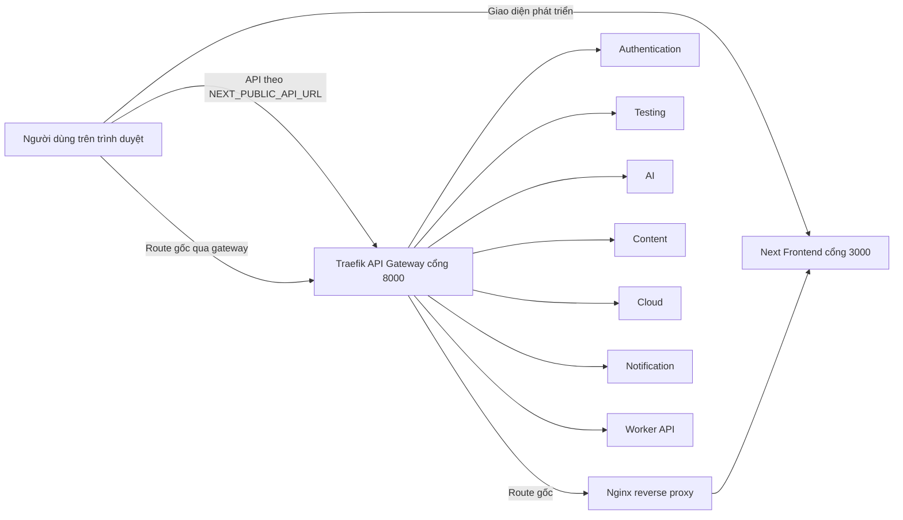
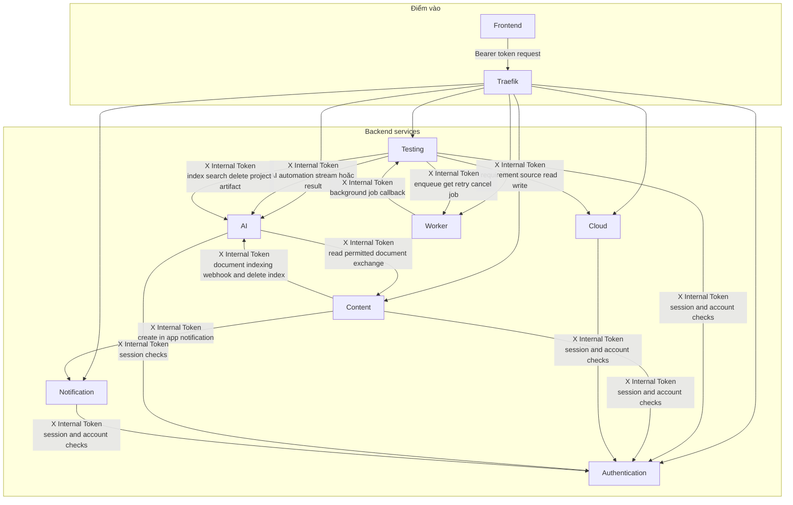
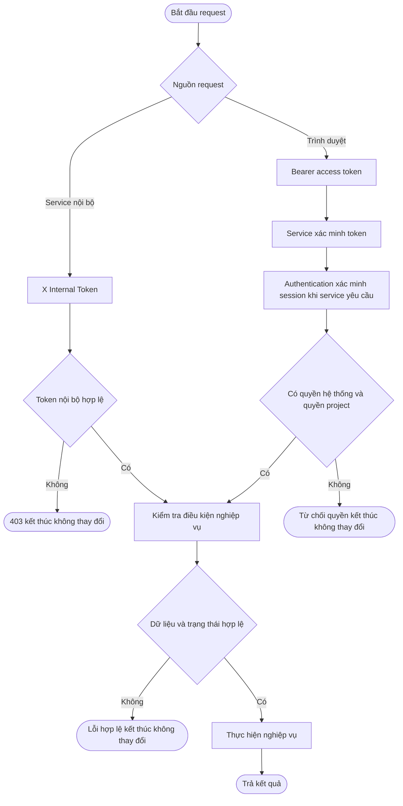
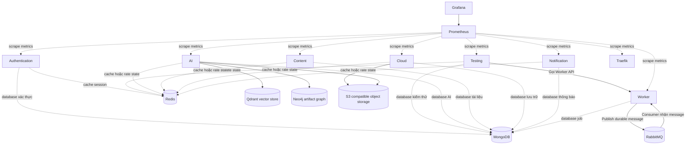
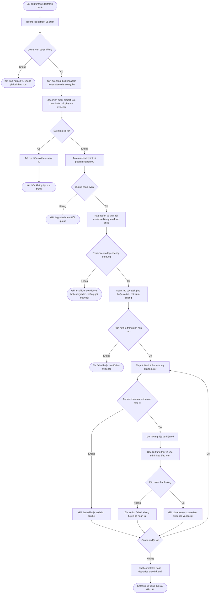
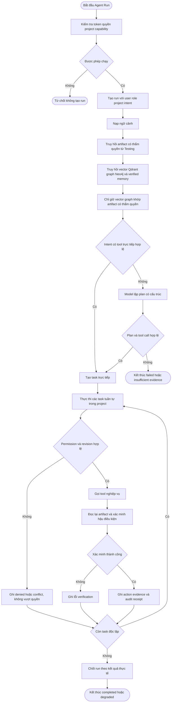
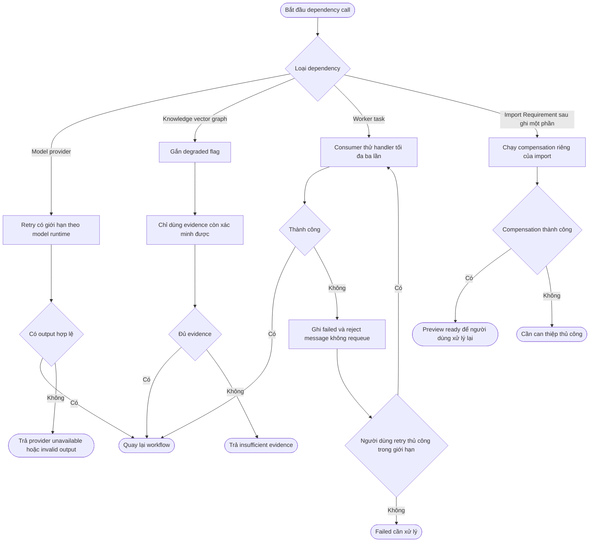

# Framework Veriq

## Mục đích và căn cứ

Tài liệu này thay thế bản framework trước và chỉ mô tả hành vi đã đối chiếu trong mã nguồn Veriq

Nó không suy diễn từ tên service  từ ảnh vẽ hay từ một dependency được khai báo trong Docker

Các nguồn đối chiếu chính

- `docker-compose.yml` và `nginx.conf`
- `frontend/shared/services/api-client.js`
- `backend/testing/src/main.py` và `backend/testing/src/clients`
- `backend/ai/src/main.py`  `backend/ai/src/agents/runner/graph.py` và `backend/ai/src/knowledge/hybrid.py`
- `backend/content/src/clients`
- `backend/worker/src/main.py`  `backend/worker/src/services.py` và `backend/worker/src/jobs/task.py`
- `backend/testing/src/modules/requirements/services/requirement_import_workflow.py`

Tài liệu tách riêng bốn vấn đề để tránh lẫn lộn

- Kiến trúc microservice
- Vòng đời nghiệp vụ kiểm thử
- Hoạt động AI
- Retry  fallback  compensation và các điểm kết thúc

## Quy ước sơ đồ

| Ký hiệu | Ý nghĩa |
| --- | --- |
| Hình bo tròn | Bắt đầu hoặc kết thúc |
| Hình chữ nhật | Hoạt động có chủ thể chịu trách nhiệm |
| Hình thoi | Quyết định  phải có các nhánh đầy đủ |
| Mũi tên liền | Lời gọi hoặc chuyển trạng thái được mã nguồn xác nhận |
| Mũi tên nét đứt | Quan sát  giám sát hoặc quan hệ dữ liệu |
| Không thay đổi | Request bị dừng trước khi có thay đổi bền vững |
| Cần can thiệp | Không có compensation tự động cho tình huống đó |

## Sự thật không được vẽ sai

1  Frontend có cổng trực tiếp `3000`

2  Traefik nhận API ở cổng `8000`

3  Nginx chỉ reverse proxy Frontend khi đi qua route gốc của Traefik  Nginx không nằm trên mọi request API

4  Testing sở hữu Projects  Requirements  Design  Execution  Quality  Integrations và Operations

5  Testing gọi AI qua API nội bộ  Testing không truy cập trực tiếp Qdrant hay Neo4j

6  Luồng tác vụ nền được xác nhận là Testing → Worker API → RabbitMQ → Worker consumer → Testing internal callback

7  Content kích hoạt AI indexing qua HTTP webhook đến event queue trong bộ nhớ của AI  Đây không phải RabbitMQ

8  Không có distributed transaction hoặc rollback chung cho toàn hệ thống

9  Các service dùng cùng MongoDB deployment nhưng có database logic riêng  Không service nào tự sở hữu dữ liệu của service khác

10  AI không tự baseline  approve  publish  archive hoặc áp dụng thay đổi nghiệp vụ thay người dùng

## 1  Bối cảnh triển khai và điểm vào

Không được vẽ đường Frontend → Nginx → Traefik → Backend như một đường bắt buộc  Frontend gọi API qua URL cấu hình và Traefik định tuyến API theo path

## 2  Luồng microservice đã xác nhận

Mỗi mũi tên trên là client nội bộ hoặc callback có trong mã nguồn

Không thêm mũi tên giữa hai service chỉ vì chúng cùng dùng Docker network  MongoDB hoặc Redis

## 3  Hai loại xác thực

Bearer token và X Internal Token là hai cơ chế khác nhau  Không được gộp thành một ô JWT chung

## 4  Sở hữu dữ liệu và hạ tầng

Qdrant và Neo4j thuộc đường tri thức AI  Object storage giữ bytes của tệp còn Cloud quản lý thao tác và metadata file

## 5  Tác vụ nền  retry và dead letter

Consumer thử handler tối đa ba lần trong một lần nhận message  Job failed có thể retry thủ công tối đa chín lần  Đây không phải cơ chế retry chung cho toàn bộ API

## 6  Vòng đời Requirements và ranh giới template

Template kết thúc khi Requirement sẵn sàng cho phân tích kiểm thử  Template không tạo test case

## 7  Vòng đời kiểm thử cấp nghiệp vụ

Không được vẽ mọi defect tự động sửa Requirement  Điểm quay về Requirement chỉ xảy ra khi có thay đổi ảnh hưởng hoặc cần làm rõ

## 8  Luồng AI automation xuyên suốt dự án

Các sự kiện hiện được phát ra khi tài liệu, Requirement, Test Case, Test Plan, execution result, Defect, Work Item hoặc Release thay đổi
Sự kiện do cùng AI run tạo ra được bỏ qua để tránh tự kích hoạt lặp
Agent tự chạy các hành động actor có quyền và không dừng để xin xác nhận từng action
RBAC, validation nghiệp vụ và kiểm tra revision vẫn bắt buộc  Với event cần thao tác QA, executor là QA đang được gán trong chính dự án; requester và executor được lưu riêng trên Automation Run, không dùng quyền Admin hay quyền nền tảng để thay thế

## 9  AI Agent execution

Agent Run có thể xử lý nhiều task tuần tự trong runtime limit; không có nhiều agent chạy song song trong một lượt
AI không chờ người dùng xác nhận action; permission, validation, conflict và xác minh hậu ghi vẫn là ranh giới thực thi

## 10  Evidence  fallback và compensation

Không có rollback toàn cục giữa MongoDB  Qdrant  Neo4j  object storage và RabbitMQ

Không có fallback nào cho phép AI tự bịa dữ liệu hoặc vượt quyền của actor

## Checklist trước khi vẽ lại

- Mỗi service chỉ vẽ mũi tên đến service có client hoặc callback thật
- Mỗi request ghi dữ liệu phải có kết thúc thành công  từ chối trước ghi  lỗi sau ghi hoặc compensation
- Mọi hình thoi có nhánh Có và Không
- Mọi nhánh lỗi phải có kết thúc hoặc quay lại checkpoint xác định
- Không ghi rollback nếu chỉ là validation  rejection  archive hoặc retry
- Không ghi fallback nếu chưa có hành vi thay thế trong mã nguồn
- Không ghi event driven cho HTTP webhook hay queue trong bộ nhớ
- Không ghi multi agent parallel cho Agent Run hiện tại
- Không vẽ Testing truy cập trực tiếp Qdrant hoặc Neo4j
- Không vẽ AI sửa dữ liệu chính nếu tool, permission và postcondition không hỗ trợ

## Giới hạn tài liệu

- Tài liệu mô tả kiến trúc và luồng từ mã nguồn hiện tại  không thay thế kiểm thử tích hợp đầy đủ cho từng endpoint
- Một dependency trong Docker Compose không chứng minh nó được gọi trong mọi nghiệp vụ
- Workflow mới ghi qua nhiều service phải được thiết kế idempotency  trạng thái quan sát được và compensation riêng trước khi được thêm vào framework
