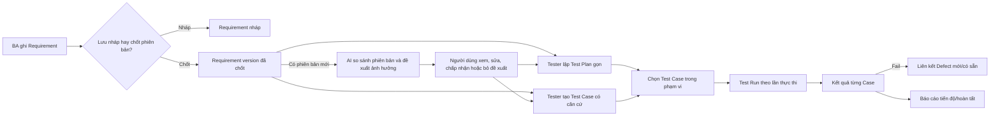
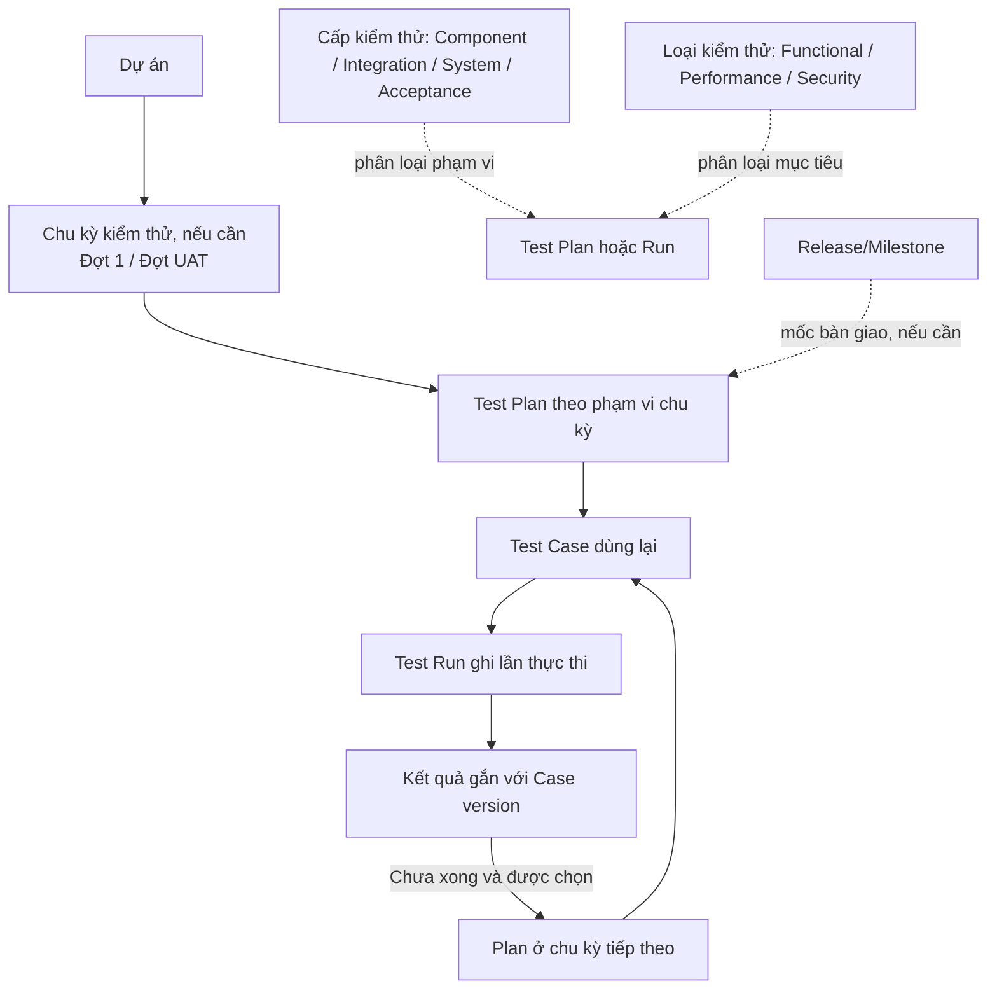
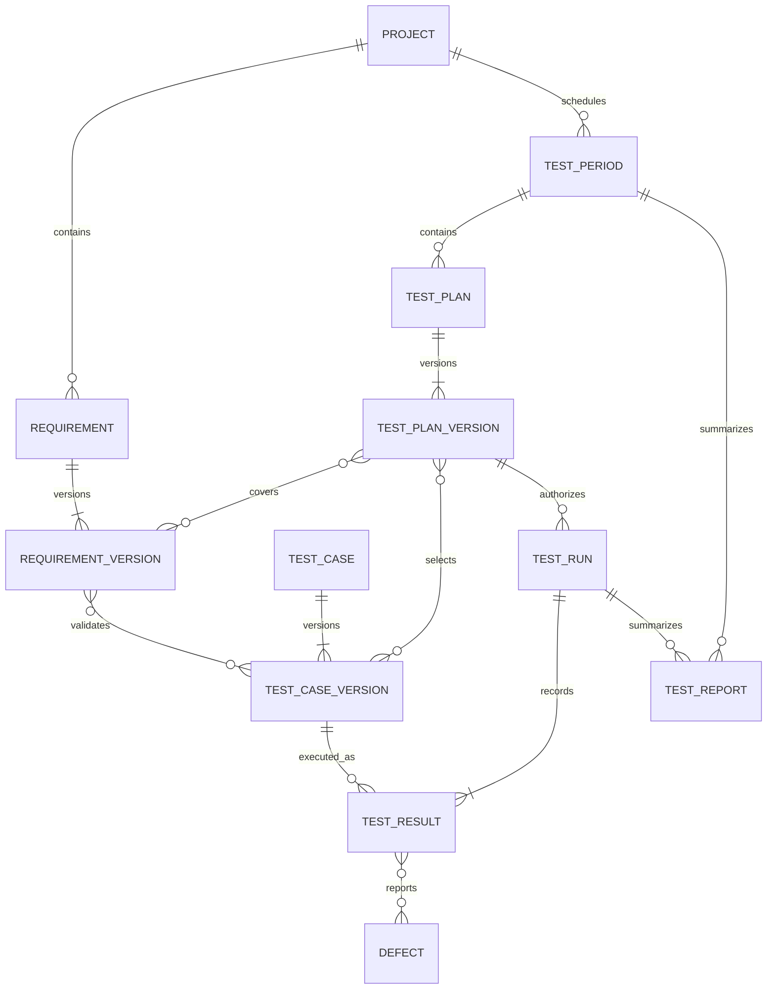
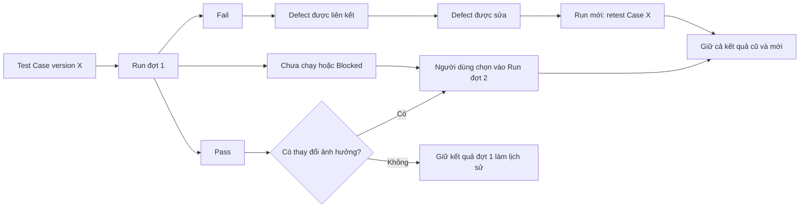
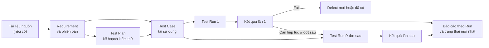
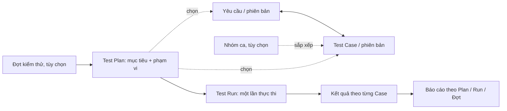
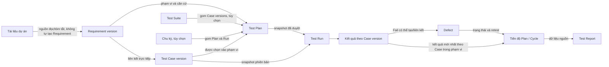

# Rà soát lại sản phẩm Veriq

**Trạng thái:** Khởi động lại phần phân tích nghiệp vụ. Tài liệu này chưa phải đặc tả đã được duyệt và chưa xác nhận chức năng nào đã hoạt động đúng.

**Nguyên tắc:** Code hiện tại chỉ dùng để tìm chỗ cần sửa, phụ thuộc và dữ liệu cần bảo toàn. Không suy ra nghiệp vụ đúng từ code đang có. Căn cứ nghiệp vụ gồm yêu cầu người dùng đã nêu, tài liệu ISTQB trong repo và tài liệu chính thức của ứng dụng tham khảo.

## 1. Mục đích sản phẩm nhìn từ người dùng

Veriq cần giúp một nhóm kiểm thử làm trọn các việc sau:

1. BA ghi yêu cầu và giữ được các phiên bản đã chốt.
2. Tester biết yêu cầu nào cần kiểm tra, tạo ca có thể thực hiện và truy được căn cứ.
3. Người phụ trách lập kế hoạch kiểm thử ngắn gọn, chọn phạm vi và điều kiện phù hợp.
4. Tester chạy các ca, lưu kết quả theo từng lần chạy, tạo hoặc nối lỗi khi cần.
5. Người xem biết phạm vi nào đã chạy, kết quả ra sao, còn ca hoặc lỗi nào chưa xử lý; có thể mở từ số liệu về dữ liệu gốc.
6. Khi yêu cầu đổi, người phụ trách biết Test Plan và Test Case nào cần xem lại; AI đưa đề xuất có căn cứ để người dùng quyết định.

Đây là mô tả nhu cầu sản phẩm suy ra từ các quyết định trong hội thoại, không phải kết quả khảo sát người dùng.

### Thứ tự dùng căn cứ khi có mâu thuẫn

1. Quyết định mới nhất mà người dùng đã chốt cho Veriq.
2. Nhu cầu và thao tác cần giải quyết trong luồng người dùng cụ thể.
3. ISTQB: dùng để kiểm tra thuật ngữ và nguyên tắc kiểm thử phù hợp ngữ cảnh; không biến mọi mục trong syllabus thành trường bắt buộc của sản phẩm.
4. Jira, Xray, TestRail: dùng làm ví dụ về cách giải quyết tác vụ; không sao chép toàn bộ mô hình hoặc mặc định mọi tính năng của họ đều cần cho Veriq.
5. Code và tài liệu nội bộ cũ: chỉ dùng để tìm dependency, dữ liệu, hành vi lệch và rủi ro khi sửa. Không dùng để quyết định nghiệp vụ đúng.

Tài liệu `LUONG_NGHIEP_VU_KIEM_THU.md` hiện có đề xuất nhập tài liệu thành Requirement, đưa Actor/Risk vào Requirement và dùng nhiều lớp tài sản kiểm thử. Các đề xuất đó mâu thuẫn với quyết định mới nhất ở mục 2. Chúng không được xem là yêu cầu hiện hành nếu chưa được người dùng xác nhận lại.

## 2. Những quyết định người dùng đã nêu

| Khu vực | Quyết định đang giữ làm căn cứ |
| --- | --- |
| Requirement | Không có Actor. Có lưu nháp và lưu yêu cầu. Tên, nội dung, AC, quy tắc nghiệp vụ và liên kết thiết kế/tài liệu thuộc phần tạo yêu cầu; AC, quy tắc và liên kết không được gọi là tùy chọn. Nhập danh sách bằng từng dòng có nút thêm/bớt. Ưu tiên và trạng thái nằm trong phần “Tùy chọn”. |
| Test Plan | Kế hoạch kiểm thử gọn cho dự án. Các phần mở rộng chỉ để tùy chọn khi có ích. Không thêm nội dung giải thích/tagline để lấp form. |
| Test Case | Không chia chế độ rút gọn/đầy đủ. Trường phụ để trong “Tùy chọn”. Không lặp Test Data hoặc Expected Result ở nhiều nơi. Luồng chính, thay thế và ngoại lệ là nội dung nhập; nếu không có thì để “-”. Không có trường rủi ro. |
| Test Run | Lưu kết quả theo lần chạy; khi Fail, có thể tạo Defect hoặc nối Defect có sẵn. Chạy lại phải giữ lịch sử lần trước. |
| Báo cáo | Có báo cáo tiến độ và hoàn tất; xuất PDF và Word. Mục Báo cáo đặt cạnh Thực thi kiểm thử. |
| Vai trò | BA, Tester, Admin. Không có Dev hoặc PM riêng. Admin/chủ dự án có toàn quyền và tự chốt nội dung do họ tạo theo quy tắc đã nêu. |
| AI | Giữ tóm tắt tài liệu và phân tích ảnh hưởng khi phiên bản Requirement đổi. Không tạo Requirement từ tài liệu; các luồng AI khác đã bị yêu cầu loại khỏi sản phẩm. |

Nếu tài liệu cũ hoặc code trái với bảng này, chúng là đối tượng cần rà, không phải căn cứ để tự khôi phục hành vi cũ.

## 3. Mô hình nghiệp vụ đề xuất

Đây là mô hình sản phẩm cần kiểm chứng với use case. Nó không được suy ra từ cách chia thư mục backend.

| Đối tượng | Việc người dùng cần làm | Ranh giới cần giữ |
| --- | --- | --- |
| Requirement và phiên bản | Ghi nội dung yêu cầu, lưu nháp hoặc chốt phiên bản, xem lịch sử. | Không có Actor. Tài liệu nguồn có thể đính kèm/tóm tắt; không tự biến nội dung tài liệu thành Requirement. |
| Test Plan | Ghi mục tiêu, phạm vi, các điều kiện và lựa chọn kiểm thử cần thiết. | Là tài liệu kế hoạch gọn. Không phải bảng điều khiển tiến độ hoặc nơi nhập lại kết quả đã chạy. Không có ô “Cách tiếp cận” chung chung. |
| Test Case | Mô tả kiểm tra có thể thực hiện lại, gồm bước và kết quả mong đợi, liên kết Requirement khi có căn cứ. | Là tài sản có thể dùng lại ở nhiều lần chạy hoặc phạm vi. Kết quả Pass/Fail không thuộc bản mô tả ca. |
| Test Run và kết quả | Chọn ca trong phạm vi, thực hiện tại một thời điểm/bối cảnh, ghi kết quả. | Mỗi lần chạy có dữ liệu riêng; không ghi đè kết quả cũ khi chạy lại. |
| Defect | Ghi nhận lỗi, trạng thái xử lý, mức độ và liên kết đến kết quả phát hiện lỗi. | Có mã và vòng đời riêng; Fail không bắt buộc tạo lỗi trùng. |
| Test Report | Tổng hợp theo phạm vi và thời điểm rõ ràng. | Số liệu phải lần được về Test Plan, Run, Case và Defect nguồn. |
| Tài liệu dự án | Lưu, đọc và tóm tắt nguồn tham khảo. | Là căn cứ cho người dùng; không tự tạo Requirement nếu người dùng chưa yêu cầu. |

## 3.1. Sơ đồ cần chốt trước khi build

Các sơ đồ sau là bản làm rõ nghiệp vụ để chuẩn bị thiết kế. Mũi tên là quan hệ cần có về mặt người dùng; chưa khẳng định API hay schema hiện tại đã đáp ứng.

### A. Luồng người dùng đầu-cuối



**Đã chốt:** lưu nháp/lưu chính cho Requirement, Test Plan, Test Case; kết quả Run giữ lịch sử; AI phân tích thay đổi đề xuất, không tự sửa tài liệu liên quan. **Cần đặc tả tiếp:** ai được chốt từng loại nội dung theo BA/Tester/Admin và trạng thái nào cho phép sửa sau khi chốt.

### B. Phân biệt các nghĩa của “giai đoạn”



**Nguyên tắc chốt:** Chu kỳ kiểm thử là nhóm tùy chọn để gom các Test Plan của một đợt kiểm thử. Tên như “Đợt 1” hoặc “UAT tháng 11” do người dùng đặt. Có thể ghi tên Sprint của nhóm nếu cần đối chiếu, nhưng đối tượng này không phải Sprint Scrum và không quản lý backlog, mục tiêu Sprint, năng lực hay velocity. Cấp và loại kiểm thử là cách phân loại hoạt động, không phải chu kỳ thời gian.

### C. Quan hệ dữ liệu nghiệp vụ



`TEST_PERIOD` là đối tượng **Chu kỳ kiểm thử** có thật trong mô hình, không phải nhãn tự nhập trên Test Case. Một chu kỳ có tên bắt buộc; mục tiêu và ngày dự kiến có thể để trống. Chu kỳ chứa các Test Plan theo phạm vi kiểm thử của đợt đó; Test Run thuộc Test Plan nên tự biết chu kỳ. Dự án vẫn có thể chạy Plan độc lập khi chưa dùng chu kỳ. Veriq quản lý chu kỳ kiểm thử, không giả làm công cụ Scrum đầy đủ.

### D. Ví dụ phần chưa xong ở đợt 1



**Cách đọc:** ca Pass không tự chuyển đợt. Ca chưa chạy/Blocked có thể được chọn lại nếu vẫn nằm trong phạm vi. Ca Fail có Defect; sau khi sửa thì chạy lại cùng ca trong Run mới. Nếu thay đổi có thể ảnh hưởng ca đã Pass, người có trách nhiệm chọn thêm ca hồi quy. Không có thao tác nào xóa kết quả đợt 1.

### E. Bốn lớp dữ liệu không được nhập nhằng

| Lớp | Ví dụ | Câu hỏi nó trả lời |
| --- | --- | --- |
| Tài liệu chuẩn bị | Requirement, Test Plan, Test Case | Cần kiểm tra điều gì và dự định kiểm tra ra sao? |
| Tổ chức kiểm thử | Chu kỳ kiểm thử, nếu dự án dùng | Test Plan này thuộc đợt kiểm thử nào? |
| Thực thi | Test Run | Ai chạy ca nào, trên build/môi trường nào, vào lần nào? |
| Kết quả lịch sử | Test Result, Defect, Report | Lần chạy đó ra sao, lỗi nào phát sinh, tổng hợp theo phạm vi nào? |

Không đặt trạng thái Pass/Fail lên bản Test Case dùng lại; đó là trạng thái của kết quả trong một Run cụ thể.

### F. Ví dụ nghiệp vụ dùng để chốt cách xử lý đợt

Ví dụ này biến khái niệm “đợt 1/đợt 2” thành các quy tắc có thể kiểm tra. Nó là đề xuất để chuẩn bị build, không phải bằng chứng rằng code hiện tại đã làm đúng.

**Phạm vi:** một Test Plan đã chốt chọn 5 phiên bản Test Case cho một Requirement. Dự án tự đặt “Đợt 1” và “Đợt 2”. Nhóm Scrum có thể đặt tên đợt theo Sprint để tiện đối chiếu, nhưng Veriq không biến chu kỳ kiểm thử thành Sprint Scrum.

| Kết quả ở Run thuộc đợt 1 | Xử lý khi kết thúc đợt 1 | Có xuất hiện ở đợt 2 không? | Báo cáo phải thể hiện |
| --- | --- | --- | --- |
| 3 ca Pass | Giữ kết quả và phiên bản ca của Run 1. | Chỉ thêm lại nếu có lý do, như thay đổi liên quan cần regression. | Pass của Run 1; không tính thành kết quả Run 2. |
| 1 ca Fail, có Defect mở | Giữ Fail và liên kết Defect. Không coi ca đã đạt. | Khi có bản sửa, chọn cùng Test Case vào Run mới để retest; giữ liên kết đến Defect và Run nguồn. | Fail ở Run 1 và kết quả retest riêng ở Run 2; không ghi đè. |
| 1 ca chưa chạy | Giữ trạng thái chưa chạy của Run 1. | Người lập phạm vi Run 2 chọn lại nếu ca vẫn cần kiểm tra. | Chưa chạy ở Run 1; trạng thái mới chỉ đổi theo Run 2. |
| Ca bị Blocked (nếu có) | Giữ trạng thái, lý do và điều kiện chặn. | Chọn lại khi điều kiện chặn được xử lý; không tự chuyển khi chưa sẵn sàng. | Blocked theo Run nguồn và lần xử lý sau. |

**Quy tắc đếm:** báo cáo của Run 1 dùng đúng kết quả Run 1. Báo cáo của Run 2 dùng đúng kết quả Run 2. Tổng quan mới nhất theo Test Plan có thể dùng kết quả mới nhất của mỗi Test Case version, nhưng phải nói rõ đây là “mới nhất”, không cộng kết quả nhiều Run như thể đó là nhiều ca khác nhau. Báo cáo theo đợt tổng hợp các Run thuộc đợt ấy và vẫn cho mở chi tiết từng Run.

**Không làm trong phạm vi giai đoạn đầu:** tự động đưa toàn bộ Fail sang đợt sau; tự quyết định Pass Run 1 có cần regression không; tự gán ngày/Sprint theo lịch; quản lý backlog phát triển, velocity hoặc burndown kiểu Jira. Những việc này cần quy tắc dự án hoặc tích hợp riêng.

### G. Phạm vi tối thiểu có thể build cho “đợt”

| Câu hỏi sản phẩm | Hướng tối thiểu đề xuất | Vì sao |
| --- | --- | --- |
| Có xây giai đoạn không? | Có. Chu kỳ kiểm thử là đối tượng có thật trong sản phẩm. Cho phép Run độc lập cho kiểm tra ad hoc. | Người dùng cần lập kế hoạch theo đợt và biết phần nào tiếp tục ở đợt sau. |
| Chu kỳ nằm ở đâu? | Chu kỳ chứa một hoặc nhiều Test Plan; mỗi Test Plan thuộc tối đa một chu kỳ. | Chu kỳ thể hiện phạm vi thời gian; Test Plan mô tả kế hoạch cho phạm vi đó. |
| Test Case gắn với chu kỳ không? | Không gắn cứng. Test Plan chọn các Case cần dùng; cùng Case có thể xuất hiện trong nhiều Plan/chu kỳ. | Cho phép tái sử dụng và giữ lịch sử. |
| Một Test Plan cho mỗi đợt? | Có thể có nhiều Plan trong một chu kỳ, theo mục tiêu/phạm vi khác nhau. Khi sang chu kỳ mới, tạo Plan mới từ Plan cũ rồi rà lại. | Azure thường lập Plan cho Sprint/milestone; TestRail dùng Plan để gom nhiều Run/cấu hình. Không có một cấu trúc duy nhất cho mọi sản phẩm. |
| “Chuyển ca” nghĩa là gì? | Chọn lại phiên bản Test Case vào Run mới, có tham chiếu Run nguồn. Không xóa ca hoặc kết quả cũ. | Bảo toàn lịch sử và vẫn cho người dùng quyết định phạm vi. |
| Có tự chuyển ca chưa đạt sang đợt sau không? | Không. Khi đóng Sprint, người dùng quyết định ca nào cần chạy tiếp; hệ thống tạo/chọn Run mới và giữ kết quả cũ. | Jira/Azure chuyển work item chưa xong về backlog hoặc Sprint sau theo lựa chọn; không có nghĩa mọi Test Case Fail tự động chuyển. |
| Sprint Scrum có được quản lý không? | Không. Sprint Scrum thuộc backlog và work item; Chu kỳ kiểm thử chỉ gom kế hoạch kiểm thử. Nếu cần Scrum đầy đủ thì cần sản phẩm quản lý backlog và luật Sprint riêng. | Chỉ có ô “Sprint 1” không tạo thành hỗ trợ Scrum. |

**Quyết định thiết kế:** Chu kỳ kiểm thử là nhóm tùy chọn trong khu vực Thực thi kiểm thử. Chu kỳ gom các Test Plan; Plan chọn Requirement và Test Case; Run ghi nhận lần chạy và kế thừa chu kỳ qua Plan. Sang chu kỳ tiếp, người dùng tạo Plan mới, chọn lại các Case cần tiếp tục và xác nhận. Run ad hoc không gắn chu kỳ vẫn được phép. Veriq không nhận là công cụ quản lý Scrum đầy đủ.

### Quyết định chốt: Bộ kiểm thử, chu kỳ và quan hệ dữ liệu

| Khái niệm | Quyết định cho Veriq | Quan hệ và giới hạn |
| --- | --- | --- |
| Bộ kiểm thử / thư mục (Test Suite) | Tùy chọn. Dùng để nhóm Test Case theo chức năng như Đăng nhập hoặc Thanh toán. Người dùng có thể tạo ngay từ danh sách ca; không cần chuyển màn trước. Nếu có thư mục thì không tạo thêm một lớp nhóm thứ hai làm cùng việc. | Không chứa kết quả chạy, không thay Test Plan. Test Case vẫn được liên kết trực tiếp với Requirement và có thể được chọn vào nhiều Plan/Run. |
| Chu kỳ kiểm thử (Test Period) | Tùy chọn. Dùng khi cần gom kế hoạch theo một đợt như Đợt 1, UAT hoặc hồi quy. Không yêu cầu mọi dự án phải tạo chu kỳ. | Một chu kỳ có thể có nhiều Test Plan. Một Plan có tối đa một chu kỳ. Run lấy chu kỳ từ Plan. Requirement và Test Case không gắn cứng vào chu kỳ. |
| Test Plan | Tài liệu xác định mục tiêu và phạm vi sẽ kiểm thử. Đây là điểm chọn Requirement và phiên bản Test Case cho một đợt. | Có thể để ngoài chu kỳ. Không chứa kết quả thực thi. |
| Test Run | Một lần thực thi phạm vi đã chọn, ghi lại môi trường/build, người chạy và kết quả. | Kết quả cũ được giữ. Retest là lần chạy mới; không ghi đè kết quả trước. |
| Sprint Scrum | Không phải Chu kỳ kiểm thử. Veriq hiện không quản lý backlog hoặc vòng đời Sprint. | Có thể dùng tên Sprint trong tên chu kỳ để người dùng đối chiếu, nhưng không suy ra quan hệ Scrum hay tự chuyển Requirement. |
| Phase cũ | Dữ liệu lịch sử chưa được phân loại. Không hiện nó như Chu kỳ và không tự chuyển thành chu kỳ. | Chỉ migrate khi người quản trị xác nhận đích đến cụ thể. Giá trị `1` không đủ căn cứ để tạo “Chu kỳ 1”. |

**Luồng đã chốt:** Requirement ↔ Test Case để truy vết căn cứ; Test Plan chọn phạm vi; Test Suite/thư mục chỉ giúp sắp xếp Case; Chu kỳ tùy chọn gom Plan; Test Run ghi kết quả theo từng lần chạy; Báo cáo lọc từ Chu kỳ → Plan → Run. Không có quan hệ tự động Chu kỳ → Requirement hay Chu kỳ → Test Case.

**Căn cứ từ sản phẩm tham khảo:** Jira đặt Sprint quanh backlog và work item. Xray tách Test Set khỏi Test Plan/Execution. TestRail dùng suite/section để tổ chức Case và Plan để gom các Run. Zephyr dùng Test Cycle để gom Case cho thực thi và giữ lịch sử chạy. Đây là những cách khác nhau, không phải một chuẩn duy nhất. Veriq chọn suite/folder để sắp xếp Case, Plan để chọn phạm vi, và Chu kỳ kiểm thử tùy chọn để gom Plan. [Jira: Sprints](https://support.atlassian.com/jira-software-cloud/docs/enable-sprints/), [Xray: Test Sets và Test Plans](https://docs.getxray.app/space/XRAY/301474179/Test%20Sets%20vs%20Test%20Plans), [TestRail: Test suites](https://support.testrail.com/hc/en-us/articles/33359301314708-Test-suites), [TestRail: Test plans](https://support.testrail.com/hc/en-us/articles/30765296499604-Create-new-test-plans), [Zephyr: Test Cycles](https://support.smartbear.com/zephyr/docs/dc/test-cycles/).

**Dữ liệu dự án “Thư viện” trong ảnh:** Test Plan `TP-5918aecf08be48d48df3af91ecdccfa6` có `phase = "1"`, nhưng không có `test_period_id`; dự án không có bản ghi Test Period. Vì vậy `1` là dữ liệu Phase cũ, không phải chu kỳ đã tạo. Bảng kế hoạch trước đây lấy `phase` làm dự phòng cho cột “Chu kỳ kiểm thử”, gây hiển thị nhầm. Giao diện đã được sửa để chỉ hiện tên chu kỳ thật; nếu chưa liên kết thì hiện “—”. Phase cũ được giữ nguyên cho lịch sử và không tự migrate.

**Giao diện chu kỳ đã chốt:** trang mở ở danh sách chu kỳ; nút “Tạo chu kỳ” mở biểu mẫu ngay trên trang. Tên là trường chính duy nhất; mục tiêu và ngày dự kiến nằm trong “Tùy chọn”. Khi tạo từ một chu kỳ đã đóng, nguồn được lấy từ thao tác “Tạo chu kỳ tiếp theo”, không bắt người dùng chọn lại trong form. Chu kỳ thuộc mục Thực thi kiểm thử. Trạng thái rỗng vẫn giữ nút tạo ở đầu trang; không hiển thị form dài khi người dùng chỉ muốn xem danh sách.

**Cách chuyển phần việc sang đợt sau:** khi đóng chu kỳ, người dùng xem kết quả từng Run rồi chọn Case cần tiếp tục hoặc chạy hồi quy. Hệ thống đưa lựa chọn vào Plan/Run mới, lưu tham chiếu đến nguồn và giữ kết quả chu kỳ trước. Không tự chuyển tất cả Case Fail, không tự chuyển Requirement, không di chuyển Test Case khỏi thư mục và không xóa kết quả cũ.



Sơ đồ thể hiện hướng nghiệp vụ được đề xuất. Đợt sau tham chiếu lại Test Case; nó không xóa ca hoặc kết quả của đợt trước. Cách tổ chức Đợt kiểm thử vẫn cần được chốt ở mục 4.

## 4. Mô hình giai đoạn kiểm thử cần xây

Yêu cầu cần giải quyết là lập kế hoạch kiểm thử theo từng chu kỳ, xem phần nào đã chạy/chưa chạy/bị chặn/lỗi, rồi quyết định phần nào tiếp tục ở chu kỳ sau. Đây là năng lực cốt lõi cần có trong Veriq. Không gắn chu kỳ vào Test Case vì cùng một ca có thể được dùng trong nhiều chu kỳ.

| Khái niệm | Nghĩa trong quy trình | Dữ liệu thường được tổ chức |
| --- | --- | --- |
| Giai đoạn dự án (Phase) | Một chặng lớn do dự án định nghĩa, có thể theo phạm vi hoặc mốc bàn giao. Không nhất thiết có Sprint. | Có thể có nhiều Requirement, kế hoạch và đợt kiểm thử. |
| Chu kỳ kiểm thử (Veriq) | Một khoảng lập kế hoạch/kiểm thử do dự án đặt tên, có thể tương ứng Sprint, iteration, UAT hoặc một mốc bàn giao. | Chứa Test Plan của chu kỳ; Plan chọn Requirement và Test Case trong phạm vi. Người dùng quyết định phần nào tiếp tục ở chu kỳ sau. |
| Sprint Scrum | Một Sprint theo Scrum có mục tiêu và phạm vi công việc của nhóm. | Veriq có thể ghi nhận tên/mốc Sprint cho kiểm thử, nhưng không quản lý backlog, năng lực hay velocity nếu chưa xây các chức năng Scrum tương ứng. |
| Cấp kiểm thử (Test Level) | Nhóm hoạt động theo đối tượng kiểm tra, như Component, Integration, System, Acceptance. Đây không phải số thứ tự Sprint hay giai đoạn dự án. | Test Plan/Run có thể ghi cấp kiểm thử nếu cần phân biệt phạm vi. |
| Loại kiểm thử (Test Type) | Mục tiêu chất lượng như Functional, Performance, Security. Có thể diễn ra ở nhiều cấp kiểm thử. | Gắn với kế hoạch hoặc hoạt động kiểm thử, không dùng làm tên giai đoạn. |
| Test Run / Test Cycle | Một hoạt động chạy tập ca trong một bối cảnh cụ thể. Retest là lần chạy mới sau thay đổi; không phải Sprint mới. | Ca được chọn, người thực hiện, môi trường/build và kết quả thời điểm đó. |
| Release/Milestone | Mốc bàn giao hoặc phiên bản sản phẩm. Có thể bao gồm nhiều đợt và nhiều Test Run. | Gom tiến độ, phạm vi và báo cáo theo mốc khi dự án cần. |

ISTQB phân biệt cấp kiểm thử với loại kiểm thử. Jira quản lý Sprint ở cấp work item; Azure hướng dẫn lập Test Plan cho Sprint/milestone và dùng lại Test Case ở chu kỳ tiếp; TestRail dùng Test Plan để gom nhiều Run/cấu hình; Xray tách Test Plan khỏi Test Execution. Những mô hình này cho thấy cần có cách tổ chức theo chu kỳ và giữ lịch sử, nhưng không cho thấy một cấu trúc duy nhất. Veriq chọn mô hình phù hợp với tác vụ người dùng: Chu kỳ kiểm thử → Test Plan theo phạm vi chu kỳ → Test Case dùng lại → Test Run và kết quả. [Jira: Sprints](https://support.atlassian.com/jira-software-cloud/docs/enable-sprints/), [Azure: Test Plans by sprint/milestone](https://learn.microsoft.com/en-us/azure/devops/test/create-a-test-plan?view=azure-devops), [Azure: end-of-sprint work](https://learn.microsoft.com/en-us/azure/devops/boards/sprints/end-sprint-activities?view=azure-devops), [TestRail: plans and runs](https://support.testrail.com/hc/en-us/articles/7076810203028-Introduction-to-TestRail), [Xray: test workflows](https://docs.getxray.app/space/XRAYCLOUD/44567832/Using%2BJira%2Bworkflows%2Bfor%2Btesting%2Bpurposes).

### Quyết định thiết kế đề xuất cho Veriq

1. Chu kỳ kiểm thử là chức năng chính thức trong Thực thi kiểm thử, không phải trường text ở Test Case. Tên chu kỳ do người dùng đặt; không bắt chọn Scrum/Waterfall.
2. Mỗi Test Plan thuộc tối đa một Chu kỳ kiểm thử. Plan được tạo trong chu kỳ; có thể bắt đầu từ Plan trước bằng thao tác “Tạo kế hoạch cho chu kỳ mới”, sau đó người dùng rà lại phạm vi và tiêu chí. Không tự sao chép kết quả.
3. Test Case được dùng lại qua các Plan/chu kỳ. Khi chuyển sang chu kỳ mới, tạo Plan mới cho phạm vi chu kỳ đó và chọn lại các Case cần kiểm tra; không di chuyển hoặc sửa lịch sử Case cũ.
4. Test Run được tạo từ Plan, lưu môi trường/build và kết quả của lần chạy. Retest sau khi sửa lỗi vẫn là Run mới trong chu kỳ hiện tại hoặc chu kỳ sau; không ghi đè kết quả cũ.
5. Khi kết thúc chu kỳ, hệ thống tổng hợp Case Pass, Fail, Chưa chạy, Blocked và Defect mở. Người dùng chọn từng Case cần tiếp tục; Pass chỉ đưa sang chu kỳ tiếp nếu cần hồi quy. Hệ thống chuẩn bị Plan mới và danh sách Case được chọn để người dùng xác nhận.
6. Nếu dự án cần quản lý Sprint Scrum thật, phải có backlog, Requirement/công việc thuộc Sprint, mục tiêu và luật đóng Sprint. Nếu chưa xây các phần đó, giao diện chỉ gọi là “Chu kỳ kiểm thử”, không tuyên bố quản lý Scrum.
7. Báo cáo lọc theo Chu kỳ → Test Plan → Test Run; luôn giữ kết quả từng Run và thể hiện riêng trạng thái mới nhất. Không cộng nhiều lần chạy thành nhiều Test Case khác nhau.

Luồng đề xuất: đóng Chu kỳ 1 → xem tổng hợp và lý do chưa hoàn tất → tạo Chu kỳ 2 → tạo Test Plan mới từ kế hoạch trước → chọn lại các Case cần tiếp tục → tạo Run mới. Kết quả Chu kỳ 1 giữ nguyên. Không thêm `phase` dạng text vào Test Case và không tự chuyển tất cả ca.

## 5. Đối chiếu tác vụ với ứng dụng đang có

| Tác vụ người dùng | Cách ứng dụng tham khảo giải quyết | Điều Veriq cần học | Điều không nên sao chép máy móc |
| --- | --- | --- | --- |
| Nối yêu cầu, ca kiểm thử và lỗi | Jira cho phép liên kết các work item với loại quan hệ rõ và xem liên kết từ hai phía. Xray nối Requirement với Test và kết quả. | Liên kết phải mở được, truy ngược được và giải thích được độ bao phủ/tác động. | Không cần tạo một trang “truy vết” riêng nếu người dùng chỉ cần xem quan hệ trong Requirement, Case hoặc Report. |
| Tách thiết kế ca với kết quả chạy | Xray để Test mô tả ca và Test Execution lưu hoạt động chạy. TestRail cũng tách Case, Run, Test Result. | Giữ định nghĩa Test Case tách khỏi Result của Run; chạy lại tạo Result mới. | Không thêm toàn bộ Test, Precondition, Test Set, Data Set và automation nếu use case Veriq không cần. |
| Gắn kiểm thử với Sprint/Iteration | Azure Test Plans có Test Plan, Test Suite và Test Case; suite có thể gom theo Sprint, Feature, Milestone hoặc Requirement. Requirement-based suite lọc work item theo Iteration Path. | Nếu Veriq cần Scrum thật, phạm vi Sprint nên lấy từ đối tượng Sprint/Iteration và Requirement/Work Item; không tạo trường Sprint nhập tự do ở Test Case. | Không sao chép cấu trúc nhiều tầng Plan/Suite nếu người dùng Veriq chỉ cần kế hoạch gọn và Run. |
| Chia hoạt động kiểm thử thành đợt | Zephyr dùng Test Cycle làm tập ca theo mục tiêu; cycle có thể nằm dưới Test Plan/release hoặc không gắn release, và lần thực thi lưu riêng để xem lịch sử. Một số bản Zephyr hỗ trợ chạy ad hoc không cần Cycle. | Một “Đợt kiểm thử” chỉ đáng có nếu cần nhóm nhiều Run, phân công hoặc báo cáo theo đợt; chạy lại vẫn là execution mới của cùng Test Case. | Không bắt buộc mọi thao tác tạo Cycle trước khi chạy test; không thêm cycle nếu một Run đáp ứng use case. |
| Chia phạm vi theo đợt | Jira chuyển work item chưa xong sang backlog/Sprint khác; Xray theo dõi Test qua nhiều Test Execution; TestRail có Milestone và Plan để nhóm Run theo những cách riêng. | Không xóa lịch sử Test Case/Result. Cần báo cáo được đợt trước và tiếp tục chọn Case trong Run đợt sau. | Không đồng nhất Phase/Sprint/Test Level/Test Type/Run; không bắt mọi dự án theo Scrum; không sao chép nguyên cấu trúc Plan của hãng khác. |
| Báo cáo | Xray/TestRail hiển thị trạng thái theo Plan/Run và cho lần từ tổng quan đến ca/lỗi. | Mỗi báo cáo ghi rõ phạm vi, thời điểm, kết quả chưa chạy/đang chặn/lỗi mở và đường về dữ liệu nguồn. | Không tạo nhiều dashboard/báo cáo nếu chúng lặp cùng một số liệu nhưng dùng phạm vi khác nhau. |

### Tài liệu tham khảo chính thức

- ISTQB, [CTFL Syllabus v4.0.1](https://www.istqb.org/wp-content/uploads/2024/11/ISTQB_CTFL_Syllabus_v4.0.1.pdf), đặc biệt mục 5.1.1–5.1.2 về Test Plan và iteration/release planning, cùng mục 5.3 về theo dõi và báo cáo.
- Atlassian, [Enable sprints and complete a sprint](https://support.atlassian.com/jira-software-cloud/docs/enable-sprints/).
- Microsoft, [Create and manage test suites in Azure Test Plans](https://learn.microsoft.com/en-us/azure/devops/test/create-test-suites?view=azure-devops) và [Test Plans overview](https://learn.microsoft.com/azure/devops/test/overview?preserve-view=true&view=azure-devops).
- Xray, [Test Sets vs Test Plans](https://docs.getxray.app/space/XRAY/301474179/Test%20Sets%20vs%20Test%20Plans), [Planning Tests](https://docs.getxray.app/space/XRAY/301403858), [Adopting Xray for Hardware Testing](https://docs.getxray.app/space/XRAYCLOUD/1853849616/Adopting%2BXray%2Bfor%2BHardware%2BTesting).
- Zephyr/SmartBear, [Test Cycles](https://support.smartbear.com/zephyr/docs/dc/test-cycles/), [Executing in Test Cycles](https://support.smartbear.com/zephyr/docs/essential-dc/executing-tests/executing-in-test-cycles/), [Zephyr test planning](https://support.smartbear.com/zephyr/docs/enterprise/zephyr-enterprise/zephyr-user-guide/test-planning/).
- TestRail, [Introduction to TestRail](https://support.testrail.com/hc/en-us/articles/7076810203028-Introduction-to-TestRail), [Test plans](https://support.testrail.com/hc/en-us/articles/30765296499604-Create-new-test-plans), [Test runs and results](https://support.testrail.com/hc/en-us/articles/32784099933844-Best-Practices-Guide-Test-Runs-and-Results).

## 6. Rà hiện trạng code — chỉ ghi lệch, không lấy làm yêu cầu

Các điểm dưới đây là vị trí cần điều tra/sửa. Chúng không chứng minh thiết kế hiện tại là đúng.

| Khu vực | Bằng chứng trong working tree | Vấn đề cần giải quyết từ góc nhìn người dùng |
| --- | --- | --- |
| Điều hướng | `navigation.js`, `AppShell.jsx`, `ProjectWorkspacePage.jsx` khai báo nhóm menu và route cho Requirement, Plan, Case, Run, Defect, Report, tài liệu; đồng thời còn route cho phân tích, dữ liệu, bộ kiểm thử, automation, giám sát, truy vết, release và cài đặt. | Người dùng có thể thấy nhiều khu vực hoặc vào được route cũ dù chức năng đã bị yêu cầu thu gọn. Cần chốt màn hình theo tác vụ rồi lần mọi đường vào, không chỉ ẩn một mục menu. |
| Requirement | Form trong `RequirementCreateModal.jsx` đánh dấu Tên, AC, quy tắc và liên kết tài liệu là bắt buộc; nội dung chưa có dấu bắt buộc. `RequirementCreate` còn `risk`, và `type` vẫn bắt buộc trong schema dù form không cho chọn (form tự đặt “Chưa phân loại”). Backend lưu chính hiện kiểm tra AC, quy tắc, liên kết; chưa kiểm tra nội dung rỗng. | Lệch giữa quyết định bỏ Risk, biểu mẫu, schema và validation. Cần làm rõ `type` chỉ là phân loại mặc định hay trường người dùng cần; bỏ Risk tận gốc sau khi rà caller/lịch sử; đồng bộ nội dung và dấu `*` với lưu chính. |
| Test Plan | `TestPlanEditor.jsx` có textarea `Cách tiếp cận`; một input môi trường tự do, ghi chú browser/device và Test Data, đồng thời có dropdown `Môi trường đã cấu hình` bị giấu trong phần Liên kết. Schema lưu cả text environment lẫn environment ID. Form còn có trường phase, lựa chọn Case, ca chuyển tiếp từ Run và gợi ý AI. Backend còn nhiều trường kế hoạch mở rộng. | Có dữ liệu môi trường nhập hai cách và thông tin lặp; dữ liệu test bị nhập ở Plan dù đã có trong Case; selector môi trường khó thấy; “Cách tiếp cận” mơ hồ và lặp với lựa chọn loại/kỹ thuật. Người dùng báo khó tìm Cài đặt dự án. Cần một selector môi trường duy nhất, dữ liệu môi trường cấu hình một lần và được chọn lại. Bỏ textarea riêng và Test Data Plan sau khi rà phụ thuộc. |
| Test Case | `TestCaseCreateForm.jsx` có Cách viết ca ở trước phần “Tùy chọn”; trong tùy chọn còn loại, ưu tiên, cấp kiểm thử, điều kiện, luồng, kỹ thuật và liên kết. Schema còn `risk`, `flow_type`, Test Data cấp ca và Expected Result cấp ca ngoài cấu trúc từng bước. | Có lệch rõ với vị trí Cách viết ca, yêu cầu bỏ Risk/enum luồng và tránh dữ liệu lặp. Xóa field chỉ sau khi rà generator, serializer, linter, query, transfer, import/export và dữ liệu lịch sử. |
| Test Run | `ExecutionPage.jsx`, `RunExecutionWorkspace.jsx` và `test_run.py` tạo Run từ Plan, lưu kết quả, tạo/nối Defect và có luồng chạy lại ca Fail. | Cần phân biệt tạo Run, chạy tiếp, chạy lại sau sửa và chuyển phạm vi sang giai đoạn mới. Không được dùng cùng một thao tác cho cả bốn việc. |
| Phase/carry-over | Schema/service có `phase` ở Plan, lưu phase vào snapshot Run, và cho thêm ca từ Run nguồn sang Plan khác. Một nhánh rerun riêng chỉ nhận ca Fail được chọn. | Hai luồng “chạy lại ca Fail” và “chuyển ca chưa xong sang phạm vi tiếp theo” đang khác nhau. Cần thiết kế lại quanh hành động người dùng và lịch sử; code hiện tại không phải đáp án nghiệp vụ. |
| Báo cáo | Báo cáo gọn tạo Tiến độ/Hoàn tất và xuất PDF/Word. API, service và AI của các workflow Status Report/Completion cũ đã được gỡ. Giữ quyền đọc tệp đính kèm lịch sử và không xóa collection/dữ liệu cũ. | Còn rà quyền lưu trong ACL cũ và xác nhận màn xuất chỉ lấy dữ liệu từ nguồn hiện hành. Không để workflow cũ quay lại qua route hay chức năng AI. |
| AI và tài liệu | Còn nhiều module/API/UI AI ngoài tóm tắt tài liệu và phân tích phiên bản; import Requirement từ tài liệu vẫn còn trong mã. | Cần call graph và dependency map trước khi gỡ tận gốc. Giữ đọc/tóm tắt tài liệu; không tạo Requirement từ tài liệu và không giữ AI phụ đã bị loại. |
| Quyền và vai trò | API giới hạn vai trò dự án ở `BA`, `TESTER`, `SYSTEM_ADMIN`; quyền cụ thể được nạp từ cấu hình DB. Chủ dự án và system admin được mở rộng quyền trong `project_membership_permissions`. Phê duyệt tự động dựa vào system admin/chủ dự án. Màn quản lý quyền đang liệt kê nhiều mã permission theo nhóm kỹ thuật; phần quyền chi tiết nằm trong một disclosure lồng nhau. | Tên quyền khó hiểu và không cho thấy ngay người dùng làm được việc gì. Cần lập ma trận theo tác vụ BA/Tester/Admin, kiểm tra từng API với ma trận đó và tách “vai trò”, “người chịu trách nhiệm” khỏi quyền kỹ thuật. Không nên chỉnh ma trận bằng cách đoán từ giao diện hoặc dữ liệu quyền cũ. |
| Tài liệu nội bộ | `LUONG_NGHIEP_VU_KIEM_THU.md`, `TOM_TAT_QUY_TRINH_VERIQ.md`, `FRAMEWORK_VERIQ.md` viết ở các thời điểm/phạm vi khác nhau. | Có mô tả AI, vai trò và quy trình cũ trái với lựa chọn mới. Phải đánh dấu lịch sử hoặc cập nhật; không trộn thành một quy trình bắt buộc. |

## 7. Kế hoạch làm lại để người dùng dùng được

### Bước 1 — Chốt mô hình nghiệp vụ và sơ đồ

Vẽ một sơ đồ duy nhất cho các đối tượng và vòng đời: Requirement/version → Test Plan/phạm vi giai đoạn → Test Case → Run/Result → Defect/Report. Ghi rõ đối tượng nào là tài liệu, đối tượng nào là lần chạy, quan hệ nào tái sử dụng, trạng thái nào cho phép chuyển tiếp.

**Điều kiện hoàn tất:** mỗi quan hệ trả lời được người dùng cần làm gì, dữ liệu thuộc đâu, ai cập nhật, lịch sử nào được giữ. Không thêm trường chỉ để khớp tên trong ISTQB hoặc ứng dụng khác.

### Bước 2 — Dựng lại luồng người dùng bằng ví dụ thật

Đi qua một ví dụ xuyên suốt: BA tạo Requirement; Tester lập kế hoạch cho phạm vi/giai đoạn 1; chọn và chạy Case; một số ca chưa chạy hoặc Fail; mở phạm vi/giai đoạn tiếp theo; chạy lại; xem báo cáo tiến độ và hoàn tất. Thêm ví dụ Requirement đổi phiên bản và xem tác động đến Plan/Case.

**Điều kiện hoàn tất:** người dùng biết bước tiếp theo ngay trên màn hiện tại; không phải nhập một dữ liệu hai lần; có đường đi cho nháp, lỗi, hủy, thử lại và dữ liệu chưa có.

### Bước 3 — Chốt hợp đồng backend và dữ liệu

Cho từng hành động, ghi route, permission, input/output, trạng thái trước/sau, validation, nguồn dữ liệu, snapshot/version, idempotency và migration. Lần tất cả caller, query, report, export, AI, worker và dữ liệu cũ trước khi xóa field/module.

**Điều kiện hoàn tất:** field nào cũng có chủ sở hữu; lưu nháp và lưu chính có quy tắc rõ; kết quả Run cũ không bị thay đổi; quyền BA/Tester/Admin nhất quán.

Riêng quyền truy cập, đặc tả cần dùng động từ nghiệp vụ dễ hiểu như “Tạo yêu cầu”, “Chốt yêu cầu”, “Soạn kế hoạch”, “Chạy ca kiểm thử”, “Ghi nhận lỗi”, “Xuất báo cáo”. Mã permission chỉ là cách thực thi ở backend, không phải nội dung chính trên màn hình người dùng. Phải xác định rõ System Admin toàn nền tảng, chủ dự án và thành viên có vai trò BA/Tester là các khái niệm nào; không gộp chúng thành một cột “Admin” nếu quyền và phạm vi khác nhau.

### Bước 4 — Sửa theo luồng đầu-cuối

Ưu tiên theo thứ tự người dùng làm việc: Requirement và phiên bản; Test Plan và chia phạm vi; Test Case; Run/Defect/chuyển tiếp; Report; quyền/tài liệu/AI. Với mỗi luồng, sửa backend contract, frontend, migration và tài liệu trong cùng lát cắt.

**Điều kiện hoàn tất:** màn hình, API và dữ liệu thể hiện cùng một workflow. Chỉ ẩn route không được tính là đã bỏ tính năng. Chỉ gỡ code sau khi không còn dependency và dữ liệu lịch sử vẫn đọc được.

### Bước 5 — Kiểm tra nghiệm thu

Sau khi người dùng yêu cầu kiểm tra, xác minh từng tác vụ đầu-cuối trên giao diện và API, gồm quyền, dữ liệu nháp, lưu chính, phiên bản, chuyển tiếp, rerun, defect, report/export và lỗi dịch vụ. Ghi kết quả quan sát được, không dùng test tự viết làm bằng chứng thay cho workflow thực.

## 8. Trạng thái chắc chắn hiện nay

- Đã xác định được những quyết định sản phẩm người dùng đã nêu và một số mâu thuẫn rõ giữa quyết định, tài liệu cũ và code.
- Đã đối chiếu CTFL v4.0 trong repo với tài liệu chính thức Jira, Xray, Azure Test Plans, Zephyr và TestRail về Test Plan, Sprint/Iteration, Cycle, Run, kết quả và chạy lại.
- Chưa hoàn tất kiểm kê mọi form/API/schema/worker, quyền, migration, report aggregation và hành vi giao diện đang chạy.
- Chưa có sơ đồ nghiệp vụ cuối cùng được duyệt; chưa sửa code trong lượt rà soát này.

**Không được kết luận sản phẩm đã dùng được hoặc đã sẵn sàng sửa hàng loạt.** Bản phân tích chỉ được coi là hoàn tất khi các phần còn thiếu trong Bước 1–3 có bằng chứng và mâu thuẫn được giải quyết trước khi triển khai.

## 9. Xác minh cách các công cụ xử lý giai đoạn

Đối chiếu tài liệu chính thức của ISTQB, Azure Test Plans, Zephyr, TestRail và Jira cho thấy không có một cấu trúc duy nhất gọi là “giai đoạn” áp dụng cho mọi dự án.

| Nguồn | Cách tổ chức được tài liệu mô tả | Bài học áp dụng cho Veriq |
| --- | --- | --- |
| ISTQB CTFL v4.0 trong repo | Phân biệt cấp kiểm thử, loại kiểm thử và kỹ thuật. Kiểm thử có thể kết thúc tại mốc release, cuối iteration hoặc khi hoàn tất một cấp kiểm thử; khi kết thúc, nhóm ghi nhận defect/backlog còn lại và báo cáo hoàn tất. | “Giai đoạn” theo thời gian không đồng nghĩa với Test Level. Tạo báo cáo ở mốc kết thúc là hợp lý; bắt mọi dự án theo cùng chuỗi giai đoạn thì không có căn cứ. |
| Azure Test Plans | Test Plan chứa Test Suite; suite có thể nhóm theo Requirement, Sprint/Iteration, Feature hoặc dùng bộ lọc. Test Case có thể được dùng lại; Test Run và kết quả lưu từng lần thực thi. | Với nhóm Scrum, Requirement/Work Item có thể nối với Iteration, còn Case gắn với Requirement và Run. Không cần gắn cứng Test Case vào duy nhất một Sprint. |
| Zephyr | Test Cycle là tập ca cho một mục tiêu thực thi; kết quả liên kết với cycle. Có thể tạo lần execution mới cho cùng ca và xem dữ liệu execution cũ. Một số luồng hỗ trợ thực thi ad hoc không cần cycle. | “Đợt kiểm thử” hữu ích để nhóm các lần chạy có kế hoạch, nhưng không nên bắt buộc cho chạy nhanh hoặc mọi dự án. |
| TestRail | Test Plan có thể nhóm nhiều Run/cấu hình; Milestone có thể đại diện mốc release. Tài liệu khuyên dùng Case cũ trong Run mới thay vì copy Case chỉ để chạy vòng khác. | Giữ Case ổn định, mỗi lần chạy có Result riêng. Test Plan của hãng là container Run, khác lựa chọn Test Plan gọn của Veriq. |
| Jira Scrum | Khi đóng Sprint, work item chưa hoàn tất được đưa về backlog hoặc Sprint khác. | Nếu Veriq hỗ trợ Scrum đầy đủ thì Sprint quản lý Requirement/công việc; không coi Test Case là work item để chuyển khỏi Sprint cũ. |

### Kết luận thiết kế cho Veriq

1. Chu kỳ kiểm thử là đối tượng cấp một và có khu vực riêng trong Thực thi kiểm thử. Mỗi chu kỳ gom các Test Plan theo mục tiêu/phạm vi của chu kỳ.
2. Test Plan trong chu kỳ xác định Requirement và Test Case cần kiểm tra. Với chu kỳ mới, tạo Plan mới từ Plan cũ để tái dùng liên kết và nội dung phù hợp; người dùng rà phạm vi trước khi lưu.
3. Test Case không thuộc độc quyền một chu kỳ. Cùng Case có thể được chọn trong nhiều Plan/chu kỳ mà không bị sao chép.
4. Test Run lưu một lần thực thi thuộc Plan; Test Result lưu kết quả theo Test Case version. Không nhập Pass/Fail vào bản Test Case dùng lại.
5. Khi kết thúc chu kỳ, hệ thống tổng hợp trạng thái; người dùng chọn ca chưa chạy/Blocked/Fail cần tiếp tục. Retest sau sửa lỗi vẫn tạo Run mới và liên kết Defect. Ca Pass chỉ chọn lại nếu cần regression.
6. Không tự chuyển ca hoặc tự tạo chu kỳ kế tiếp. Hệ thống có thể chuẩn bị danh sách đề xuất từ trạng thái cũ, nhưng người dùng xem và xác nhận Plan mới.

## 10. Luồng sản phẩm từ đầu đến cuối và giao diện đề xuất

Đây là bản thiết kế nghiệp vụ/UX để review trước khi code. Dấu `*` là trường chặn thao tác chính; trường khác được lưu khi có dữ liệu và không chặn luồng nếu dự án không dùng.

### 10.1 Điều hướng chính

```text
Dự án
├── Tổng quan
├── Yêu cầu
├── Kế hoạch kiểm thử
├── Ca kiểm thử
├── Thực thi kiểm thử
├── Báo cáo
├── Tài liệu
└── Cài đặt dự án (qua biểu tượng bánh răng, theo quyền)
```

- **Thực thi kiểm thử** chứa danh sách Đợt, Test Run, kết quả và Defect liên kết; không tách màn “Theo dõi” riêng.
- **Chu kỳ kiểm thử** là dữ liệu để gom Plan/Run, nhưng không đặt thành mục điều hướng chính riêng. Người dùng quản lý chu kỳ và lọc Plan ngay từ khu vực **Kế hoạch kiểm thử**.
- **Tài liệu** là nơi tải và đọc tài liệu; AI tóm tắt nằm ngay trong chi tiết tài liệu.
- **Cài đặt dự án** cần có lối vào nhìn thấy được từ tiêu đề dự án. Khu vực này giữ danh mục môi trường và thành viên; không để cấu hình môi trường nằm ở một route khó tìm hoặc trong Quản lý tài khoản nền tảng.
- **Phân tích ảnh hưởng** nằm trong trang phiên bản Requirement. Tạo phiên bản mới sẽ tự chạy so sánh văn bản; chỉ khi khác nội dung mới gọi AI. Kết quả gắn với đúng phiên bản, Plan, Case và bằng chứng nguồn. Người dùng quyết định có cập nhật tài liệu liên quan hay không.
- Không để menu riêng cho Test Analysis, Test Data, Test Scenario, AI Runs, Automation hay Traceability nếu các tác vụ đó không nằm trong phạm vi Veriq đã chốt. Truy vết cần thiết hiển thị ngay tại Requirement, Case, Run, Defect và Report.

### 10.2 Trang Yêu cầu

| Khu vực | Trường / thao tác | Quy tắc hiển thị |
| --- | --- | --- |
| Danh sách | Mã hệ thống, tên, trạng thái hiện hành, phiên bản, ưu tiên nếu có, người cập nhật | Tìm kiếm/lọc trong trang; không cần tách một trang truy vết. |
| Nội dung chính | Tên*; Nội dung* | Hai trường đủ để tạo yêu cầu dùng được. Không có Actor. |
| Tiêu chí chấp nhận | Danh sách dòng, nút `+` thêm và `−` xóa | Hiện ngay trên form, không giấu trong accordion “Tùy chọn”. Khi có tiêu chí thì từng dòng có thể truy vết và kiểm thử; không tự bịa tiêu chí. |
| Quy tắc nghiệp vụ | Danh sách dòng, `+`/`−` | Giữ riêng khi Requirement có quy tắc rõ; không gộp trùng vào nội dung. |
| Thiết kế/tài liệu liên quan | Chọn tài liệu hoặc nhập liên kết | Hiện ngay trên form để người viết bổ sung căn cứ; không tạo nguồn giả nếu không có. |
| Tùy chọn | Ưu tiên; trạng thái theo quy trình | Ưu tiên High/Medium/Low hoặc chưa đánh giá. Trạng thái do workflow quản lý, không phải chuỗi tự nhập. Không có Risk tại Requirement. |
| Lưu | `Lưu nháp`; `Lưu yêu cầu` | Nháp không trở thành baseline. Lưu yêu cầu tạo bản chính/đưa vào rà soát theo quyền; Admin/chủ dự án tự chốt nội dung của họ như người dùng đã chọn. |

**Điểm cần thể hiện rõ:** sau “Lưu yêu cầu”, trang phải nói chính xác trạng thái là “Đã chốt” hay “Chờ rà soát”; không được lưu thành nháp rồi gọi là bản chính.

AC, Quy tắc nghiệp vụ và Thiết kế/tài liệu liên quan phải hiện trực tiếp trên form, không nằm trong nhóm “Tùy chọn” và không có chữ “Tùy chọn” gắn cạnh tiêu đề. Chỉ Tên và Nội dung có `*` mặc định. Người viết thêm AC/quy tắc/link khi yêu cầu có thông tin tương ứng; không chặn lưu chỉ vì tài liệu nguồn không có AC hoặc không có link thiết kế.

### 10.3 Trang Kế hoạch kiểm thử

| Khu vực | Trường | Quy tắc |
| --- | --- | --- |
| Chính | Chu kỳ kiểm thử; Tên kế hoạch*; Mục tiêu*; Yêu cầu trong phạm vi* | Khi tạo trong Chu kỳ, chu kỳ được gắn tự động. Nếu tạo từ danh sách chung, chọn một Chu kỳ hoặc chọn “Không thuộc chu kỳ” cho kế hoạch ad hoc. Chọn Requirement version có sẵn làm phạm vi chính. |
| Mở rộng | Phạm vi ngoài | Chỉ ghi phần bị loại khỏi phạm vi, nếu có. |
| Phân loại (Tùy chọn) | Loại kiểm thử; cấp kiểm thử; kỹ thuật thiết kế test | Loại và kỹ thuật có thể chọn nhiều giá trị vì một kế hoạch có thể bao phủ nhiều mục tiêu/phương pháp. Hiển thị lựa chọn trực tiếp, không cho nhập tự do. Loại (Functional, Non-functional, White-box, Change-related) khác kỹ thuật cụ thể (Equivalence Partitioning, Boundary Value Analysis, Decision Table, State Transition, Statement/Branch Coverage, Error Guessing). Không có ô văn bản “Cách tiếp cận kiểm thử” chung chung; không bắt chọn đủ các trường. |
| Môi trường dự kiến | Chọn một hoặc nhiều môi trường đã cấu hình trong dự án | Không nhập tên môi trường, trình duyệt, thiết bị hoặc cấu hình bằng văn bản tự do ở đây. Môi trường được tạo một lần trong Cài đặt dự án và được chọn lại. Nếu chưa có môi trường, ô hiển thị `-` và vẫn dùng được; có đường dẫn tới nơi cấu hình nếu người dùng có quyền. |
| Điều kiện | Entry Criteria; Exit Criteria | Nội dung theo dòng, thêm/bớt khi cần. Không tự đặt tiêu chí Critical/High nếu kế hoạch không có. |
| Lịch và người phụ trách | Bắt đầu/kết thúc dự kiến; người phụ trách | Phần mở rộng, không bắt điền nếu nhóm chưa lập lịch. Mỗi nhãn và ô nhập ở dòng riêng, cùng chiều rộng hợp lý. |
| Rủi ro | Rủi ro ↔ Cách ứng phó | Phần mở rộng; thêm cặp dòng bằng `+`/`−`. Không dùng Risk ở Requirement hoặc Test Case. |
| Lưu | `Lưu nháp`; `Lưu kế hoạch` | Lưu chính tạo trạng thái dùng được hoặc chờ duyệt theo quyền; không hiển thị “đã duyệt” giả. |

Mình rút lại đề xuất có trường nhập riêng “Cách tiếp cận kiểm thử”. CTFL nêu test approach trong nội dung thường gặp của Test Plan, nhưng không bắt sản phẩm phải có một textarea riêng. Trong Veriq, mục tiêu, Requirement nằm trong phạm vi, lựa chọn loại/cấp/kỹ thuật và điều kiện mô tả kế hoạch đủ rõ hơn, không cần thêm một ô văn bản chung dễ lặp lại. [CTFL 4.0.1, mục 5.1](https://www.istqb.org/wp-content/uploads/2024/11/ISTQB_CTFL_Syllabus_v4.0.1.pdf), [Azure configurations](https://learn.microsoft.com/en-us/azure/devops/test/new-test-plans-page?view=azure-devops), [TestRail configurations](https://support.testrail.com/hc/en-us/articles/23043143013268-Configurations)

Danh mục loại kiểm thử và kỹ thuật lấy theo CTFL, không phải tên tự nhập. `White-box` là một trong các test types được syllabus dùng; `Black-box` không phải một loại riêng trong danh sách test types đó. Các kỹ thuật hiển thị bằng tên kỹ thuật cụ thể để tránh đưa checkbox “Black-box/White-box” vào cả hai nhóm. [CTFL 4.0, mục 2.2 và 4](https://www.istqb.org/wp-content/uploads/2024/11/ISTQB_CTFL_Syllabus_v4.0.1.pdf)

### 10.4 Trang Thư viện ca kiểm thử

| Khu vực | Trường / thao tác | Quy tắc |
| --- | --- | --- |
| Chính | Tiêu đề*; các bước*; kết quả mong đợi* | Data nằm cùng bước thực hiện để tránh lặp cột Test Data; kết quả mong đợi nằm ở bước tương ứng, không có bản thứ hai ở cuối form. |
| Luồng | Luồng chính; luồng thay thế; luồng ngoại lệ | Đều là nội dung nhập. Nếu không có luồng thay thế/ngoại lệ thì hiển thị `-`; không dùng dropdown chọn loại luồng. |
| Liên kết | Requirement/AC liên quan | Chọn nguồn đã có để biết ca này kiểm tra điều gì; không nhập lại nội dung Requirement. |
| Tùy chọn | Tiền điều kiện; hậu điều kiện; loại kiểm thử nếu ca đặc thù; cấp kiểm thử; ưu tiên; cách viết Manual/BDD; người phụ trách | Nằm trong một vùng “Tùy chọn” duy nhất. Chỉ giữ field có tác vụ sử dụng cụ thể. Không có Risk. |
| Mã và trạng thái | Mã ca do hệ thống định danh; trạng thái vòng đời của bản ca nếu dùng phê duyệt | Mã không phải ô nhập trong form. Pass/Fail/Blocked thuộc kết quả Run, không thuộc trạng thái định nghĩa Test Case. |
| Lưu | `Lưu nháp`; `Lưu ca kiểm thử` | Giữ bản nháp tách với phiên bản ca được dùng trong Test Run. |

### 10.5 Trang Thực thi kiểm thử — gợi ý bố cục

```text
Thực thi kiểm thử                         [+ Tạo lần chạy]

[Đợt kiểm thử ▼] [Kế hoạch ▼] [Trạng thái ▼] [Tìm ca / mã Run]

ĐỢT 2 · Kiểm thử đăng nhập bản 1.2                 [Mở đợt]
  RUN-08  Kế hoạch xác thực  ·  Staging  ·  8/10 hoàn tất  [Tiếp tục]
  RUN-09  Kiểm tra hồi quy       ·  Chrome   ·  5/5 hoàn tất  [Xem]

ĐỢT 1 · Phạm vi đăng nhập bản 1.1                   [Xem lịch sử]
  RUN-04  3 Pass · 1 Fail · 1 Chưa chạy                     [Xem]
```

**Tạo Chu kỳ kiểm thử:** tên chu kỳ*; mục tiêu/phạm vi ngắn; ngày bắt đầu/kết thúc dự kiến nếu đã biết. Không bắt chọn loại Scrum/Waterfall và không bắt đặt ngày. Trạng thái hiển thị `Sắp diễn ra / Đang thực hiện / Đã đóng`; lần chạy đầu đưa chu kỳ sang “Đang thực hiện”, còn “Đã đóng” chỉ xảy ra khi người dùng chủ động đóng sau bước rà soát. Quá ngày không tự đóng. Có thể liên kết Release/Milestone đã cấu hình nếu dự án dùng.

**Tạo Test Plan trong chu kỳ:** tên*; mục tiêu*; Requirement/phiên bản trong phạm vi; Test Case version được chọn; tiêu chí kiểm thử/hoàn tất. Với chu kỳ tiếp theo, nút `Tạo từ chu kỳ trước` sao chép phần khung và liên kết nguồn; người dùng phải rà rồi lưu Plan mới. Không sao chép kết quả Run.

**Đóng Chu kỳ:** hệ thống hiện tổng kết theo Plan/Run và nhóm ca `Pass`, `Fail`, `Chưa chạy`, `Blocked`, Defect đang mở. Người đóng chọn `Tạo chu kỳ tiếp theo` và chọn các ca cần tiếp tục. Ca Pass không được chọn sẵn; ca Fail chỉ đưa vào retest theo xử lý Defect; ca chưa chạy/Blocked được chọn sau khi rà nguyên nhân. Tạo bước tiếp theo sẽ tạo Chu kỳ và Plan mới ở trạng thái nháp, giữ liên kết tới chu kỳ/Run nguồn. Không di chuyển hoặc ghi đè kết quả cũ.

**Tạo Test Run:** tên Run*; Test Plan*; môi trường thực tế chọn từ môi trường đã cấu hình; build/release chọn từ danh mục nếu có; người chạy chọn từ thành viên đang hoạt động. Run nhận Chu kỳ từ Test Plan. Nếu danh mục chưa có giá trị thì hiển thị `-`, không khóa form và không bắt nhập nhãn thay thế. Danh sách Case kế thừa từ Plan; cho phép rà và bỏ/chọn ca trước khi tạo Run.

**Trong Run:** mỗi dòng hiển thị mã/tên Case, bước và kết quả mong đợi ở chế độ đọc, trạng thái thực thi, Actual Result và liên kết Defect. Khi Fail, cho `Tạo lỗi` hoặc `Liên kết lỗi có sẵn`; không tự tạo Defect trùng. Bằng chứng là phần mở rộng. Khi sửa lỗi xong, `Chạy lại ca` tạo execution mới, giữ execution trước đó.

### 10.6 Trang Báo cáo

Hai báo cáo đã được người dùng chọn: **Tiến độ** và **Hoàn tất**. Bộ lọc trên cùng: Chu kỳ kiểm thử, Test Plan, khoảng thời gian/Run. Nút xuất: PDF, Word.

| Báo cáo | Nội dung tối thiểu |
| --- | --- |
| Tiến độ | Phạm vi, số Case cần chạy, Pass/Fail/Blocked/Chưa chạy, tiến độ theo Run hoặc Chu kỳ, Defect đang mở; bấm từng số mở danh sách nguồn đã lưu cùng báo cáo. |
| Hoàn tất | Phạm vi và thời điểm chốt, Run được tính, kết quả, Defect còn mở, điều kiện Exit Criteria của Plan và kết luận. Nếu điều kiện chưa đạt, nêu rõ; không tự kết luận cho phép phát hành. Số liệu có thể mở danh sách Case/Defect nguồn. |

Khi xem báo cáo đã lưu, API chi tiết trả về danh sách Case theo trạng thái và Defect liên kết, gồm Test Run nguồn khi có. Danh sách báo cáo chỉ trả phần tóm tắt để tránh tải lặp các hàng chi tiết. Báo cáo giữ snapshot nguồn tại thời điểm tạo; giới hạn 5.000 Case và 5.000 Defect chi tiết cho mỗi báo cáo để tránh tạo tài liệu vượt dung lượng lưu trữ. Báo cáo cũ chưa lưu danh sách nguồn vẫn mở được nhưng không thể dựng lại chính xác từ dữ liệu đã thay đổi.

Không tạo thêm báo cáo AI, tổng quan trùng số liệu hoặc luồng ký duyệt release mới nếu chưa có quyết định nghiệp vụ tương ứng.

### 10.7 Trang Tài liệu và AI

```text
Tài liệu
[Tải tài liệu lên]

Tên tài liệu | Loại | Ngày cập nhật | Trạng thái xử lý | Tóm tắt
```

Tải tài liệu không sinh Requirement. AI chỉ tóm tắt tài liệu và phân tích ảnh hưởng khi Requirement có phiên bản mới. Phân tích thay đổi chạy Text Diff trước; bỏ qua thay đổi chỉ do khoảng trắng/format; nếu nội dung đổi, tìm Plan/Case có liên kết trực tiếp rồi mới gọi AI. AI trả về đề xuất theo đối tượng, kèm phần Requirement đổi và căn cứ liên kết. Người dùng mở từng đề xuất để cập nhật hoặc bỏ; AI không tự ghi đè Plan/Case.

### 10.8 Ma trận vai trò ở mức tác vụ

Đây là ma trận ban đầu theo ba vai trò đã chốt; cần kiểm tra lại từng API và scope trước khi triển khai. Admin/chủ dự án có quyền toàn dự án theo quyết định của người dùng.

| Tác vụ | BA | Tester | Admin/chủ dự án |
| --- | --- | --- | --- |
| Tạo/sửa Requirement nháp | Có | Xem/nhận xét | Có |
| Chốt Requirement | Gửi rà soát | Xem/nhận xét | Chốt; nội dung do chính họ tạo được tự chốt |
| Tạo/sửa Test Plan | Xem/nhận xét | Có | Có và tự chốt nội dung mình tạo |
| Tạo/sửa Test Case | Xem/nhận xét | Có | Có và tự chốt nội dung mình tạo |
| Tạo Run, ghi kết quả | Xem | Có | Có |
| Tạo/liên kết Defect, retest | Xác nhận nghiệp vụ khi cần | Có | Có |
| Xem/xuất Report | Xem | Có | Có |
| Tải tài liệu/tóm tắt/impact | Theo quyền dự án | Theo quyền dự án | Có |

**Quy tắc chống tự duyệt:** Admin/chủ dự án được tự chốt nội dung của họ theo quyết định đã nêu. Tác giả BA/Tester không tự duyệt nội dung của chính mình nếu quy trình cần duyệt độc lập; nếu dự án không có người duyệt phù hợp thì trạng thái phải nói rõ đang chờ ai, không lặng lẽ cho tự duyệt.

### 10.9 Kiểm tra từng trường: chọn danh mục hay nhập nội dung?

| Dữ liệu | Cách nhập đúng | Không nên làm |
| --- | --- | --- |
| Môi trường | Select từ môi trường đã cấu hình trong dự án. Test Plan chọn môi trường dự kiến; Run ghi môi trường thực tế và có thể lấy mặc định từ Plan. | Hai ô trùng nghĩa “Môi trường” tự nhập và “Môi trường đã cấu hình”; bắt viết lại browser/device nếu đã nằm trong cấu hình. |
| Browser/device/platform | Chọn từ cấu hình đã đặt tên, chỉ khi cần chạy cùng ca trên nhiều nền tảng. Nếu không quản lý nhiều tổ hợp, chỉ chọn môi trường. | Nhập đoạn văn bản khác nhau ở mỗi Plan/Run, khiến báo cáo không lọc hoặc so sánh được. |
| Test Data | Ghi tại bước Test Case tương ứng. Nếu dùng lại dữ liệu bảo mật, tham chiếu kho được bảo vệ thay vì dán secret vào tài liệu. | Trường Test Data cấp Plan và trường thứ hai cấp Test Case cùng chứa một dữ liệu. |
| Build/Release | Select từ build/release đã đăng ký; giữ ID và snapshot tên vào Run. Nếu chưa có, hiển thị `-` và cho phép tiếp tục theo chính sách dự án. | Textbox tự do ở mỗi Run khiến cùng một build bị ghi bằng nhiều tên khác nhau. |
| Người phụ trách/người chạy | Select thành viên đang hoạt động trong dự án; chưa phân công thì `-`. | Nhập tên tùy ý, người ngoài dự án hoặc tài khoản không hoạt động. |
| Ngày | Date/time picker; kế hoạch ghi ngày dự kiến, Run giữ thời gian thực tế. | Nhập ngày tự do hoặc dùng một khoảng lịch chung thay cho thời điểm từng lần chạy. |
| Trạng thái | Chọn giá trị workflow được định nghĩa. Kết quả thực thi do Run cập nhật. | Một trạng thái nhập tay hoặc gộp Draft/Approved của tài liệu với Pass/Fail của Run. |
| Loại/kỹ thuật/cấp kiểm thử | Select từ danh sách chuẩn; chỉ chọn khi cần phân loại/lọc/báo cáo. | Textbox tùy ý tạo nhiều biến thể thuật ngữ; đưa Black-box/White-box ở hai trường mà không phân biệt cách dùng. |
| Requirement, AC, Test Case | Tìm và chọn object/version có sẵn, hiển thị ID và tên. | Nhập ID bằng tay hoặc chọn tên mà không cố định version nguồn. |

### 10.10 Những điểm cần sửa khỏi bản thiết kế trước

- Bỏ ô nhập tay Môi trường, ô ghi chú browser/device trùng cấu hình và ghi chú Test Data trên Test Plan. Dùng môi trường đã cấu hình; Test Data nằm ở bước Case.
- Bỏ textarea “Cách tiếp cận kiểm thử” riêng. Giữ bộ chọn loại/kỹ thuật/cấp nếu thật sự dùng; để trống nếu chưa xác định.
- Dùng Requirement version đã chọn làm phạm vi chính của Test Plan; tránh vừa gõ Phạm vi trong vừa chọn lại các Requirement đó.
- Bỏ checkbox cứng “0 lỗi Critical/High”; nếu nhóm muốn ngưỡng đó thì ghi thành Exit Criteria của đúng kế hoạch.
- Không bắt tạo Test Suite nếu nó chỉ là thư mục. Không chọn Suite lẫn toàn bộ Case con vào cùng Plan nếu gây đếm đôi.
- Môi trường, build, release, người dùng, trạng thái và liên kết nội bộ lấy từ danh mục. Nếu chưa có dữ liệu, hiện `-`; không disable ô hoặc buộc nhập nhãn thay thế.

### 10.11 Giao diện cấu hình và chọn môi trường

```text
Cài đặt dự án  >  Môi trường                       [+ Thêm môi trường]

Tên môi trường       Địa chỉ (nếu có)       Tình trạng
Test                 https://test.example   Sẵn sàng
UAT                  https://uat.example    Bảo trì
```

Từ tiêu đề dự án có biểu tượng cài đặt mở thẳng `Cài đặt dự án`; đây không phải trang “Quản lý tài khoản”. Trong cấu hình ban đầu chỉ cần tên môi trường*, URL nếu có và tình trạng chọn từ danh sách. Không bắt người dùng nhập JSON hoặc một chuỗi `environment_type` tùy ý. Chỉ thêm các chi tiết như hệ điều hành, thiết bị hay trình duyệt nếu một dự án thật sự cần lọc/chạy cùng Test Case trên các cấu hình đó. Khi cần nhiều biến thể, biểu diễn chúng thành các cấu hình có tên để chọn, không ghi thành văn bản tự do ở mỗi Run.

Trong form Test Plan, một bộ chọn `Môi trường dự kiến` có thể chọn nhiều cấu hình trực tiếp. Trong form Run, chọn đúng một `Môi trường thực thi`; nếu cần chạy cùng tập ca trên hai môi trường thì tạo hai Run trong cùng Đợt. Khi danh mục rỗng, select vẫn hoạt động và hiện `-`, kèm đường dẫn “Cấu hình môi trường” cho người có quyền. Không tự tạo sẵn Dev/Staging/Prod vì như vậy có thể bịa môi trường không tồn tại trong dự án.

Tài liệu công cụ xác nhận cách làm này: Azure gán cấu hình ở Test Suite và có thể để cấu hình ở cấp Test Case ghi đè; TestRail tạo nhóm cấu hình trong phạm vi dự án rồi chọn chúng cho Run; Zephyr quản lý Environment qua cấu hình và liên kết Environment với hoạt động test. Đây là bằng chứng để dùng danh mục chọn lại, không phải yêu cầu sao chép hết cấu hình nâng cao của họ. [Azure](https://learn.microsoft.com/en-us/azure/devops/test/new-test-plans-page?view=azure-devops), [TestRail](https://support.testrail.com/hc/en-us/articles/23043143013268-Configurations), [Zephyr](https://support.smartbear.com/zephyr/docs/cloud/configuration/advanced-customization-options/environments-labels-and-iterations/)

### 10.12 Rà thêm những điểm dễ làm giao diện rối

- Chỉ để một nhóm “Tùy chọn” cho mỗi form; không đặt thêm nhóm tùy chọn lồng bên trong.
- Mỗi quan hệ dữ liệu phải là picker có tìm kiếm và hiển thị mã + tên + phiên bản; không dùng input text để nhập ID.
- Danh mục chưa có dữ liệu phải hiện `-` và đường dẫn cấu hình phù hợp; người không đủ quyền vẫn xem được trạng thái nhưng không thấy nút quản lý.
- Tách “người phụ trách kế hoạch”, “người chạy Run” và “người được giao sửa Defect”; ba vai trò này là ba tác vụ khác nhau, nhưng đều chọn từ thành viên dự án.
- Tách trạng thái vòng đời tài liệu khỏi kết quả chạy; kết quả được lưu ở từng execution, không sửa Test Case gốc.
- Chỉ cho nhập tay dữ liệu người dùng thực sự định nghĩa như tên, mục tiêu, nội dung, bước test, actual result, lý do và ghi chú; các danh mục dùng chung phải được cấu hình một lần rồi chọn lại.
- Nếu một trường không giúp tạo, thực thi, truy vết, ra quyết định hoặc báo cáo thì bỏ khỏi màn hình; không giữ chỉ vì backend hiện có field đó.

### 10.12.1 Kiểm tra vị trí Chu kỳ qua công cụ thực tế

Không có một quy ước chung rằng Chu kỳ/Sprint phải là tab điều hướng riêng trong mọi công cụ:

- Jira đặt Sprint trong Backlog/board; người dùng tạo, lập kế hoạch, bắt đầu và hoàn tất Sprint tại đó.
- Azure Test Plans gắn Test Plan với iteration path và khuyến nghị tạo Plan theo Sprint/release; chu kỳ là ngữ cảnh của Plan, không phải một tab “Cycle” độc lập.
- Xray có Test Plan như một thực thể kiểm thử riêng; Plan bao các Test Execution và gắn với version/sprint context.
- TestRail có Milestones riêng ở dự án và cho liên kết Test Plan/Test Run với Milestone.

Các công cụ khác nhau về mô hình và cách đặt menu. Vì vậy Veriq giữ quan hệ Chu kỳ trong dữ liệu, nhưng bỏ Chu kỳ khỏi điều hướng chính; người dùng vào **Quản lý chu kỳ** từ trang Kế hoạch và chọn Chu kỳ tại bộ lọc/biểu mẫu Plan. Đây là lựa chọn giao diện cho luồng đã chốt, không phải tuyên bố rằng mọi sản phẩm đều thiết kế như vậy.

Nguồn chính thức: [Jira Sprints](https://support.atlassian.com/jira-software-cloud/docs/use-your-scrum-backlog/), [Azure Test Plans theo Sprint/iteration](https://learn.microsoft.com/en-us/azure/devops/test/create-a-test-plan?view=azure-devops), [Xray Test Sets và Test Plans](https://docs.getxray.app/space/XRAY/301474179/Test%20Sets%20vs%20Test%20Plans), [TestRail Milestones](https://support.testrail.com/hc/en-us/articles/15545364561044-Milestones).

### 10.13 Đối chiếu màn hình, hợp đồng API và quyết định trường

Phần này là kiểm tra trên các form và schema chính trong working tree tại thời điểm rà soát. Nó trả lời trường đang xuất hiện ở đâu và phải xử lý thế nào. Schema cũ là bằng chứng có dữ liệu/phụ thuộc cần rà; không phải lý do giữ trường trên giao diện. Mục 6 là ảnh chụp hiện trạng ban đầu trước các thay đổi sau đó; khi hai mục khác nhau, dùng mục 10.13 và bảng tiến độ 12.6 làm trạng thái mới nhất.

| Màn hình | Hiện trạng giao diện và API | Quyết định nghiệp vụ | Hành động thiết kế/backend |
| --- | --- | --- | --- |
| Tạo Requirement | Form hiện giữ Tên, Nội dung, AC, Quy tắc và Liên kết ở phần chính; AC/Quy tắc/Liên kết không còn bắt buộc ở giao diện và bước lưu/chốt; Nội dung và Tên bắt buộc. Đã bỏ Risk khỏi form, write contract, luồng import và version writer. `type` vẫn được gán mặc định “Chưa phân loại” và dùng để lọc custom fields. | Không có Actor/Risk. AC, quy tắc và link được nhập khi có; không chặn lưu nếu thiếu. Ưu tiên là lựa chọn; trạng thái theo dõi do người dùng cập nhật. | Quyết định bỏ `type`/custom field phân loại hay cung cấp danh mục có ý nghĩa; hiện giá trị mặc định ẩn chưa giải thích. Dọn reader legacy của Risk và cập nhật đúng nhãn * cho Tên/Nội dung ở các màn sửa/version. Xem riêng việc chuyển link sang nhiều dòng và gắn tài liệu đã tải lên. |
| Chu kỳ kiểm thử | Entity, schema/API, quyền và trang Chu kỳ đã có. Plan/Run mới đọc `test_period_id`; chuỗi phase cũ còn ở compatibility reader/hash và script kiểm kê. Đóng chu kỳ chặn khi còn Run mở, lưu số liệu tổng kết tại thời điểm đóng và danh sách ca được chọn chuyển; Plan chưa duyệt không được đưa vào tổng kết. Sửa kết quả hoặc liên kết/trạng thái Defect trong chu kỳ mở làm tăng revision để ngăn chốt trên dữ liệu cũ. | Chu kỳ là đối tượng riêng, Plan thuộc Chu kỳ, Case có thể dùng lại. Đóng Chu kỳ phải tổng hợp rồi để người dùng chọn Case sang Plan mới. | Hoàn thiện quy tắc khóa sau khi đóng qua mọi endpoint liên quan; rà retry/concurrency với DB thực tế. Rà và chạy migration dry-run trên bản sao dữ liệu trước backfill. |
| Tạo Test Plan | Form hiện có Tên, Chu kỳ, Mục tiêu, Requirement trong phạm vi, Ngoài phạm vi; nhóm Phân loại kiểm thử (Loại, Cấp, Kỹ thuật); môi trường chọn từ danh mục; tiêu chí bắt đầu/kết thúc; các phần mở rộng về phạm vi Case, ước lượng, lịch, rủi ro và liên lạc. Khi chọn Chu kỳ có ca chuyển tiếp, form đưa các ca đó vào phạm vi Case. Không còn ô Phase tự nhập, Cách tiếp cận chung, Test Data ở Plan hay môi trường tự nhập. | Giữ Chu kỳ là đối tượng; Plan lưu Requirement version và Case version; môi trường lấy từ cấu hình. Loại/Cấp/Kỹ thuật là trường riêng, có danh mục. Ca chuyển tiếp phải theo quyết định đóng Chu kỳ. | Rà xem các trường mở rộng ở Plan có đang tạo tác vụ cần thiết hay chỉ làm form dài; xác nhận tiêu chí chặn gửi duyệt và snapshot các phiên bản. Kiểm tra việc tạo nhiều Plan trong một Chu kỳ và ca chuyển tiếp tự thêm vào Plan. |
| Tạo Test Case | Form có Tên, Ước lượng và bước kiểm thử ở phần chính. Cách viết, loại, module, ưu tiên, cấp kiểm thử và liên kết nằm trong Tùy chọn. Data/Kết quả mong đợi nhập theo bước. Khi chọn BDD, form hiện Feature/Scenario/Given/When/Then riêng. Contract tạo/sửa không còn nhận `test_data` và `expected_result_doc` cấp Case. Reader chuyển dữ liệu lịch sử vào bước đầu; writer dọn dữ liệu cấp Case khi người dùng sửa, duyệt hoặc tạo phiên bản. `scenario_id` cùng entity Scenario riêng vẫn tồn tại, gồm Risk/Ưu tiên bắt buộc. | Data/Expected chỉ có một nguồn theo bước; không bắt entity Scenario riêng trong luồng tạo thông thường; Risk và luồng chính/thay thế/ngoại lệ không thuộc trường Test Case mới theo quyết định đã chốt. | Rà bỏ tận gốc field cấp Case trùng bước; quyết định giữ hay gỡ Scenario entity và đường `scenario_id`; kiểm tra generator, BDD, review, import/export, search và lịch sử trước khi xóa schema cũ. |
| Tạo Test Run | Form cho chọn Plan, chu kỳ có thể lấy theo Plan; môi trường chọn từ danh mục; có luồng chọn phạm vi và tạo/retest Run. Danh sách cũ còn hiển thị `phase` làm fallback tương thích. Backend vẫn cho phép Run không gắn Plan và nhận một số trường legacy. | Run kiểm thử theo kế hoạch cần giữ snapshot Plan/Cycle/Case; kết quả thuộc lần chạy. Rerun tạo execution mới. | Chốt và đồng bộ đường Run độc lập với mục tiêu của Veriq; rà field legacy text/ID, nguồn Suite/Case, quyền và thay đổi Plan/Run khi Chu kỳ đóng. Chỉ bỏ fallback phase sau khi dữ liệu cũ được đối soát. |
| Thực thi từng Case và Defect | `TestResultInput` lưu status, kết quả thực tế, kết quả từng bước, attachments và note; có API nối Defect. | Đây là dữ liệu động riêng của mỗi Run. Fail có thể tạo Defect hoặc nối Defect hiện có. Retest tạo execution mới. | Giữ kết quả theo Test Case version và Run; không ghi lên Test Case gốc. Đảm bảo nguồn retest/carry-over và Defect được truy ngược ở report. |
| Báo cáo | Màn hiện có Tiến độ/Hoàn tất, lọc Chu kỳ/Plan/Run, xuất PDF/Word; số liệu trong màn xem mở được danh sách Case/Defect snapshot. API ghi mới của workflow Monitoring/Completion cũ đã gỡ; collection và reader tệp đính kèm lịch sử còn giữ. | Giữ hai loại báo cáo đã chốt và nguồn số liệu snapshot. | Rà ACL cũ; kiểm tra nội dung PDF/Word và quyền export; kiểm tra report cũ chưa có snapshot chi tiết. |
| Cài đặt môi trường | Form cấu hình chỉ nhập Tên*, URL nếu có và tình trạng khả dụng. API và giao diện không còn yêu cầu loại môi trường, JSON capabilities hoặc secret refs; giá trị cũ vẫn nằm trong DB nhưng bị ẩn khỏi phản hồi. | Người dùng cấu hình môi trường một lần, rồi chọn trong Plan/Run. Không ép họ nhập JSON hoặc tự nghĩ ra loại môi trường. | Form cấu hình trước mắt chỉ cần Tên*; URL và tình trạng nếu có tác vụ. Các trường capabilities và secret refs không có consumer ở luồng môi trường; đã bỏ khỏi form, API ghi mới và route cập nhật secret refs. Giá trị legacy vẫn được che khi đọc; chưa xóa dữ liệu lịch sử. |

#### Quy tắc trường sau khi đối chiếu

- Dấu `*` chỉ đặt ở trường chặn thao tác chính. Trường có thể thiếu theo nghiệp vụ thì không ép bằng HTML `required`, validator hoặc rule ẩn.
- Danh mục rỗng hiển thị `-`; cho phép tiếp tục nếu trường không bắt buộc. Có quyền thì hiện lối vào cấu hình ngay cạnh selector.
- ID liên kết không gõ tay. Backend nhận ID; giao diện hiển thị mã/tên/phiên bản. Tên snapshot chỉ dùng để giữ lịch sử.
- Không lưu cùng ý nghĩa ở nhiều cấp: Environment ID và text environment; Requirement links và scope text; Test Data/Expected Result theo bước và cấp Test Case; phase text ở Plan và Run.
- Khi một trường bị loại, trước tiên lập danh sách reader/writer: form, create/patch schema, service, database query/index, AI prompt/output, import/export, report, search, audit event, role permission và migration. Chỉ xóa tận gốc sau khi từng phụ thuộc có phương án thay thế hoặc được xác nhận không dùng.

#### Luồng Requirement → Chu kỳ → Plan → Case → Run cần có trước khi sửa code

```text
Tạo Requirement và chốt phiên bản
  → Tạo Chu kỳ 1
  → Tạo Test Plan nháp, chọn Requirement versions và tiêu chí
  → Thiết kế Test Case từ Requirement/Plan, chọn Case versions vào Plan
  → Gửi duyệt Plan, tạo Run, chạy Case và ghi Result/Defect
  → Đóng chu kỳ: xem tổng kết và tự chọn Case cần tiếp tục
  → Tạo Chu kỳ 2 và Plan mới từ Plan 1
  → Rà lại phạm vi, tạo Run mới, giữ nguyên toàn bộ lịch sử cũ
```

**Phần rà soát đã hoàn tất ở mức thiết kế:** đã đối chiếu các form chính của Requirement, Test Plan, Test Case, Test Run, Result/Defect, Report và Environment với schema/API tương ứng; đã ghi quyết định giữ/bỏ/chuyển và các phụ thuộc cần kiểm tra. **Chưa hoàn tất để bắt đầu xóa code:** chưa lần hết mọi reader/writer, worker, truy vấn báo cáo, quyền, import/export, index và dữ liệu lịch sử của từng trường. Đó là bước kiểm kê kỹ thuật tiếp theo, không được suy đoán từ form.

### 10.14 Kết quả rà phụ thuộc lần đầu

Tìm kiếm tham chiếu trong frontend/backend cho thấy một số trường chạm nhiều luồng. Không được xóa bằng cách chỉ bỏ input hoặc bỏ field khỏi schema.

| Trường/khái niệm | Nơi đang được đọc/ghi | Cách xử lý an toàn |
| --- | --- | --- |
| `phase` | Contract mới không nhận `phase` trong Test Plan/Run. Snapshot/hash tương thích và dữ liệu cũ vẫn có thể chứa trường này; UI chỉ hiển thị fallback cho Run cũ. Script dry-run kiểm kê các nhóm phase. | Không ghi phase mới. Chỉ chuyển phase cũ sang Cycle sau khi người quản trị xác nhận mapping; giữ snapshot/hash cũ cho đến khi không còn cần đọc. Không nhầm `phase` nội bộ của AI/document job. |
| `carry_over_items` | Chọn ca ở trang đóng Chu kỳ; Plan mới lấy các lựa chọn đã chốt từ Cycle. Ca có Run dùng nguồn Run; ca chưa có kết quả dùng Run chứa ca nếu có, nếu chưa có Run thì dùng Plan nguồn. Backend kiểm tra nguồn, Cycle và phiên bản Case. | Giữ nguồn, Case version, lý do và trạng thái nguồn trong Cycle; Plan nhận danh sách đó và không yêu cầu nhập lại trạng thái Run. Cần xác minh giao diện Plan hiển thị đúng toàn bộ Case chuyển tiếp trước khi lưu. |
| `risk` ở Requirement | Requirement schema và `requirement_records.py` còn lưu/đọc. Risk xuất hiện ở các luồng chuyển/import và có thể dùng trong phân tích. | Bỏ khỏi nội dung Requirement theo quyết định người dùng, nhưng rà importer, bản cũ, AI prompt, API response và report trước. Không áp quyết định này lên Risk Register của Test Plan hoặc residual risk của báo cáo nếu hai tác vụ đó vẫn được duyệt. |
| `risk` ở Test Case/Scenario | Test Case query/transfer/lifecycle/generation và monitoring snapshot còn đọc/ghi risk; Scenario có risk/priority bắt buộc trong schema và bộ lọc riêng. | Bỏ Risk khỏi form/schema Test Case theo quyết định trước; xác định Scenario có còn là thực thể trong sản phẩm hay sẽ bị gộp/bỏ. Nếu bỏ Scenario thì dọn toàn bộ risk/priority/actor/route/query của nó cùng luồng Scenario, không chỉ xóa field trên Test Case. |
| `risk_register` ở Test Plan | Plan snapshot/service/AI context; risk-register pair được dùng ở form Plan. | Giữ Risk ↔ Cách ứng phó ở Test Plan nếu đúng yêu cầu đã chốt. Không nhầm nó với Risk của Requirement/Test Case hoặc rủi ro còn lại ở báo cáo hoàn tất. |
| `test_data` và `expected_result` | Test Case mới ghi theo bước; draft cũ được chuẩn hóa ở màn sửa, so sánh, sao chép, tạo phiên bản và import. Một số schema/reader cấp Case còn để tương thích BDD và dữ liệu lịch sử. | Tiếp tục rà BDD, review và các consumer còn đọc field cấp Case. Chỉ xóa schema sau khi mọi bản cũ có adapter; không xóa dữ liệu lịch sử bằng migration suy đoán. Dataset chỉ giữ nếu còn tác vụ tái sử dụng rõ. |
| `environment` và `environment_id` | Form/API Plan, Run và Defect chọn `environment_id`; service lấy tên từ cấu hình. Kết quả và Defect lịch sử vẫn đọc nhãn snapshot cũ. | Không nhận tên môi trường tự nhập ở write API; giữ nhãn lịch sử để báo cáo cũ không đổi theo cấu hình. Khi cập nhật bản ghi cũ mà không đổi môi trường, giữ nguyên nhãn snapshot cũ. |
| `test_approach`, `scope_in`, `environment_notes` | Contract/form Plan mới không dùng các trường này. Reader chỉ còn compatibility hash, Requirement Impact snapshot cũ, và fallback để đọc/hiển thị báo cáo từ Plan lịch sử. | Giữ reader lịch sử cho đến khi xác nhận không còn snapshot/báo cáo phụ thuộc; phạm vi báo cáo mới lấy nhãn từ Requirement versions trong Plan snapshot. Không thêm lại vào form Plan. |
| `test_suite_ids` cùng `test_case_version_ids` | Plan/Run nhận cả hai; service mở Suite thành các Case version rồi khử trùng lặp, kiểm tra Case nằm trong snapshot Plan. | Đây chưa phải lỗi đếm đôi ở service hiện tại. Nhưng UI không nên bắt người dùng chọn cả Suite lẫn Case. Chốt Suite có còn là thư mục hữu ích không; nếu bỏ thì giữ trực tiếp Case version và cập nhật API/export sau khi thay scope. |
| Báo cáo rủi ro/giám sát cũ | Monitoring snapshot tính risk coverage; Completion có residual-risk decisions; status report có period/evidence/review workflow. | Đây là các workflow tách biệt và đang rộng hơn hai báo cáo Tiến độ/Hoàn tất đã chốt. Trước khi dọn, xác định chính xác phần nào xuất hiện trong hai report và phần nào là màn/menu/API dư; bảo toàn dữ liệu đã tạo nếu còn được report đọc. |

Đây mới là **bản đồ phụ thuộc lần đầu**, không phải xác nhận có thể xóa ngay. Các vùng Scenario, Dataset, AI generation, Monitoring và Completion có luồng độc lập; phải rà route/API/permission và dữ liệu trước khi quyết định gộp hay bỏ. Các mục đang dùng field `phase` trong xử lý tài liệu AI là checkpoint nội bộ, không liên quan Chu kỳ kiểm thử và không được đổi nhầm.

## 11. Phạm vi build sau khi chốt UX

Thực hiện theo lát cắt đầu-cuối, không xóa module hàng loạt trước khi dò dependency:

1. **Requirement và phiên bản:** form, lưu nháp/lưu chính, quyền/trạng thái, lịch sử và AI impact từ Text Diff.
2. **Chu kỳ kiểm thử:** entity, API, quyền, vòng đời, trang danh sách/chi tiết và bước đóng/chọn chuyển tiếp; không lưu tên chu kỳ bằng text tự do ở Plan/Run.
3. **Test Plan:** form gọn theo Chu kỳ, validation khớp dấu `*`, phiên bản/snapshot và phạm vi Requirement/Case; tạo Plan mới từ Plan chu kỳ trước.
4. **Test Case:** thư viện, phiên bản, luồng và trường một nguồn dữ liệu; bỏ field bị lặp và trường không có người dùng.
5. **Test Run/Defect:** tạo Run từ Plan, gắn chu kỳ qua Plan, lưu Result theo lần, retest và Defect liên kết.
6. **Report:** hai báo cáo đã chọn, đối chiếu số liệu theo Chu kỳ/Plan/Run, xuất PDF/Word.
7. **Tài liệu và AI:** tóm tắt; dọn các luồng AI bị loại sau khi map call graph và bảo toàn dữ liệu cần thiết.
8. **Quyền/menu:** ma trận BA/Tester/Admin theo tác vụ; bỏ menu/API/route không còn dùng sau khi kiểm tra dependency.

Mỗi lát cắt phải ghi trước: thao tác người dùng, trường nhập và `*`, điều kiện lưu, trạng thái sau lưu, quyền, endpoint/data, lỗi có thể gặp, dữ liệu cũ cần đọc và tiêu chí nghiệm thu. Chỉ sau đó mới sửa backend và frontend cho lát cắt đó.

## 12. Đối chiếu thiết kế với toàn bộ luồng code và dữ liệu

### 12.1 Kết luận về mức hoàn tất

Đối chiếu thiết kế với các form và contract chính đã hoàn tất ở mức **bản đồ thay đổi đầu-cuối**. Rà phụ thuộc đã mở rộng tới service, API, snapshot, xuất báo cáo, điều hướng, quyền và khởi tạo chỉ mục. Đây vẫn là kiểm kê tĩnh từ source code; chưa chạy đối soát dữ liệu thật trong MongoDB và chưa thể coi là kế hoạch migration đã được nghiệm chứng trên bản sao dữ liệu. Không sửa nghiệp vụ hiện tại chỉ vì code đã có nó.

Các quyết định nghiệp vụ là căn cứ để thay đổi. Code hiện tại là bằng chứng cho biết phạm vi ảnh hưởng và dữ liệu nào cần xử lý.

### 12.2 Bản đồ phụ thuộc theo lớp

| Lớp | Hiện có | Thay đổi cần làm | Điều không được làm |
| --- | --- | --- | --- |
| Điều hướng dự án | navigation.js có Phân tích kiểm thử, Ca, Dữ liệu, Bộ kiểm thử, Kế hoạch, Lần chạy, Tự động hóa, Lỗi, Giám sát, Truy vết, Báo cáo, Nhật ký, Tài liệu, Cài đặt. | Điều hướng chính giữ Yêu cầu, Kế hoạch, Ca, Thực thi (Run/Defect), Báo cáo, Tài liệu, Cài đặt. Quản lý Chu kỳ mở từ trang Kế hoạch, không thêm mục riêng. Dữ liệu, Suite, Scenario và Automation chỉ còn menu nếu rà người dùng xác nhận chúng có tác vụ độc lập; nếu không, bỏ route, trang, quyền và API cùng nhau. | Chỉ ẩn tab nhưng để route trực tiếp, API mồ côi hoặc quyền không dùng. |
| Trang workspace và phân quyền trang | ProjectWorkspacePage.jsx ánh xạ slug → page, kiểm tra quyền rồi redirect; Reports cho vào bằng nhiều quyền phân tích/báo cáo; Monitoring/Traceability là page riêng. | Cập nhật đồng thời slug, page map, guard, fallback redirect và link cũ. Mỗi route mới phải có một quyền xem phù hợp; thao tác ghi vẫn được backend kiểm quyền. Hai loại Report chỉ dùng quyền đọc/xuất Report cần thiết, không phụ thuộc quyền AI/analytics chung. | Bỏ kiểm tra UI mà quên guard backend; đổi URL mà để route cũ mở được. |
| Requirement | Form, RequirementCreate/patch, service ghi record/version, phân tích tác động, tài liệu nguồn, import và AI đều có thể đọc cùng record. | Giữ version, trạng thái nháp/chốt và liên kết tài liệu. Bỏ risk; sửa AC/rules/link thành nội dung thêm được nhiều dòng và không required. Giải quyết rõ type: bỏ khỏi form/schema nếu không dùng để lọc hoặc xử lý, hoặc định nghĩa danh mục thực sự thay vì giá trị giả “Chưa phân loại”. | Xóa field khỏi response khi AI impact, lịch sử version hay dữ liệu cũ còn cần nó. |
| Chu kỳ | Đã có collection, schema, service, API, index, trang quản lý và liên kết từ Plan/Run. Lối vào chu kỳ nằm trong Kế hoạch. | Summary lấy cả Case trong phạm vi Plan chưa chạy và kết quả Run mới nhất. Khi đóng, ca đã chạy lấy nguồn từ Run; ca chưa chạy lấy nguồn từ Plan. Kiểm tra luồng tạo Plan kế tiếp trên giao diện. `phase` cũ chỉ được đọc để giữ lịch sử; không nhận ghi mới. | Chỉ thêm field test_period_id ở form mà không tạo lifecycle, quyền, index và màn quản lý chu kỳ. |
| Test Plan | Contract, test_plan.py, snapshot, completeness gate, self-review, approved snapshot, AI sinh Case và Report cùng dùng Plan. | Gắn Plan vào Chu kỳ; giữ mục tiêu, Requirement versions, Case versions, tiêu chí bắt đầu/kết thúc thực sự được dùng và Risk ↔ ứng phó nếu người dùng đã chốt. Bỏ phase text, scope trùng Requirement picker, Test Data cấp Plan, free-text environment, test_approach, gate cố định Critical/High và carry-over nhập ở form Plan. Thay readiness check bằng các trường và liên kết nghiệp vụ còn lại. | Xóa field khỏi write contract khi snapshot/hash cũ, generation, completion và báo cáo đã có reader tương thích. |
| Quyền/chốt Plan | test_plan.py gọi require_independent_review; các endpoint submit/approve yêu cầu testplan.approve. Người dùng đã chốt Admin/chủ dự án toàn quyền và nội dung họ tự làm được tự chốt. | Phân biệt BA/Tester/Admin theo tác vụ; Admin/chủ dự án có thể tự chốt nội dung họ tạo. Không áp quy tắc tự duyệt độc lập cứng cho Admin/chủ dự án. Với BA/Tester, chỉ yêu cầu người khác chốt nếu thiết kế workflow thật sự có người được giao; nếu không có người đó, không được làm kẹt tài liệu. Sửa service/API và nhãn trạng thái cùng lúc. | Chỉ đổi checkbox ở UI hoặc thêm ngoại lệ Admin ở một endpoint. |
| Test Case/Scenario/Dataset | Case version và Case draft là nguồn cho Plan/Run; Scenario, Dataset, kỹ thuật, cấp độ và kiểu viết có route/API, bộ lọc, generator và các liên kết riêng. | Case giữ nội dung có thể thực thi: tên, bước kèm data, expected result, trạng thái kết quả ở Run. Đưa kiểu viết vào Tùy chọn; bỏ Scenario bắt buộc và trường cấp Case bị trùng bước. Quyết định riêng có căn cứ cho Scenario/Dataset/API artifact/Automation: nếu người dùng không có tác vụ cần chúng thì gỡ end-to-end; nếu còn thì nối vào Case/Plan thay vì để thành vùng rời. | Bỏ model Scenario/Dataset chỉ vì form đang rối; còn generator, import/export, selector, index, route hoặc dữ liệu tham chiếu thì sẽ vỡ. |
| Test Run/Result/Defect | Run tạo từ approved Plan snapshot, nhận danh sách Case từ Plan/Suite, giữ trạng thái/actual result theo execution; Defect có record, lifecycle, link và quyền riêng. | Run bắt buộc có Plan trong luồng chính; chu kỳ kế thừa Plan; giữ snapshot Case version và kết quả lịch sử. Fail cho tạo Defect hoặc liên kết Defect có sẵn. Retest tạo execution mới. Chuyển chọn Case carry-over sang đóng chu kỳ/tạo Plan kế tiếp, kèm nguồn và người xác nhận. | Thay kết quả cũ khi retest; tự tạo Defect cho mọi Fail; nhận phase tay từ Run tạo form không nhất quán. |
| Môi trường/build/release | Plan/Run/Defect mới chọn ID từ danh mục; service giữ nhãn môi trường như snapshot. Màn cấu hình Environment chỉ có tên, URL và trạng thái; type/capabilities/secret legacy bị ẩn. | Không cho nhập môi trường tự do. Bản ghi cũ không có ID vẫn giữ nhãn khi sửa trường khác. Build/release vẫn giữ quy tắc hiện hành, chưa đồng bộ toàn bộ sang danh mục. | Không xóa snapshot môi trường cũ hoặc ép dữ liệu cũ phải có ID khi chưa kiểm kê DB. |
| Report và tiến độ Plan | `simple_reports.py` tạo hai báo cáo Tiến độ/Hoàn tất. API Progress của Plan nằm riêng trong `plan_progress.py` và đọc kết quả mới nhất theo từng Case. API/service/AI cũ cho Completion, Status Report, Monitoring và Quality Gate đã bị gỡ; Dashboard đếm báo cáo mới. Attachment reader giữ khả năng truy cập tệp từ report cũ. | Giữ collection cũ để bảo toàn dữ liệu/tệp đính kèm, nhưng không tạo index hay ghi bản ghi mới cho workflow đã bỏ. Rà ACL cũ khi có migration quyền. | Không xóa dữ liệu lịch sử; không để endpoint cũ được include vào router hoặc hiển thị như một tác vụ mới. |
| Database và migration | Collection Chu kỳ và index đã có; repo không có framework migration chung. Có script read-only dry-run để kiểm kê chuỗi phase cũ theo dự án. | Chạy dry-run trên bản sao dữ liệu; lập mapping thủ công cho nhóm mơ hồ; chỉ backfill ID Plan/Run khi mapping được xác nhận; giữ snapshot cũ và ghi số bản ghi xử lý/bỏ qua. | Dùng index để tự gộp tên phase giống nhau mà không có kiểm tra; xóa field cũ ngay trong cùng đợt deploy đầu tiên. |
| Export/import | Import Requirement, import/export Case, AI/document ingestion và export Report/Defect đọc/ghi hợp đồng riêng. | Cập nhật định dạng import/export cùng schema; version và link phải dùng ID nội bộ được tra cứu/đối chiếu, không suy ra bằng tên đơn thuần. Tài liệu tải lên không tạo Requirement. | Chỉ cập nhật form/API CRUD mà bỏ import/export, AI context và template dữ liệu. |

### 12.3 Danh sách cần rà trước khi xóa từng khái niệm

| Định xóa/đổi | Reader/writer bắt buộc rà | Dữ liệu cần bảo toàn | Điều kiện cho phép xóa khỏi schema |
| --- | --- | --- | --- |
| phase | Plan/Run create+patch, snapshot/hash, carry-over validator, rerun, report/export và UI fallback. Không nhầm phase nội bộ của document job. | Tên phase cũ của Plan/Run và hash snapshot đã duyệt. | Đã bỏ ghi mới và chuyển carry-over sang Cycle ID. Chỉ xóa reader/hash compatibility sau khi xác nhận dữ liệu cũ và snapshot vẫn đọc được. |
| carry_over_items | Plan create/update/approval, approved snapshot, Case membership, Run, form, close/reopen, report. | Nguồn Run với Case đã chạy hoặc nguồn Plan với Case chưa chạy; Case version, lý do, người quyết định, thời điểm. | Flow đóng Chu kỳ/tạo Plan mới lưu đầy đủ lịch sử; không còn client/API gửi carry-over ở Plan thường. |
| test_approach và scope_in | Completeness gate, Plan snapshot/hash, AI generation, completion decision, status/completion report, export và API response. | Giá trị trong Plan cũ và phê duyệt/snapshot đã lưu. | Thay thế bằng Requirement versions/Case versions và tiêu chí rõ; các report cũ vẫn render từ snapshot tương thích. |
| Risk tại Requirement/Case/Scenario | CRUD, versioning, import/export, AI prompts, query/filter, generator, monitoring, completion, list/detail. | Giá trị rủi ro lịch sử nếu còn hiển thị báo cáo hoặc giải thích quyết định cũ. | Đã phân biệt risk register của Plan và residual risk; toàn bộ reader/writer đã chuyển hoặc có legacy adapter. |
| Scenario/Dataset/Automation/Analysis | Menu/route, API, quyền, service, index, Case editor/generator, import/export, Run, report. | Case/step và execution phụ thuộc; lịch sử đã tạo và liên kết. | Chốt từng module là tác vụ người dùng cần hay bỏ; nếu bỏ phải có chuyển đổi dữ liệu hoặc xác nhận loại bỏ có chủ đích. |
| Monitoring/Traceability/Changes/Review | Navigation, route guard, APIs, permissions, collections, reports, notifications, AI runs, background jobs. | Snapshot/decisions/audit và các report đã xuất. | Nội dung cần thiết đã vào Run/Report/Requirement; không consumer, scheduler hoặc link còn sử dụng. |
| environment_notes, test_data_notes, Case-level test_data/expected_result_doc | Plan/Run environment context, Case step parsing, BDD, generator, cloning, import/export, API schema. | Bản cũ phải đọc được; bước và expected result giữ nguyên thứ tự. | Một nguồn dữ liệu rõ ràng đã nhận đủ dữ liệu chuyển đổi; kiểm tra truy xuất không còn field cũ. |

### 12.4 Thứ tự đổi backend/frontend để không tạo trạng thái nửa vời

1. **Chốt contract và trạng thái:** định nghĩa Cycle/Plan/Case/Run/Result/Defect, trạng thái mỗi đối tượng, quy tắc chốt BA/Tester/Admin, và các ID snapshot. Không sửa form trước khi contract này rõ.
2. **Thêm Cycle tương thích ngược:** collection/index/API/quyền; đọc chu kỳ mới, đồng thời đọc được phase cũ. Chạy migration dry-run trên bản sao dữ liệu, lập danh sách phase ánh xạ duy nhất và phase mơ hồ.
3. **Chuyển Plan:** hỗ trợ test_period_id, snapshot Plan mới và kiểm tra duyệt mới. Trong giai đoạn chuyển, adapter đọc các Plan cũ; sửa AI/report/completion consumer trước khi bỏ scope/approach cũ khỏi write contract.
4. **Chuyển Case:** chuẩn hóa nội dung Test Data/Expected theo bước và phiên bản; giữ đọc lịch sử; bỏ Scenario/field lặp chỉ sau call graph và import/export đã chuyển.
5. **Chuyển Run/carry-over:** Run lấy Cycle từ snapshot Plan; giữ kết quả từng lần. Xây flow đóng Cycle và tạo Plan mới từ Case được chọn. Không viết đè kết quả Run.
6. **Chuyển Report và export:** lọc theo Cycle/Plan/Run, tính mỗi Case một lần theo quy tắc kết quả mới nhất; vẫn có trang lịch sử từng Run. Xuất PDF/Word từ cùng một payload đã kiểm tra quyền.
7. **Chuyển điều hướng/quyền:** đưa các tác vụ vào nhóm đã chốt; bỏ menu/page/API/permission cùng một thay đổi khi đã hết consumer. Backend luôn kiểm quyền độc lập với UI.
8. **Backfill rồi dọn field:** chạy migration idempotent, so sánh số lượng và liên kết trước/sau; chỉ gỡ compatibility reader sau khi không còn bản ghi/consumer cũ. Không xóa collection cũ nếu report/history còn tham chiếu.

### 12.5 Quy tắc cho dữ liệu cũ và rollback

- Migration phải có chế độ chỉ đọc/dry-run, báo tổng số Plan/Run theo phase, số chuỗi trùng sau chuẩn hóa, số không có phase và số không thể ánh xạ.
- Chỉ tự tạo Cycle khi nhóm phase trong cùng dự án ánh xạ rõ ràng và không có khác biệt ngữ nghĩa. Các tên như Sprint 1, Phase 1, Đợt 1 không tự gộp dù nhìn giống nhau.
- Ghi mapping nguồn → Cycle cùng thời điểm, nguồn, phiên bản migration; chạy lại không sinh Cycle/Mapping trùng.
- Tạo bản sao lưu trước migration có ghi dữ liệu. Rollback chuyển ứng dụng về reader cũ trước; không rollback bằng cách xóa Cycle đã sinh hoặc kết quả thực thi mới.
- Đối chiếu số Plan, Run, Result, Defect link, version và báo cáo trước/sau. Mọi chênh lệch phải giải thích được bằng bản ghi cụ thể.
- Mọi snapshot/phê duyệt lịch sử giữ nguyên nội dung đã chốt. Thay đổi mô hình mới không làm sửa lại snapshot cũ trong im lặng.

### 12.6 Tình trạng kiểm kê

| Phần | Trạng thái | Còn phải làm khi bước sang triển khai |
| --- | --- | --- |
| Thiết kế tác vụ, trường và luồng | Đã có bản đồ end-to-end trong mục 10. | Dùng làm căn cứ; chỉnh tài liệu nếu phát hiện mâu thuẫn mới. |
| Form và contract chính | Đã đối chiếu Requirement, Plan, Case, Run, Result, Environment, Report ở mục 10.13. | Mỗi PR kiểm lại hợp đồng thực tế vì working tree đang có thay đổi chưa commit. |
| Requirement | AC, Quy tắc nghiệp vụ và Liên kết vẫn hiện ở phần chính, không còn bắt buộc khi lưu/chốt. Tên/Nội dung bắt buộc; backend kiểm tra nội dung ở create, sửa draft, tạo version và chuyển sang trạng thái sẵn sàng. Risk đã bị loại khỏi contract và write path manual/import/version. | Quyết định tiếp theo: bỏ phân loại `type`/custom-field theo type hoặc đưa ra danh mục có ý nghĩa; chuyển liên kết tài liệu sang danh sách nếu cần; giữ dữ liệu Risk cũ ở trạng thái đọc tương thích hay lập kế hoạch dọn dữ liệu. Rà template/import resolution và sửa luồng submit/auto-approve theo role. |
| Chu kỳ | Trang tổng kết snapshot số liệu khi đóng; chỉ Plan đã duyệt được tính; Run mở chặn đóng; ca được chọn chuyển tiếp lưu kèm nguồn và lý do. Các sửa Result/Defect trong chu kỳ mở cập nhật revision để tránh chốt trên dữ liệu cũ. | Hoàn tất rà các writer liên quan và concurrency trên MongoDB; kiểm tra hành vi của chu kỳ cũ đã đóng nhưng không có snapshot; chạy dry-run migration phase trên bản sao dữ liệu. |
| Dependency backend/frontend | Đã rà đầu-cuối tới service, snapshot, permission, routes, indexes, AI/report consumers và migration concerns ở mục 12. | Trước khi code một field/module cụ thể, rà chi tiết call graph của chính field đó và các fixtures/import/export liên quan. |
| Môi trường | Form cấu hình chỉ còn tên, URL và trạng thái. Plan, Run và Defect ghi ID môi trường đã chọn; service lấy tên cấu hình. Legacy metadata bị ẩn, nhãn môi trường cũ được giữ khi sửa bản ghi khác trường môi trường. | Chạy kiểm kê chỉ đọc trên bản sao DB để biết số bản ghi còn text-only/metadata cũ; chưa xóa hay backfill dữ liệu. |
| Dữ liệu đang chạy | Chưa đọc hoặc migration trên MongoDB; tài liệu code không đủ để kết luận dữ liệu thật có thể tự chuyển hết. | Chỉ chạy dry-run trên snapshot database khi chuẩn bị rollout. |
| Thay đổi code | Đã thêm Cycle contract/API/trang quản lý, liên kết Plan, snapshot và tự kích hoạt khi tạo Run đầu. Chu kỳ không nằm ở điều hướng chính; lối vào đặt tại Kế hoạch. Plan form và gate duyệt đã chuyển phạm vi chính sang Requirement version; bỏ ô Cách tiếp cận, nhập tự do môi trường và chọn carry-over tại form Plan. Môi trường lấy từ cấu hình; loại kiểm thử, cấp và kỹ thuật là lựa chọn có danh mục. Đã gỡ luồng AI gợi ý Test Plan khỏi form, API và AI contract; đã đổi ngữ cảnh AI sinh Case để đọc Requirement/Case links cùng các thuộc tính Plan còn dùng. Báo cáo Tiến độ lấy phạm vi hiển thị từ Requirement version. Case form nhập Data và kết quả mong đợi theo từng bước; dữ liệu Case cũ được chuyển vào bước đầu trong các adapter sửa, sao chép, tạo version, so sánh và import. **Contract tạo/sửa đã bỏ hai trường cấp Case. Writer mới lưu nội dung theo bước; khi sửa hoặc duyệt Case cũ, nội dung legacy được chuyển vào bước rồi làm rỗng trường cũ. Phiên bản mới không ghi hai trường này. Dữ liệu lịch sử vẫn có reader tương thích.** Đã bỏ Risk/loại luồng khỏi contract ghi mới, bản Case mới, sao chép, index tìm kiếm và export; dữ liệu lịch sử vẫn có đường đọc tương thích. Đã bỏ checkbox bắt buộc “không còn lỗi Critical/High” khỏi Test Plan và không ghi `quality_targets` vào Plan mới; legacy hash vẫn đọc field này cho snapshot cũ. ReportsPage chỉ còn hai báo cáo Tiến độ/Hoàn tất và xuất PDF/Word; bỏ lối vào màn Tổng quan/báo cáo cũ, màn Giám sát độc lập, tab truy vết trong Phân tích kiểm thử và API độ phủ điều kiện trùng. Truy vết Requirement vẫn được xem ngay trong khu vực Requirement; route cũ chuyển hướng tới nơi liên quan. Release không còn gate yêu cầu Completion report cũ; readiness chỉ hiển thị trạng thái Release và Defect chặn. Endpoint đóng Release cũng kiểm tra Defect chặn phía backend trong transaction; gate revision chỉ còn làm khóa đồng bộ nội bộ. Các helper/repository query chỉ phục vụ gate Completion cũ đã bị xóa. Plan/Run mới không còn nhận hoặc ghi `phase`; chuyển ca cần có Cycle nguồn và Cycle đích khác nhau. `phase` cũ chỉ còn ở compatibility hash/đọc dữ liệu cũ và công cụ kiểm kê dry-run; Run mới/rerun không sao chép nhãn phase. | Rà các consumer đọc legacy cấp Case trong BDD, review, import/export và template; contract đã bỏ hai trường, còn giữ adapter đọc đến khi dữ liệu lịch sử được đối soát. Rà Scenario/Dataset/API artifacts/Automation và các màn thiết kế kiểm thử chưa có tác vụ rõ. Đã gỡ API/service/AI và index ghi mới của Monitoring, Quality Gate, Status Report và Completion cũ; còn giữ collection lịch sử cùng reader tệp đính kèm. Rà và dọn quyền cũ trong ACL bằng migration có đối soát. Rà hash và dữ liệu Plan cũ; xác minh carry-over khi tạo/cập nhật Plan; rà migration phase trước backfill; rồi tiếp tục theo thứ tự Run/Defect → Report. |

**Kết luận:** phần đối chiếu thiết kế với mã nguồn đã xong cho các luồng chính đã nêu; các sửa đổi backend/frontend hiện nằm trong working tree và chưa được xác minh trên dữ liệu thật. Plan, Cycle, Case, Run/Defect và Report vẫn cần xác nhận bằng kiểm tra nghiệp vụ trên môi trường có dữ liệu mẫu. Workflow Completion/Monitoring cũ không còn API ghi mới; collection và attachment reader lịch sử vẫn giữ. `scope_in` và nhãn/field legacy chỉ giữ để đọc snapshot cũ. Dry-run đã có nhưng chưa chạy trên bản sao MongoDB; vì vậy chưa thể cam kết mapping/backfill tự động cho dữ liệu dự án. Scenario, Dataset, API artifact và Automation vẫn là các khu vực cần quyết định phạm vi trước khi xóa tận gốc vì còn consumer và dữ liệu tham chiếu.

### 12.7 Tệp code đã đối chiếu trong lượt này

Các điểm sau là nơi bắt đầu lần theo khi triển khai; chúng không thay thế việc rà lại theo symbol trước mỗi thay đổi:

| Tác vụ | Tệp nguồn chính đã thấy | Phụ thuộc cần sửa đồng bộ |
| --- | --- | --- |
| Điều hướng, route, guard | frontend/shared/components/layout/navigation.js; frontend/features/testing/pages/ProjectWorkspacePage.jsx; frontend/features/testing/routes.js | Menu item, slug, page map, permission guard, redirect URL và API router. |
| Requirement | frontend/features/testing/pages/workspace/requirements/RequirementCreateModal.jsx; backend/testing/src/schemas/contracts/requirements.py; backend/testing/src/modules/requirements/services/requirement_records.py; backend/testing/src/modules/requirements/api/requirements.py | Contract, lưu version, import, tài liệu nguồn, impact worker và list/detail. |
| Plan, snapshot, readiness, phê duyệt | frontend/features/testing/components/TestPlanEditor.jsx; backend/testing/src/schemas/contracts/planning.py; backend/testing/src/schemas/contracts/execution.py; backend/testing/src/modules/execution/services/test_plan.py | Snapshot/hash, completeness, carry-over validation, create/update/submit/approve, AI generation, completion, report. |
| Chu kỳ mới | backend/testing/src/core/database.py; backend/testing/src/modules/execution/router.py; backend/testing/src/modules/execution/services/test_period.py; backend/testing/src/modules/execution/api/test_periods.py; frontend/features/testing/pages/workspace/TestPeriodsPage.jsx | Entity, index, API và trang đã có. Đóng chu kỳ kiểm tra Run mở và revision trong transaction; tạo/sửa/chốt Plan và tạo/chạy lại Run khóa revision chu kỳ để không ghi vào chu kỳ đã đóng. Tổng kết tính Defect từ cả Result cũ lẫn mới. Còn đối soát dữ liệu cũ bằng dry-run. |
| Case và Scenario | frontend/features/testing/pages/workspace/test-design/TestCaseCreateForm.jsx; backend/testing/src/schemas/contracts/design.py; backend/testing/src/modules/design/services/test_case_records.py; test_case_lifecycle.py; test_case_transfer.py; test_case_query.py; test_scenario.py; generation.py | Draft/version, approve/review, copy/import/export, filters, Scenario link và AI generator. |
| Run, Result, Defect | frontend/features/testing/pages/workspace/ExecutionPage.jsx; frontend/features/testing/pages/workspace/execution/RunExecutionWorkspace.jsx; backend/testing/src/modules/execution/services/test_run.py; backend/testing/src/modules/execution/api/execution.py; backend/testing/src/modules/quality/services/defect_lifecycle.py | Tạo Run từ snapshot, selection từ Suite, Result mới theo mỗi lần chạy, defect create/link, retest, permissions. |
| Environment | backend/testing/src/schemas/contracts/environment.py; cấu hình dự án và execution context | Plan/Run/Defect chỉ ghi ID được chọn; snapshot giữ tên; form cấu hình gọn tên/URL/trạng thái. Legacy metadata được che và chưa bị xóa khỏi DB. |
| Report và tiến độ kế hoạch | frontend/features/testing/pages/workspace/ReportsPage.jsx; frontend/features/testing/components/SimpleTestReports.jsx; backend/testing/src/modules/execution/api/simple_reports.py; api/plan_progress.py; services/test_plan_progress.py; modules/execution/router.py | Hai báo cáo Tiến độ/Hoàn tất, PDF/Word, bộ lọc Chu kỳ → Plan → Run. Báo cáo một Run chỉ dùng các Case trong Run đó; báo cáo Plan dùng toàn bộ phạm vi đã duyệt. Tiến độ lấy kết quả mới nhất theo từng Case, kể cả trạng thái chưa chạy của Run mới. Báo cáo lưu snapshot Case/Defect để mở danh sách nguồn; danh sách báo cáo tải bản tóm tắt, chi tiết tải riêng theo quyền. Giới hạn 5.000 Case/Defect chi tiết mỗi báo cáo. Các workflow cũ đã gỡ, dữ liệu và attachment reader lịch sử được giữ. |
| Index, snapshot và dữ liệu cũ | backend/testing/src/core/database.py; backend/testing/scripts/inspect_test_period_migration.py; các repository/service nêu trên | Index Cycle và công cụ kiểm kê dry-run đã có. Chưa chạy trên bản sao dữ liệu thật; mapping/backfill chưa được thực hiện. |

**Giới hạn kiểm kê:** tìm kiếm toàn repo không thể chứng minh vắng phụ thuộc được tạo động qua tên field, dữ liệu JSON, script vận hành ngoài repo hoặc dữ liệu MongoDB. Trước khi xóa module/collection phải rà thêm scripts, scheduled jobs, cấu hình triển khai, fixtures, export template và database snapshot tương ứng. Vì vậy bản đồ đủ để định phạm vi và thứ tự sửa; nó không phải xác nhận an toàn để chạy DROP field/collection ngay.

### 12.8. Tiếp tục triển khai và phần còn lại

Đã hoàn tất trong lượt tiếp tục:

- Bỏ tên môi trường nhập tự do khỏi payload tạo Run và Defect; Plan chỉ gửi ID môi trường đã chọn.
- Bỏ ô nhập tay môi trường khỏi form Defect. Select để `-` khi chưa chọn hoặc danh mục rỗng.
- Giữ nhãn môi trường của Run/Defect cũ khi cập nhật trường khác; chỉ thay đổi nhãn khi chọn môi trường mới.
- Sửa kiểm tra chất lượng Case để dữ liệu và kết quả legacy cấp Case chỉ được đọc như nội dung bước đầu. Thiếu Test Data không còn sinh cảnh báo, vì dữ liệu này được nhập trong bước khi cần.
- Cập nhật phần đối chiếu môi trường và tình trạng kiểm kê trong tài liệu này.

Đã kiểm tra ESLint/Prettier và production build frontend; cú pháp 59 tệp Python; `git diff --check`; build và khởi động lại backend Testing. Smoke test HTTP/OpenAPI đạt: frontend và backend health trả 200; OpenAPI có route Chu kỳ, Kế hoạch, Lần chạy, Báo cáo; route Giám sát và Completion cũ không còn đăng ký. Repo không có unit/integration test suite riêng. Đã chạy kiểm kê chỉ đọc trên MongoDB đang dùng; tài liệu không lưu nội dung tài liệu hay định danh bản ghi.

Phần còn lại cần làm trước khi tuyên bố triển khai hoàn tất:

1. Đã kiểm kê dữ liệu legacy trên DB hiện dùng. Một Test Plan còn Phase `1` chưa gắn Chu kỳ; không thể suy ra ý nghĩa hoặc tự chuyển đổi an toàn. Cần chủ dự án xác nhận chu kỳ tương ứng trước khi backfill.
2. Đã chốt phạm vi mặc định và gỡ lối vào giao diện cho Scenario, Dataset và Automation; API artifact cũng không nằm trong quy trình kiểm thử thủ công. Backend và dữ liệu các phần này được giữ tương thích vì đang có dữ liệu thật (xem 12.9); không xóa dữ liệu/route hàng loạt.
3. Đã build và smoke test các service/API. Chưa xác nhận thủ công các luồng có đăng nhập: trình duyệt đang ở trạng thái đăng xuất nên không thể kiểm chứng thao tác người dùng Requirement/Plan/Case, đóng Chu kỳ, Run/Defect, retest và xuất Report. Đây là phần còn lại cần một phiên đăng nhập hợp lệ; repo cũng chưa có test suite tự động để thay thế bước này.
4. Đã đối chiếu role grants: chỉ còn BA, TESTER và SYSTEM_ADMIN; quyền môi trường `environment.secret_ref.manage` đã được gỡ ở revision 23. Không sửa thêm grant nghiệp vụ nếu chưa có bằng chứng quyền nào đang sai.

### 12.9. Chốt phạm vi Scenario, Dataset và công cụ nâng cao

Đối chiếu tài liệu Xray cho thấy Test Set chỉ gom danh sách Test; Test Plan lập phạm vi kiểm thử theo phiên bản/đợt; Test Execution ghi lần chạy và kết quả. Xray mô tả Test là đặc tả dùng để kiểm tra yêu cầu; không bắt buộc một thực thể Scenario riêng. Dataset có ích khi cần chạy cùng ca với nhiều bộ dữ liệu, nhưng đây là cách mở rộng, không phải ô cần có trong luồng manual mặc định. [Xray: Test Sets và Test Plans](https://docs.getxray.app/space/XRAY/301474179/Test%20Sets%20vs%20Test%20Plans), [Xray: Planning Tests](https://docs.getxray.app/space/XRAY/301403858), [Xray: xuất Dataset](https://docs.getxray.app/space/XRAYCLOUD/44578241/Exporting%2Bdatasets%2B-%2BREST%2Bv2).

Quyết định sản phẩm cho luồng chính:

- Test Case giữ tiêu đề, tiền điều kiện, bước kèm Test Data và kết quả mong đợi; không cần một Scenario bắt buộc riêng.
- Test Suite vẫn là nhóm/folder tùy chọn để sắp xếp Case. Nó không thay Test Plan.
- Test Data nhập tại bước. Dataset tái sử dụng chỉ là phần mở rộng khi có ca parameterized thật sự cần nhiều bộ dữ liệu.
- API artifact và Automation không nằm trong luồng mặc định của đồ án kiểm thử thủ công. Không tạo thêm AI để sinh ca API hoặc script tự động trong luồng này.
- Đã bỏ lối vào điều hướng của Dữ liệu kiểm thử, Scenario và Automation; các URL cũ chuyển về Ca kiểm thử. Bộ kiểm thử vẫn được giữ như công cụ gom Case.

Đây là bước giảm bề mặt thao tác. Kiểm kê DB có 912 dự án; các collection liên quan còn 235 Scenario, 65 Dataset/124 phiên bản, 77 API import/54 API operation, 18 bản nháp Automation và 16 lần chạy Automation. Các bản ghi có thể được liên kết hoặc dùng bởi luồng cũ, nên chưa xóa collection/API/backend. Route giao diện cũ chuyển về Ca kiểm thử. Việc xóa tận gốc cần migration có lưu trữ/rollback và rà soát đầy đủ liên kết trước khi làm.

Kiểm kê legacy trên DB: có 518 Test Case draft và 434 Test Case version còn dữ liệu `test_data` cấp Case; có 914 draft và 653 version còn `expected_result_doc` cấp Case. Đây là nội dung lịch sử; reader giữ tương thích, writer mới đã chuyển sang dữ liệu theo bước. Có 57 môi trường còn `environment_type` và 3 môi trường còn `capabilities`; API mới không nhận các field này và response đã che metadata cũ. Không có Test Period đã đóng thiếu snapshot. Không còn grant role ngoài BA/TESTER/SYSTEM_ADMIN. Không chạy cập nhật hàng loạt các field này vì cần giữ nguyên lịch sử và chưa có yêu cầu xóa dữ liệu.

Phân tích Phase trên 470 Plan và 439 Run cho thấy chỉ một Plan có Phase `1`; các Plan/Run còn lại không có Phase, và không bản ghi nào đã liên kết Chu kỳ. Giá trị `1` không đủ để map sang một Chu kỳ cụ thể. Không tạo Chu kỳ giả định và không chạy migration cho đến khi ý nghĩa được xác nhận.

Quyền môi trường `environment.secret_ref.manage` không còn consumer trong mã nguồn. Đã gỡ một mục capability và hai role grant bằng migration revision-check từ 22 lên 23 và ghi audit event. Quyền `secret_ref.manage` của Dataset không bị thay đổi. Prettier, ESLint, production build frontend, build backend Testing và HTTP/OpenAPI smoke test đều đạt. Repo không có test suite tự động riêng; kiểm tra authenticated UI còn chờ do trình duyệt đang đăng xuất.

### 12.10. Quyết định nghiệp vụ và UX: Nhóm ca kiểm thử và Đợt kiểm thử

Phần này là quyết định mới nhất và thay thế các mô tả giao diện trước đây về vị trí/luồng tạo Chu kỳ, gồm các đoạn 10.5, 10.12.1 và “Giao diện chu kỳ đã chốt”. Những đoạn cũ mô tả lẫn “chu kỳ” như nhóm Plan, nhóm Case và trang riêng; không dùng chúng làm căn cứ triển khai.

#### Hai khái niệm khác nhau

| Khái niệm trong Veriq | Tên kỹ thuật | Việc người dùng cần làm | Vòng đời |
| --- | --- | --- | --- |
| **Bộ kiểm thử** | Bộ sưu tập Test Case; gần với Xray Test Set hơn TestRail Suite | Gom các ca được chọn theo mục tiêu như Smoke, Hồi quy, hoặc một nhóm chức năng. | Tùy chọn và tái sử dụng qua nhiều kế hoạch. Không chứa kết quả chạy. Một Case có thể thuộc nhiều bộ hoặc chưa thuộc bộ nào. Không phải cây thư mục. |
| **Kế hoạch kiểm thử** | Test Plan | Chốt mục tiêu và chọn Requirement/phiên bản cùng các Test Case cần kiểm tra cho một mục tiêu hoặc giai đoạn. | Có thể tạo kế hoạch mới từ kế hoạch trước; chọn lại phạm vi phù hợp. Không lưu Pass/Fail. |
| **Lần chạy kiểm thử** | Test Run / Execution | Thực thi phạm vi của một Test Plan trên môi trường/build cụ thể và ghi kết quả thực tế. | Mỗi lần chạy lưu kết quả riêng; chạy lại không ghi đè lần trước. |
| **Đợt kiểm thử** | Test Period (Veriq) | Tùy chọn gom nhiều Test Plan thuộc cùng một mốc/chiến dịch để lọc và tổng hợp, ví dụ “UAT bản 1.2”. | Không bắt buộc. Không phải Scrum Sprint và không tự chuyển Requirement/Case. Tên “Đợt kiểm thử” rõ nghĩa hơn “Chu kỳ”. |

“Bộ kiểm thử” của Veriq **không phải folder kiểu TestRail Suite/Section**. Nó là danh sách ca được chọn để dùng lại; về vai trò gần với Xray Test Set. TestRail Suite có cấu trúc phân cấp, còn TestRail Milestone là mốc có thể gắn với Plan/Run. Zephyr gọi tập ca phục vụ mục tiêu thực thi là Test Cycle và hiển thị tiến độ Cycle. Jira Sprint quản lý work item/backlog. Các tên này không thay thế cho nhau; Veriq không ghép chúng thành một loại dữ liệu. [Xray: Test Sets vs Test Plans](https://docs.getxray.app/space/XRAY/301474179/Test%20Sets%20vs%20Test%20Plans), [TestRail: Test suites](https://support.testrail.com/hc/en-us/articles/33359301314708-Test-suites), [TestRail: Milestones](https://support.testrail.com/hc/en-us/articles/15545364561044-Milestones), [Zephyr: Test Cycles](https://support.smartbear.com/zephyr/docs/dc/test-cycles/), [Jira: Sprints](https://support.atlassian.com/jira-software-cloud/docs/use-your-scrum-backlog/).

#### Mô hình Veriq được chọn



- **Bộ kiểm thử** là danh sách ca tái sử dụng, không theo thời gian. Không bắt buộc đưa mọi Case vào bộ; một Case có thể có mặt trong nhiều bộ và không cần nhân bản để dùng trong nhiều Plan.
- **Test Plan** là đơn vị mô tả phạm vi công việc kiểm thử. Nếu chỉ có một kế hoạch cho một giai đoạn thì Plan đó đủ dùng; người dùng không cần tạo thêm Đợt.
- **Đợt kiểm thử** chỉ cần khi có nhiều Plan cần xem/tổng hợp chung theo một mốc. Đây là nhóm tùy chọn ở tầng Plan, không phải một bước tiền đề bắt buộc để tạo Plan hay Run.
- **Test Run** luôn là một lần chạy có kết quả. Không đặt Case trực tiếp vào “Đợt” để rồi bỏ qua Plan; phạm vi Run đến từ Plan và người dùng rà danh sách Case trước khi chạy.
- Yêu cầu, Test Case và Test Suite không thuộc độc quyền một Đợt. Case có thể được dùng lại ở các Plan khác nhau; kết quả cũ luôn nằm trong Run đã tạo.
- “Giai đoạn 1/2” là cách nhóm công việc theo thời gian/phạm vi, không phải một Test Level, Test Type, Suite hay trạng thái Pass/Fail. Khi sang giai đoạn mới, tạo Plan mới và chọn những Case cần tiếp tục. Giữ Plan/Run trước đó làm lịch sử.

#### Giao diện đề xuất trước khi code

**Thư viện Test Case:** mở thẳng vào danh sách ca. Ngay trên danh sách hiện các lựa chọn “Tất cả ca” và tên từng Bộ kiểm thử kèm số ca; chọn một bộ sẽ lọc danh sách. Nút `Tạo bộ kiểm thử` mở form chọn tên và các Case đưa vào bộ. Tạo Case không yêu cầu chọn bộ; có thể thêm Case vào bộ sau từ danh sách. Không dùng một trang quản lý bộ riêng làm luồng chính và không gọi các bộ là thư mục.

**Kế hoạch kiểm thử:** trang chính hiển thị danh sách Plan. Bộ lọc “Mọi đợt” là tùy chọn; không có nút “Quản lý chu kỳ” đứng cạnh nút tạo Plan. Form Plan có trường “Đợt kiểm thử” không bắt buộc: chọn Đợt có sẵn hoặc nhập tên Đợt mới ngay trong form. Backend tạo Đợt và Plan trong cùng giao dịch để không để lại Đợt rỗng nếu Plan không lưu được. Nếu dự án chỉ có một Plan cho một mục tiêu/giai đoạn, bỏ trống trường này.

**Đợt kiểm thử:** không có mục điều hướng chính hoặc trang tạo rỗng trong luồng thường. Người dùng thấy đợt qua bộ lọc và cột Đợt trong danh sách Plan. Mở Đợt từ cột này sẽ thấy Plan thuộc đợt, tổng kết Run và các ca được đề xuất tiếp. Nút “Tạo kế hoạch tiếp theo” đưa sang form Plan; tên đợt mới và các ca được chọn chuyển tiếp được điền sẵn. Người dùng có thể rà nội dung trước khi lưu. Backend tạo Plan và đợt mới cùng giao dịch; không tạo đợt rỗng nếu hủy form. Kết quả Run cũ vẫn được giữ.

#### Ví dụ luồng thực tế

1. Tester mở thư viện, tạo Case “Đăng nhập với mật khẩu hợp lệ”. Có thể thêm Case vào Bộ kiểm thử “Smoke đăng nhập”, nhưng không bắt buộc.
2. Tester tạo Plan “Kiểm thử đăng nhập – giai đoạn 1”, liên kết Requirement và chọn Case. Nếu chỉ có Plan này thì không cần tạo Đợt.
3. Tester tạo Run từ Plan, chọn môi trường và ghi kết quả từng Case. Khi chạy lại, tạo Run mới để giữ lịch sử.
4. Nếu còn Case cần kiểm tra ở giai đoạn 2, tạo Plan mới từ Plan trước, rà phạm vi rồi chọn Case chưa hoàn tất hoặc cần hồi quy. Không di chuyển Case ra khỏi nhóm chức năng, không sửa kết quả Run cũ.
5. Nếu có nhiều Plan cùng thuộc một UAT/release, gắn chúng vào một Đợt để xem và báo cáo chung. Nếu chỉ có một Plan, không thêm Đợt cho đủ hình thức.

**Quyết định này loại bỏ bước tạo Đợt trước Plan và phân biệt Bộ kiểm thử với thư mục:** Case luôn dùng được; Bộ là danh sách Case tái sử dụng; Plan chọn phạm vi; Đợt tùy chọn gom nhiều Plan; Run lưu kết quả theo lần thực thi. Không tự đổi Phase `1` thành một Đợt.

### 12.11. Tái thiết kế giao diện toàn hệ thống

Đây là quyết định UX mới nhất cho toàn bộ khu vực dự án, thay các mô tả điều hướng giao diện trước ở mục 12.10. Không thay đổi mô hình Requirement → Test Plan → Test Case → Test Run → Result/Defect → Report đã chốt ở trên.

#### Vấn đề quan sát được trên giao diện hiện tại

- Điều hướng dự án xuất hiện thành dải ngang cố định trên màn lớn, nhưng biến mất khỏi đầu trang ở màn nhỏ. Người dùng phải mở menu để đổi khu vực.
- Trên màn Ca kiểm thử, khối đề xuất AI nằm trước danh sách và chiếm phần đầu trang dù người dùng thường cần tìm, tạo hoặc sửa ca.
- Bộ lọc kế hoạch bị ép thành các ô ngắn và cắt nhãn ở màn nhỏ.
- Danh sách yêu cầu và kế hoạch đổi từ bảng sang nhiều dòng nhãn/giá trị. Mỗi dòng chiếm nhiều chiều cao, khó quét nhanh.
- Báo cáo có lời giải thích dài trước các số liệu chính; thao tác xuất nằm xa nội dung người dùng cần đọc.
- Một số trang có action “Về dự án” lặp cạnh tiêu đề dù thanh điều hướng trên màn lớn đã cho biết vị trí hiện tại.

#### Khung điều hướng được chọn

- Giữ thanh trên cùng cho tên dự án, tìm kiếm, thông báo và tài khoản.
- Dùng **một thanh điều hướng dọc bên trái** cho các khu vực của dự án. Nhóm theo công việc: Tổng quan, Bảo đảm yêu cầu, Kế hoạch kiểm thử, Thiết kế kiểm thử, Thực thi kiểm thử, Báo cáo và Tài liệu.
- Bỏ dải tab cố định ngang lặp lại điều hướng này. Sidebar giữ được tên đầy đủ, trạng thái đang mở và nhóm chức năng trên desktop. Trên thiết bị nhỏ, drawer dùng cùng cấu trúc để tránh hai sơ đồ điều hướng khác nhau.
- Đặt tên dự án ở đầu danh sách sidebar; action trở về tổng quan vẫn hiện một lần trong nhóm Tổng quan.

#### Quy tắc trình bày màn hình

Mỗi trang dùng cùng thứ tự: tiêu đề và một action chính; nội dung chính; bộ lọc ngay trên danh sách; tùy chọn nâng cao nằm sau thao tác chính. Không đặt mô tả giải thích dài lên trước dữ liệu hoặc tác vụ.

| Khu vực | Nội dung đầu trang | Nội dung chính | Tùy chọn / thao tác phụ |
| --- | --- | --- | --- |
| Dự án | Tên, trạng thái, action mở dự án | Việc cần làm và số liệu dự án có nguồn | Cài đặt, nhật ký và cấu hình |
| Yêu cầu | Tìm kiếm, `Tạo yêu cầu` | Danh sách gọn: mã, tên, trạng thái, phiên bản hiện tại | Trùng lặp, lịch sử và liên kết kiểm thử ở chi tiết yêu cầu |
| Kế hoạch | `Tạo kế hoạch`, `Quản lý chu kỳ`, lọc theo chu kỳ/trạng thái | Danh sách: tên, phạm vi, chu kỳ nếu có, trạng thái, thời gian | Trong form Kế hoạch, chọn chu kỳ đã có hoặc tạo chu kỳ mới ngay tại trường Chu kỳ; kế hoạch vẫn được lưu khi không chọn chu kỳ |
| Ca kiểm thử | `Tạo ca kiểm thử`, tìm kiếm | Danh sách ca và bộ lọc cơ bản; nhóm ca hiện như lựa chọn, không cần trang riêng | Sinh bằng AI thu gọn thành thao tác phụ; bộ lọc nâng cao chỉ mở khi cần |
| Thực thi | `Tạo lần chạy` từ một Plan đã duyệt | Danh sách Run theo trạng thái và tiến độ | Build/môi trường và bộ lọc phụ; lỗi xử lý từ kết quả Fail |
| Báo cáo | Chọn Plan và loại báo cáo | Chỉ số, trạng thái theo từng Case, lần chạy gần nhất | Xuất PDF/Word cạnh báo cáo; mô tả quy tắc tính trong phần thông tin |
| Tài liệu | `Nhập tài liệu` | Kho tài liệu, trạng thái xử lý và liên kết nguồn | Tóm tắt tài liệu ở thao tác rõ ràng, không lẫn với Requirement |
| Tài khoản | `Thêm tài khoản`, tìm kiếm | Tài khoản, vai trò và trạng thái | Xem/sửa/khóa tại chi tiết; quyền theo vai trò có tên người dùng hiểu được |

#### Quy tắc Responsive và dữ liệu

- Màn hình hẹp không được cắt tên trường/lọc. Bộ lọc xếp thành hàng tự xuống dòng; ô tìm kiếm được ưu tiên chiều rộng. Nhãn trường vẫn đọc được sau khi thu gọn.
- Danh sách không biến mỗi cột thành một cặp nhãn/giá trị lặp lại quá dài. Dùng hàng/card gọn: tên là dòng chính; mã và trạng thái là metadata; thao tác gắn với đúng dòng.
- Khi danh sách trống, giữ một câu nêu rõ chưa có gì và action liên quan ngay tại chỗ. Không hiện nhóm form dài trước khi người dùng chọn tạo.
- Form chia trường chính và tùy chọn đúng theo nghiệp vụ. Trường bắt buộc có dấu `*`; không thêm lời nhắc/tagline nếu không giúp người dùng điền hoặc hiểu kết quả.
- Các trang dùng chung quy tắc tiêu đề, nút chính/phụ, trạng thái, bộ lọc, bảng/card, phân trang và thông báo lỗi.

#### Thứ tự triển khai giao diện

1. **Khung và điều hướng:** sidebar dự án thống nhất; bỏ tab ngang lặp; bảo đảm điều hướng desktop/mobile có cùng nhóm và nhãn.
2. **Thư viện dữ liệu:** thống nhất danh sách Yêu cầu, Ca, Plan, Run, Defect, Tài liệu và Tài khoản; chỉnh responsive và bộ lọc để không cắt chữ.
3. **Chi tiết và biểu mẫu:** thống nhất xem/sửa/duyệt; trình bày trường chính trước, tùy chọn sau; giữ liên kết nguồn và trạng thái ở cùng ngữ cảnh.
4. **Thực thi và báo cáo:** làm rõ tạo Run từ Plan, thao tác Fail/Defect và số liệu báo cáo theo kết quả mới nhất.
5. **Kiểm tra thủ công theo vai trò:** BA, Tester, Admin hoàn thành các tác vụ chính trên màn lớn và nhỏ; ghi lỗi thực tế trước khi điều chỉnh tiếp.

#### Căn cứ sản phẩm

Xray tách Test Set để gom Test khỏi Test Plan dùng lập kế hoạch và tổng hợp Execution. Azure Test Plans cho phép Case được đưa thẳng vào Plan mà không cần Suite, và các loại Suite phục vụ nhóm ca theo từng Plan. TestRail phân biệt thư viện Case/Suite với Test Plan và Run. Vì vậy Veriq không bắt buộc người dùng tạo nhóm/đợt để tiếp tục; giao diện phải bắt đầu từ Case, Plan hoặc Run tùy tác vụ. [Xray: Test Sets vs Test Plans](https://docs.getxray.app/space/XRAY/301474179/Test%20Sets%20vs%20Test%20Plans), [Azure: Test objects](https://learn.microsoft.com/en-us/azure/devops/test/test-objects-overview?view=azure-devops), [Azure: Test suites](https://learn.microsoft.com/en-us/azure/devops/test/create-test-suites?view=azure-devops), [TestRail: Test suites](https://support.testrail.com/hc/en-us/articles/33359301314708-Test-suites).

### 12.12. Chỉnh hướng giao diện sau khi rà lại thao tác

Lượt sửa giao diện trước đã thay một số modal thành khối nằm cuối màn hình. Cách đó không tạo được luồng trang rõ ràng và làm người dùng phải cuộn tìm biểu mẫu. Form tạo/sửa thuộc tác vụ riêng phải có URL riêng; không render biểu mẫu ở cuối danh sách.

- **Chu kỳ kiểm thử:** không tạo chu kỳ rời trước kế hoạch. Người dùng chọn chu kỳ đã có hoặc tạo chu kỳ trong form Kế hoạch. Trang Chu kỳ dùng để xem kế hoạch, lần chạy và kết quả chuyển tiếp của chu kỳ. Khi không dùng nhiều kế hoạch trong một đợt, không cần tạo chu kỳ.
- **Bộ kiểm thử:** là nhóm Case tùy chọn. Dùng danh sách hàng gọn với tên, loại, số Case và trạng thái; tạo/sửa có URL riêng. Không biến mỗi bộ thành một thẻ lớn.
- **Kế hoạch:** dùng bảng có tiêu đề cột để so sánh mã/tên, chu kỳ, số Case, lịch, người phụ trách và trạng thái. Mở kế hoạch ở trang chi tiết riêng.
- **Ca kiểm thử:** thư viện dùng bảng để quét mã/tên, loại/ưu tiên, kết quả gần nhất, trạng thái và người phụ trách. Trên màn hẹp, chỉ chuyển thành các hàng dọc không viền thẻ; mở ca ở trang chi tiết.
- **Yêu cầu:** dùng bảng có các cột Mã, Yêu cầu, Phiên bản và Trạng thái. Tên là liên kết mở trang chi tiết. Không dùng lưới thẻ cho thư viện có nhiều bản ghi.
- **Lần chạy:** dùng hàng có tiêu đề cột cho tên, kế hoạch, tiến độ, ngày cập nhật và trạng thái. Mở hàng sẽ vào không gian thực thi của đúng Run.
- **Tổng quan thực thi:** là trang riêng, không trùng với danh sách Run. Hiển thị kế hoạch đã duyệt và các lần chạy gần đây; không trộn bộ kiểm thử, bản dựng hay chức năng tự động hóa vào trang này.
- **Chu kỳ:** dùng danh sách hàng có cột tên/số thứ tự, trạng thái và thời gian dự kiến; trang chi tiết riêng hiển thị kế hoạch, lượt chạy và ca chuyển tiếp.
- **Không dùng bố cục chung cho mọi thực thể:** yêu cầu, kế hoạch và thư viện ca cần bảng để so sánh nhiều dòng; chu kỳ và bộ kiểm thử cần danh sách nhóm; Run cần danh sách lượt chạy và không gian thao tác từng ca. Chỉ chia sẻ hệ thống nhãn, khoảng cách, trạng thái và nút.

Các quyết định này được triển khai theo từng trang: danh sách Yêu cầu và Kế hoạch dùng bảng, danh sách Ca dùng bảng có hàng thay thế trên màn hẹp, Chu kỳ/Bộ kiểm thử dùng danh sách hàng, Lần chạy có cột thông tin rõ, và Tổng quan thực thi tách khỏi danh sách Run. Đây là thiết kế trang cụ thể để tránh lặp lại lỗi chỉ đổi bảng thành các thẻ lớn. Các màn còn lại vẫn cần được rà theo cùng nguyên tắc trước khi tuyên bố hoàn tất toàn bộ tái thiết kế.

### 12.13. Đặc tả tái thiết kế theo từng trang

Mục này cụ thể hóa yêu cầu “mỗi trang có cách hiển thị phù hợp với việc người dùng làm”. Nó thay các gợi ý chung ở 12.11–12.12 khi hai mục đó mâu thuẫn với bố cục dưới đây. Đây là kế hoạch để duyệt trước khi sửa giao diện; chưa có trang nào được tuyên bố đã hoàn tất.

#### Nguyên tắc áp dụng

1. Chọn bố cục theo câu hỏi người dùng cần trả lời trên trang, không chọn theo thói quen dùng bảng hay thẻ.
2. Trang thư viện dùng để tìm và so sánh nhiều bản ghi; trang chi tiết dùng để hiểu một đối tượng; trang biểu mẫu dùng để tạo hoặc sửa một đối tượng; trang thực thi tập trung vào hành động và kết quả.
3. Dùng cùng quy tắc nhận diện bắt buộc, trạng thái, lỗi, lưu nháp/lưu chính và điều hướng. Không ép mọi trang dùng chung một bố cục.
4. Tất cả thao tác tạo/sửa/xem chi tiết chính có URL và trang riêng. Modal chỉ dành cho xác nhận ngắn hoặc thao tác nhỏ; không dùng modal thay trang.
5. Chỉ hiển thị dữ liệu có căn cứ trong model hoặc đã được người dùng chốt. Không thêm cây phân cấp, số liệu, vai trò, nhãn hoặc trạng thái giả để làm giao diện trông đầy đủ.
6. Nội dung chính phải xuất hiện trước phần giới thiệu. Tiêu đề nêu tên trang; chỉ thêm mô tả nếu nó giúp người dùng chọn hành động hoặc hiểu số liệu.

#### Bản đồ trang và mẫu giao diện

| Trang | Việc người dùng đến làm | Bố cục đề xuất riêng | Thông tin và thao tác chính |
| --- | --- | --- | --- |
| Danh sách dự án | Tìm hoặc mở dự án | Danh sách dự án theo hàng gọn, có tìm kiếm; không dùng dashboard cho danh sách | Tên, mã, trạng thái và thao tác mở; tạo dự án nếu có quyền |
| Tổng quan dự án | Biết việc nào cần xử lý tiếp | Bảng điều khiển: việc chờ xử lý ở trên, sau đó là các số liệu có liên kết mở danh sách nguồn | Requirement cần rà, Plan đang hoạt động, Run gần nhất, Defect đang mở; không tự tạo số liệu hoặc biểu đồ không truy được dữ liệu |
| Thư viện Requirement | Tìm, lọc, chọn nhiều yêu cầu | Bộ lọc bên trái theo trạng thái/loại/ưu tiên; danh sách trung tâm dạng bảng gọn; không có cây cha–con | Mã, tên, phiên bản hiện hành, trạng thái, cập nhật; tìm kiếm, lọc, tạo mới, mở chi tiết |
| Tạo/sửa Requirement | Ghi hoặc cập nhật yêu cầu | Trang biểu mẫu theo luồng đọc từ trên xuống; phần chính trước, “Tùy chọn” sau | Tên, nội dung, AC, quy tắc nghiệp vụ, liên kết; ưu tiên/trạng thái trong tùy chọn; Lưu nháp và Lưu yêu cầu |
| Chi tiết Requirement | Hiểu yêu cầu và lịch sử của nó | Trang đọc tài liệu: phần nội dung chính rộng; thông tin trạng thái/phiên bản ở cột phụ; lịch sử phiên bản ở tab hoặc vùng riêng | Nội dung, AC, quy tắc, liên kết Test Plan/Case có thật, lịch sử; sửa hoặc tạo phiên bản mới |
| Phân tích ảnh hưởng phiên bản | Xem phần nào có thể bị ảnh hưởng khi Requirement đổi | Trang đối chiếu: diff phiên bản ở cột trái; đề xuất ảnh hưởng theo Plan/Case ở cột phải; mỗi kết luận mở được nguồn | Nội dung thêm/sửa/xóa, đối tượng liên quan, căn cứ, mức chắc chắn và lý do; người dùng xác nhận từng đề xuất; không tự sửa Plan/Case |
| Kho tài liệu | Tìm tài liệu nguồn | Thư viện tệp có tìm kiếm và lọc loại/trạng thái xử lý; không trộn tài liệu với Requirement | Tên, loại tệp, ngày nhập, trạng thái tóm tắt; nhập tài liệu, mở trang đọc, yêu cầu tóm tắt |
| Nhập tài liệu | Đưa nguồn vào dự án | Trang riêng cho chọn tệp và xem trước metadata trước khi xác nhận | Tệp, tên hiển thị, loại; kết quả nhập và lỗi theo tệp; không tự tách thành Requirement |
| Đọc tài liệu | Đọc nội dung nguồn và bản tóm tắt | Khung đọc tài liệu chiếm phần chính; tóm tắt/metadata ở panel phụ có thể thu gọn | Nội dung đọc được, trang/trang mục lục nếu định dạng hỗ trợ, tóm tắt AI và nguồn; không giả vờ trích xuất phần không đọc được |
| Danh sách Test Plan | Chọn và theo dõi kế hoạch cần làm | Danh sách có cột rõ và bộ lọc theo trạng thái/đợt; không dùng thẻ lớn cho từng Plan | Mã/tên, đợt nếu có, số Case, trạng thái, ngày; tạo Plan, mở chi tiết |
| Tạo/sửa Test Plan | Xác định mục tiêu và phạm vi dự kiến | Trang biểu mẫu chia phần theo quyết định: mục tiêu/phạm vi; loại kiểm thử; môi trường/dữ liệu; tiêu chí; tùy chọn | Các trường đã chốt trong nghiệp vụ; lựa chọn môi trường lấy từ cấu hình khi có, nếu không có hiển thị “—” và cho nhập theo thiết kế; Lưu nháp/Lưu kế hoạch |
| Chi tiết Test Plan | Rà kế hoạch trước khi tạo lần chạy | Trang tài liệu có thanh trạng thái và thông tin phạm vi; danh sách Requirement/Case chọn trong Plan nằm ở vùng trung tâm | Mục tiêu, phạm vi, loại kiểm thử, điều kiện, liên kết; lịch sử; tạo Run khi đủ điều kiện |
| Đợt kiểm thử | Xem thứ tự, trạng thái và mở đợt để xem kế hoạch/kết quả | Dòng thời gian dọc theo số thứ tự đợt; mỗi mốc mở trang chi tiết; không dựng biểu đồ thời gian nếu chưa có ngày | Tên, số thứ tự, trạng thái và ngày đã nhập; tạo đợt mới cùng lúc tạo Test Plan; không gắn cứng Requirement/Case |
| Bộ kiểm thử | Tái sử dụng một nhóm Case | Sidebar/danh sách tên bộ ở trái, danh sách Case của bộ ở phải; đây là bộ lọc nhóm, không phải cây thư mục lồng nhiều tầng | Tên bộ, số Case, mô tả nếu có; thêm/bỏ Case; tạo bộ ngay từ thư viện Case |
| Thư viện Test Case | Tìm và quản lý nhiều Case | Không gian ba vùng: bộ kiểm thử bên trái, danh sách hàng ca ở giữa, nội dung xem nhanh của ca đang chọn bên phải; mở trang chi tiết riêng để sửa hoặc xem đầy đủ | Mã, tên, trạng thái, ưu tiên, loại/cấp đã được chốt; tìm/lọc danh sách; xem các bước chính trước khi mở trang chi tiết |
| Tạo/sửa Test Case | Viết ca có thể thực hiện lại | Trang biểu mẫu; bước kiểm thử là danh sách lặp có số thứ tự, không là một textarea dài; trường phụ ở “Tùy chọn” | Tên, bước và kết quả mong đợi; tiền điều kiện/hậu điều kiện, Test Data, kỹ thuật, cấp và ưu tiên theo quyết định đã chốt; Lưu nháp/Lưu chính |
| Chi tiết Test Case | Đọc một ca và căn cứ của nó | Trang hướng dẫn thực hiện, không phải trang chỉnh sửa dạng bảng | Nội dung ca, liên kết Requirement và bộ kiểm thử, lịch sử phiên bản; thao tác sửa và thêm vào Plan |
| Điều kiện/phân tích kiểm thử | Rà điều kiện hoặc phát hiện có căn cứ | Bố cục làm việc hai vùng: danh sách đối tượng ở trái, chi tiết và căn cứ ở phải; không trộn với thư viện Case | Chỉ giữ năng lực còn được xác nhận trong phạm vi sản phẩm; AI sinh Case/scenario/automation không nằm ở đây theo quyết định AI hiện hành |
| Danh sách Test Run | Tìm lần chạy cần mở | Danh sách theo hàng có tiến độ và trạng thái; bộ lọc theo Plan/đợt/trạng thái | Tên Run, Plan, số Pass/Fail/Blocked/chưa chạy, môi trường/build nếu có, lần cập nhật |
| Tạo Test Run | Chọn phạm vi của lần chạy | Trang khởi tạo ngắn: Plan, ca được đưa vào sẵn để rà, môi trường/build và người chạy nếu hỗ trợ | Lưu phạm vi chụp tại thời điểm tạo; không kéo ngầm thay đổi mới vào Run đã tạo |
| Thực thi một Test Run | Chạy từng Case và lưu kết quả thực tế | Workspace tập trung một Case tại một thời điểm; danh sách ca và trạng thái ở panel bên; nội dung/bước ở vùng chính | Pass/Fail/Blocked/Skipped theo quy tắc đã chốt, Actual Result, liên kết/tạo Defect khi Fail, bằng chứng nếu có; giữ lịch sử kết quả |
| Defect | Theo dõi lỗi được báo từ một hay nhiều lần chạy | Danh sách lọc được theo trạng thái/mức độ; chi tiết lỗi có nội dung và lịch sử riêng | Mã, tiêu đề, mức độ, trạng thái, Case/Run nguồn, người phụ trách; tạo/sửa trên trang riêng |
| Báo cáo | Trả lời tiến độ hoặc kết quả hoàn tất | Màn chọn phạm vi nhỏ ở trên; nội dung báo cáo đọc được ngay bên dưới; không bắt người dùng “tạo báo cáo” để xem số liệu hiện tại | Hai loại đã chọn: tiến độ và hoàn tất; chọn Plan/đợt/Run và mốc dữ liệu; số liệu có đường dẫn tới bản ghi nguồn; xuất PDF/Word |
| Bản phát hành | Xem readiness cho mốc bàn giao nếu dự án dùng | Danh sách bản phát hành; trang chi tiết có điều kiện đóng và nguồn số liệu | Tên/phiên bản/trạng thái, Plan/Run liên quan, điều kiện còn chặn; không hiển thị nếu không có nhu cầu release được xác nhận |
| Tài liệu tham khảo/Knowledge | Tra cứu nội dung dự án | Trang thư viện nội dung có mục lục và vùng đọc | Tên, nguồn và nội dung đã lưu; phân biệt rõ với tài liệu nhập và Requirement |
| Cài đặt dự án | Cấu hình các giá trị được dùng ở nơi khác | Trang cài đặt chia nhóm theo đối tượng cấu hình; mỗi nhóm có trang con hoặc section có URL/anchor | Môi trường, thành viên/quyền, các danh mục thật sự được tiêu thụ; chỉ cho sửa nếu có quyền |
| Quản lý tài khoản | Thêm, tìm, xem, sửa, vô hiệu hóa tài khoản | Danh sách tài khoản gần dạng bảng; mở chi tiết bằng trang riêng; bảng quyền theo vai trò dùng tên thao tác dễ hiểu | Tài khoản, trạng thái, vai trò BA/Tester/Admin; quyền gắn với hành động sản phẩm, không phơi tên permission kỹ thuật |
| Hồ sơ tài khoản | Người dùng cập nhật thông tin cá nhân | Trang cài đặt cá nhân đơn giản | Tên hiển thị, thông tin liên hệ, tùy chọn cá nhân thực sự hỗ trợ; đăng xuất nếu cần |

#### Ranh giới dữ liệu để tránh bắt chước sai giao diện tham khảo

- Ảnh Jira thể hiện một danh sách Requirement phân cấp. Jira có thể tạo phân cấp nhờ loại work item và liên kết cha–con được cấu hình. API/model Requirement hiện được rà trong Veriq không có `parent_id`, quan hệ cha–con hoặc entity thư mục. Vì vậy thư viện Requirement dùng lọc và danh sách phẳng cho đến khi có yêu cầu nghiệp vụ và mô hình dữ liệu riêng cho phân cấp. Không suy diễn cây từ `dependencies`, tags hoặc tên.
- Ảnh TestRail thể hiện Section/Subsection để nhóm Case trong Suite. Veriq có Bộ kiểm thử nhưng quyết định hiện tại định nghĩa đây là tập hợp Case có thể tái sử dụng, không phải thư mục lồng tầng. Vì thế chỉ hiển thị danh sách bộ để lọc; không thêm cây phân cấp nhiều tầng khi chưa có quan hệ section/subsection trong dữ liệu.
- Bảng phù hợp khi người dùng cần so sánh nhiều bản ghi; panel phù hợp khi cần chọn một nhóm rồi đọc nội dung liên quan; form tuần tự phù hợp khi nhập tài liệu; workspace phù hợp khi phải thực hiện nhiều bước liên tiếp. Đây là lựa chọn UX theo tác vụ, không phải tuyên bố các công cụ tham khảo đều dùng cùng một chuẩn.
- Test Suite/đợt/Plan không được ép thành bước bắt buộc để tạo Case hoặc Run. Đợt không có nút tạo độc lập; người dùng tạo đợt ngay trong form Test Plan và lưu cùng kế hoạch. Không có dữ liệu thì hiển thị “—” hoặc trạng thái rỗng kèm đúng thao tác tiếp theo, không vô hiệu hóa luồng chính nếu nghiệp vụ cho phép làm độc lập.

#### Thứ tự thiết kế và bàn giao trước khi code

| Chặng | Kết quả cần duyệt | Điều kiện kết thúc |
| --- | --- | --- |
| 1. Sơ đồ trang | Sitemap hiện hành, URL từng danh sách/chi tiết/form, quan hệ điều hướng | Không còn trang ẩn, trùng, legacy nào chưa được phân loại; xác định trang nào bị gộp hoặc bỏ |
| 2. Wireframe | Khung bố cục riêng cho từng trang ở desktop và mobile | Người dùng thấy rõ nội dung đầu tiên, hành động chính, vùng phụ và trạng thái rỗng/lỗi |
| 3. Bản đồ trường | Mỗi trường gắn với nguồn dữ liệu, mục đích, bắt buộc/tùy chọn, quyền sửa và trang xuất hiện | Không có trường lặp, trường không có tác vụ, hoặc field chỉ tồn tại để lấp giao diện |
| 4. Quy tắc tương tác | Tạo/sửa/duyệt, lọc, chọn phạm vi, chuyển trang, xác nhận, lỗi lưu và tải lại | Luồng không phụ thuộc modal cho tác vụ chính; trạng thái sau lưu và đường lui rõ ràng |
| 5. Kiểm kê ảnh hưởng | API, quyền, schema, dữ liệu cũ, import/export và báo cáo bị tác động | Không bỏ field hoặc route trước khi biết consumer và cách bảo toàn dữ liệu |
| 6. Triển khai theo lát cắt | Điều hướng + một quy trình đầu-cuối tại một thời điểm | Mỗi lát có giao diện, API và quyền nhất quán; không đổi toàn bộ trang cùng lúc rồi mất khả năng truy nguyên lỗi |
| 7. Nghiệm thu người dùng | Kịch bản BA/Tester/Admin cho tác vụ thật, ở màn rộng và hẹp | Người dùng hoàn tất được tác vụ không cần giải thích miệng; lỗi lệch, cắt chữ và dữ liệu sai được xử lý |

#### Thứ tự lát cắt được đề xuất

1. **Khung ứng dụng và điều hướng:** tên trang, sidebar, breadcrumb, responsive và quyền truy cập.
2. **Requirement và tài liệu:** nhập/đọc tài liệu độc lập; tạo, sửa, xem phiên bản Requirement; liên kết và phân tích ảnh hưởng.
3. **Test Case và Bộ kiểm thử:** thư viện, tổ chức nhóm, biểu mẫu, chi tiết, truy vết căn cứ.
4. **Test Plan và Đợt kiểm thử:** tạo Plan không cần tạo đợt trước; chọn phạm vi, xem chi tiết, tạo Run.
5. **Test Run và Defect:** phạm vi được chụp tại thời điểm tạo; thực thi theo Case; Fail liên kết hoặc tạo Defect; retest giữ lịch sử.
6. **Báo cáo và tổng quan:** số liệu được tính từ Run/Result, lọc theo phạm vi và mở về nguồn.
7. **Tài khoản và quản trị:** thao tác người dùng và quyền theo vai trò với nhãn hành động dễ hiểu.

Không bắt đầu code giao diện toàn bộ ngay từ bảng này. Mỗi lát cần wireframe và bản đồ trường được chấp nhận trước; sau đó mới sửa component/API liên quan. Như vậy có thể đánh giá bố cục trực quan trước khi chi phí sửa logic và dữ liệu tăng lên.

#### Tài liệu tham khảo cho cách tổ chức giao diện

Ảnh người dùng gửi là tài liệu tham khảo trực quan, không phải yêu cầu phải sao chép nguyên trạng. Hướng phân biệt cần giữ: Jira quản lý Requirement như work item và cây phân cấp tùy thuộc parent-child/process; TestRail dùng section trong suite để nhóm Case; Azure cũng chỉ hiển thị cây khi các work item có quan hệ cha–con hoặc suite được cấu hình. Các pattern này giúp chọn cách trình bày nhưng không chứng minh Veriq đã có cùng cấu trúc dữ liệu. [Atlassian: Jira for requirements management](https://support.atlassian.com/jira/kb/using-jira-for-requirements-management/), [Azure: About work items](https://learn.microsoft.com/en-us/azure/devops/boards/work-items/about-work-items?view=azure-devops), [Azure: Tree queries](https://learn.microsoft.com/en-us/azure/devops/boards/queries/using-queries?tabs=browser&view=azure-devops), [TestRail: Introduction](https://support.testrail.com/hc/en-us/articles/7076810203028-Introduction-to-TestRail).

### 12.14. Tiến độ triển khai tái thiết kế

Cập nhật ngày 25/11/2026. Mục 12.13 là bản đồ đích; bảng này ghi nhận phần đã được áp dụng trong mã nguồn để không nhầm kế hoạch với kết quả.

| Trang/lát | Đã áp dụng trong mã nguồn | Còn phải làm |
| --- | --- | --- |
| Biểu mẫu tạo/sửa Requirement, nhập tài liệu, Test Case, Bộ kiểm thử, Kịch bản và Dữ liệu kiểm thử | Các modal tác vụ chính đã được thay bằng route và form có trang riêng; bộ điều khiển điều hướng đã được cập nhật | Rà lại từng trạng thái lưu/lỗi/quyền và hiển thị ở màn nhỏ |
| Test Plan | Form cho phép chọn đợt có sẵn hoặc tạo đợt mới cùng lúc lưu kế hoạch; danh sách gộp lịch và người phụ trách vào cột thông tin kế hoạch để hạn chế tràn ngang | Kiểm tra hiển thị dữ liệu thật, trạng thái rỗng, lọc và chi tiết Plan |
| Thư viện Test Case | Bộ kiểm thử bên trái, danh sách ca chọn được ở giữa, xem nhanh ca đang chọn bên phải; vùng chính không render bảng | Rà breakpoint, số lượng lớn, bộ dài tên và quyền đọc/ghi |
| Thư viện Requirement | Bộ lọc được đưa thành panel bên trái; danh sách phẳng vẫn là bảng vì Requirement hiện chưa có quan hệ phân cấp | Rà breakpoint, tải nhiều dòng, chọn hàng và các thao tác hàng loạt |
| Danh sách Đợt kiểm thử | Dòng thời gian dọc theo số thứ tự; mở mốc để xem chi tiết | Rà trạng thái và hiển thị khi không có lịch dự kiến |
| Chu kỳ, lần chạy, Defect, báo cáo và các trang còn lại | Chưa được nghiệm thu theo bản đồ trang ở 12.13 trong lát triển khai hiện tại | Tiếp tục theo từng luồng nghiệp vụ, không tuyên bố đã tái thiết kế toàn bộ |

Quy tắc của đợt kiểm thử đã được giữ nhất quán: không tạo đợt rỗng qua một nút tạo riêng; tạo mới đợt ngay trong biểu mẫu Test Plan và cùng giao dịch lưu kế hoạch. Người dùng vẫn có thể mở trang Chu kỳ để xem danh sách, chi tiết, kế hoạch và kết quả của những đợt đã có.

Đã loại bỏ luôn API tạo Chu kỳ độc lập, schema tạo độc lập và frontend adapter không còn được sử dụng. API tạo/sửa Test Plan vẫn tạo đợt mới và kế hoạch trong cùng transaction; nếu transaction thất bại thì không để lại đợt mồ côi. API đọc, cập nhật thông tin, xem tổng kết và đóng đợt vẫn được giữ vì trang Chu kỳ dùng các thao tác đó.

Kiểm tra mã nguồn ngày 25/11/2026: `NEXT_PUBLIC_API_URL=/api INTERNAL_API_URL=http://traefik:8000 pnpm quality` đạt Prettier, ESLint và production build. Build có cảnh báo dữ liệu Browserslist cũ nhưng hoàn tất. Bố cục danh sách Requirement chuyển sang hai cột ở màn rộng (`xl`); ở màn nhỏ bộ lọc xếp trên nội dung. Thư viện Ca kiểm thử dùng ba vùng ở màn rộng và xếp dọc trên màn nhỏ. Đây là kiểm tra build và mã nguồn; các breakpoint còn cần nghiệm thu trực quan.

### 12.15. Phạm vi tái thiết kế đã chốt

Theo xác nhận của người dùng ngày 25/11/2026, tái thiết kế áp dụng cho **toàn bộ giao diện trừ trang Tổng quan**. Trang Tổng quan giữ nguyên. Các trang còn lại gồm danh sách, chi tiết, form tạo/sửa, trang đọc, trang cấu hình và các trang con theo từng khu vực. Mục 12.13 là bản đồ giao diện cho phạm vi này; mọi trang cần có mẫu trình bày dựa trên tác vụ của trang, không mặc định dùng bảng hoặc thẻ.

Trang Ca kiểm thử dùng không gian ba vùng: Bộ kiểm thử, danh sách ca dạng hàng chọn được, và phần xem nhanh ca. Trang chi tiết vẫn là URL riêng. Trang Đợt kiểm thử dùng dòng thời gian dọc theo thứ tự; nó không hiển thị ngày hoặc tiến độ nếu nguồn dữ liệu chưa có. Hai lát này đã được build vào frontend đang chạy; đây chưa phải hoàn tất toàn bộ các trang.

### 12.16. Kế hoạch triển khai giao diện trước khi build tiếp

Đây là kế hoạch triển khai có hiệu lực cho phần tái thiết kế còn lại. Nó thay thế các chỉ dẫn triển khai trái nhau ở 12.11–12.15. Hai lát Ca kiểm thử và Đợt kiểm thử đã sửa trước khi có kế hoạch hoàn chỉnh; không dùng chúng làm mẫu mặc định cho các trang khác.

#### Phạm vi

- **Ngoài phạm vi:** trang Tổng quan dự án tại route gốc của dự án. Giữ nguyên giao diện và hành vi hiện tại.
- **Trong phạm vi:** mọi trang còn lại, gồm danh sách dự án; Yêu cầu; Tài liệu; Kế hoạch; Chu kỳ/Đợt; Thiết kế kiểm thử; Ca/Bộ kiểm thử; Thực thi/Lần chạy/Lỗi; Báo cáo; Tài liệu tham khảo; Cài đặt dự án; Quản lý tài khoản; và mọi trang con tạo, sửa, đọc, xem chi tiết.
- **Giả định phạm vi:** “Tổng quan” ở đây là Tổng quan dự án. Trang Tổng quan bên trong Thực thi kiểm thử vẫn nằm trong phạm vi vì nó phục vụ một tác vụ kiểm thử riêng. Không thay đổi nghiệp vụ/API chỉ để làm giao diện trông khác.
- Nếu một trang không có route riêng mà được chọn bằng tab/section, vẫn phải ghi thành một màn hình riêng trong kiểm kê và wireframe.

#### Nguyên tắc quyết định bố cục

1. Mỗi trang có một tác vụ chính và một bố cục được chọn cho tác vụ đó. Không dùng cùng một danh sách bảng hoặc lưới thẻ làm mẫu cho mọi trang.
2. Bảng chỉ dùng khi người dùng cần so sánh cùng thuộc tính trên nhiều mục. Không đổi bảng thành thẻ mà không đổi cách người dùng tìm, đọc hoặc thao tác.
3. Không thêm cây phân cấp, dữ liệu, biểu đồ, trường hoặc hành động nếu model và quy trình không hỗ trợ.
4. Tạo/sửa/xem đầy đủ có URL riêng. Modal chỉ dành cho xác nhận ngắn hoặc hành động phụ.
5. Không xóa API, field, dữ liệu hoặc quyền trong lúc làm UI nếu chưa kiểm tra đầy đủ nơi tạo, đọc, cập nhật, xuất và dùng dữ liệu đó.
6. Tổng quan dự án phải được giữ nguyên; không đổi tên, bố cục hoặc nội dung của trang này trong các lát bên dưới.

#### Bản đồ màn hình và bố cục cần thiết kế

| Khu vực | Màn hình trong phạm vi | Cách làm cần thiết kế riêng | Việc phải làm rõ trước khi code |
| --- | --- | --- | --- |
| Dự án | Danh sách dự án, tạo/sửa dự án | Danh sách để tìm/mở dự án; form riêng để cấu hình | Trường dự án, trạng thái, quyền tạo/sửa và trạng thái rỗng |
| Yêu cầu | Thư viện, tạo/sửa, chi tiết, phiên bản, phân tích ảnh hưởng | Thư viện để tìm và chọn; trang đọc yêu cầu; màn đối chiếu phiên bản có liên kết nguồn | Trường hiện có, trạng thái phiên bản, luồng duyệt, quan hệ thực với Plan/Case |
| Tài liệu | Thư viện, nhập, đọc, tóm tắt | Thư viện tệp; trang nhập có xem trước; vùng đọc tài liệu có panel tóm tắt | Định dạng hỗ trợ, lỗi trích xuất, trạng thái xử lý và nguồn tóm tắt |
| Kế hoạch | Danh sách, tạo/sửa, chi tiết | Danh sách tổ chức theo đợt/trạng thái; form theo phạm vi và điều kiện; chi tiết dạng tài liệu kế hoạch | Nguồn từng trường, bắt buộc/tùy chọn, duyệt và điều kiện tạo Run |
| Chu kỳ/Đợt | Danh sách, chi tiết, chuyển tiếp | Dòng thời gian theo thứ tự; chi tiết hiển thị Plan/Run và ca được chuyển tiếp | Cách đếm trạng thái, quy tắc đóng đợt, dữ liệu từ Run/Plan nào |
| Thiết kế kiểm thử | Ca, Bộ kiểm thử, Kịch bản, Dữ liệu, Điều kiện, API, mẫu và nhập/xuất | Thư viện Ca để chọn và đọc; Bộ để nhóm Case; từng công cụ phụ có trang và tác vụ riêng | Mục nào còn trong sản phẩm, quyền, liên kết nguồn và hành động trùng |
| Thực thi | Tổng quan thực thi, danh sách/tạo Run, workspace chạy, Lỗi/Defect | Tổng quan để chọn việc tiếp; danh sách Run để mở lượt; workspace thao tác từng Case; Defect để phân loại và xử lý | Phạm vi Run, trạng thái, retest, liên kết/tạo Defect, lưu kết quả và quyền BA/Tester/Admin |
| Báo cáo | Tiến độ, hoàn tất, xem và xuất | Báo cáo tự tổng hợp theo bộ lọc; trang xem trước; xuất PDF/Word | Công thức từng số liệu, phạm vi, nguồn và thời điểm chốt |
| Tài liệu tham khảo | Thư viện, trang đọc | Tìm theo nguồn; đọc nội dung ở vùng chính | Phân biệt với tài liệu nhập và Requirement |
| Cài đặt dự án | Môi trường, thành viên, quyền, cấu hình khác đang dùng | Trang cấu hình chia theo nhóm; form sửa riêng | Cấu hình nào được các form/API sử dụng; quyền truy cập |
| Quản lý tài khoản | Danh sách, xem, tạo, sửa, vô hiệu hóa, ma trận quyền | Danh bạ tài khoản; trang chi tiết; bảng quyền dùng nhãn tác vụ tiếng Việt | Vai trò BA/Tester/Admin, hành động thật, quyền Admin toàn quyền và khóa tự duyệt |

#### Các bước phải hoàn thành theo thứ tự

| Bước | Công việc | Đầu ra để rà soát | Không chuyển bước khi |
| --- | --- | --- | --- |
| 1. Chốt kiểm kê | Liệt kê route, trang con, hành động, role, API và dữ liệu cho mọi trang trong phạm vi; đánh dấu trang Tổng quan dự án là giữ nguyên | Sitemap và ma trận route × tác vụ × role × API | Còn route hoặc thao tác nào chưa được giải thích |
| 2. Chốt bố cục | Vẽ từng màn desktop và mobile; dùng dữ liệu thật/fixture hiện có; thể hiện tải, rỗng, lỗi, quyền bị từ chối và nội dung dài | Bộ wireframe có trạng thái, điều hướng và hành động chính | Có trang chỉ đổi bảng thành thẻ hoặc chưa rõ cách thao tác |
| 3. Chốt trường và luồng | Gắn mỗi trường với nguồn dữ liệu, người dùng, mục đích, bắt buộc/tùy chọn, quyền và hành vi lưu | Bảng field-to-API và luồng trước/sau thao tác | Có trường không có mục đích hoặc thiếu field để hoàn tất tác vụ |
| 4. Rà phụ thuộc | Lần theo frontend, API, model, quyền, lịch sử, báo cáo, import/export và dữ liệu cũ trước mọi sửa nghiệp vụ | Danh sách đổi/add/remove có tác động và cách bảo toàn dữ liệu | Chưa rõ producer/consumer hoặc ảnh hưởng dữ liệu cũ |
| 5. Duyệt kế hoạch | Gửi sitemap, wireframe, field map và thay đổi phụ thuộc cho người dùng rà | Bộ thiết kế đủ cụ thể để review | Chưa có xác nhận cho bộ thiết kế trước triển khai |
| 6. Build theo lát | Triển khai từng luồng từ backend tới frontend; cập nhật tài liệu và build môi trường chạy sau mỗi lát | Mã chạy được, API tương ứng, trạng thái cập nhật | Lát hiện tại chưa đạt kiểm tra hoặc làm hỏng lát đã duyệt |
| 7. Nghiệm thu | Thực hiện tác vụ BA/Tester/Admin trên desktop và mobile; rà dữ liệu, quyền và lỗi | Biên bản kết quả theo route và role | Có tác vụ chính không hoàn thành hoặc lỗi dữ liệu/tràn/cắt nội dung |

#### Thứ tự build sau khi bộ thiết kế được duyệt

1. Khung ứng dụng, điều hướng và danh sách dự án; giữ nguyên Tổng quan dự án.
2. Yêu cầu và Tài liệu, gồm tạo/sửa/đọc/phiên bản/phân tích ảnh hưởng.
3. Thiết kế kiểm thử: Ca, Bộ, Kịch bản, dữ liệu và công cụ phụ được giữ lại.
4. Kế hoạch và Chu kỳ/Đợt.
5. Thực thi: Run, kết quả, Defect và retest.
6. Báo cáo, Tài liệu tham khảo và các trang cấu hình dự án.
7. Quản lý tài khoản và quyền; rà xuyên suốt ba vai trò BA/Tester/Admin.

#### Điều kiện hoàn tất tái thiết kế

- Mọi route trong phạm vi có bố cục và tác vụ được mô tả; Tổng quan dự án không đổi.
- Trang có mục đích khác nhau thì cách trình bày và tương tác cũng khác nhau; không ép tất cả thành bảng, thẻ hoặc panel ba cột.
- Không còn form chính trong modal; không còn nút dẫn tới thao tác không có ích hoặc trạng thái rỗng không chỉ được bước tiếp theo.
- Từng trường hiển thị có nguồn, mục đích, nhãn rõ, trạng thái bắt buộc đúng và không lặp.
- API, quyền và dữ liệu còn nhất quán; kiểm tra lint/build, API và tác vụ theo role; xác nhận trực tiếp các breakpoint desktop/mobile.
- Không tuyên bố hoàn tất chỉ dựa trên build thành công. Cần nghiệm thu thao tác đầu-cuối trên giao diện đang chạy.

**Cổng triển khai:** sau các sửa đổi Ca kiểm thử/Đợt kiểm thử đã xảy ra trước khi trình kế hoạch này, không build thêm trang nào cho tới khi người dùng rà và chốt sitemap, wireframe cùng field map ở bước 5.

### 12.17. Kiểm kê route và màn hình — lượt đối chiếu đầu

Phần này ghi lại những gì đang được khai báo trong frontend và API. Đây là kiểm kê hiện trạng để thiết kế lại, không phải xác nhận nghiệp vụ hiện tại là đúng. Những mục có redirect hoặc dùng chung component vẫn được ghi riêng nếu người dùng có thể đi tới bằng một URL hoặc tác vụ riêng.

#### Route ứng dụng ngoài không gian dự án

| Route | Màn hình hiện tại | Tác vụ đang được cung cấp | API/nguồn dữ liệu cần đối chiếu | Quyền hiện thấy trong mã |
| --- | --- | --- | --- | --- |
| `/du-an` | `ProjectsPage` | Tìm/mở dự án; tạo dự án; lời mời/thành viên và thao tác dự án trong trang | `testing.projects.js`: dự án, thành viên, lời mời, cài đặt, lưu trữ | Yêu cầu đăng nhập trong điều hướng; quyền từng thao tác cần đọc tiếp từ component và API |
| `/van-hanh` | `OperationsPage` | Quản lý tài khoản nền tảng | API quản trị tài khoản trong authentication/platform; cần tách khỏi các API vận hành nền tảng không còn trên giao diện | Điều hướng yêu cầu Admin; quyền API là nguồn quyết định cuối |
| `/cai-dat` | `AccountPage` | Hồ sơ và cài đặt cá nhân | API session/account | Yêu cầu đăng nhập |
| `/thong-bao` | Trang thông báo | Xem thông báo | API thông báo/session | Chưa đối chiếu điều kiện từng thao tác |
| `/dieu-khoan` | Trang điều khoản | Đọc điều khoản | Nội dung frontend | Không thấy tác vụ thay đổi dữ liệu |

#### Route không gian dự án và tác vụ có URL

| Route/slug | Màn hình/component hiện tại | Tác vụ/URL con nhìn thấy | Nhóm API chính | Quyền đọc được kiểm tra tại route |
| --- | --- | --- | --- | --- |
| `/du-an/{id}` | Tổng quan dự án | Dashboard; **ngoài phạm vi tái thiết kế** | Dự án/tổng quan | `project.read` |
| `/du-an/{id}/yeu-cau` | `RequirementsPage` | Danh sách; tạo (`/new`); mở yêu cầu theo ID; xem phiên bản, tạo phiên bản, so sánh/ảnh hưởng; nhập tài liệu và xử lý ứng viên | Requirement, version, impact, import/document trong `testing.design.js` | `requirement.read`; quyền sửa/duyệt theo action cần lập riêng |
| `/du-an/{id}/tai-lieu` | `RequirementsPage` ở chế độ documents | Danh sách tài liệu dự án, thêm/xem tài liệu | Requirement document và upload | `requirement_document.read` |
| `/du-an/{id}/tai-lieu/{id}` | `DocumentReaderPage` | Đọc tài liệu và phần tóm tắt | Document reader/upload/content | `requirement_document.read` |
| `/du-an/{id}/phan-tich-kiem-thu` | `TestAnalysisPage` | Điều kiện/phân tích, phát hiện, xử lý và xem kết quả AI | Điều kiện, phân tích kiểm thử, findings, AI runs | `testcondition.read` hoặc `testanalysis.read` |
| `/du-an/{id}/ca-kiem-thu` | `TestDesignPage` | Danh sách/chi tiết/tao mới; các chế độ ca, dữ liệu, bộ, mẫu, nhập/xuất và công cụ khác đang nằm trong component | Test case, suite, scenario/data, template, import/export và liên kết trong `testing.design.js` | `testcase.read`; quyền con được kiểm tra riêng một phần |
| `/du-an/{id}/bo-kiem-thu` | Redirect về `/ca-kiem-thu` | URL cũ; không phải trang độc lập hiện tại | Suite API còn tồn tại | Chuyển tiếp URL; route đích cần `testcase.read`/`testsuite.read` |
| `/du-an/{id}/ke-hoach-kiem-thu` | `ExecutionPage` ở chế độ plan | Danh sách; tạo; xem/sửa; kiểm tra; gửi rà soát; duyệt; yêu cầu sửa; lưu trữ/nhân bản | Test plan, suite, phase/period, tiến độ | `testplan.read` |
| `/du-an/{id}/chu-ky-kiem-thu` | `TestPeriodsPage` | Danh sách; tạo kế hoạch có gắn chu kỳ; chi tiết; đóng/tổng kết; mở các plan liên quan | Test periods và test plans | `testplan.read` (khu vực được kiểm tra ở route) |
| `/du-an/{id}/thuc-thi` | `ExecutionPage` | Tổng quan thực thi và các tác vụ đang gộp ở view mặc định | Test run, plan, build, environment, report/automation phụ thuộc view | `testrun.read` |
| `/du-an/{id}/lan-chay-kiem-thu` | `ExecutionPage` ở chế độ run | Danh sách; tạo (`/tao-moi`); chi tiết run; bắt đầu, ghi kết quả, hoàn tất/hủy, chạy lại và liên kết lỗi | Test run, execution results, defects, build/environment | `testrun.read` |
| `/du-an/{id}/loi` | Trang Defects | Danh sách, lọc, xem/sửa trạng thái, liên kết lần chạy | Defect trong execution API | `defect.read` |
| `/du-an/{id}/bao-cao` | `ReportsPage` | Báo cáo tiến độ/hoàn tất; xem trước, xem, xuất | Simple reports; execution/quality analytics | Một trong các quyền report/analytics/coverage/test status/test completion |
| `/du-an/{id}/ban-phat-hanh` | `ReleasesPage` | Xem/tạo/sửa/kích hoạt/đóng/lưu trữ release; build và environment là dữ liệu liên quan | Release, build, environment | `release.read` |
| `/du-an/{id}/tri-thuc` và `/tim-kiem` | `KnowledgePage` | Tìm/đọc nguồn tham khảo; hỏi đáp/tạo nguồn nếu có quyền | Knowledge/search/AI Q&A | `knowledge.read` cho route tri thức |
| `/du-an/{id}/cai-dat` | `SettingsPage` | Thành viên, môi trường, quy tắc/cài đặt dự án | Project settings, members, environments, notifications | Tập quyền cài đặt; route cho phép nếu có một trong các quyền cấu hình |
| `/du-an/{id}/nhat-ky-kiem-toan` | `SettingsPage` ở chế độ audit | Đọc nhật ký kiểm toán | Project audit/quality analytics | `project.audit.read` |
| `/du-an/{id}/ra-soat-ai` | `ReviewQueuePage` | Hàng đợi rà soát đề xuất | Proposal/review API | Requirement hoặc proposal read |

Các slug cũ `thay-doi`, `thiet-ke-kiem-thu`, `giam-sat-kiem-thu`, `truy-vet`, `du-lieu-kiem-thu`, `tu-dong-hoa` và một số đường dẫn con cũ của ca được chuyển hướng về trang đang dùng. Vì vậy, không coi riêng từng slug cũ là một chức năng đang có giao diện độc lập. Tuy nhiên, API liên quan vẫn tồn tại ở vài nhóm; phải kiểm tra consumer trước khi đề xuất bỏ.

#### Các khoảng trống đã xác nhận trong lượt này

1. **Route đã được rà ở mức khai báo và component, chưa chốt xong ma trận tác vụ.** Các URL con tạo/sửa/xem chi tiết không đồng nhất giữa các khu vực; cần trích xuất tiếp từ từng component và kiểm tra trực tiếp điều hướng.
2. **Tên role không ánh xạ trực tiếp từ bảng quyền trong trang.** Route kiểm tra permission keys như `requirement.read`, `testcase.read` và `testplan.read`; bảng BA/Tester/Admin cần đối chiếu với cấu hình role-permission phía backend. Không suy ra rằng mọi BA/Tester đều có quyền giống nhau chỉ từ tên role.
3. **API còn nhiều khả năng không có route giao diện riêng.** Ví dụ truy vết, AI, nhập/xuất, lịch sử và vận hành. Cần phân loại từng API là tác vụ đang dùng, tác vụ phụ/ẩn, tương thích dữ liệu cũ hay không còn được gọi trước khi giữ/bỏ.
4. **“Chu kỳ” đang trộn với đường dẫn kế hoạch.** Trang chu kỳ có URL riêng, nhưng tạo/chỉnh kế hoạch lại dẫn sang route kế hoạch. Cần xác định chu kỳ là nhóm lập kế hoạch hay một phân đoạn thời gian có kế hoạch và lần chạy trước khi vẽ lại luồng.
5. **Bộ kiểm thử còn hai cách vào.** Có trang Ca kiểm thử với chế độ bộ và API suite, trong khi URL `/bo-kiem-thu` chuyển về trang Ca. Cần quyết định cách tổ chức thư viện và điều hướng dựa trên tác vụ người dùng, không xóa API theo việc redirect.
6. **Chưa thể chốt layout hoặc đánh dấu trường bắt buộc từ inventory này.** Điều đó cần field-to-API cho từng biểu mẫu, quy tắc validation backend và tác vụ theo BA/Tester/Admin. Đây là bước tiếp theo sau khi sitemap được duyệt.

#### Kết quả của lượt kiểm kê

- Đã xác nhận các route gốc, component cấp trang, chế độ view chính và các nhóm API/permission route-level từ mã hiện tại.
- Chưa hoàn tất bước 1 trong kế hoạch 12.16: chưa có bảng đủ từng nút/tác vụ × role × API, cũng chưa đối chiếu toàn bộ nguồn quyền và thao tác backend.
- Vì vậy chưa bắt đầu wireframe chi tiết và chưa sửa thêm giao diện. Tiếp tục hoàn tất ma trận tác vụ/quyền/API, rồi mới đưa sitemap đã làm sạch để người dùng duyệt.

#### Ma trận tác vụ, quyền và API ở mức đã kiểm chứng

Ma trận dưới đây ghi quyền cần có khi mở route và nhóm API đã tìm thấy trong client/router. Đây chưa phải ma trận nghiệp vụ đã duyệt: quyền của từng nút phải được xác minh trong API/service tương ứng; vai trò BA/Tester/Admin không đồng nghĩa với một quyền cố định nếu cấu hình role-permission của dự án có thể thay đổi.

| Tác vụ người dùng | Route/UI | Quyền route hiện thấy | Nhóm API xác nhận trong mã | Còn phải kiểm tra trước khi thiết kế |
| --- | --- | --- | --- | --- |
| Mở danh sách và tạo/mở dự án | `/du-an` – `ProjectsPage` | Đăng nhập; quyền thao tác chưa nằm ở route này | `testing.projects.js`: list/create/get project, members/invitations, update/archive/restore | Mỗi hành động tạo/sửa/lưu trữ và quyền BA/Tester/Admin |
| Tạo và quản lý Requirement | `/yeu-cau`, `/yeu-cau/new`, `/yeu-cau/{id}` | `requirement.read` | `testing.design.js`: list/create/update draft, read, versions, create version, baseline/review | Trạng thái và quyền của từng nút; field nào bắt buộc theo backend |
| Đánh giá thay đổi Requirement | Chi tiết/phiên bản Requirement | Route dùng quyền đọc Requirement; kiểm tra quyền chạy AI ở action | Compare versions, impact, retry impact, quality analysis | Trigger tự động hay theo thao tác; nguồn so sánh; hành vi khi chưa có case/plan liên kết |
| Nhập tài liệu làm nguồn Requirement | Khu vực Requirement/Tài liệu | `requirement_document.read` cho thư viện tài liệu | Create/upload/compare requirement document/import candidates/confirm import | Tách rõ “tài liệu nguồn” với “Requirement”; quyền upload; trạng thái trích xuất và lỗi |
| Soạn thảo và duyệt Test Case | `/ca-kiem-thu` và các route con | `testcase.read` | `testing.design.js`: case/version/draft/review/approve/transfer; import/export | Các trường và transitions; phân quyền action cho Tester/BA/Admin |
| Gom Test Case vào Test Suite | Chế độ `test-sets` trong trang ca | Route yêu cầu quyền ca; section cần `testsuite.read` hoặc quyền ca | Suite list/create/update/clone/archive, bulk add | Suite có phải folder nhóm ca trong mô hình cuối; phân biệt suite và test run |
| Lập kế hoạch kiểm thử | `/ke-hoach-kiem-thu`, `/.../{id}`, `/.../tao-moi` | `testplan.read` | `testing.execution.js`: plan list/create/update/validate/submit/approve/revision/archive/clone; suite/release | Plan liên kết Requirement/Case/chu kỳ thế nào; trường/criteria bắt buộc; quyền từng chuyển trạng thái |
| Xem/đóng chu kỳ | `/chu-ky-kiem-thu`, `/.../{periodId}` | `testplan.read` | Period list/detail/summary/close/update | Quan hệ chính thức với Plan/Run; việc tạo chu kỳ hiện đi qua form Plan; định nghĩa carry-over |
| Tạo Run và ghi kết quả | `/thuc-thi`, `/lan-chay-kiem-thu`, `/.../tao-moi`, `/.../{runId}` | `testrun.read` | Run list/create/update/start/result/complete/cancel/rerun; actual result; assignment | Đầu vào Run, snapshot Case/Plan, trạng thái, cách tính kết quả mới nhất và lịch sử |
| Ghi nhận và xử lý Defect | `/loi`, chi tiết lỗi hoặc kết quả Fail | `defect.read` | Defect create/list/detail/update/status/retest/duplicate/export, link result-to-defect | Tạo nhanh từ Fail hay liên kết lỗi có sẵn; trường tối thiểu; quyền sửa/đóng theo role |
| Xem/xuất Test Report | `/bao-cao` | Một trong nhóm report/analytics/coverage/test status/test completion | Preview, auto report, list/detail/export; analytics endpoints | Hai loại tiến độ/hoàn tất đã chốt; công thức, bộ lọc, nguồn snapshot và định dạng xuất |
| Cấu hình dự án | `/cai-dat` | Một trong `PROJECT_SETTINGS_PERMISSIONS` | Project settings, members, environment, notification settings | Phần nào thực sự nằm trong phạm vi tái thiết kế; quyền đọc/sửa từng nhóm |
| Quản lý tài khoản nền tảng | `/van-hanh` | Điều hướng yêu cầu Admin | Authentication platform account list/detail/create/update/activate/disable/lock/unlock/system role | UI hiện chỉ giữ tài khoản; loại bỏ khỏi điều hướng các trang vận hành khác nhưng giữ API có consumer hay không |

#### Chốt lại các điểm phải giải quyết trước wireframe

1. **Đối tượng “giai đoạn”**: hiện mô hình có `TestPeriod`; Test Plan, Test Run, Release và Build cũng có liên kết/vòng đời riêng. Không được gọi chúng chung là “giai đoạn”. Cần chọn một định nghĩa duy nhất: nếu người dùng chia công việc theo Sprint/Phase thì đó là chu kỳ/đợt chứa Plan và Run; còn trạng thái Release/Build là ngữ cảnh phát hành, không phải chu kỳ.
2. **Chu kỳ có thực sự là thao tác đầu tiên không**: code hiện tạo Plan từ trang Plan và cho chọn chu kỳ; trang Chu kỳ lại dẫn sang tạo Plan. Wireframe cần cho người dùng tạo Plan trước và chọn chu kỳ, hoặc tạo chu kỳ trước rồi thêm Plan — hai luồng này chưa được quyết định bởi tài liệu chuẩn hay dữ liệu đã xác minh.
3. **Tổ chức Test Case**: Suite là cách gom nhóm; Run là tập Case được chọn để thực thi tại một lượt. Chúng không thay thế nhau. Cần làm rõ trang mặc định sẽ phục vụ tìm/đọc/sửa Case, và thao tác gom nhóm nằm tại thư viện hay trong form Case.
4. **Các khu vực cần có mặt trên menu**: slug được route xử lý không đồng nghĩa có mục menu. Riêng Release, Phân tích kiểm thử, Rà soát AI và một số chế độ con cần đối chiếu giữa route trực tiếp, menu theo quyền và API đang được gọi. Chỉ giữ trang trong sitemap nếu có tác vụ người dùng rõ.
5. **Vai trò**: repo hỗ trợ các role dự án `BA`, `TESTER`, `SYSTEM_ADMIN`; quyền của Admin nền tảng nằm ở authentication riêng. `SYSTEM_ADMIN` có quyền quản trị vượt vai trò dự án. Cần phân biệt Admin dự án với Admin nền tảng trước khi lập bảng quyền hiển thị.
6. **Tác vụ AI và API cũ**: một số API AI/traceability/import vẫn tồn tại dù route cũ bị redirect hoặc menu không có. Cần truy call-site và consumer backend, không kết luận giữ trang hay xóa API chỉ từ tên endpoint.

**Trạng thái kế hoạch:** lượt này hoàn tất kiểm kê route/component, nhóm nhiệm vụ, nhóm API và các quyền route-level. Bước 1 vẫn chưa được đánh dấu hoàn tất vì chưa chốt ma trận quyền theo hành động và chưa xác định quyết định cho chu kỳ, menu và các trang phụ. Việc tiếp theo là xác minh các điểm 1–6 từ quy trình độc lập và ứng dụng tham khảo, sau đó trình sitemap gọn để duyệt; chưa tiếp tục đổi code giao diện.

### 12.18. Đối chiếu mô hình tổ chức kiểm thử với tài liệu sản phẩm

Đã đối chiếu hướng dẫn chính thức của Xray, Azure Test Plans và TestRail. Các sản phẩm này không dùng cùng một cây đối tượng, nên không thể lấy tên “Sprint/Phase/Test Cycle” của một công cụ rồi áp thành chuẩn chung.

| Công cụ | Cách tổ chức được tài liệu mô tả | Điều rút ra cho Veriq |
| --- | --- | --- |
| Xray | Test Set hoặc Test Repository để tổ chức Case; Test Plan chọn Case cần theo dõi theo version/sprint; Test Execution ghi lượt chạy; Test Run là kết quả cho từng Test trong Execution. Plan tổng hợp trạng thái mới nhất qua nhiều lượt chạy. | Suite và Plan phải có mục đích khác nhau. Run giữ lịch sử; trạng thái hiện tại trong Plan có thể dùng kết quả mới nhất. Sprint là một ngữ cảnh của Plan, không phải trường bắt buộc trên từng Case. |
| Azure Test Plans | Test Plan chứa Suite và Case; Suite có thể nhóm tĩnh, theo Requirement hoặc theo truy vấn. Test Case có thể được dùng trong nhiều Suite/Plan. Kết quả chạy gắn với test point (Case + Suite + cấu hình + tester), và có lịch sử chạy. | Giữ Case như tài sản tái sử dụng; phạm vi chạy thuộc Plan/Suite/Run. Không buộc mọi Case phải thuộc một chu kỳ duy nhất. |
| TestRail | Milestone là mốc dự án có thể gắn với Plan/Run; Test Plan có thể gom nhiều Run cho các suite/cấu hình. | Mốc phát hành hoặc giai đoạn là tùy mô hình dự án. Không bắt mọi dự án khai báo một chu kỳ để tạo Case hay Run. |

Nguồn chính: [Xray — Test Sets vs Test Plans](https://docs.getxray.app/space/XRAY/301474179/Test%20Sets%20vs%20Test%20Plans), [Xray — Planning Tests](https://docs.getxray.app/space/XRAY/301403858), [Microsoft — Test objects and terms](https://learn.microsoft.com/en-us/azure/devops/test/test-objects-overview?view=azure-devops), [Microsoft — Test Plans overview](https://learn.microsoft.com/en-us/azure/devops/test/overview?view=azure-devops), [TestRail — Create test plans](https://support.testrail.com/hc/en-us/articles/30765296499604-Create-new-test-plans), [TestRail — Milestones](https://support.testrail.com/hc/en-us/articles/15545364561044-Milestones).

#### Mô hình đề xuất để thiết kế tiếp

Đây là quyết định thiết kế cho Veriq dựa trên nhu cầu đã nêu và các mô hình đối chiếu; không phải yêu cầu bắt buộc của ISTQB hay một công cụ cụ thể.

```text
Requirement phiên bản ── liên kết bao phủ ── Test Case (thư viện)
                                               ▲
Test Suite ── nhóm nhiều Test Case ────────────┘
Test Plan ── chọn Case/Suite và có thể gắn Chu kỳ/Đợt
      └── Test Run (lượt thực thi)
            └── Kết quả từng Case ── Defect nếu Fail
```

- **Requirement:** phiên bản có thể liên kết với Plan/Case để bao phủ và truy vết. Không tự chuyển Requirement giữa các chu kỳ chỉ vì Test Case được chạy lại.
- **Test Case:** nằm trong thư viện, có thể tái sử dụng và liên kết với một hay nhiều Requirement/Suite/Plan. Không gắn cứng vào duy nhất một chu kỳ.
- **Test Suite:** nhóm Case theo tính năng hoặc mục đích. Suite không chứa kết quả thực thi và không thay cho Plan/Run.
- **Chu kỳ/Đợt:** mốc công việc có tên do dự án chọn, ví dụ Sprint 1 hoặc Phase 1. Chu kỳ tùy chọn; không ép người dùng tạo một chu kỳ để lập Plan. Chu kỳ gom các Plan liên quan; nó không tự thay đổi trạng thái Requirement hoặc Case.
- **Test Plan:** xác định mục tiêu/phạm vi kiểm thử trong chu kỳ hoặc theo version/release. Một chu kỳ có thể có nhiều Plan (ví dụ chức năng mới và hồi quy); Plan không phải bản sao của Case.
- **Test Run:** ghi nhận một lần thực hiện thực tế. Mỗi lần chạy lại tạo kết quả mới; không ghi đè lịch sử lượt trước. Khi hiển thị trạng thái tổng hợp của Plan, dùng kết quả mới nhất của từng Case trong đúng phạm vi Plan; lịch sử từng lượt vẫn xem được trong Run.
- **Carry-over:** khi công việc chưa xong, chu kỳ sau có thể tham chiếu Case/Plan/Defect còn tồn. Không “di chuyển” hoặc xóa kết quả cũ; lần chạy ở kỳ sau là Run mới. Lý do và người quyết định dời việc chỉ cần trường riêng nếu người dùng xác nhận cần theo dõi.
- **Release/Build/Environment:** ngữ cảnh triển khai/chạy test. Có thể liên kết với Run/Plan khi dự án quản lý chúng; không đồng nhất với Sprint/Phase.
- **Report:** báo cáo tự tổng hợp từ Plan/Run/Defect theo phạm vi và mốc người dùng chọn; không tạo dữ liệu kiểm thử riêng và không bắt người dùng nhập lại kết quả.

#### Hệ quả cho sitemap cần vẽ

1. Menu **Thiết kế kiểm thử** dẫn đến thư viện Case; trong thư viện có vùng tìm/lọc, nhóm Suite và trang chi tiết Case. Tạo Suite là hành động trong tác vụ nhóm Case, không phải một cổng bắt buộc trước khi tạo Case.
2. Menu **Kế hoạch kiểm thử** là nơi chọn chu kỳ (nếu có), phạm vi Requirement/Case/Suite, lịch và các điều kiện kế hoạch. Không yêu cầu gán chu kỳ trong form Case.
3. Menu **Chu kỳ/Đợt** là timeline và trang chi tiết tổng hợp Plan/Run, carry-over và tình trạng. Nút tạo trong đây tạo chu kỳ; Plan có thể tạo từ chu kỳ hoặc chọn chu kỳ trong form Plan. Cả hai đường vào phải dùng cùng một bản ghi và cùng validation.
4. Menu **Thực thi kiểm thử** mở danh sách Run đang chạy/gần đây và tác vụ chạy. Chọn Plan để tạo Run nạp phạm vi có thể chỉnh trước khi bắt đầu; Run giữ snapshot và kết quả riêng.
5. Menu **Báo cáo** mặc định hiển thị báo cáo tổng hợp; bộ lọc chọn chu kỳ, Plan, Release và khoảng thời gian khi có dữ liệu. Xuất là tác vụ phụ, không phải bước tạo báo cáo thủ công.
6. Không có màn “Giai đoạn” riêng trên từng Test Case. Nếu người dùng muốn chia Case theo chủ đề, dùng Suite; nếu muốn chia công việc theo thời gian, dùng Chu kỳ/Đợt; nếu muốn lập phạm vi kiểm thử, dùng Plan.

**Giới hạn:** Đây mới là mô hình logic đủ để vẽ sitemap/wireframe. Chưa chốt các trường chi tiết của Chu kỳ, Plan, Run hoặc hành vi carry-over trên giao diện; cần xác minh các field hiện có với schema/API và role-action matrix trước khi build.

### 12.19. Wireframe lưu vết — đã thay thế

Mục này dùng để review bố cục trước khi code. Nó thay cách trình bày trong 12.13 ở những chỗ không khớp với mô hình tại 12.18. Tổng quan dự án giữ nguyên theo yêu cầu. Wireframe mô tả vùng và thứ tự thao tác, chưa khóa màu sắc, component hay trường chưa được xác minh.

#### Sitemap đích

```mermaid
flowchart TD
  P[Danh sách dự án] --> PW[Không gian dự án]
  PW --> O[Tổng quan dự án — giữ nguyên]
  PW --> R[Yêu cầu]
  R --> RL[Thư viện yêu cầu]
  R --> RE[Tạo / sửa yêu cầu]
  R --> RD[Chi tiết + phiên bản + phân tích ảnh hưởng]
  PW --> D[Tài liệu]
  D --> DL[Thư viện tài liệu]
  D --> DI[Nhập tài liệu]
  D --> DR[Đọc tài liệu + tóm tắt]
  PW --> C[Thiết kế kiểm thử]
  C --> TA[Phân tích điều kiện kiểm thử]
  C --> CL[Thư viện ca]
  C --> CD[Chi tiết / tạo / sửa ca]
  C --> SL[Không gian bộ kiểm thử]
  PW --> PL[Kế hoạch kiểm thử]
  PL --> PLL[Danh sách kế hoạch]
  PL --> PLE[Tạo / sửa kế hoạch]
  PL --> PLD[Chi tiết kế hoạch]
  PL -. có thể thuộc .-> CY[Chu kỳ / đợt — tùy dự án]
  CY -. gom các kế hoạch .-> PL
  PW --> EX[Thực thi kiểm thử]
  EX --> ER[Danh sách lần chạy]
  EX --> EN[Chuẩn bị lần chạy]
  EX --> EW[Không gian thực thi]
  EW --> DF[Defect liên kết khi Fail]
  PW --> RP[Báo cáo tiến độ / hoàn tất]
  PW --> REL[Bản phát hành]
  PW --> RS[Tài liệu tham khảo]
  PW --> ST[Cài đặt dự án]
  P --> UA[Quản lý tài khoản nền tảng]
  P --> AC[Hồ sơ tài khoản]
  P --> N[Thông báo]
  P --> AUTH[Đăng nhập / xác thực / khôi phục]
  P --> T[Điều khoản]
```



**Điểm không tạo thành một trang độc lập:** Phân tích ảnh hưởng nằm trong chi tiết phiên bản Requirement; tạo/liên kết Defect nằm trong kết quả Fail và có trang Defect riêng để xử lý; môi trường được cấu hình ở Cài đặt và chọn tại Plan/Run; truy vết mở từ Requirement/Case/Plan/Report. AI chỉ còn tóm tắt tài liệu và phân tích tác động phiên bản Requirement theo quyết định trước đó. Đề xuất AI trong Phân tích kiểm thử và hàng đợi Rà soát AI không nằm trong sitemap đích; trước khi xóa route/API phải kiểm tra consumer và xác định phần phân tích thủ công có tác vụ độc lập hay cần gộp vào Thiết kế kiểm thử.

#### Khung bố cục desktop theo tác vụ

`[ ]` thể hiện vùng nội dung, không biểu thị giao diện đã được triển khai.

**1. Danh sách dự án — tìm rồi mở**

```text
┌ Dự án ─────────────────────────────────────────────── [+ Tạo dự án] ┐
│ [Tìm theo tên/mã________________] [Trạng thái ▾] [Sắp xếp ▾]       │
│ Gần đây                                                               │
│ [Tên dự án] [Mã] [Trạng thái] [Vai trò của tôi]       [Mở →]          │
│ [Tên dự án] [Mã] [Trạng thái] [Vai trò của tôi]       [Mở →]          │
│ Tất cả dự án: danh sách có phân trang                               │
└──────────────────────────────────────────────────────────────────────┘
```

Không lặp dashboard số liệu ở đây. Trạng thái rỗng có một nút tạo/tham gia phù hợp với quyền; lỗi tải có nút thử lại.

**2. Thư viện Requirement — tìm và chọn**

```text
┌ Yêu cầu ─────────────────────────────────────────── [+ Tạo yêu cầu] ┐
│ [Tìm kiếm________________________________] [Trạng thái ▾] [Lọc ▾]   │
├ Bộ lọc đang dùng ───────────┬ Danh sách yêu cầu ────────────────────┤
│ Trạng thái                  │ Mã | Tên | Phiên bản | Trạng thái     │
│ Loại                        │     | ...                             │
│ Ưu tiên (nếu có)            │     | ...                             │
│ Xóa bộ lọc                  │     | ...                             │
└─────────────────────────────┴───────────────────────────────────────┘
```

Chọn một dòng mở trang chi tiết riêng. Danh sách phẳng cho tới khi có quan hệ phân cấp thật. Bộ lọc chuyển lên vùng trên khi màn hình hẹp.

**3. Tạo/sửa Requirement — nhập theo thứ tự đọc**

```text
┌ ← Yêu cầu     Tạo yêu cầu                         [Lưu nháp] [Lưu] ┐
│ Tên *                                                               │
│ Loại *                                                              │
│ Nội dung *                                                          │
│ Tiêu chí chấp nhận (tùy chọn)           [+ Thêm điều kiện]          │
│ Quy tắc nghiệp vụ (tùy chọn)            [+ Thêm quy tắc]            │
│ Liên kết tài liệu/thiết kế (tùy chọn)                               │
│ ▸ Tùy chọn: Ưu tiên, Trạng thái                                   │
└─────────────────────────────────────────────────────────────────────┘
```

Chỉ giữ trường đã có trong hợp đồng dữ liệu và nghiệp vụ đã chốt. Dấu `*` chỉ trường thực sự bắt buộc. Khi sửa bản đã chốt, hiển thị rõ đang tạo phiên bản nháp; không gắn nhãn bản nháp cho lần tạo mới đã lưu chính.

**4. Chi tiết Requirement — đọc nội dung và phiên bản**

```text
┌ ← Yêu cầu     REQ-…: Tên yêu cầu             [Sửa] [Tạo phiên bản] ┐
├ Nội dung ───────────────────────────────┬ Phiên bản hiện tại       ┤
│ Mô tả, AC, quy tắc, liên kết nguồn      │ Trạng thái / ngày        │
│                                         │ Các phiên bản            │
├ Liên kết kiểm thử ──────────────────────┴──────────────────────────┤
│ Test Plan / Test Case liên quan, mở được bản ghi nguồn             │
└ Lịch sử phiên bản ─────────────────────────────────────────────────┘
```

Phân tích ảnh hưởng nằm trong chi tiết phiên bản: chọn cặp phiên bản để xem diff và kết quả AI có căn cứ. AI gợi ý; người dùng quyết định cập nhật tác phẩm liên quan.

**5. Tài liệu — thư viện, nhập, đọc**

```text
Thư viện: [Tìm tài liệu________] [Loại ▾] [Trạng thái xử lý ▾] [+ Nhập]
┌ Tên tệp | Loại | Ngày nhập | Tóm tắt | Mở tài liệu → ┐
└────────────────────────────────────────────────────────┘

Nhập: [Chọn tệp] → danh sách tệp và lỗi từng tệp → [Nhập tài liệu]

Đọc: ┌ Nội dung tài liệu / trang ─────────┬ Thông tin + Tóm tắt AI ┐
      │ Nội dung đọc được                  │ Tạo/cập nhật tóm tắt   │
      └────────────────────────────────────┴────────────────────────┘
```

Tài liệu không tự biến thành Requirement. Nếu trích xuất thất bại, chỉ rõ tệp/phần không đọc được; không tạo nội dung thay thế.

**6. Thư viện Test Case — duyệt, lọc, mở nhanh**

```text
┌ Ca kiểm thử ───────────────────────────────────────── [+ Tạo ca] ┐
│ [Tìm tên/mã____________________] [Trạng thái ▾] [Thêm bộ ▾]       │
├ Bộ kiểm thử ─────────┬ Danh sách Case ─────────┬ Xem nhanh Case ──┤
│ Tất cả               │ Mã | Tên | Trạng thái   │ Mục tiêu         │
│ Bộ A                 │ ...                     │ Bước chính       │
│ Bộ B                 │ ...                     │ Kết quả mong đợi │
│ [+ Tạo bộ]            │                         │ [Mở chi tiết →]  │
└──────────────────────┴─────────────────────────┴──────────────────┘
```

Suite chỉ là nhóm để lọc/chọn; không tạo tầng thư mục lồng nếu model không có. Khi màn hình hẹp, bộ kiểm thử trở thành bộ lọc có thể mở; chọn Case mở trang chi tiết.

**7. Tạo/sửa và chi tiết Test Case — viết rồi đọc để thực hiện**

```text
Tạo/sửa: ┌ Tên ca * ───────────────────────────────────────────────┐
         │ Tiền điều kiện (theo quyết định field map)                │
         │ Các bước: 1. [Hành động] [Kết quả mong đợi] [+ Thêm bước] │
         │ ▸ Tùy chọn: Test Data, hậu điều kiện, kỹ thuật, cấp, ưu tiên│
         └────────────────────────────────────── [Lưu nháp] [Lưu] ──┘

Chi tiết: ┌ Tên ca / mã / trạng thái ─────────────────── [Sửa] ─────┐
         │ Tiền điều kiện → từng bước → kết quả mong đợi             │
         │ Requirement nguồn | Suite chứa ca | lịch sử phiên bản      │
         └────────────────────────────────────────────────────────────┘
```

Test Data xuất hiện một lần. Luồng chính/thay thế/ngoại lệ là nội dung nhập theo các nhóm đã chốt, không phải lựa chọn loại luồng. Nếu không có luồng phụ thì hiển thị `—` ở trang đọc.

**8. Test Plan — danh sách, tạo, chi tiết**

```text
Danh sách: [Tìm kế hoạch____] [Chu kỳ ▾] [Trạng thái ▾] [+ Tạo kế hoạch]
┌ Tên kế hoạch | Phạm vi | Chu kỳ (nếu có) | Trạng thái | Mở → ┐

Tạo: ┌ Tên * | Mục tiêu ────────────────────────────────────────────┐
     │ Phạm vi (nếu có): chọn Requirement / Case / Suite             │
     │ Loại kiểm thử / Môi trường / Tiêu chí theo field map          │
     │ ▸ Tùy chọn: người phụ trách, ngày, ghi chú                    │
     │ Chu kỳ: chọn có sẵn hoặc tạo ngay; không bắt buộc              │
     └──────────────────────────────────────── [Lưu nháp] [Lưu] ────┘

Chi tiết: mục tiêu + phạm vi + liên kết nguồn | trạng thái/lịch sử
          [Tạo lần chạy] nếu điều kiện nghiệp vụ cho phép
```

Plan không bắt buộc phải có Cycle. Nếu cấu hình môi trường chưa có, hiển thị `—` và cho phép tiếp tục theo quy tắc chọn/nhập đã xác minh; không disable toàn form.

**9. Chu kỳ/Đợt — xem giai đoạn và carry-over**

```text
┌ Chu kỳ kiểm thử ───────────────────────────────────────────────┐
│ Danh sách theo thứ tự:                                        │
│ ● Sprint/Phase 1   Plan…   Run…   Mở chi tiết →                │
│ ● Sprint/Phase 2   Plan…   Run…   Mở chi tiết →                │
│ Nếu chưa có: [Tạo kế hoạch] — chu kỳ được tạo trong form Plan │
└────────────────────────────────────────────────────────────────┘
Chi tiết chu kỳ:
┌ Mục tiêu/tên/ngày nếu có ───────────────────────────────────────┐
│ Kế hoạch trong chu kỳ → mở Plan                               │
│ Lần chạy → mở Run                                               │
│ Việc chuyển tiếp → nguồn cũ, đích mới, trạng thái (nếu có dữ liệu)│
└────────────────────────────────────────────────────────────────┘
```

Theo quyết định đã ghi ở phần triển khai hiện có, chu kỳ được tạo ngay trong form Plan và lưu cùng Plan; trang Chu kỳ dùng để xem, sửa thông tin được phép, xem tổng kết và đóng đợt. Không tự dựng số thứ tự/ngày/trạng thái nếu thiếu nguồn. Nếu muốn khôi phục tạo chu kỳ độc lập thì đó là thay đổi nghiệp vụ/API cần được duyệt riêng.

**10. Test Run — chọn phạm vi, thực thi, xem lỗi**

```text
Danh sách Run: bộ lọc Plan/Cycle/trạng thái | tên | tiến độ | mở →

Chuẩn bị Run: chọn Plan (nếu có) → rà Case trong phạm vi → chọn build,
              môi trường/người chạy khi dùng → [Tạo Run]

Workspace:
┌ Danh sách Case + trạng thái ──────┬ Case đang chạy ─────────────┐
│ 1. Case A       Chưa chạy         │ Tiền điều kiện              │
│ 2. Case B       Fail               │ Bước 1 / expected result   │
│ ...                                │ Kết quả thực tế             │
│                                    │ [Pass] [Fail] [Blocked]     │
│                                    │ Khi Fail: liên kết/tạo lỗi  │
└────────────────────────────────────┴─────────────────────────────┘
```

Run lưu snapshot phạm vi và kết quả lượt đó. Lịch sử lần chạy lại không bị ghi đè. Defect có trang riêng để theo dõi trạng thái, nhưng form tạo/liên kết lỗi xuất hiện ngay từ kết quả Fail.

**11. Defect — lọc lỗi, xử lý từng lỗi**

```text
┌ Lỗi ─────────────────────────────────────────────────────────────┐
│ [Tìm kiếm] [Trạng thái ▾] [Mức độ ▾] [Case/Run ▾]                 │
│ Hàng lỗi: mã | tiêu đề | mức độ | trạng thái | Case/Run | mở →     │
└──────────────────────────────────────────────────────────────────┘
Chi tiết: mô tả + kết quả mong đợi/thực tế + nguồn Run/Case
          lịch sử chuyển trạng thái + người phụ trách nếu được dùng
```

Không tạo Defect trùng nếu đã có lỗi liên kết; không ép người dùng nhập lại dữ liệu Case/Run.

**12. Báo cáo — tự tổng hợp hai loại**

```text
┌ Báo cáo ─────────────────────────────────────────────────────────┐
│ [Tiến độ] [Hoàn tất]   Phạm vi: [Chu kỳ] [Plan] [Từ–đến]          │
│ Tóm tắt số liệu có công thức/định nghĩa                            │
│ Chi tiết theo Plan/Run/Case; mỗi dòng mở được nguồn                 │
│ [Xuất PDF] [Xuất Word]                                             │
└──────────────────────────────────────────────────────────────────┘
```

Không có nút tạo báo cáo mới để xem tình hình hiện tại. Phải ghi công thức và chính sách latest result trong field map trước khi vẽ số liệu.

**13. Bản phát hành — quản lý mốc bàn giao**

```text
┌ Bản phát hành ─────────────────────────────────────────────────────────┐
│ [Tìm phiên bản________] [Trạng thái ▾] [Thời gian ▾]                   │
│ Đang chuẩn bị: tên/phiên bản | Plan liên quan | trạng thái | mở →      │
│ Đã phát hành: tên/phiên bản | ngày đóng | kết quả | mở →              │
└────────────────────────────────────────────────────────────────────────┘
Chi tiết: phạm vi Plan/Run + build hiện hành + điều kiện đóng + lịch sử.
```

Release không phải Chu kỳ. Không bắt tạo Release để lập Plan/Run; nếu không dùng release thì hiển thị trạng thái rỗng rõ ràng.

**14. Phân tích kiểm thử — rà điều kiện thủ công**

```text
┌ Điều kiện kiểm thử ─────────────────────────── [+ Tạo điều kiện] ┐
│ Chọn Requirement / nguồn → danh sách điều kiện → trạng thái rà soát│
│ Chi tiết điều kiện + căn cứ → Case liên quan hoặc còn cần thiết   │
└───────────────────────────────────────────────────────────────────┘
```

Không đưa tab Đề xuất AI hoặc sinh tự động vào thiết kế đích. Cần xác minh liệu rà điều kiện thủ công có tác vụ khác với viết Test Case hay không; nếu không, gộp vào Thiết kế kiểm thử thay vì giữ một trang điều hướng riêng.

**15. Tài liệu tham khảo — tìm và đọc nguồn**

```text
┌ Tài liệu tham khảo ─────────────────────────────────────── [Tìm kiếm] ┐
│ Nguồn / loại / thời gian ▾                                            │
│ Danh sách tiêu đề, nguồn, ngày cập nhật → mở                         │
└───────────────────────────────────────────────────────────────────────┘
Đọc: mục lục ở trái | nội dung ở giữa | thông tin nguồn ở phải.
```

**16. Cài đặt dự án — chỉnh cấu hình theo nhóm**

```text
┌ Cài đặt dự án ──────────┬ Cấu hình đang chọn ────────────────────────┐
│ Thành viên và quyền     │ Nhãn cấu hình | Giá trị | dùng ở đâu       │
│ Môi trường              │ [Sửa] [Lưu]                                │
│ Thông báo                │                                            │
└─────────────────────────┴────────────────────────────────────────────┘
```

Mỗi mục chỉ hiện khi có consumer thật. Environment là danh sách cấu hình có thể chọn ở Plan/Run; không nhập lặp thông tin môi trường vào từng form.

**17. Quản lý tài khoản nền tảng — danh sách và hồ sơ**

```text
┌ Quản lý tài khoản ─────────────────────────────── [+ Thêm tài khoản] ┐
│ [Tìm tên/email________] [Vai trò ▾] [Trạng thái ▾]                    │
│ Tên | Email | Vai trò | Trạng thái | mở hồ sơ →                       │
└───────────────────────────────────────────────────────────────────────┘
Hồ sơ: thông tin người dùng | trạng thái và vai trò | sửa/vô hiệu hóa.
Quyền: nhóm tác vụ tiếng Việt, không hiển thị key kỹ thuật.
```

**18. Hồ sơ cá nhân — cập nhật thông tin của tôi**

```text
┌ Hồ sơ cá nhân ────────────────────────────────────────────────────────┐
│ Thông tin cá nhân | tùy chọn tài khoản đang được hỗ trợ              │
│ [Lưu thay đổi]                                                        │
└───────────────────────────────────────────────────────────────────────┘
```

**19. Thông báo, xác thực và điều khoản**

```text
Thông báo: danh sách theo thời gian | bộ lọc chưa đọc/loại | mở nguồn.
Đăng nhập: thông tin đăng nhập | lỗi gần trường | hành động xác thực.
Xác thực/khôi phục: một form cho đúng bước | chỉ rõ bước kế tiếp.
Điều khoản: nội dung văn bản có mục lục, không dùng dashboard.
```

Quyền Admin hệ thống phải được thực thi ở backend. Xem/sửa hồ sơ và các tác vụ chính dùng trang có URL; xác nhận ngắn hiển thị inline để không mở modal.

#### Hành vi chung cho tất cả wireframe

| Trạng thái | Cách thể hiện |
| --- | --- |
| Đang tải | Skeleton đúng cấu trúc nội dung; giữ tiêu đề và vùng thao tác, không nhảy bố cục |
| Chưa có dữ liệu | Nêu loại dữ liệu còn thiếu và hành động hợp lệ tiếp theo; không chỉ hiện một trang trắng |
| Lỗi tải/lưu | Giữ dữ liệu người dùng vừa nhập; hiển thị lỗi gần vùng liên quan và có cách thử lại |
| Chưa có quyền | Không hiện nút ghi; nếu người dùng vào URL trực tiếp, báo không có quyền thay vì âm thầm quay về Dashboard |
| Dữ liệu dài/nhiều | Có phân trang/tìm kiếm; tên dài xuống dòng hoặc cắt có thể xem đầy đủ; không làm tràn toàn trang |
| Màn hình nhỏ | Một cột; vùng phụ thành bộ lọc/chi tiết mở được; hành động chính luôn nhìn thấy; không ép bảng rộng gây lệch trang |

#### Trạng thái thiết kế

- Đã có sitemap và wireframe cấu trúc cho các khu vực trong phạm vi, không gồm Tổng quan dự án.
- Đây chưa phải bản vẽ pixel-perfect và chưa chốt field bắt buộc, quyền theo từng thao tác hay loại trang nào cần gộp/bỏ. Các trường đó phải lấy từ schema/validation và quyết định nghiệp vụ, không đoán từ tên control cũ.
- Đã phát hiện form và schema chưa đồng nhất về bắt buộc: form Requirement đánh dấu nội dung là bắt buộc trong khi schema backend cho phép nội dung mặc định rỗng; form Plan bắt buộc Mục tiêu trong khi schema cho phép rỗng. Field map phải chốt đây là quy tắc nghiệp vụ cần enforce hay nhãn/UI cũ trước khi đặt dấu `*` ở bản thiết kế cuối.
- Bước tiếp theo là lập field-to-API và action-to-role cho từng form/trang. Sau đó mới chốt sitemap cuối và wireframe để review; chưa triển khai giao diện trong bước này.

### 12.20. Đối chiếu trường, API và quyền — lượt rà thiết kế đầu-cuối

Phần này tách rõ ba lớp: trường người dùng nhìn thấy, dữ liệu/API đang lưu, và quyền cần cho từng thao tác. Schema/API hiện tại chỉ cho biết code đang làm gì; cột “thiết kế đích” ghi theo quyết định đã trao đổi, không mặc định giữ mọi trường hiện có.

#### Quy ước đọc bảng

- **Chính**: trường cần cho tác vụ thường gặp; dấu `*` chỉ dùng khi nghiệp vụ thật sự không thể tiếp tục nếu thiếu.
- **Tùy chọn**: chỉ mở khi người dùng có dữ liệu hoặc nhu cầu tương ứng; giá trị rỗng hiển thị `—`.
- **Hệ thống**: mã, phiên bản, tác giả, dấu thời gian và trạng thái duyệt do hệ thống quản lý; không bắt người dùng nhập.
- **Chưa chốt**: schema hoặc luồng hiện tại còn mâu thuẫn với quyết định sản phẩm; cần sửa cùng backend và frontend, không chữa bằng cách ẩn control.

#### Requirement

| Trường hiển thị / mục đích | API hoặc dữ liệu hiện tại | Thiết kế đích | Quyền chính | Kết luận đối chiếu |
| --- | --- | --- | --- | --- |
| Tên yêu cầu `*` | `title` | Chính, bắt buộc | `requirement.create` / `requirement.update` | Khớp. Backend giới hạn 2–300 ký tự. |
| Nội dung `*` | `content_doc` | Chính, bắt buộc nếu đây là mô tả yêu cầu | như trên | Chưa khớp: form bắt buộc, schema cho phép tài liệu rỗng. Chốt enforce cùng một quy tắc ở cả hai phía. |
| Loại yêu cầu | `type` | Chính nếu người dùng cần phân loại; không được âm thầm gán loại giả | như trên | Chưa khớp: schema yêu cầu `type`, form không hiện ô và model tự gán “Chưa phân loại”. Phải chọn rõ: hiện trường có lựa chọn thật, hoặc quy định loại mặc định hợp lệ trong domain/backend. |
| Tiêu chí chấp nhận | `acceptance_criteria[]` | Tùy chọn, thêm từng dòng bằng `+` | `acceptance_criteria.manage` hoặc quyền sửa Requirement | Khớp với UX đã chốt; không ép có AC. |
| Quy tắc nghiệp vụ | `business_rules[]` | Tùy chọn, thêm từng dòng bằng `+` | `requirement.update` | Khớp; không biến thành một khối văn bản bắt buộc. |
| Tài liệu/thiết kế tham chiếu | `source_refs[]`, `designReference` và API tài liệu riêng | Tùy chọn; tài liệu dự án ở trang Tài liệu, liên kết nguồn tại Requirement khi cần | `requirement_document.upload/read` | Cần tránh hai nơi cùng tải lên một tài liệu. Requirement chỉ giữ liên kết/căn cứ; thư viện tài liệu quản lý tệp. |
| Ưu tiên, trạng thái theo dõi | `priority`, `progressStatus` | Tùy chọn theo yêu cầu trước đó; nhãn tiếng Việt, giá trị hệ thống có thể tiếng Anh | quyền sửa Requirement | Phân biệt trạng thái theo dõi với trạng thái duyệt. Không dùng một trường thay cho trường kia. |
| Tác nhân, rủi ro, phân tích thay đổi | actor-like section bị lọc; risk không thuộc biểu mẫu Requirement đích; impact là xử lý phiên bản | Không hiện trong biểu mẫu theo quyết định đã chốt | Không áp dụng | Không thêm lại từ template tổng quát. Phân tích tác động phiên bản là luồng hệ thống riêng đã được duyệt, không phải trường nhập Requirement. |
| Phiên bản, người tạo, duyệt | `requirement_key`, version records, lifecycle | Hệ thống sinh/quản lý; người tạo chọn “Lưu nháp” hoặc “Lưu yêu cầu” | `requirement.approve` cho chốt; Admin/Trưởng dự án tự chốt nội dung của họ | Mã/phiên bản không nhập tay. Người tạo không phải Admin/Trưởng dự án cần người độc lập duyệt. |

#### Test Plan và Chu kỳ kiểm thử

| Trường hiển thị / mục đích | API hoặc dữ liệu hiện tại | Thiết kế đích | Quyền chính | Kết luận đối chiếu |
| --- | --- | --- | --- | --- |
| Tên kế hoạch `*` | `name` | Chính, bắt buộc | `testplan.create` / `testplan.update` | Khớp; backend 2–300 ký tự. |
| Mục tiêu | `objective` | Chính, xuống dòng riêng; dấu `*` chỉ khi đã thống nhất là điều kiện lưu | như trên | Chưa khớp: giao diện chặn lưu chính nếu rỗng, schema cho phép rỗng. Wireframe chưa đánh dấu `*`; phải thống nhất validation trước khi triển khai lại. |
| Phạm vi Requirement / Suite / Case | `requirement_version_ids[]`, `test_suite_ids[]`, `test_case_version_ids[]` | Phạm vi thể hiện rõ; cho phép làm việc chưa có Requirement và ghi rõ “chưa liên kết” | `testplan.create/update`, quyền đọc tương ứng với tài nguyên được chọn | Mâu thuẫn lớn: UI hiện chặn lưu chính nếu chưa chọn Requirement. Điều này trái yêu cầu không khóa các tác vụ khác khi chưa có Requirement. Bỏ chặn cứng; vẫn giữ cảnh báo truy vết thiếu. |
| Loại kiểm thử | `test_types[]` | Chọn từ danh mục được hỗ trợ; không nhập văn bản tự do | quyền sửa Plan | Tách khái niệm khỏi kỹ thuật kiểm thử. Danh mục phải được chốt ở cấu hình sản phẩm; không coi taxonomy hiện có là mặc định đúng. |
| Kỹ thuật kiểm thử | `test_techniques[]` | Tùy chọn hoặc trường chọn nếu kế hoạch cần ghi cách thiết kế; không lặp lại loại kiểm thử | quyền sửa Plan | Backend có danh sách chuỗi, chưa bảo đảm bộ lựa chọn chuẩn hay hiển thị rõ. Không gộp hộp trắng/đen vào kỹ thuật nếu không đúng phân loại chuyên môn. |
| Cấp kiểm thử | `test_level` | Trường chọn nếu cần xác định cấp; đặt gần mức ưu tiên/các thuộc tính ngắn trong bố cục | quyền sửa Plan | Có trong schema; cần dùng danh mục rõ ràng, không bắt nhập tự do. |
| Môi trường | `environment_id` | Chọn cấu hình có sẵn; nếu chưa có thì `—`, không vô hiệu hóa các trường khác | `environment.read`; cấu hình môi trường cần `environment.create/update` | Backend đã có API đọc/tạo/sửa môi trường. Thiếu môi trường không được chặn lưu Plan/Run nếu không cần cho tác vụ hiện tại. |
| Tiêu chí bắt đầu/kết thúc | `entry_criteria[]`, `exit_criteria[]` | Mục kế hoạch có ích khi thật sự dùng; tùy chọn và thêm dòng bằng `+` | quyền sửa Plan | Giữ nội dung có thể kiểm tra; tránh tự sinh “0 Critical/High” hoặc điều kiện cứng nếu người lập kế hoạch không khai báo. |
| Lịch, ước lượng, người phụ trách, giả định, ràng buộc, liên lạc | `schedule`, `estimation`, `owner_id`, `assumptions[]`, `constraints[]`, `communication_plan` | Tùy chọn; chỉ mở trong vùng “Tùy chọn” | quyền sửa Plan | API đang chứa nhiều trường. Chỉ giữ những trường có tác vụ và vị trí hiển thị rõ; không bắt nhập để hoàn tất Plan. |
| Rủi ro và cách ứng phó | `risk_register[]` | Tùy chọn, hàng cặp Rủi ro/Cách ứng phó với `+`/`−` ở ngoài hai ô | quyền sửa Plan | Giữ vì người dùng đã yêu cầu rõ; mỗi hàng là một cặp. Không biến thành trường bắt buộc hoặc tagline. |
| Chu kỳ | `test_period_id`, `new_test_period`; chu kỳ có tên, mục tiêu, ngày, carry-over | Không bắt buộc; chọn chu kỳ hiện có hoặc tạo ngay trong form Plan; trang Chu kỳ xem/sửa/đóng và tổng hợp | quyền Plan; quyền riêng cho sửa/đóng chu kỳ cần xác nhận trong ACL | Khớp quyết định UX trước đó. Chu kỳ nhóm Plan/Run theo đợt làm việc; không phải trường tự động gắn mọi Requirement/Case. |
| Duyệt Plan | lifecycle/version và snapshot Plan | Lưu nháp hoặc gửi/chốt theo quyền; Plan chưa duyệt không được lẫn với Plan đã duyệt | `testplan.approve` | Admin hệ thống/Trưởng dự án tự chốt nội dung của họ; người khác cần người duyệt độc lập. |

#### Test Suite và Test Case

| Trường hiển thị / mục đích | API hoặc dữ liệu hiện tại | Thiết kế đích | Quyền chính | Kết luận đối chiếu |
| --- | --- | --- | --- | --- |
| Tên Suite | `name` | Tên nhóm có thể hiểu được; tạo sẵn một vùng/danh sách nhóm để phân loại, không bắt tạo Suite nếu chỉ có vài Case | quyền quản lý nhóm ca cần xác định | Suite là nhóm Case để tổ chức/tái sử dụng; không phải một lần chạy hay một giai đoạn. |
| Loại Suite | `suite_type` | Bỏ khỏi luồng chính trừ khi lọc/báo cáo thật sự cần; không dùng danh mục giả tạo để lấp chỗ | quyền sửa Suite | API có smoke/regression/sanity/feature/api/ui/integration/custom. Chưa có căn cứ sản phẩm đủ để bắt người dùng gán loại này. |
| Tên Test Case `*` | `title` | Chính, bắt buộc | `testcase.create` / `testcase.update` | Khớp. |
| Loại ca | `type` | Cần quyết định danh mục nghiệp vụ và lựa chọn hiển thị; không bắt nhập tự do | quyền sửa Case | Schema cho phép rỗng. Trước đó yêu cầu “loại” không được bắt nhập; thiết kế phải cung cấp lựa chọn thật hoặc bỏ trường nếu không có tác vụ dùng. |
| Bước, dữ liệu, kết quả mong đợi | `steps[]`: `action_doc`, `test_data`, `expected_doc` | Chính; nhập theo từng bước. Test Data và Expected chỉ xuất hiện tại bước, không lặp ở đầu trang | quyền sửa Case | API hỗ trợ đúng mô hình theo bước. Trạng thái Pass/Fail không thuộc nội dung Case mà thuộc kết quả chạy. |
| Tiền điều kiện / hậu điều kiện | `preconditions`, `postconditions` | Tùy chọn, dùng đúng nhãn tiếng Việt đã chốt | quyền sửa Case | Không ép nhập dấu gạch ngang; khi trống, trang đọc hiển thị `—`. |
| Luồng chính / thay thế / ngoại lệ | `main_flow`, `alternate_flow`, `exception_flow` | Ba vùng nhập riêng; luồng phụ trống là không có và hiển thị `—` | quyền sửa Case | Không dùng dropdown để chọn loại luồng. |
| Mức ưu tiên / cấp kiểm thử / thời lượng | `priority`, `test_level`, `duration` | Ưu tiên và cấp kiểm thử nằm cùng hàng; ưu tiên không gắn chữ “Tùy chọn” trong label; giá trị chưa đánh giá được biểu diễn rõ | quyền sửa Case | Schema ưu tiên mặc định `unassessed`; không hiển thị mã ca tự tạo để người dùng nhập. |
| Kỹ thuật kiểm thử | `techniques[]` | Tùy chọn, chọn từ danh mục kỹ thuật đã được xác minh; không phải ô nhập tự do | quyền sửa Case | Không trùng với loại kiểm thử; kiểm tra taxonomy ở bước thiết kế chi tiết. |
| Requirement/AC và nguồn gốc | `requirement_version_ids[]`, `acceptance_criterion_ids[]`, coverage/condition IDs | Liên kết có thể không có; hiển thị “Chưa liên kết” thay vì chặn tạo Case | quyền đọc nguồn + `testcase.create/update` | Không tạo actor hoặc yêu cầu AC bắt buộc. Khi AI sinh từ Requirement không có AC, căn cứ phải ghi nội dung Requirement. |
| Phiên bản và duyệt | draft/version lifecycle | Mã và phiên bản do hệ thống quản lý; “Lưu nháp”/“Lưu ca kiểm thử” ngay khi tạo | `testcase.approve` cho duyệt | Tách trạng thái nội dung khỏi kết quả chạy. Admin/Trưởng dự án tự chốt nội dung của họ. |

#### Test Run, kết quả và Defect

| Trường hiển thị / mục đích | API hoặc dữ liệu hiện tại | Thiết kế đích | Quyền chính | Kết luận đối chiếu |
| --- | --- | --- | --- | --- |
| Tên lần chạy | `TestRunCreate.name` | Bắt buộc, tên do người dùng đặt có ý nghĩa | `testrun.create` | Khớp schema. |
| Plan / Suite / Case / môi trường / build | `test_plan_id`, `test_suite_ids[]`, `test_case_version_ids[]`, `environment_id`, `release(_id)`, `build(_id)` | Chọn nguồn và phạm vi trước khi chạy; môi trường/build rỗng không khóa tạo nếu không bắt buộc cho lần chạy | `testplan.read`, quyền đọc Suite/Case/Environment; `testrun.create` | Run lưu snapshot phạm vi và kết quả để lịch sử không bị đổi khi Case gốc sửa. |
| Kết quả thực thi | `TestResultInput.status`, `step_results[]`, `actual_result_doc`, attachments, note | Pass/Fail là thao tác chính; trạng thái bổ sung chỉ dùng nếu luồng cần và có giải thích | `testrun.execute` | Backend hỗ trợ PASS, FAIL, BLOCKED, SKIPPED, NOT_APPLICABLE; cấp bước còn có IN_PROGRESS/NOT_RUN. Cần quyết định trạng thái nào người dùng được chọn ở mỗi cấp để tránh đưa toàn bộ enum lên nút. |
| Chạy lại | `failed_only` mặc định `false`; có thể truyền Case IDs | “Chạy lại ca lỗi” tạo Run mới chỉ gồm ca được chọn; không ghi đè kết quả cũ | `testrun.create` | API hỗ trợ nhưng mặc định hiện tại không chỉ lấy ca lỗi. Đặt `failed_only=true` cho hành động riêng và giữ lựa chọn phạm vi. |
| Defect từ Fail | Liên kết kết quả; `DefectCreate` cần title, severity, priority; có mô tả, bước tái hiện, actual/expected, assignee, tệp | Tạo lỗi hoặc liên kết lỗi hiện có ngay trong kết quả Fail; điền trước căn cứ từ Case/Run; không trùng lặp | `defect.create/read/update/assign/retest` theo thao tác | Severity và priority đang là bắt buộc trong schema tạo lỗi. Chưa có quyết định UI cuối cùng về mặc định/required; không được âm thầm tạo giá trị giả. |
| Trạng thái Defect | trạng thái vòng đời và lý do chuyển | Theo dõi tại trang Defect; tạo/liên kết từ Run | `defect.update`; gán người sửa cần `defect.assign`; retest cần `defect.retest` | Backend có nhiều trạng thái. UI cần chỉ hiện bước chuyển hợp lệ theo vòng đời, không đưa danh sách trạng thái thô vào một select. |

#### Báo cáo và các trang quản trị

| Tác vụ | API/dữ liệu hiện tại | Thiết kế đích | Quyền | Điểm cần xử lý |
| --- | --- | --- | --- | --- |
| Xem tiến độ / hoàn tất | Báo cáo tự tổng hợp và endpoint xem trước; có cả API lưu báo cáo | Hai loại đã được chốt: Tiến độ, Hoàn tất. Nội dung lấy từ Plan/Run/Defect hiện có | xem cần quyền đọc tương ứng; `report.export` khi xuất | Người dùng muốn tự tổng hợp, không phải tạo báo cáo thủ công. Cần chọn API đọc tự động làm đường chính; chỉ giữ snapshot lưu nếu có tác vụ lịch sử/audit cụ thể. |
| Xuất PDF / Word | Endpoint export | Nút xuất ở trang báo cáo; không tạo report thủ công trước khi xem | `report.export` | Cần xác minh đường Word hiện hỗ trợ thật và không chỉ có PDF trước khi ghi vào thiết kế bàn giao. |
| Môi trường | `environment` records và API đọc/tạo/sửa | Trang cài đặt có danh sách cấu hình có ý nghĩa: tên, URL/địa chỉ, ghi chú/cấu hình cần thiết; Plan/Run chọn từ danh sách | `environment.read/create/update` | Không lặp tên môi trường nhập tự do ở từng Plan/Run nếu đã có cấu hình. |
| Tài khoản nền tảng | người dùng hệ thống; role dự án khác với role Admin hệ thống | Trang riêng quản lý tài khoản; xem/sửa/vô hiệu hóa; bảng quyền dùng nhãn tác vụ tiếng Việt | Admin hệ thống; không đồng nhất với quyền BA/Tester trong dự án | Quyền theo role dự án được cấu hình động trong DB, nên code/schema không xác nhận một ma trận cố định BA/Tester. Cần đọc cấu hình đang chạy và chốt theo tác vụ, không hiển thị chuỗi permission thô. |

#### Ma trận quyền theo hành động — nền hiện có và quy tắc đích

| Đối tượng | Xem | Tạo/sửa | Duyệt/chốt | Quy tắc người thực hiện |
| --- | --- | --- | --- | --- |
| Requirement | `requirement.read` | `requirement.create`, `requirement.update` | `requirement.approve` | BA tạo/sửa theo ma trận dự án; Tester xem/góp ý nếu được cấp; Admin hệ thống/Trưởng dự án toàn quyền và tự chốt nội dung của họ. |
| Test Plan / Chu kỳ | `testplan.read` | `testplan.create/update`; chu kỳ có thao tác riêng | `testplan.approve` | Tester phụ trách kế hoạch theo vai trò đã chốt; BA xem/góp ý; Admin hệ thống/Trưởng dự án tự chốt nội dung của họ. Quyền đóng chu kỳ phải được phân biệt với sửa Plan. |
| Test Suite / Test Case | `testcase.read`, `testcase.version.read` | `testcase.create/update` | `testcase.approve` | Tester soạn và duyệt theo phân quyền; BA xem/góp ý; người tạo không tự duyệt trừ Admin hệ thống/Trưởng dự án. Cần xem API Suite để chốt quyền riêng. |
| Test Run / Result | `testrun.read` | `testrun.create`; cập nhật kết quả `testrun.execute` | Không có bước duyệt tài liệu | Tester tạo/chạy; BA xem/góp ý; Admin hệ thống/Trưởng dự án toàn quyền. |
| Defect | `defect.read` | `defect.create`, `defect.update`; giao việc `defect.assign` | Không dùng phê duyệt nội dung; chuyển trạng thái theo lifecycle | Hành động phụ thuộc vai trò cụ thể. Không suy diễn rằng chỉ Tester được cập nhật lỗi hoặc Dev là người sửa, vì vai trò Dev đã bỏ khỏi hệ thống. |
| Báo cáo | `teststatusreport.read`, `testcompletion.read` | Tự tổng hợp; không tạo thủ công theo thiết kế đích | Không có “PM role” riêng; người có quyền phù hợp chốt phát hành theo workflow đã chọn | Admin/Trưởng dự án không phải role PM riêng. Vai trò Trưởng dự án là thuộc tính chủ dự án; Admin là quyền hệ thống. |
| Cài đặt môi trường / dự án | `environment.read` hoặc quyền cấu hình tương ứng | `environment.create/update`; quyền thành viên/cấu hình dự án riêng | Không áp dụng | Phải lấy ACL đã cấu hình, không đoán từ tên vai trò. |

#### Quyền động và giới hạn của lần rà này

Backend lấy grant BA/TESTER/SYSTEM_ADMIN từ cấu hình trong cơ sở dữ liệu; quyền chủ dự án và Admin hệ thống được cộng thêm ở lớp xác thực. Bảng trên mô tả quyền kỹ thuật đã thấy và quy tắc nghiệp vụ đã được người dùng chốt. Cấu hình DB đang chạy đã được đọc ở mục 12.22; đây là snapshot môi trường hiện tại, không phải ma trận quyền đích.

Kiểm tra thêm `ProjectAccessRepository.ensure_workflow_role_capabilities`: khi khởi động, migration bổ sung một số quyền cho TESTER (duyệt Test Case, tạo Test Run, cập nhật/đóng Defect và quản lý severity) và gỡ quyền `defect.triage`. Đây chỉ là phần cập nhật grant, không phải toàn bộ ma trận BA/TESTER. Quyền cuối cùng còn chịu ảnh hưởng của `policy_permissions`, `conditional_permissions`, `conditional_denials` và override theo dự án. Không được dùng danh sách migration này thay cho việc đọc grant đang hoạt động.

Các quyền quan sát được gồm `requirement.read/create/update/approve`, `testplan.read/create/update/approve`, `testcase.read/create/update/approve`, `testrun.read/create/execute`, `defect.read/create/update/assign/retest`, `environment.read/create/update`, `report.export`, `teststatusreport.read` và `testcompletion.read`. Một số API phụ có quyền riêng như đọc phiên bản, tài liệu và liên kết truy vết; chỉ đưa ra UI nếu có tác vụ người dùng tương ứng.

#### Danh sách mâu thuẫn phải sửa đồng bộ trước khi coi thiết kế là hoàn tất

1. **Requirement:** `type` backend bắt buộc nhưng UI ẩn và tự gán “Chưa phân loại”; `content_doc` UI bắt buộc nhưng backend cho rỗng.
2. **Test Plan:** `objective` UI bắt buộc nhưng backend cho rỗng. Chưa có thống nhất cuối về dấu `*`; cần một quy tắc duy nhất.
3. **Plan khi chưa có Requirement:** hiện UI chặn lưu chính; thiết kế đích cho phép công việc độc lập và hiển thị trạng thái chưa liên kết.
4. **Test Case loại/technique:** `type` có thể rỗng, kỹ thuật là chuỗi tự do trong schema; UI cần lựa chọn có danh mục hoặc bỏ trường không có tác vụ rõ.
5. **Run state:** API hỗ trợ nhiều trạng thái hơn bộ thao tác gọn mà người dùng mong muốn; cần giữ trạng thái phục vụ luồng nhưng chỉ trình bày trạng thái hợp lệ theo ngữ cảnh.
6. **Defect:** API bắt Severity và Priority; chưa chốt cách nhập mặc định và quyền sửa của từng vai trò. Không được tạo lỗi với phân loại tự bịa.
7. **Báo cáo:** vừa có endpoint tự tổng hợp vừa có API lưu báo cáo. Chọn đường tự tổng hợp làm mặc định; việc xóa lưu snapshot phụ thuộc kiểm tra lịch sử/audit và reader trước.
8. **Vai trò:** BA/Tester/Admin là mô hình vai trò đã chốt; `SYSTEM_ADMIN` khác Trưởng dự án. Không thêm role PM hoặc Dev. Grant thực tế trong DB phải được kiểm tra trước khi sửa ma trận quyền.

#### Trình tự xử lý tiếp theo

1. Chốt các dấu `*` và hành vi khi thiếu Requirement, môi trường, AC; áp dụng cùng quy tắc ở giao diện, schema và API.
2. Đọc cấu hình quyền thực tế và lập bảng hành động BA/Tester/Admin bằng tiếng Việt; ánh xạ nhãn về permission key chỉ ở hệ thống.
3. Lập danh sách API giữ/bỏ cho các trang đích; lần theo consumer ở frontend, export, báo cáo và dữ liệu cũ trước khi xóa API hoặc cột.
4. Sau khi ma trận này được duyệt, cập nhật wireframe từng trang, rồi mới sửa theo lát cắt Requirement → Plan/Cycle → Suite/Case → Run/Defect → Report.

Lượt này là kiểm kê thiết kế và hợp đồng dữ liệu. Chưa sửa code, chưa xóa API/schema và chưa xác nhận kiểm thử runtime. `git diff --check` cần chạy sau khi hoàn tất chỉnh sửa tài liệu.

### 12.21. Quy tắc dấu bắt buộc và dữ liệu chưa có

Quy tắc này chốt phần có căn cứ từ yêu cầu đã trao đổi. Dấu đỏ `*` xuất hiện cạnh nhãn và validation chạy đồng nhất ở form, API và schema. Không dùng `required` chỉ để ép người dùng điền cho đủ form.

| Trang / trường | Dấu `*` đích | Khi chưa có dữ liệu | Lý do và xử lý hiện tại |
| --- | --- | --- | --- |
| Requirement — Tên | Có | Không hợp lệ nếu trống | Là định danh dễ đọc của tài liệu; backend đã giới hạn độ dài. |
| Requirement — Nội dung | Có | Không hợp lệ nếu rỗng | Không thể xác định yêu cầu cần làm gì nếu thiếu nội dung. Frontend đã yêu cầu nhưng API/schema cần thêm cùng validation. |
| Requirement — Loại | Không | `—` / chưa phân loại | Backend hiện bắt buộc trong khi form ẩn và tự điền giá trị giả. Loại chỉ giữ nếu có danh mục thật và có tác vụ lọc/đọc; nếu chưa có danh mục này, bỏ trường khỏi contract sau khi kiểm tra consumer. |
| Requirement — Tiêu chí chấp nhận | Không | Danh sách rỗng; trang đọc hiện `—` | Người dùng đã chốt “giữ AC riêng, khi cần”; cho phép sinh Test Case từ nội dung và nêu rõ căn cứ khi không có AC. |
| Requirement — Quy tắc nghiệp vụ, liên kết tài liệu, ưu tiên, trạng thái theo dõi | Không | `—` | Được xác nhận là tùy chọn; không được dùng làm cổng lưu. |
| Test Plan — Tên | Có | Không hợp lệ nếu trống | Dùng để nhận diện kế hoạch trong danh sách, chu kỳ và Run. |
| Test Plan — Mục tiêu | Có | Không hợp lệ khi lưu chính; bản nháp có thể thiếu | Là trường nội dung chính trong kế hoạch tinh gọn. Gắn `*` đúng với hành vi hiện có của form; đồng thời thêm validation phía backend để không phụ thuộc riêng giao diện. |
| Test Plan — Requirement trong phạm vi | Không | Hiển thị `—` / “Chưa liên kết” | Không khóa Plan, Test Case hoặc Run chỉ vì chưa có Requirement. Báo rõ phần này chưa có liên kết truy vết. |
| Test Plan — Suite/Case trong phạm vi | Không trong bản nháp; Plan có thể được lập trước khi Case sẵn sàng | Hiển thị `—` / “Chưa chọn” | Cho phép lập kế hoạch sớm. Chỉ khi tạo Run mới yêu cầu chọn ít nhất một Case thực sự sẽ chạy. |
| Test Plan — Chu kỳ | Không | `—` | Chu kỳ là cách gom các Plan/Run theo đợt, không phải prerequisite. Có thể tạo ngay trong Plan nếu người dùng muốn. |
| Test Plan — Môi trường | Không | Hiển thị `—`; tiếp tục các thao tác khác | Người dùng đã yêu cầu mục chọn chưa có thì hiện `—`, không disable form. Môi trường có thể được thêm từ cài đặt dự án khi cần. |
| Test Plan — AC, tiêu chí bắt đầu/kết thúc, rủi ro, ứng phó, lịch, ước lượng, người phụ trách | Không | Danh sách/giá trị rỗng hiển thị `—` | Không tự thêm rủi ro hoặc tiêu chí mẫu. Rủi ro và cách ứng phó là cặp nhập lặp tùy chọn. |
| Test Case — Tên | Có | Không hợp lệ nếu trống | Cần tên để chọn, tìm và gọi ca khi báo lỗi. |
| Test Case — Bước và kết quả mong đợi | Có ít nhất một bước có nội dung và kết quả | Không thể lưu ca dùng được nếu không có bước/kết quả | Test Data nằm trong từng bước, không có trường Test Data thứ hai. Validation phải áp vào từng bước, không ép số bước tùy ý. |
| Test Case — Tiền điều kiện, hậu điều kiện, luồng phụ, loại, ưu tiên, cấp kiểm thử | Không, trừ khi product rule của một trường được xác nhận riêng | `—` hoặc giá trị “chưa đánh giá” đúng nghĩa | Không bắt người dùng nhập dấu `-`; trạng thái kết quả không nằm ở Test Case. Luồng chính là nội dung nhập, không phải trường chọn. |
| Run — Tên và phạm vi thực thi | Tên có `*`; cần ít nhất một Case để tạo Run | Môi trường/build/chu kỳ thiếu thì `—` | Một Run trống không tạo được kết quả thực thi; còn metadata không có thì không chặn nếu không cần cho lần chạy. |
| Kết quả — trạng thái | Có khi ghi kết quả | Trước khi chạy hiển thị “Chưa chạy” | Status thuộc kết quả của từng Case trong Run. Không đặt mặc định Pass/Fail. |
| Defect — dữ liệu phân loại | Chưa chốt dấu `*` cho Severity/Priority | Không được tự điền mức độ giả | Backend hiện bắt buộc cả hai. Trước khi thiết kế form phải kiểm tra chuẩn vòng đời lỗi và quyết định liệu Severity có bắt buộc để xử lý lỗi hay Priority có thể để trống. |

#### Trạng thái khi thiếu liên kết

1. **Requirement không có AC:** vẫn lưu Requirement. Khi sinh Test Case, dùng nội dung Requirement làm căn cứ và ghi rõ “Căn cứ: nội dung Requirement”; không tạo AC giả.
2. **Plan chưa có Requirement:** vẫn lưu Plan và cho tiếp tục các tác vụ. Trên Plan và báo cáo hiển thị “Chưa liên kết Requirement”; không tính đây là lỗi dữ liệu nếu người dùng chủ động làm việc độc lập.
3. **Plan chưa có Suite/Case:** vẫn lưu Plan. Không tạo Run cho đến khi người dùng chọn ít nhất một Case; thông báo chỉ ra hành động còn thiếu.
4. **Chưa cấu hình Environment:** select có giá trị `—`; vẫn cho lưu Plan và tạo Run không khai báo môi trường. Không tự tạo một môi trường giả. Nếu tác vụ sau yêu cầu môi trường, chỉ chặn chính tác vụ đó và nêu lý do.
5. **Chưa có chu kỳ:** Plan và Run hoạt động bình thường ngoài chu kỳ; không tự tạo “Chu kỳ 1” hay dựa vào ngày để suy ra chu kỳ.
6. **Luồng thay thế/ngoại lệ trống:** lưu được; trang chi tiết hiển thị `—` hoặc “Không có luồng được ghi nhận”.

#### Chuẩn hóa loại kiểm thử và kỹ thuật

Code hiện tại đặt `white_box` trong loại kiểm thử, đồng thời nhóm các kỹ thuật “Hộp đen/Hộp trắng/Dựa trên kinh nghiệm” ở trường kỹ thuật. Đây là hai tầng phân loại trộn lẫn. Không chuyển nguyên các lựa chọn này sang giao diện mới.

- **Loại kiểm thử** trả lời “đang kiểm tra đặc tính hay mục tiêu gì” (ví dụ chức năng hoặc phi chức năng).
- **Kỹ thuật kiểm thử** trả lời “thiết kế trường hợp kiểm thử bằng cách nào” (ví dụ phân vùng tương đương, giá trị biên, bảng quyết định, chuyển trạng thái, kiểm thử câu lệnh/nhánh, đoán lỗi).
- Hộp đen/hộp trắng mô tả cách nhìn/phương pháp dựa trên mức biết về cấu trúc; không phải cùng một nhóm nghĩa với loại chức năng/phi chức năng hay từng kỹ thuật cụ thể. Giao diện phải giữ ranh giới này và danh mục chính thức phải được kiểm tra theo tài liệu trước khi triển khai.

#### Thay đổi contract bắt buộc nếu chốt theo bảng này

- Requirement: loại không được vừa ẩn vừa bắt buộc; content bắt buộc phải được backend kiểm tra; AC vẫn không bắt buộc.
- Test Plan: objective có dấu `*` ở giao diện và được backend kiểm tra khi lưu chính; bản nháp vẫn được thiếu objective. Bỏ validation bắt buộc có Requirement khi lưu chính; cho phép Plan chưa chọn Case/Suite.
- Test Case: bắt buộc tên và ít nhất một bước hợp lệ; loại/tiền-hậu điều kiện/luồng phụ/liên kết Requirement không được biến thành cổng lưu nếu chưa có quy tắc nghiệp vụ tương ứng.
- Test Run: yêu cầu ít nhất một Case khi tạo Run; môi trường, chu kỳ và build không tự biến thành trường bắt buộc.
- Mọi giá trị `—` là cách trình bày trạng thái rỗng; không lưu dấu gạch ngang vào DB thay cho `null`, danh sách rỗng hoặc trường chưa có.

Phần này chốt quy tắc requiredness và dữ liệu trống dựa trên các lựa chọn trước đó. Còn hai điểm chưa đủ căn cứ để tự áp đặt: danh mục “Loại yêu cầu/Loại ca” có nên tồn tại sau khi xem consumer đầy đủ, và trường Severity/Priority của Defect cần bắt buộc đến mức nào. Hai điểm này phải được xác minh từ tài liệu nghiệp vụ và luồng xử lý lỗi trước khi đổi schema.

### 12.22. Quyền đang hoạt động trong DB và chênh lệch với vai trò đích

Đã truy vấn chỉ phần cấu hình phân quyền đang hoạt động trong DB kiểm thử: revision `23`, các grant của BA/TESTER/SYSTEM_ADMIN và 19 rule theo cài đặt. Không đọc hay ghi thông tin tài khoản. Đây là trạng thái runtime tại thời điểm kiểm tra; cấu hình có thể đổi sau khi Admin cập nhật quyền.

Kết quả này cập nhật kết luận ngắn ở mục 12.8, mục 4. Kết luận cũ chỉ ghi việc gỡ một permission môi trường và chưa rà toàn bộ quyền theo vai trò; snapshot ở đây là lượt đối chiếu đầy đủ hơn và phát hiện thêm grant rộng ngoài nhu cầu sản phẩm. Vì vậy không dùng câu “không sửa thêm grant” ở mục 12.8 làm quy tắc hiện hành.

| Vai trò hiện tại | Quyền liên quan trực tiếp đến luồng QA | Quyền rộng hoặc điểm cần lưu ý | So với vai trò đã chốt |
| --- | --- | --- | --- |
| BA | Tạo/sửa/gửi rà soát Requirement; đọc Plan, Case, Run, Defect; đọc báo cáo; đọc và tải tài liệu Requirement. | Có `project.members.manage`, quyền xác nhận/thu hồi liên kết truy vết và các quyền phụ khác. BA không có `requirement.approve` trong grant hiện tại. | Khớp việc BA soạn Requirement và gửi duyệt; quyền quản lý thành viên cần gỡ nếu BA không được quản lý dự án. |
| TESTER | Tạo/sửa/gửi rà soát Plan và Case; duyệt Case; tạo/chạy Run; tạo/cập nhật/đóng/retest Defect; quản lý Environment; đọc/xuất báo cáo. | Có các quyền ngoài luồng chính như tạo/sửa/lưu trữ/khôi phục dự án, quản lý connector/CI, quyền AI sinh nội dung, quản lý dữ liệu và nhiều chức năng chất lượng nâng cao. Một số quyền chạy Run/đóng lỗi được cấp lặp qua grant và rule cài đặt. | Năng lực Test chính phần lớn có sẵn, nhưng grant hiện tại rộng hơn vai trò Tester của Veriq. Cần gỡ quyền ngoài phạm vi thay vì chỉ ẩn nút. |
| SYSTEM_ADMIN | Có các quyền thao tác, quản trị và duyệt trong toàn hệ thống; được hỗ trợ trong membership dự án. | Đây là role quản trị hệ thống, không phải tên role nghiệp vụ “Admin” có thể cấu hình ngang BA/Tester. | Ánh xạ vào “Admin” trên UI; được toàn quyền theo quyết định đã chốt. |
| Chủ dự án | Backend hợp nhất quyền dự án ở lớp xác thực và cho phép tự chốt nội dung của chính chủ dự án. | Chủ dự án là thuộc tính người dùng của dự án, không phải role thứ tư. | Giữ riêng trong quy tắc xử lý duyệt; không thêm cột role PM. |

#### Hành động nghiệp vụ nên dùng trên ma trận quyền

| Nhóm hành động hiển thị | BA | Tester | Admin / Chủ dự án | Permission key tham chiếu |
| --- | --- | --- | --- | --- |
| Xem Requirement | Có | Có | Có | `requirement.read` |
| Tạo/sửa Requirement | Có | Không theo ma trận nghiệp vụ đích | Có | `requirement.create`, `requirement.update` |
| Gửi Requirement rà soát | Có | Không theo ma trận nghiệp vụ đích | Có | `requirement.submit_review` |
| Chốt Requirement | Không | Không | Có; người có quyền khác không tự duyệt nội dung của mình | `requirement.approve` |
| Xem/lập/sửa Test Plan | Xem | Có | Có | `testplan.read/create/update` |
| Gửi Plan rà soát | Không | Có | Có | `testplan.submit_review` |
| Chốt Test Plan | Không | Theo quyền duyệt riêng nếu được phân vai; mặc định Admin/Chủ dự án | Có và tự chốt nội dung của mình | `testplan.approve` |
| Xem/lập/sửa Test Case | Xem | Có | Có | `testcase.read/create/update` |
| Duyệt Test Case | Không | Tester khác với người soạn; cùng role nhưng khác người | Có và tự chốt nội dung của mình | `testcase.approve` |
| Tạo/chạy Test Run | Xem | Có | Có | `testrun.read/create/execute` |
| Tạo/cập nhật/retest Defect | Xem/góp ý | Có | Có | `defect.read/create/update/retest` |
| Gán người xử lý/đổi phân loại lỗi | Không mặc định | Có theo quy trình kiểm thử đã được giao | Có | `defect.assign`, `defect.severity.manage`, `defect.priority.manage` |
| Xem/xuất báo cáo | Xem | Xem/xuất | Có | `teststatusreport.read`, `testcompletion.read`, `report.export` |
| Quản lý tài khoản hệ thống | Không | Không | Admin hệ thống | quyền quản trị nền tảng, tách khỏi quyền dự án |

Quyền trong cột Admin/Chủ dự án là quyền bao phủ từ hai cơ chế khác nhau. Chủ dự án được cấp quyền dự án; SYSTEM_ADMIN là quyền hệ thống. Backend hiện cho cả hai nhóm tự chốt nội dung của chính họ. Người có role BA hoặc Tester nhưng không phải chủ dự án/Admin phải qua người duyệt độc lập.

#### Các sai lệch cần sửa ở backend, không chỉ ẩn giao diện

1. Grant BA có quyền quản lý thành viên; cần bỏ nếu BA chỉ chịu trách nhiệm nghiệp vụ Requirement.
2. Grant TESTER có các quyền quản trị dự án, connector/CI và nhiều AI/workflow ngoài phạm vi sản phẩm đã chốt. Cần lập danh sách endpoint còn dùng trước khi thu gọn grant để tránh lỗi 403 ở chức năng cần giữ.
3. `testplan.approve` hiện có ở SYSTEM_ADMIN nhưng không có trong grant TESTER. Vì vậy Plan của Tester chỉ có thể được người có quyền Admin/Chủ dự án chốt; đây là quy tắc cần thể hiện trên UI và trong hàng đợi duyệt.
4. `testcase.approve` có trong grant TESTER. Backend phải tiếp tục chặn người soạn tự duyệt khi người đó không phải Admin/Chủ dự án; quyền cùng role không đồng nghĩa được tự duyệt.
5. BA grant đang có `requirement.create/update/submit_review` nhưng không có `requirement.approve`; điều này phù hợp quy tắc độc lập người soạn/người duyệt.
6. Tester grant có `environment.create/update`; nếu muốn Tester tự cấu hình môi trường thì giữ. Nếu không, chuyển quyền này cho Admin/Chủ dự án và chỉ cấp Tester quyền chọn môi trường. Không được quyết định bằng cách ẩn trang cài đặt mà vẫn để API mở.
7. Các rule TESTER theo setting cấp thêm quyền tạo/chạy/hoàn tất Run, gán Run, đóng lỗi và quản lý kiến thức. Khi sửa ma trận, cần đồng bộ grant tĩnh lẫn rule điều kiện để quyền không tự xuất hiện lại.

Ma trận này là cấu hình đang chạy, không phải kết luận rằng mọi quyền hiện tại đều đúng. Mục tiêu quyền đã được chốt ở bảng hành động phía trên; bước triển khai phải cập nhật cả cấu hình DB, endpoint, điều kiện tự duyệt và nhãn giao diện. Không được chỉ đổi tên key thành câu tiếng Việt trong bảng mà giữ nguyên grant rộng ở backend.

### 12.23. Kiểm kê API, nơi gọi và quyết định giữ/sửa/bỏ

Đợt rà này đối chiếu các trang và service API ở frontend với router/service backend, quyền tại endpoint và các collection có dữ liệu. Phạm vi là luồng Requirement → Plan/Cycle → Suite/Case → Run/Defect → Report, tài liệu và các khu vực AI đang được gọi. Đây là quyết định về bề mặt sản phẩm; nó chưa phải lệnh xóa code hoặc dữ liệu.

#### API cần giữ cho quy trình chính

| Khu vực | API cần giữ | Lý do / nơi dùng | Hướng thiết kế |
| --- | --- | --- | --- |
| Requirement | Danh sách, tạo/cập nhật bản nháp, chi tiết, phiên bản, so sánh, gửi rà soát, chốt chuẩn, lịch sử | `RequirementsPage`, panel phiên bản và lịch sử; dữ liệu Requirement làm đầu vào cho Plan/Case | Giữ trang Requirement riêng. Version compare là cơ sở cho phân tích tác động. |
| Tác động phiên bản Requirement | Đọc kết quả, retry lỗi tác vụ; worker phân tích phiên bản khi tạo bản mới | `RequirementImpactPanel`; quyền `ai.run_impact`; worker lưu kết quả | Giữ AI phân tích phiên bản. Tác vụ chạy tự động sau thay đổi; retry chỉ là khôi phục lỗi, không phải nút để người dùng chọn có phân tích hay không. |
| Tài liệu dự án | Tải lên, liệt kê, đọc, lưu trữ; tạo/xem trạng thái/tải lại tóm tắt AI | `DocumentReaderPage`, `RequirementSourceDocumentsPanel`; document summaries được lưu job riêng | Giữ trang Tài liệu và AI tóm tắt. Tệp là nguồn tham khảo, không tự tách thành Requirement. |
| Test Plan | Liệt kê, tạo/cập nhật nháp, xem, kiểm tra, gửi rà soát, duyệt/chốt, yêu cầu sửa, lưu trữ | `TestPlanEditor`, danh sách Plan, hàng đợi duyệt và Report | Giữ luồng lưu nháp/lưu chính. Gỡ chặn cứng vì thiếu Requirement; giữ validation của trường thực sự bắt buộc. |
| Chu kỳ | Liệt kê, chi tiết, tổng kết, sửa, đóng | Trang Chu kỳ, form Plan và tạo Run | Giữ. Tạo chu kỳ ngay trong form Plan; route riêng phục vụ xem/sửa/đóng. |
| Test Suite | Liệt kê, tạo/sửa, nhóm Case, lưu trữ | Trang thiết kế và Plan/Run chọn phạm vi | Giữ như nhóm/folder tùy chọn; không bắt mọi người tạo Suite trước khi tạo Case. |
| Test Case | Tạo/sửa bản nháp, kiểm tra nội dung, gửi rà soát, duyệt, tạo phiên bản, xem lịch sử/so sánh, ngừng hiệu lực/khôi phục | `TestDesignPage`, `TestCaseCompareWorkspace`, Plan và Run tham chiếu phiên bản | Giữ phần quản lý vòng đời và phiên bản. API clone/bulk chỉ để trong tác vụ nâng cao nếu người dùng thực sự cần. |
| Run và Result | Tạo, danh sách, xem, bắt đầu/tiếp tục, ghi/cập nhật kết quả, hoàn tất/hủy, chạy lại, gán người chạy, liên kết Defect | `ExecutionPage`, `RunExecutionWorkspace`, báo cáo tự tổng hợp | Giữ. Kết quả cũ bất biến theo từng Run; chạy lại tạo Run mới. Lọc `failed_only` phải được gọi khi người dùng chọn chạy lại ca lỗi. |
| Defect | Tạo từ Fail hoặc trang lỗi, xem, sửa, chuyển trạng thái, retest, liên kết Result, xuất nếu cần | Inline flow trong Run và trang Defect | Giữ tạo/liên kết lỗi. Giữ chi tiết/history để theo dõi; UI chỉ đưa ra chuyển trạng thái hợp lệ. |
| Báo cáo | Tự tổng hợp Tiến độ/Hoàn tất theo Plan, xuất PDF/Word; đọc snapshot lịch sử đã có | `SimpleTestReports` đọc live report và snapshot; backend hiện xuất được docx và chuyển sang PDF | Tự tổng hợp là nội dung chính. Bỏ thao tác “Lưu bản chốt” khỏi luồng thường; giữ đọc/xuất các snapshot đã có trong lịch sử cho đến khi có chính sách lưu trữ. |
| Môi trường | Liệt kê, tạo/sửa/lưu trữ; Plan/Run chọn `environment_id` | `EnvironmentManagementPanel`, Plan/Run và Defect | Giữ cấu hình dùng chung. Thiếu Environment hiển thị `—`, không chặn form khác. |
| Tài khoản và quyền | Đọc/cập nhật ACL; xem, thêm/sửa/vô hiệu hóa tài khoản qua dịch vụ quản trị nền tảng | `OperationsPage` và backend project access/auth | Giữ chức năng, thay key thô bằng nhãn tác vụ; quyền endpoint phải được thu gọn theo 12.22. |

#### API cần rời luồng chính; chưa xóa backend/dữ liệu

| Nhóm hiện có | Dấu vết consumer hiện tại | Quyết định sản phẩm | Điều kiện trước khi xóa tận gốc |
| --- | --- | --- | --- |
| Nhập tài liệu để tách ứng viên Requirement | `RequirementImportForm` còn gắn trong `RequirementsPage`; endpoint `requirement_imports.py` | Bỏ khỏi thao tác Requirement. Người dùng tạo Requirement bằng form; tệp tải ở trang Tài liệu, AI chỉ tóm tắt hoặc phân tích phiên bản | Có 216 `import_jobs`; dịch vụ import còn được `requirement_templates.py`, `requirement_indexing.py` và API tài liệu dùng chung để đọc/chuẩn hóa nguồn. Tách chức năng ứng viên khỏi helper dùng chung; giữ lịch sử và reader trước khi xóa writer. |
| Sinh Test Case bằng AI, gợi ý kỹ thuật, AI Run tổng quát | `ManualTestGenerationPanel`, `AIRunPanel` còn được gắn vào Test Design, Dashboard và Review Queue; API trong `test_design.py`/AI runs | Bỏ khỏi luồng theo quyết định chỉ giữ AI phiên bản Requirement và tóm tắt tài liệu | Gỡ consumer ở mọi trang, permission grant và worker trigger; giữ bản ghi/log đã tạo nếu còn liên kết. Không xóa `AIRunPanel`/service khi chưa rà job đang chạy và outbox. |
| Change Set impact riêng | `ChangesPage` gọi API phân tích Impact theo Change Set; trang Requirement có pipeline tác động theo phiên bản | Gộp trải nghiệm vào Requirement version để chỉ có một nguồn sự thật về thay đổi Requirement | Xác minh Change Set còn phục vụ loại thay đổi nào khác; đối soát `requirement_change_sets`, impact records và report reader trước khi xóa route/collection. |
| Scenario, Dataset, Test Condition/Analysis, API Artifact, Automation/JUnit | `TestDesignPage`, `ExecutionPage`, `JUnitResultPanel` còn tải và hiển thị các phần này; `TestAnalysisPage` có route riêng | Không thuộc luồng manual tối giản đã chốt; gỡ khỏi trang chính, không để chúng tự chen vào trang tạo Case/Run | DB hiện có Scenario 235, Dataset 65 và phiên bản Dataset 124, Test Case draft 952, API operation 54, Automation draft 18. API artifact record hiện 0. Test conditions/analysis và các Case draft còn được Plan/Case quy chiếu; phải rà foreign key logic, job và export trước khi xóa. |
| Gợi ý truy vết lỗi bằng AI | `ExecutionPage` có API trợ giúp; API defect trace suggestion đang tồn tại | Bỏ AI này; Run vẫn cho người dùng liên kết Defect thủ công với Case/Result | Rà quyền `ai.suggest_bug_trace`, dữ liệu gợi ý đã lưu, notification và defect reader trước khi bỏ service. |
| Lưu snapshot Báo cáo | UI hiện vừa tự tải báo cáo sống vừa có nút “Lưu bản chốt”; collection có 4 snapshot | Không yêu cầu tạo báo cáo để xem hoặc xuất. Tự tổng hợp là mặc định; snapshot cũ vẫn đọc/xuất | Bỏ nút ghi mới sau khi thống nhất rằng cần giữ lịch sử chốt ở đâu. Giữ API GET cũ cho 4 bản ghi; chỉ xóa POST/collection sau khi xác nhận không cần audit và không có client ngoài gọi. |
| CSV riêng của Run / nhập kết quả JUnit | `RunExecutionWorkspace` dùng xuất CSV; `JUnitResultPanel` được gắn trong `ExecutionPage` | Chưa đưa vào quy trình manual chính; file Report PDF/Word là đường xuất chuẩn | Xác nhận CSV/JUnit không phải chức năng đồ án hoặc người dùng nào đang dùng trước khi gỡ. Không coi API không nằm trên menu là API không còn consumer. |
| Hợp tác cùng sửa, bình luận, thông báo, clone/bulk operations | Có component/API độc lập, một phần có thể được mount theo quyền | Không đưa vào luồng tạo/chạy cơ bản nếu không giải quyết vấn đề cụ thể | Rà trạng thái người dùng và endpoint đang gọi; giữ phần cộng tác phục vụ review nếu không thể thay bằng ghi chú/lịch sử đơn giản. |

#### Những sai lệch quan sát trực tiếp giữa thiết kế và code

1. Mục 12.9 từng ghi Scenario, Dataset, Automation đã rời điều hướng; lượt rà source cho thấy TestDesign vẫn import và mount Scenario, Dataset, API Artifact, Automation, AI Run và sinh Case bằng AI. Dashboard/Review Queue cũng mount `AIRunPanel`. Cần đánh dấu các mục này là **chưa được gỡ**, không coi việc đổi menu là đã hoàn tất.
2. `RequirementImportForm` vẫn được render trong trang Requirement, trái quyết định không biến tài liệu thành Requirement tự động. Tải tài liệu và tóm tắt nằm ở component/API khác; hai luồng phải được tách rõ.
3. Trang Báo cáo đã tự tổng hợp và tự làm mới, nhưng vẫn có nút lưu snapshot. Bản snapshot là tùy chọn lưu trữ, không phải bước tạo để xem báo cáo.
4. Trang Thực thi còn dùng xuất CSV riêng và import kết quả JUnit. Đây là chức năng dành cho automation, không phải bước bắt buộc để chạy ca thủ công.
5. `requirement_import.py` không thể xóa nguyên khối để bỏ chức năng tách Requirement: module còn được dùng bởi xử lý tài liệu, template và indexing. Chỉ gỡ workflow nhập ứng viên sau khi tách helper dùng chung.

#### Thứ tự gỡ an toàn

1. Gỡ link/section và component khỏi trang; thay bằng trang/luồng đích đã chốt. Giữ API và DB để rollback.
2. Chạy tìm kiếm caller trong frontend, backend, AI worker, notification, report/export, script, migration và background job. Đặc biệt rà mọi `AIRunPanel`, `RequirementImportForm`, `JUnitResultPanel` và consumer dùng chung.
3. Thu gọn quyền DB cùng endpoint: xóa grant ngoài phạm vi, nhưng giữ quyền cần cho hành động cốt lõi. Kiểm tra role BA/Tester/Admin và quyền chủ dự án/Admin tự chốt.
4. Đối soát số lượng, liên kết và trạng thái job trong DB; tạo migration có dry-run/backup/rollback cho dữ liệu không còn được dùng.
5. Chỉ khi không còn writer, reader, job, report hay client tương thích mới xóa route/service/index/collection. Không để code chết dưới dạng comment hoặc cờ tắt kéo dài.

Lượt này đã rà static consumers, API/service và số lượng bản ghi cần giữ trong DB. Không có endpoint hoặc quyền nào bị xóa. Phần tiếp theo là cập nhật wireframe cuối theo các quyết định này và bắt đầu lát cắt triển khai đầu tiên; trước khi xóa các nhóm có dữ liệu, phải xử lý điều kiện migration nêu trên.

### 12.24. Wireframe lưu vết sau một lượt kiểm kê — đã thay thế

Mục này thay phần wireframe tương ứng ở 12.19 khi hai phần khác nhau. Bố cục dưới đây dùng mô hình và API đã xác minh, không thêm dữ liệu giả để lấp khoảng trống. Mỗi tác vụ tạo/sửa/đọc vẫn có URL; các vùng xem nhanh chỉ để chọn và chuyển trang.

| Trang | Bố cục chính | Tương tác người dùng | Vì sao phù hợp tác vụ |
| --- | --- | --- | --- |
| Dự án | Không gian thẻ dự án có tìm kiếm và bộ lọc gọn; mỗi dự án hiện tên, mã, vai trò và trạng thái | Tìm → mở; tạo/sửa trên trang riêng | Giúp chọn dự án mà không tạo một bảng thuộc tính dày. |
| Yêu cầu | Trình duyệt hai vùng: danh sách Requirement có tìm kiếm ở trái, nội dung bản chọn ở phải; chi tiết có tab Nội dung / Phiên bản / Liên kết | Chọn Requirement để đọc; tạo/sửa ở route riêng; diff phiên bản mở thành trang đối chiếu | Yêu cầu là tài liệu cần đọc và truy vết; danh sách chỉ giúp chuyển bản ghi. |
| Tài liệu | Thư viện tệp theo hàng danh mục, có trạng thái xử lý; mở sang Reader với nội dung trang ở giữa và nguồn/tóm tắt ở cạnh | Nhập tệp; mở Reader; yêu cầu AI tóm tắt; xem trạng thái job | Tách file và summary khỏi Requirement; không biến đoạn trích thành Requirement tự động. |
| Test Plan | Danh sách dạng dòng kế hoạch theo Chu kỳ; mỗi dòng có tên nổi bật, mục tiêu ngắn, phạm vi và trạng thái; nhóm “Không thuộc chu kỳ” riêng | Mở Plan; tạo/sửa bằng trang form; từ Plan sang Run | Thể hiện quan hệ Cycle → Plan mà không giả định mọi Plan thuộc chu kỳ. |
| Chu kỳ | Timeline đứng theo thứ tự thật từ API; mỗi đợt hiển thị số hiệu, tên, Plan/Run và trạng thái; chi tiết tách trang | Mở chi tiết; xem tổng kết; chọn Case chuyển tiếp khi đóng | Chu kỳ là nhóm thời gian/đợt công việc, không phải cột tùy chọn lẫn trong mọi danh sách. |
| Bộ kiểm thử | Explorer hai vùng: danh sách Suite và số ca ở trái; thành viên Suite cùng thao tác thêm/bỏ ở phải | Chọn Suite → quản lý thành viên; tạo Suite ngay tại vùng danh sách khi cần | Suite là nhóm Case; thao tác chính là gom/chọn Case, không phải quản lý metadata của folder. |
| Ca kiểm thử | Thư viện Case có tìm kiếm và bộ lọc ở trái; vùng nội dung đọc Case đã chọn ở phải; bước được trình bày tuần tự, Test Data/Expected nằm cùng bước | Chọn Case → đọc; tạo/sửa/duyệt ở route riêng; gán Suite từ tác vụ chọn | Tester cần đọc và chạy từng bước, không cần lặp các thuộc tính của một bảng chung. |
| Thực thi | Lịch sử Run theo Plan/Chu kỳ; mở Run thành workbench: danh sách ca ở trái, bước và nhập kết quả ở giữa, thông tin liên kết ở phải | Chọn ca → ghi kết quả; Fail → tạo/link Defect tại chỗ; chạy lại chọn ca Fail | Phục vụ thao tác tuần tự, giữ ngữ cảnh của một lượt chạy và không nhồi thống kê vào cùng danh sách. |
| Defect | Hàng đợi phân loại: bộ lọc trạng thái/mức độ, danh sách lỗi có tiêu đề và nguồn; trang riêng đọc/sửa lỗi và lịch sử chuyển trạng thái | Mở lỗi → xử lý trạng thái; quay lại Run nguồn | Tối ưu xử lý lỗi; không dùng một dashboard khác hoặc yêu cầu tạo lỗi trùng từ Run. |
| Báo cáo | Canvas báo cáo tự tổng hợp; đầu trang chọn Plan và loại Tiến độ/Hoàn tất; các chỉ số có công thức và biểu đồ thanh; phần dưới là chi tiết có liên kết nguồn | Đổi Plan/loại; xuất PDF/Word; xem snapshot cũ ở mục Lịch sử | Xem được ngay không cần tạo; lịch sử snapshot cũ được giữ nhưng không chặn báo cáo hiện tại. |
| Tài liệu tham khảo | Danh sách nguồn có tìm kiếm/loại; trang đọc tài liệu riêng | Tìm → đọc → mở nguồn | Nguồn tri thức khác tệp dự án và khác Requirement. |
| Cài đặt dự án | Thanh điều hướng cài đặt ở trái; từng trang con tập trung một nhóm như Môi trường, Thành viên, Quyền | Mở nhóm → xem cấu hình → sửa tại trang có URL | Không trộn Environment với thông báo, role và thông tin chung thành một form dài. |
| Quản lý tài khoản | Danh bạ tài khoản có tìm kiếm/trạng thái/vai trò; chọn tài khoản mở trang hồ sơ | Xem/sửa/vô hiệu hóa theo quyền; ma trận role dùng câu tiếng Việt mô tả tác vụ | Tài khoản cá nhân và quyền hệ thống có ngữ cảnh rõ; không hiện permission key thô. |

#### Luồng trang đã làm rõ

```text
Yêu cầu ── phiên bản ── diff + AI tác động ── liên kết Plan/Case bị ảnh hưởng
   │                                                    │
   └── AC (nếu có) hoặc nội dung Requirement ──> Test Case
                                                   │
Chu kỳ ──> Test Plan (có thể không thuộc chu kỳ) ───┤
                                                   ├──> Test Run ──> Result ──> Defect
Test Suite ── nhóm các Test Case ──────────────────┘                      │
                                                                          └──> retest / Run mới
Test Run/Result ──> Báo cáo tiến độ hoặc hoàn tất tự tổng hợp ──> PDF/Word
Tài liệu dự án ──> Reader ──> AI tóm tắt (không tự sinh Requirement)
```

#### Những mục không còn là trang trong thiết kế đích

- Nhập/tách tài liệu thành Requirement; Requirement tạo thủ công, tài liệu được quản lý ở trang Tài liệu.
- AI Run tổng quát, sinh Test Case/Scenario/Dataset/API/Automation, gợi ý Defect và phân tích kiểm thử bằng AI.
- Trang Scenario và Dataset trong luồng manual chính. Không xóa record/API cho tới khi migration và quan hệ dữ liệu hoàn tất.
- Trang phân tích Change Set riêng nếu cùng ý nghĩa với phân tích khi tạo phiên bản Requirement. Chỉ giữ loại phân tích khác nếu có tác vụ rõ và dữ liệu nguồn riêng.
- Nút lưu snapshot mới ở báo cáo chính. Báo cáo live là đường mặc định; snapshot cũ chỉ còn khả năng xem/xuất trong lịch sử.

Tổng quan dự án là ngoại lệ duy nhất theo yêu cầu và không đổi. Wireframe này là căn cứ triển khai; nếu có khác biệt với 12.19 thì dùng 12.24.

### 12.25. Ghi chú triển khai cũ — đã rollback, không phải hiện trạng

- Trang Kế hoạch đã chuyển phần danh sách từ bảng cuộn ngang sang các nhóm theo chu kỳ; kế hoạch chưa gắn chu kỳ nằm trong nhóm riêng. Mỗi dòng vẫn giữ mở, sửa, kiểm tra, gửi rà soát, phê duyệt, yêu cầu sửa, nhân bản và lưu trữ theo quyền hiện có.
- Trang Báo cáo đã chuyển sang bố cục tổng hợp trực tiếp: tỷ lệ đạt, phân bố trạng thái và danh sách kết quả từng ca. Báo cáo tự tải lại; lịch sử snapshot cũ vẫn đọc được. Đã bỏ nút tạo snapshot mới khỏi luồng chính.
- API và dữ liệu lịch sử báo cáo chưa bị xóa. Cấu hình chu kỳ vẫn tạo cùng kế hoạch để tránh bản ghi chu kỳ mồ côi; API tạo chu kỳ độc lập đã được gỡ, còn trang chu kỳ là timeline và trang tổng kết.
- Các thay đổi trên chỉ là lát cắt đầu tiên của wireframe 12.24, chưa đồng nghĩa mọi trang đã được thiết kế lại. Tiếp tục đối chiếu từng trang và kiểm tra bằng tài khoản người dùng trước khi kết luận giao diện hoàn tất.

### 12.26. Rà và sửa các lệch luồng giao diện

- Trang danh sách Yêu cầu bỏ bảng cuộn ngang. Mỗi yêu cầu hiện thành một mục đọc nhanh với mã, tiêu đề, phiên bản và trạng thái; tìm kiếm, bộ lọc, chọn nhiều và phân trang giữ nguyên.
- Trang Bộ kiểm thử đã có route và mục điều hướng riêng. Route cũ `Ca kiểm thử/Bộ kiểm thử` được chuyển tới trang Bộ kiểm thử thay vì trả người dùng về danh sách Ca.
- Trang Phân tích kiểm thử và Hoạt động AI tổng quát đã rời luồng dự án. Các URL cũ chuyển đến Ca kiểm thử hoặc Yêu cầu. Giao diện sinh Case/Scenario bằng AI cũng được gỡ khỏi Test Design.
- API và bản ghi Scenario, Test Analysis, AI Run cùng dữ liệu liên quan chưa bị xóa; các consumer backend, job và reader lịch sử cần được rà riêng trước khi gỡ tận gốc.
- Trang Tổng quan dự án không được sửa trong lượt này. Các trang đã chỉnh vẫn cần nghiệm thu trực quan với phiên đăng nhập BA/Tester/Admin, trên desktop và mobile.

### 12.27. Đặc tả tái thiết kế theo tác vụ — bản thay thế cho cách làm “đổi bảng thành thẻ”

Cập nhật ngày 25/11/2026 theo yêu cầu mới nhất. Các chỉnh sửa trước đó chưa đáp ứng yêu cầu tái thiết kế: nhiều trang vẫn giữ cách quét bản ghi của bảng, chỉ đổi hình thức trình bày. Không dùng các trang hiện tại làm mẫu bố cục. Chỉ dùng chúng để lần ra dữ liệu, API, quyền và hành động cần bảo toàn.

#### Quy tắc thiết kế

1. Mỗi trang bắt đầu bằng một câu hỏi người dùng cần giải quyết và kết thúc bằng hành động tiếp theo rõ ràng. Không dùng một mẫu danh sách chung cho mọi nghiệp vụ.
2. Không dùng bảng hoặc danh sách các thẻ lặp lại làm nội dung chính mặc định. Chỉ giữ bảng ở khu vực so sánh dữ liệu có cấu trúc, như quyền hoặc lịch sử kết quả nhiều cột.
3. Trang thư viện dùng cơ chế tìm, chọn và đọc; trang tài liệu dùng cơ chế đọc; trang tạo/sửa dùng biểu mẫu theo thứ tự nghiệp vụ; trang thực thi dùng không gian thao tác; trang báo cáo dùng vùng tổng hợp và phân tích.
4. Tạo, sửa và đọc chi tiết có URL riêng. Modal chỉ dành cho xác nhận ngắn, không chứa luồng tạo nghiệp vụ.
5. Không thêm số liệu, trường, cây phân cấp hoặc trạng thái chỉ để lấp giao diện. Nội dung rỗng nêu việc cần làm tiếp theo; dữ liệu thiếu hiển thị “—”.
6. Trang Tổng quan dự án giữ nguyên cả bố cục lẫn hành vi. Không áp dụng hệ thiết kế mới vào trang này.

#### Mẫu giao diện theo từng công việc

| Khu vực | Bố cục riêng phải triển khai | Người dùng làm gì trên trang |
| --- | --- | --- |
| Danh sách dự án | Trang chọn dự án dạng thư mục gần đây + khu vực tất cả dự án có bộ lọc; mỗi mục là hàng thông tin gọn, không biến thành thẻ lớn. | Tìm, mở, tạo hoặc tham gia dự án. |
| Yêu cầu | Thư viện hai vùng: bên trái tìm/lọc và danh sách yêu cầu có thể chọn; bên phải đọc nhanh nội dung, phiên bản, trạng thái và liên kết thật. Khi mở yêu cầu, chuyển sang trang tài liệu riêng với mục lục nội dung và lịch sử phiên bản. | Tìm yêu cầu, đọc căn cứ, tạo/sửa phiên bản, xem ảnh hưởng và truy vết Plan/Case. |
| Tạo/sửa yêu cầu | Trang soạn thảo toàn chiều rộng đọc được; tên và nội dung ở vùng chính; tiêu chí chấp nhận, quy tắc và liên kết theo cụm, mỗi mục thêm/xóa tại chỗ; thông tin bổ sung ở vùng phụ; thanh lưu cố định dưới trang. | Viết hoặc cập nhật Requirement mà không phải cuộn qua các khối phụ trước khi lưu. |
| Tài liệu nguồn | Thư viện tài liệu trái, vùng đọc giữa, thông tin file và tóm tắt bên phải. Nhập tệp là trang riêng có vùng thả tệp, danh sách tệp và xác nhận metadata trước khi tải. | Tìm, nhập, đọc tài liệu và xem tóm tắt; không tự chuyển tài liệu thành Requirement. |
| Kế hoạch kiểm thử | Trang danh sách tổ chức thành các nhóm theo chu kỳ thật và nhóm “Chưa gắn chu kỳ”; mỗi Plan mở thành trang tổng quan phạm vi, tiêu chí, môi trường và Case đã chọn. Không dùng chu kỳ giả từ phase cũ. | Chọn Plan cần chuẩn bị, xem đã đủ điều kiện chạy chưa, tạo/sửa Plan. |
| Chu kỳ kiểm thử | Dòng thời gian theo thứ tự tạo, không phải danh sách thẻ; chọn một mốc mở trang chi tiết có các Plan và kết quả thuộc chu kỳ. Form tạo chu kỳ chỉ xuất hiện khi tạo Plan mới. | Xem diễn tiến các đợt và quyết định phần nào tiếp tục. |
| Ca kiểm thử / Bộ kiểm thử | Thư viện làm việc ba vùng: điều hướng bộ kiểm thử; danh sách ca có thể quét nhanh; nội dung ca đang chọn với các bước đọc được. Bộ kiểm thử là nhóm phẳng tùy chọn; không thêm thư mục lồng nếu dữ liệu không hỗ trợ. Trang chi tiết ca là tài liệu hướng dẫn từng bước. | Tìm, nhóm, đọc, sửa và tái sử dụng Case trong Plan/Run. |
| Tạo/sửa Test Case | Trang soạn thảo ca: tên và mục tiêu ngắn; các bước là từng khối có số thứ tự, hành động, dữ liệu và kết quả mong đợi; tiền/hậu điều kiện và kỹ thuật nằm trong phần tùy chọn; lưu nháp/lưu chính ở thanh cuối. | Viết một ca có thể chạy lại, không nhập steps vào một vùng văn bản dài. |
| Test Plan | Trang soạn có mục lục bám theo các phần nghiệp vụ: phạm vi; loại/cấp; môi trường; điều kiện; liên kết; nhân sự/thời gian; rủi ro. Chọn mục đưa người dùng tới phần đó. Trang chi tiết đọc lại như bản kế hoạch và có hành động tạo Run tại phạm vi. | Lập phạm vi và xác nhận mức sẵn sàng chạy. |
| Thực thi Test Run | Bàn làm việc thực thi: danh sách ca còn lại và trạng thái ở cột trái; bước Case hiện tại ở trung tâm; Actual Result, Defect và bằng chứng ở cột phải; điều khiển Pass/Fail/Blocked/Skipped cố định gần vùng thao tác. | Chạy từng Case, ghi kết quả, báo/liên kết lỗi, chuyển ca và giữ lịch sử. |
| Defect | Hộp thư triage chia nhóm theo trạng thái; chọn một lỗi để mở hồ sơ chi tiết, gồm nội dung, nguồn Run/Case, trạng thái xử lý và hoạt động theo thời gian. | Tìm lỗi cần xử lý, cập nhật trạng thái, phân công, retest và đóng theo quyền. |
| Báo cáo | Trang báo cáo đọc trực tiếp: chọn phạm vi và loại ở đầu; phần tổng quan có kết luận số liệu; sau đó là phân bố kết quả, độ phủ, lỗi mở và danh sách Case/Run có thể mở nguồn. Xuất nằm cạnh tiêu đề báo cáo. | Xem báo cáo tiến độ hoặc hoàn tất đang được tổng hợp tự động, lọc phạm vi, mở nguồn và xuất PDF/Word. |
| Tài liệu tham chiếu | Thư viện tri thức theo mục lục/chủ đề; vùng đọc nội dung riêng, tách khỏi tài liệu nguồn và Requirement. | Tìm và đọc quy tắc/tham chiếu đã lưu. |
| Cài đặt dự án | Trang chỉ mục cài đặt chia theo nhóm đối tượng (thành viên/quyền, môi trường, danh mục); mỗi mục mở route riêng với mô tả tác động ở nơi dùng. | Cấu hình một nguồn dữ liệu dùng lại ở Plan/Run. |
| Quản lý tài khoản | Danh sách tài khoản để tìm; mở hồ sơ ở route riêng; quyền hiển thị thành hành động tiếng Việt theo role BA/Tester/Admin, không lộ permission key. | Xem, sửa, vô hiệu hóa tài khoản và hiểu quyền theo tác vụ. |

#### Sơ đồ điều hướng và bố cục

```text
Không gian dự án
├─ Tổng quan                         (giữ nguyên)
├─ Yêu cầu                           thư viện → trang đọc/soạn thảo
├─ Tài liệu nguồn                    thư viện → nhập/đọc/tóm tắt
├─ Kế hoạch kiểm thử                 nhóm theo chu kỳ → chi tiết Plan
├─ Thiết kế kiểm thử                 thư viện Case ↔ Bộ kiểm thử
├─ Thực thi kiểm thử                 danh sách Run → bàn làm việc Run
│  ├─ Chu kỳ kiểm thử                timeline → tổng kết chu kỳ
│  └─ Lỗi                            triage → hồ sơ Defect
├─ Báo cáo                           báo cáo tự tổng hợp
├─ Tài liệu tham chiếu               thư viện → trang đọc
└─ Cài đặt dự án                     danh mục → từng trang cấu hình
```

Mẫu khung trang không lặp nội dung: `Requirement = đọc/sửa tài liệu`, `Suite/Case = thư viện có vùng đọc`, `Run = bàn thao tác`, `Cycle = timeline`, `Defect = triage`, `Report = phân tích`, `Settings = chỉ mục cấu hình`. Chỉ dùng chung thanh ứng dụng, điều hướng, kiểu chữ, màu trạng thái, khoảng cách và điều khiển form.

#### Phạm vi thực hiện và kiểm chứng

- Rà và dựng lại tất cả trang kể trên, bao gồm route tạo/sửa/chi tiết; giữ nguyên trang Tổng quan dự án.
- Bảo toàn hành vi API, quyền, phân trang, lọc, phiên bản, lưu nháp/lưu chính và trạng thái tải/rỗng/lỗi. Nếu bố cục mới phát hiện hành vi backend chưa hỗ trợ, ghi rõ trước khi thêm logic; không giả dữ liệu trên giao diện.
- Kiểm tra bằng ảnh ở 1440×900, 1280×800 và 390×844. Mỗi trang phải thể hiện khác nhau qua cách người dùng tìm/đọc/thao tác, không chỉ qua màu hoặc hình hộp.
- Dùng dữ liệu kiểm tra thật của môi trường cục bộ. Xác nhận luồng quyền BA/Tester/Admin và link điều hướng; ghi các trang đã xem trực tiếp cùng kết quả. Build thành công không thay thế kiểm tra giao diện.
- Không coi các thay đổi trước đây tại 12.25–12.26 là hoàn thành tái thiết kế. Bản mục 12.27 này thay thế khuyến nghị wireframe cũ nếu chúng dẫn tới bố cục bảng/thẻ lặp lại.

### 12.28. Tiến độ triển khai tái thiết kế

Cập nhật ngày 25/11/2026. Mục 12.27 vẫn là yêu cầu thiết kế gốc. Mục này ghi những thay đổi đã có trong mã nguồn và giới hạn kiểm chứng, không thay thế quyết định nghiệp vụ.

| Khu vực | Thay đổi hiện có | Kiểm tra |
| --- | --- | --- |
| Danh sách dự án | Chuyển từ hàng nhiều cột sang danh sách chọn và hồ sơ chi tiết ở cạnh; tạo dự án vẫn là màn hình riêng. | Lint và build frontend qua. |
| Yêu cầu | Bộ lọc chuyển thành thanh phía trên; vùng làm việc chính chỉ còn danh sách chọn và vùng đọc. Form tạo/nhập ở route riêng. | Lint/build cần chạy lại sau lần chỉnh này; chưa có phiên đăng nhập để xem trực quan. |
| Kế hoạch | Nhóm theo chu kỳ thật; danh sách kế hoạch ở giữa và phạm vi/thao tác kế hoạch đang chọn ở cạnh. Form soạn có mục lục phần nghiệp vụ và nhảy tới phần được chọn. Phân trang theo từng chu kỳ. | Lint/build sau chỉnh sửa qua; cần xem trực quan với dữ liệu dự án. |
| Chu kỳ | Dùng dòng thời gian và trang chi tiết chu kỳ, không tạo bản ghi chu kỳ giả từ Plan. | Lint và build frontend qua. |
| Ca và Bộ kiểm thử | Giữ thư viện ca có điều hướng bộ kiểm thử, danh sách ca và vùng đọc nội dung; form ca là route riêng. | Lint và build frontend qua. |
| Thực thi | Giữ danh sách lần chạy và route thao tác từng lần chạy. | Lint và build frontend qua; cần phiên đăng nhập hợp lệ để kiểm tra thao tác thật. |
| Lỗi | Chuyển thành hộp thư triage hai vùng; mỗi lỗi có URL chi tiết và tải được hồ sơ khi mở trực tiếp. | Lint và build frontend qua; cần phiên đăng nhập hợp lệ để kiểm tra tải hồ sơ và cập nhật trạng thái. |
| Báo cáo | Hiển thị báo cáo trực tiếp theo loại và kế hoạch; xuất PDF/Word theo quyền. | Lint và build frontend qua. |
| Tài liệu, tri thức, cài đặt và tài khoản | Các khu vực có route/tác vụ riêng; không áp một bố cục chung thay nội dung nghiệp vụ. | Cần rà trực tiếp với BA, Tester và Admin sau khi có phiên đăng nhập. |
| Tổng quan dự án | Giữ nguyên theo yêu cầu. | Không chỉnh sửa trong đợt này. |

Kiểm chứng kỹ thuật gần nhất: `pnpm lint` và `NEXT_PUBLIC_API_URL=/api INTERNAL_API_URL=http://traefik:8000 pnpm build` đều qua. Môi trường trình duyệt hiện chuyển về đăng nhập khi mở route dự án; vì vậy chưa thể đánh dấu hoàn tất nghiệm thu trực quan, luồng quyền, kích thước 1440/1280/390 hoặc thao tác dữ liệu thật. Không xem build thành công là thay thế cho các bước đó.

### 12.29. Tự đánh giá chất lượng giao diện — chưa đạt nghiệm thu

Cập nhật ngày 25/11/2026 sau khi rà lại mã giao diện, đặc tả 12.27 và trạng thái trình duyệt. Đây là đánh giá độc lập, không dùng việc build thành công làm bằng chứng giao diện đã tốt.

#### Kết luận

**Chưa thể gọi đợt tái thiết kế là hoàn chỉnh.** Một số trang đã đổi bố cục, nhưng các thay đổi chưa đạt yêu cầu “mỗi trang một kiểu” một cách nhất quán và chưa được kiểm tra trực quan sau đăng nhập.

#### Những điểm chưa đạt đã xác nhận

1. **Còn lặp cùng một khuôn bố cục.** Danh sách Dự án, Yêu cầu, Kế hoạch và Lỗi đều đang dựa nhiều vào kiểu chọn một mục trong danh sách rồi xem hồ sơ cạnh bên. Dù nội dung khác nhau, cách quét trang vẫn gần nhau; điều này chưa đáp ứng đặc tả tránh một mẫu danh sách chung.
2. **Yêu cầu chưa đúng bố cục hai vùng đã ghi.** Lúc rà soát, bộ lọc còn chiếm thành một cột riêng bên cạnh danh sách và phần xem trước. Mình đã chuyển bộ lọc thành thanh phía trên để vùng làm việc chính chỉ còn danh sách và vùng đọc; thay đổi này chưa được kiểm tra trực quan.
3. **Kế hoạch vẫn trình bày từng kế hoạch như các mục lặp trong danh sách.** Việc nhóm theo chu kỳ đúng nghiệp vụ hơn trước, nhưng phần trung tâm vẫn cần được đánh giá lại về khả năng đọc nhanh và so sánh phạm vi; chưa chứng minh được người dùng nhận ra việc cần làm tiếp theo.
4. **Đặc tả rộng hơn phần đã kiểm tra.** Đặc tả 12.27 bao gồm từng trang, trạng thái rỗng/lỗi, các độ phân giải và thao tác thật. Lượt này mới xác nhận lint/build; trình duyệt hiện chỉ hiển thị đăng nhập, chưa có phiên hợp lệ để xem trang dự án.
5. **Chưa có bằng chứng usability.** Chưa hoàn tất các tác vụ đầu-cuối với BA, Tester và Admin; chưa đo được trang nào khó tìm, khó hiểu hoặc buộc cuộn ngang.

#### Tiêu chuẩn để gọi là hoàn tất

- Mỗi trang có cấu trúc xuất phát từ công việc riêng: tài liệu Requirement, thư viện và bước kiểm thử, chuẩn bị phạm vi Plan, dòng thời gian Cycle, bàn chạy Run, hồ sơ xử lý Defect, phân tích Report. Không dùng cùng khung danh sách-hồ-sơ cho tất cả.
- Mỗi trang có ảnh chụp và kiểm tra thao tác ở 1440×900, 1280×800 và 390×844; không tràn ngang, cắt nhãn, mất nút chính hoặc ẩn dữ liệu cần quyết định.
- Hoàn tất tác vụ thực tế bằng dữ liệu thử: tìm và sửa Requirement; tạo Plan cho một Cycle; chọn lại Test Case dùng chung; chạy Pass/Fail và liên kết Defect; xem Report sau khi có kết quả.
- Ghi kết quả đạt/chưa đạt theo từng trang. Nếu không thể xem màn hình sau đăng nhập, ghi rõ là còn chặn nghiệm thu; không đánh dấu hoàn thành dựa trên mã hoặc ảnh phác thảo.

#### Hướng sửa tiếp theo

Không tiếp tục tinh chỉnh CSS trên các bố cục hiện tại. Trước hết phải thay cấu trúc những trang đang dùng lại cùng mẫu: Requirement thành vùng đọc tài liệu làm trung tâm với điều hướng nội dung; Test Design thành thư viện Suite/Case kiểu cây và vùng bước kiểm thử; Plan thành trang lập phạm vi theo thứ tự quyết định; Cycle thành timeline có trang tổng kết; Run thành bàn thao tác từng bước; Defect thành hồ sơ vòng đời lỗi; Report thành trang phân tích số liệu. Sau mỗi nhóm, kiểm tra trên trình duyệt có đăng nhập trước khi làm nhóm kế tiếp.

#### Tiến độ sau tự đánh giá

- Đã sửa thanh lọc của thư viện Yêu cầu khỏi cột riêng; danh sách và phần đọc vẫn là hai vùng chính. Còn phải kiểm tra ở desktop và màn hình nhỏ.
- Đã đổi Form Kế hoạch thành mục lục nghiệp vụ cố định cạnh nội dung. Các trường, quy tắc kiểm tra và lưu không đổi; cần xác nhận điều hướng giữa các phần, nhất là mục mở rộng và màn hình hẹp.
- Trang Thiết kế kiểm thử đã có điều hướng bộ kiểm thử, vùng danh sách ca và vùng xem nhanh. Danh sách dùng bảng vì TestRail cũng dùng dạng hàng có cột để quét ID, tên và trạng thái; cần kiểm tra lại độ rộng và khả năng đọc bước trong vùng xem nhanh trước khi giữ quyết định này.
- Các trang Kế hoạch, Lỗi, Dự án và Báo cáo vẫn cần rà xem mẫu chọn mục + chi tiết cạnh bên có thực sự phục vụ tác vụ của từng trang hay chỉ lặp lại cùng một khung. Chưa đánh dấu hoàn tất.

### 12.30. Trạng thái sau khi hoàn tác giao diện

Ngày 25/11/2026, toàn bộ thay đổi code chưa push trong `frontend/` và `backend/testing/` được hoàn tác về commit `09a8e5385` (`origin/main`). Lý do: đợt thay đổi trước có sửa cả điều hướng, route, form, màn hình và API chu kỳ; chỉ gỡ CSS sẽ để lại giao diện cũ nhưng luồng không đồng bộ. Không có commit chưa push và không có migration dữ liệu trong phần thay đổi này.

Các mục 12.26–12.29 ghi lại hướng thiết kế và đánh giá của đợt trước; chúng không mô tả code đang chạy sau khi hoàn tác. Giữ tài liệu làm cơ sở phân tích, chưa coi thiết kế trong các mục đó là đã triển khai.

### 12.31. Kế hoạch chuẩn để thiết kế lại UI/UX toàn Veriq

Cập nhật ngày 25/11/2026 theo prompt redesign, link hội thoại tham khảo và xác nhận mới nhất của người dùng. Đây là kế hoạch có hiệu lực cho đợt làm tiếp theo, thay các quyết định phạm vi cũ ở 12.15–12.30. Mục tiêu là thay cách người dùng tìm, đọc, tạo và thực thi công việc trên từng trang; không thay dữ liệu, nghiệp vụ hoặc API để làm giao diện trông khác.

#### Quyết định phạm vi đã chốt

- Thiết kế lại **toàn bộ trang và luồng giao diện đang có, gồm cả Tổng quan dự án**. Không trang nào được miễn redesign.
- Bao gồm trang danh sách dự án, quản lý tài khoản, trang cá nhân, xác thực, các trang trong dự án, chi tiết, tạo/sửa, tài liệu, AI tại ngữ cảnh và các trạng thái rỗng/tải/lỗi. Lượt kiểm kê đầu tiên phải xác nhận route thực tế trước khi chốt danh sách cuối.
- Giữ nguyên nghiệp vụ, API contract, cơ sở dữ liệu, quyền, validation, công thức, trạng thái, phê duyệt, dữ liệu và các chức năng hiện có. Nếu không thể trình bày chức năng hiện tại bằng dữ liệu/API đang có, ghi hạn chế và điều chỉnh thiết kế; không lén đổi backend.
- Không áp dụng nguyên các trường, số liệu ví dụ, tên vai trò, quy trình, biểu đồ hoặc bố cục gợi ý trong prompt/hội thoại. Chúng là gợi ý thiết kế, không phải bằng chứng về tính năng thật. Dùng source code và quyết định nghiệp vụ đã chốt để xác định nội dung.
- Quyết định trước của người dùng vẫn có hiệu lực: không tagline vô nghĩa, không comment giải thích mới trong code, không modal cho luồng tạo/sửa/xem nghiệp vụ. Modal chỉ dùng cho xác nhận ngắn nếu ứng dụng hiện cần.

#### Thứ tự căn cứ khi có thông tin mâu thuẫn

1. Yêu cầu trực tiếp mới nhất của người dùng: làm lại toàn bộ giao diện, gồm cả Tổng quan.
2. Các quyết định nghiệp vụ người dùng đã xác nhận và phần mô hình nghiệp vụ đã được rà trong tài liệu này.
3. Hành vi đang chạy ở commit `09a8e5385` (`origin/main`): dùng để bảo toàn trường, quyền, route và thao tác; không coi bố cục cũ là mẫu thiết kế.
4. Master prompt và link hội thoại: dùng làm đầu vào gợi ý bố cục, thành phần và tiêu chí kiểm tra; không được ghi đè ba căn cứ trên.

Link tham khảo có gợi ý cho Dashboard và chứa số liệu minh họa. Có thể dùng hướng tổ chức để dựng wireframe; không đưa số liệu minh họa vào dữ liệu sản phẩm. Dashboard phải dựa vào API thật và được thiết kế lại như các trang khác.

#### Bản đồ trang cần lập trước khi code

Ở Phase 0, kiểm kê route/component thật và chốt bảng dưới đây. Đây là phạm vi cần khảo sát, không phải giả định rằng từng route đều đang tồn tại.

| Khu vực | Trang và luồng cần kiểm kê | Hướng giao diện để dựng wireframe | Câu hỏi nghiệm thu |
| --- | --- | --- | --- |
| Không gian làm việc | Danh sách dự án, tạo/sửa dự án, lời mời nếu đang hoạt động | Thư viện dự án: chế độ lưới và danh sách, tìm/lọc chung, điều hướng vào dự án | Có thấy tên, trạng thái và thao tác mở/tạo phù hợp quyền mà không phải đọc bảng rộng không? |
| Tổng quan dự án | Trang tổng quan tại route gốc; số liệu, liên kết nhanh, công việc cần chú ý, hoạt động gần đây, thông tin dự án và trạng thái quyền | Dashboard phân tích: điểm vào theo khu vực, chỉ số có căn cứ, kết quả Run, hàng đợi cần chú ý, hoạt động và thông tin dự án; không biến thành tập hợp bảng hoặc KPI trùng lặp | Mỗi số liệu truy được nguồn; thao tác mở đúng danh sách; trạng thái quyền/rỗng/lỗi rõ; không thể hiện giai đoạn như cổng tuần tự nếu hệ thống không bắt buộc. |
| Yêu cầu | Thư viện; chi tiết; tạo/sửa; lịch sử phiên bản; so sánh; phân tích tác động; truy vết | Thư viện Requirement riêng với trang đọc tài liệu; phiên bản dùng so sánh hai bản và kết quả tác động theo đúng dịch vụ hiện có | Người dùng phân biệt bản hiện hành và bản nháp, biết căn cứ thay đổi, không bị yêu cầu nhập Actor/rủi ro không có trong nghiệp vụ? |
| Kế hoạch kiểm thử | Thư viện; chi tiết; tạo/sửa; liên kết Requirement, Cycle, Suite/Case, môi trường | Màn chuẩn bị kế hoạch theo phạm vi và mức sẵn sàng; trang đọc Plan riêng; Cycle chỉ xuất hiện theo mô hình đã chốt | Có thể tạo Plan mà không bị chặn bởi thực thể chưa tồn tại; thông tin chỉ hiện khi schema/API hỗ trợ? |
| Thiết kế kiểm thử | Thư viện Case; chi tiết; tạo/sửa; Bộ kiểm thử; AI và so sánh phiên bản nếu đang hoạt động | Kho Case có điều hướng nhóm phù hợp dữ liệu, danh sách có thể quét, nội dung chi tiết đọc được; bước kiểm thử trình bày theo từng bước | Tìm/chọn nhiều ca, đọc được hành động và kết quả mong đợi, thao tác hàng loạt và liên kết vẫn đúng? |
| Thực thi kiểm thử | Danh sách Run; tạo Run; bàn thực thi; Pass/Fail/Blocked; bằng chứng; tạo/liên kết Defect; retest/rerun | Danh sách đợt chạy tách khỏi bàn thao tác; bàn chạy giữ ca đang làm, bước, Actual Result, lỗi và bằng chứng cùng ngữ cảnh | Có lưu đúng kết quả và lịch sử; chuyển ca không mất dữ liệu; fail không tạo lỗi trùng tự động? |
| Lỗi | Thư viện/tìm kiếm; chi tiết; chuyển trạng thái; phân công; retest và liên kết nguồn | Hộp thư xử lý theo trạng thái thật; Kanban chỉ dùng nếu mapping trạng thái và transition backend cho phép, nếu không dùng danh sách theo hàng đợi | Người dùng biết lỗi đang ở đâu, cần ai xử lý và liên kết đến Run/Case nào? |
| Báo cáo | Báo cáo tiến độ, hoàn tất; phạm vi; xem trước; xuất PDF/Word; lịch sử nếu đang lưu | Trang báo cáo tự tổng hợp; phần kết quả trước, bộ lọc và xuất cạnh nội dung | Chỉ dùng số liệu từ API; trạng thái “chưa đủ dữ liệu” không bị hiểu là “đạt”; số liệu khớp backend? |
| Tài liệu dự án | Thư viện tệp; nhập; xem/đọc; tóm tắt; trạng thái xử lý | File library và document reader; phần AI gắn với tài liệu đang đọc | Tải lên, trích xuất và tóm tắt thể hiện thành các trạng thái khác nhau; không biến tệp thành Requirement tự động? |
| Tài liệu tham chiếu | Thư viện tri thức; tìm kiếm; kết quả; nguồn; thao tác quản lý | Thư viện và kết quả tìm kiếm theo đoạn trích có căn cứ; chi tiết kỹ thuật chỉ ở đúng ngữ cảnh/quyền | Mở được tài liệu nguồn và phân biệt nội dung gốc với kết quả truy xuất? |
| Cài đặt dự án | Thông tin, thành viên/quyền, môi trường và nhóm thật đang được API hỗ trợ | Chỉ mục cài đặt theo nhóm; mỗi nhóm có trang riêng, không tạo mục giả | Nhãn là ngôn ngữ công việc; chỉ có thể sửa theo quyền và validation thực? |
| Quản lý tài khoản | Tìm danh sách; xem; cập nhật; disable/xóa theo chính sách hiện tại; ma trận quyền | Danh sách quản trị có thể so sánh, mở trang hồ sơ riêng để xem/sửa; quyền diễn giải thành tác vụ tiếng Việt | Có thể thật sự mở hồ sơ và thực hiện đúng quyền; Admin không bị hiểu nhầm với vai trò nghiệp vụ? |
| Tài khoản cá nhân và xác thực | Hồ sơ, đăng nhập, khôi phục, bảo mật và phiên nếu route/API còn dùng | Trang cấu hình cá nhân; màn hình xác thực tách biệt khỏi khung sản phẩm | Luồng đăng nhập/đăng xuất và bảo mật vẫn dùng được, không thay đổi cơ chế auth? |

#### Nội dung riêng của Dashboard cần thiết kế

Rà `DashboardPage.jsx`, API `/du-an/{id}/tong-quan`, API coverage, quyền và analytics service trước khi chốt wireframe. Các dữ liệu hiện được frontend đọc gồm: tổng/đã duyệt Requirement; số Test Plan, Case hoạt động, Run hiện tại, báo cáo hoàn tất và release; Defect đang mở theo mức độ; coverage Requirement/AC/Requirement còn hiệu lực/đã thực thi; Case cần cập nhật; Run gần nhất và result counts; Requirement thay đổi gần đây; mô tả, chủ dự án, thời gian, thành viên; AI Run theo quyền. Đây là dữ liệu có thể cân nhắc, không phải danh sách bắt buộc phải nhồi lên một màn hình.

Wireframe phải chia thông tin theo việc người dùng cần làm:

1. **Đi tới khu vực:** liên kết Requirement, Plan, Case, Run, Defect và Report; số lượng chỉ hiện nếu API trả về và người dùng có quyền. Đây là điều hướng, không phải tiến trình bắt buộc. Không vẽ stepper đánh số 1–5 hay đường nối khiến người dùng hiểu phải hoàn thành tuần tự; hệ thống hiện không khóa tác vụ theo giai đoạn.
2. **Tình hình hiện tại:** tối đa bốn số liệu nổi bật có thể hỗ trợ quyết định, dự kiến gồm Requirement đã duyệt/tổng, Case hoạt động, Defect mở và coverage. Xác minh ngữ nghĩa, mẫu số, thời điểm cập nhật và permission trước khi giữ từng chỉ số. Không đổi công thức backend.
3. **Run gần nhất:** trạng thái, thời gian, Plan/môi trường/build nếu API trả, và phân bố kết quả của chính Run đó. Không gọi đó là xu hướng lịch sử khi API chỉ có một Run gần nhất.
4. **Cần chú ý:** các việc có căn cứ như Case cần cập nhật và Defect đang mở; mỗi mục mở đúng nguồn. Không lặp lại cùng count ở KPI, danh sách và biểu đồ. Không thêm “Requirement chờ duyệt” nếu endpoint không cung cấp dữ liệu.
5. **Thay đổi gần đây:** chỉ gọi là thay đổi Requirement nếu endpoint chỉ trả Requirement change; hiển thị tên, trạng thái, thời gian và link khi có đủ quyền `requirement.read` và `impact.read`. Không gọi phần này là toàn bộ activity log.
6. **Thông tin dự án:** mô tả, chủ dự án, thời gian và thành viên; đặt ở vùng phụ, không lặp thành viên ở nơi khác.
7. **Chi tiết chất lượng và AI:** coverage chi tiết và AI Run ở vùng phụ hoặc vùng mở rộng; chỉ hiển thị khi có quyền và có dữ liệu.

Wireframe và code phải xử lý riêng: tải ban đầu, tải lại, lỗi từng API, dự án chưa có dữ liệu, một API trả 403 trong khi API khác thành công, thiếu quyền, số 0 hợp lệ và thiếu mẫu số. API lỗi không được đổi thành số 0 hoặc làm mất vùng đã tải thành công. Không vẽ biểu đồ lịch sử nếu backend không cung cấp chuỗi thời gian. Chỉ dùng biểu đồ khi nó giúp so sánh; nếu không thì dùng nhãn và thanh phân bố.

#### Phase 0 — Kiểm kê có thể truy nguyên

1. Ghi commit và trạng thái Git; xác nhận code hiện tại khớp `origin/main` trước khi làm.
2. Liệt kê mọi route thực tế, page, form, dialog, shared component và trạng thái UI. Đối chiếu `navigation.js`, routing và quyền; không suy danh sách route từ prompt.
3. Với mỗi hành động trên trang, lần theo `component → client/service → API → service/schema → permission`. Ghi nguồn dữ liệu, validation, điều kiện chuyển trạng thái, lỗi và trạng thái rỗng.
4. Tạo ma trận chức năng bảo toàn: hành động, route, quyền, endpoint, trường gửi/nhận, tác động dữ liệu, ảnh hưởng tới trang khác.
5. Chụp ảnh baseline cho mọi trang, gồm Tổng quan. Dùng phiên đăng nhập của BA, Tester, Admin nếu có; không tạo dữ liệu giả để thay màn lỗi.
6. Chỉ ra xung đột giữa prompt, link và hệ thống thật. Mọi khác biệt về nghiệp vụ được ghi “không đổi UI-only” hoặc đưa thành câu hỏi trước khi code; không tự quyết bằng cách thêm field.

**Cổng qua Phase 0:** Có sitemap chính xác, ma trận route/permission/API, danh mục chức năng giữ nguyên, danh sách lỗi đang tồn tại và baseline ảnh. Chưa sửa giao diện khi còn điểm chưa rõ có thể làm mất dữ liệu hoặc quyền.

#### Phase 1 — Bản thiết kế có thể nhìn và duyệt

1. Rà token hiện tại: màu, font hỗ trợ tiếng Việt, kích thước, khoảng cách, focus/disabled/error. Giữ nhận diện Veriq; chỉ chuẩn hóa những gì đang lệch.
2. Vẽ shell toàn hệ thống: sidebar, header, breadcrumb, responsive nav, page header và vùng nội dung.
3. Dựng wireframe có nội dung và trường thật theo ma trận cho từng route, gồm: mặc định, không dữ liệu, tải, lỗi API, không quyền, nội dung dài, chọn nhiều và kích thước hẹp.
4. Với từng trang, ghi rõ: mục tiêu người dùng, thứ tự đọc, action chính, action phụ, nguồn từng trường, quyền, URL đích và cách thao tác bằng bàn phím.
5. Làm prototype/wireframe trực quan trước khi chuyển thành component. Soát riêng các trang có lịch sử thất bại: Tổng quan, Requirement, Plan/Cycle, Test Design, Run/Defect và Reports. Không dùng một layout danh sách + hồ sơ cho tất cả.

**Cổng qua Phase 1:** Có wireframe riêng theo tác vụ, page mapping, field/action mapping và ảnh ở desktop/mobile. Không có tagline, số liệu mẫu bị hiểu là thật, trường lặp hoặc thao tác nghiệp vụ chỉ nằm trong modal. Người dùng có thể nhận xét giao diện trên artifact trực quan trước khi đầu tư vào code.

#### Phase 2 — Xây khung và quy tắc dùng chung

- Xây hoặc chỉnh bộ token và component dùng chung cần thiết: page header, nút, trường, trạng thái, tìm kiếm/lọc, phân trang, empty/loading/error, cảnh báo rời form và confirmation ngắn.
- Shared component chỉ chuẩn hóa cách dùng/hiển thị; không ép các trang dùng cùng layout.
- Điều hướng giữ route và quyền hiện tại. Tên nhóm, mục ẩn/hiện phải đối chiếu capability đang chạy.
- Sau khi dựng shell, so sánh với baseline; kiểm tra sidebar co/mở, responsive và xác nhận Dashboard có thiết kế mới dựa trên dữ liệu thật.

**Cổng qua Phase 2:** Link điều hướng không lỗi, quyền không đổi, không có route mất tích, Dashboard dùng API thật và không còn bị coi là ngoại lệ, không có modal luồng tạo/sửa.

#### Phase 3 — Thiết kế theo lát cắt nghiệp vụ

Triển khai theo thứ tự phụ thuộc dữ liệu:

1. **Dự án, shell và Tổng quan** — danh sách dự án, khung điều hướng và Dashboard; xác nhận số liệu, đường dẫn, quyền và bố cục mới bằng phiên đăng nhập.
2. **Requirement** — danh sách, trang chi tiết, create/edit, lịch sử/so sánh/impact/tracing. Kiểm tra riêng lưu nháp/lưu chính và tự duyệt theo quyền hiện có.
3. **Test Plan và Cycle** — thư viện, chi tiết, form, quan hệ Plan–Cycle và chuyển tiếp. Không tạo Cycle rỗng hoặc ép Plan vào Cycle nếu logic hiện tại không yêu cầu.
4. **Test Case và Suite** — kho ca, nhóm hiện có, chi tiết, form và AI theo ngữ cảnh; không thêm phân cấp mới chỉ để có sidebar.
5. **Test Run và Defect** — danh sách Run, bàn thực thi, Fail/Defect, liên kết lỗi, retest/rerun. Giữ riêng lịch sử lần chạy và trạng thái hiện tại.
6. **Report** — tiến độ và hoàn tất theo dữ liệu thật; đối chiếu tổng số với endpoint/logic backend; xuất PDF/Word.
7. **Tài liệu và tri thức** — thư viện, nhập/đọc, trạng thái xử lý, tóm tắt và tìm kiếm nguồn.
8. **Cài đặt, tài khoản, cá nhân, xác thực** — trang riêng theo từng nhóm hành động, giữ kiểm soát quyền và an toàn hiện tại.

Mỗi lát cắt hoàn thành đủ: route, loading/empty/error, quyền, responsive, thao tác lưu, điều hướng quay lại, lint/build và kiểm tra browser bằng dữ liệu có sẵn. Sửa theo ảnh thấy được trước khi chuyển lát kế tiếp.

#### Phase 4 — Kiểm tra giao diện trong lúc làm

Với mỗi lát, lặp theo vòng ngắn: chạy app thật → mở đúng route → thực hiện tác vụ bằng user role thật → chụp ảnh → đọc lỗi console/network → sửa → chụp lại. Không đợi xong toàn hệ thống mới xem giao diện.

Viewport tối thiểu: 1440×900, 1280×800 và 390×844. Kiểm tra cắt chữ, cuộn ngang, sticky footer/header, trường số nhiều dòng, menu, focus, dialog xác nhận, trạng thái rỗng/lỗi và quyền ẩn/khóa. Với Dashboard, kiểm tra thứ bậc thông tin, trùng số liệu, khả năng đọc biểu đồ và liên kết từ từng số liệu tới nguồn. Ảnh sau sửa phải được lưu hoặc gắn vào báo cáo kiểm tra của lát tương ứng.

Không tạo, xóa, khóa hoặc cập nhật dữ liệu thật để minh họa. Dùng dữ liệu seed/test đã có và ghi trước/sau nếu cần thao tác ghi. Nếu không có dữ liệu hoặc role phù hợp, đánh dấu kiểm chứng còn thiếu; không khẳng định đã kiểm tra.

#### Phase 5 — Nghiệm thu đầu-cuối

Chạy các kịch bản thực tế bằng user role được cấp:

1. BA tìm Requirement, mở lịch sử, tạo/cập nhật nháp và xem khác biệt phiên bản.
2. Người có quyền chuẩn bị Plan; chọn Cycle nếu phù hợp; liên kết Case theo phạm vi hỗ trợ.
3. Tester tìm Case, đọc bước, tạo hoặc chọn Run, ghi Pass/Fail/Blocked và bằng chứng.
4. Từ Fail, tạo Defect hoặc liên kết Defect sẵn; cập nhật đúng trạng thái và retest theo quyền.
5. Mở báo cáo tiến độ/hoàn tất; đối chiếu số liệu với Run/Plan nguồn; xuất đúng định dạng.
6. Nhập tài liệu, xem trạng thái xử lý và tóm tắt; xác minh không tạo Requirement ngoài yêu cầu.
7. Admin tìm tài khoản, xem chi tiết và thao tác cập nhật theo quyền; thử role BA/Tester xác nhận không lộ nút trái quyền.
8. Mở Dashboard bằng từng role; đối chiếu số liệu với API nguồn, thử liên kết nhanh, dữ liệu bị ẩn theo quyền, trạng thái rỗng/lỗi và màn hình nhỏ.

Mỗi kịch bản ghi: role, route, bước đã chạy, kết quả thực tế, ảnh, lỗi mở và trạng thái đạt/chưa đạt. Không lấy build thành công làm tiêu chuẩn usability.

#### Quy tắc giữ code sạch và an toàn

- Không có comment mới trong code; không có tagline hoặc nội dung hướng dẫn chung chung trong sản phẩm.
- Không sửa backend, schema, API, quyền hay công thức trong một đợt UI. Nếu phát hiện yêu cầu kỹ thuật bắt buộc, dừng lát đó, ghi cụ thể endpoint/contract đang thiếu và xin quyết định riêng.
- Không xóa legacy/API/component chỉ vì không xuất hiện trên màn hình; trước tiên xác định route, import, job, test và lịch sử đang dùng.
- Không tạo dữ liệu mẫu, lựa chọn giả, trạng thái giả hoặc tác vụ không có endpoint.
- Không chuyển mọi trang thành table, card, kanban, split view hay wizard theo một luật cố định; chọn mô hình theo tác vụ và số lượng dữ liệu thật.
- Không gộp thay đổi giao diện vào một patch khổng lồ. Mỗi lát cắt có diff nhỏ, ảnh trước/sau và xác minh điều hướng.

#### Artifact và cách cập nhật tiến độ

Tài liệu này là nguồn quyết định chính để tránh nhiều file md mâu thuẫn. Có thể thêm ảnh wireframe và báo cáo kiểm chứng riêng khi cần, nhưng liên kết chúng tại đây thay vì sao chép lại cùng một đặc tả. Mỗi trang trong ma trận tiến độ sẽ có trạng thái `Chưa khảo sát → Đã khảo sát → Wireframe → Đang làm → Đã kiểm tra trên trình duyệt → Đạt/Chưa đạt` cùng commit/file và ảnh làm căn cứ.

#### Cập nhật phạm vi mới nhất

Yêu cầu trước đây “thiết kế lại toàn bộ trừ Tổng quan” đã được đổi: Tổng quan cũng nằm trong phạm vi. Các hình trong prompt/link chỉ là mẫu trình bày; số liệu như 68%, 24/30, 65 Pass, 15 Fail, 20 khác, số thành viên và tên dự án không được đưa vào sản phẩm như dữ liệu thật.

Hiện trạng sau khi rollback: code vẫn ở giao diện của commit `09a8e5385`; Phase 0 của kế hoạch này chưa được làm xong, chưa có wireframe mới được duyệt và chưa có code redesign nào được xem là đạt. Bước kế tiếp là hoàn tất kiểm kê theo Phase 0, đưa wireframe trực quan cho mọi trang — gồm Dashboard — ra xem trước khi triển khai từng lát.

### 12.32. Phase 0 — kiểm kê route và điểm lệch ban đầu

Rà lượt đầu trực tiếp trên commit `09a8e5385` ngày 25/11/2026. Lượt này xác nhận cấu trúc route và một số lệch giữa điều hướng, trang và luồng form; **chưa phải kiểm kê đầy đủ từng API/field/permission và chưa đánh dấu Phase 0 hoàn tất**.

#### Route và trang đã xác nhận

| Khu vực | Route/page hiện có | Quan sát cần giữ trong thiết kế |
| --- | --- | --- |
| Xác thực | `/dang-nhap`, `/quen-mat-khau`, `/dat-lai-mat-khau`, `/xac-minh-thu-dien-tu`, `/xac-thuc` | Có layout xác thực riêng; giữ nguyên cơ chế auth, thiết kế từng trạng thái sau khi đọc page và API. |
| Dự án | `/du-an` | Có danh sách, lọc ngày/trạng thái, lời mời, capability tạo dự án và form tạo hiện mở trong modal. |
| Quản lý tài khoản | `/van-hanh` | Route được đặt tên Quản lý tài khoản nhưng page dùng `OperationsPage`; cần đối chiếu chỉ còn đúng tác vụ tài khoản, hành động và API nào đang được hiển thị. |
| Tài khoản cá nhân | `/cai-dat` | Dùng `AccountPage`; khác với `/du-an/{id}/cai-dat`. Cần giữ rõ phạm vi cá nhân và phạm vi dự án. |
| Không gian dự án | `/du-an/{projectId}` | `DashboardPage`; redesign theo mục 12.31 và API thật. |
| Requirement | `/du-an/{id}/yeu-cau` và các route con | Một page điều phối danh sách, chi tiết, tạo, nhập, lịch sử, chất lượng, trùng lặp, tác động, truy vết và tài liệu nguồn; cần chia route/nhóm trang theo tác vụ mà không làm mất các hành động hiện có. |
| Test Plan / Run / Suite | `/ke-hoach-kiem-thu`, `/lan-chay-kiem-thu`, `/thuc-thi` | Cùng `ExecutionPage` với `workspaceView` khác nhau; hiện vẫn có form tạo Plan, Suite và Run dưới các cách mở khác nhau. Phải tách trải nghiệm theo tác vụ mà vẫn giữ service và quyền. |
| Chu kỳ | `/chu-ky-kiem-thu` và `/chu-ky-kiem-thu/{id}` | `TestPeriodsPage` tồn tại, có API list/create/summary/close/update; không có mục Chu kỳ riêng ở sidebar chính. Trong Plan có nút “Quản lý chu kỳ”. Đây là vấn đề điều hướng cần giải quyết trong wireframe, không phải thiếu model/backend. |
| Test Case | `/ca-kiem-thu` và route con | `TestDesignPage`; có bước, phiên bản, duyệt, liên kết Requirement/AC/BR, import/export, template, dataset và các thao tác AI. Phải kiểm tra từng khả năng theo quyền trước khi sắp lại trang. |
| Defect | `/loi` và route chi tiết | `DefectsPage`; có vòng đời, truy vết và retest. Dùng các transition thật; không mặc định kéo thả. |
| Báo cáo | `/bao-cao` | `ReportsPage` gọi `SimpleTestReports`; có báo cáo tự động/xem trước, lưu báo cáo và xuất. Giao diện không được mặc định chỉ là danh sách báo cáo đã tạo. |
| Tài liệu/tri thức/cài đặt | `/tai-lieu`, `/tri-thuc`, `/cai-dat`, `/nhat-ky-kiem-toan` | Đọc lần lượt `DocumentReaderPage`, `KnowledgePage`, `SettingsPage`; quyền cài đặt là nhóm nhiều capability, không đồng nghĩa user có toàn quyền. |

#### Lệch điều hướng và luồng cần xử lý trước wireframe

1. `navigation.js` định nghĩa “Tổng quan” cho dự án và còn một item “Tổng quan” trong nhóm execution, nhưng item execution overview bị loại khỏi menu chính. Người dùng có thể gặp hai khái niệm cùng nhãn hoặc route không có lối vào. Phải xác định nội dung và API của execution overview trước khi quyết định giữ, đổi tên hoặc gộp.
2. Chu kỳ có trang và API riêng nhưng không có mục sidebar; người dùng chỉ thấy đường vào từ trang Plan. Wireframe phải đặt đường quản lý ở đúng ngữ cảnh Plan và nêu cách mở trang tổng kết chu kỳ.
3. Điều hướng chính lọc `test-analysis` khỏi nhóm Thiết kế, nhưng `ProjectWorkspacePage` vẫn import và route trực tiếp tới `TestAnalysisPage`. `ReviewQueuePage`, `ReleasesPage`, `ChangesPage`, `TraceabilityPage` và một số route cũ cũng còn trong source; vài route chuyển hướng thay vì là màn hình độc lập. Không coi tất cả là tính năng người dùng cần thấy, cũng không xóa code/API trước khi kiểm tra consumer.
4. Route `/du-an/{id}/bo-kiem-thu` và một số URL legacy được chuyển hướng. Phải thử URL và cách dùng thật để phân biệt mục con hiện hoạt động với alias cũ.
5. Một số luồng hiện dùng modal cho tạo dự án, tạo/nhập Requirement, tạo Suite/Run và các form phụ. Đây là lệch với yêu cầu đã chốt “các luồng nghiệp vụ có trang riêng”; cần chuyển đúng tác vụ sang route, không thay API và không đổi trạng thái nghiệp vụ.
6. `ProjectWorkspacePage` kiểm tra permission theo khu vực trước khi render; navigation cũng ẩn mục theo capability. Bản đồ UI phải ghi cả kiểm soát điều hướng và kiểm tra action trong page; không lấy việc ẩn nút làm kiểm soát bảo mật duy nhất.

#### API đã xác nhận ở lượt đầu

- Chu kỳ: `GET /kiem-thu/du-an/{project_id}/chu-ky-kiem-thu`, `POST /kiem-thu/chu-ky-kiem-thu`, `GET /kiem-thu/chu-ky-kiem-thu/{period_id}`, `GET /kiem-thu/chu-ky-kiem-thu/{period_id}/tong-ket`, `POST /kiem-thu/chu-ky-kiem-thu/{period_id}/dong`, `PATCH /kiem-thu/chu-ky-kiem-thu/{period_id}`.
- Plan: các endpoint `GET/POST /kiem-thu/du-an/{project_id}/ke-hoach-kiem-thu`, `GET/PATCH /kiem-thu/ke-hoach-kiem-thu/{plan_id}` và hành động kiểm tra, gửi rà soát, phê duyệt, yêu cầu chỉnh sửa, lưu trữ, nhân bản trong `execution.py`.
- Report: `POST /kiem-thu/du-an/{project_id}/bao-cao-kiem-thu/xem-truoc`, `GET .../tu-dong`, `GET .../tu-dong/xuat`, cùng endpoint lưu/list/get/export trong `simple_reports.py`.
- Project: các endpoint `/kiem-thu/du-an...` và `/kiem-thu/loi-moi-du-an` cho capability, create/list/get/update, tiến độ, archive/restore, thành viên, lời mời và quyền trong `projects.py`/`access.py`.

Đây mới là mẫu để chứng minh mỗi khu vực phải lần tới API/service/schema; chưa phải ma trận hoàn chỉnh. Còn phải lập đủ method, request/response field, capability, lỗi, tác động ghi và consumer cho Requirement, Case, Run, Defect, tài liệu, AI, tài khoản và cài đặt.

#### Trạng thái Phase 0

- **Đã làm:** xác nhận commit; liệt kê route app; đọc navigation, route mapper, project workspace, trang danh sách dự án, Test Plan/Run/Cycle và một phần endpoint tương ứng; ghi các lệch điều hướng và modal ở trên.
- **Chưa làm:** ma trận action × role × API cho toàn bộ trang; kiểm kê tất cả field và empty/loading/error; xác nhận route bằng browser với từng role; ảnh baseline desktop/mobile; lập inventory liên kết để phát hiện thay đổi ảnh hưởng trang khác.
- **Điều kiện tiếp tục:** hoàn thành ma trận còn thiếu và baseline ảnh; sau đó dựng wireframe cụ thể. Chưa bắt đầu sửa code trong bước audit này.

### 12.33. Phase 0 — ma trận tác vụ, dữ liệu và quyền (lượt hai)

Lượt này đọc tiếp các trang và service phía frontend. Ma trận dưới đây ghi tên capability thấy trong code; capability là điều kiện cho một hành động, không được suy diễn thành vai trò BA/Tester/Admin nếu chưa đối chiếu dữ liệu cấu hình quyền. Đây vẫn là kiểm kê mã nguồn, chưa phải xác nhận trực quan trên trình duyệt.

| Trang/tác vụ | Dữ liệu/API đang dùng | Hành động và capability được kiểm tra ở UI | Trạng thái đã thấy trong mã | Ràng buộc thiết kế cần giữ |
| --- | --- | --- | --- | --- |
| Tổng quan dự án | `dashboard`, `coverage`, `getProject`, `listMembers`; `AIRunPanel` | Analytics: `analytics.read`; coverage: `coverage.read`; thành viên: `project.members.read`; AI panel theo `proposal.read` hoặc `requirement.read` | Loading; tải từng API bằng `allSettled`; 403 một nguồn không làm hỏng nguồn khác; lỗi khác hiện thông báo; thiếu metric không đồng nghĩa 0 | Không giả số; hỗ trợ dữ liệu một phần theo quyền; mỗi số dẫn tới nguồn tương ứng; không hiển thị mục không có dữ liệu/permission như số 0 |
| Requirement | Phân trang yêu cầu, field options, detail, versions, members và source documents khi có quyền; các lệnh tạo/cập nhật/version/import/duplicate/merge/trace/impact/approval | Tạo `requirement.create`; tài liệu xem `requirement_document.read`, tải `requirement_document.upload`; truy vết `trace.read`; hiển thị tác động theo `testcase.read`; các hành động khác được kiểm soát trong panel và backend | Loading/error ở lần tải chính; lưu có state; import có progress và pending parse; detail/history nạp theo ID; lỗi parse riêng; kiểm tra xung đột phiên bản khi gộp | Tách việc soạn yêu cầu khỏi tài liệu nguồn; chi tiết, phiên bản, so sánh và tác động phải giữ ngữ cảnh Requirement; không thiết kế như một form dài; giữ phân trang và trạng thái parse |
| Test Plan | Plan, suite, run, case, release/build/environment, requirement, scenario, members, periods tùy quyền/view; endpoint kiểm tra, gửi rà soát, duyệt, yêu cầu sửa, lưu trữ, nhân bản | `testplan.read/create/update/submit_review/review/approve/archive`; tạo Run `testrun.create`; cấu hình khác có capability riêng | Lỗi tải toàn trang; empty state Plan; plan có trạng thái draft/review/approved/archived và hành động tùy trạng thái/quyền; validation kiểm tra trước duyệt | Trang Plan phải tập trung một Plan và phạm vi của nó; Cycle là quan hệ có thật nhưng không bắt buộc nếu Plan không gắn; không trộn toàn bộ Run/Build/Suite vào cùng một màn |
| Chu kỳ | `listTestPeriods`, `getTestPeriodSummary`, Plan theo `test_period_id`; tạo/đóng/sửa | Tạo `testplan.create`; đóng chu kỳ `testplan.update` | Danh sách, form tạo, chi tiết/tổng kết, trạng thái đóng/mở; lỗi tải và các hành động async | Chu kỳ là nhóm Plan theo đợt công việc, không bắt buộc. Người dùng có thể chọn chu kỳ có sẵn hoặc chủ động tạo chu kỳ ngay trong form Plan; không tự sinh chu kỳ ngầm. Hiển thị rõ Plan nào thuộc chu kỳ và cách chọn ca chuyển tiếp |
| Ca kiểm thử và bộ kiểm thử | Case page, versions, drafts, conditions, scenarios, datasets, suites, API artifacts, members; import/export và template theo quyền | `testcase.read/create/update/version.create/submit_review/review/approve`, `testsuite.read/create/update/archive`, `testdata.read`, `testcase.import/export`, quyền bulk; AI cần cả capability AI và create tương ứng | Loading/error; danh sách rỗng khác “không có ca được duyệt”; detail thiếu version/content/steps có placeholder; draft có trạng thái save; review có hành động theo trạng thái | Case là đơn vị thực thi; Suite chỉ gom nhóm và không bắt buộc; chi tiết phải cho thấy bước và expected result; trường tùy chọn vắng dữ liệu hiện “—”, không sinh thêm dữ liệu |
| Test Run và thực thi | Run page/details, linked Plan, Case versions, result, build/environment, members; lưu execution result; create/link defect; rerun/retest | `testrun.read/create/assign`, ghi thực thi theo quyền result; Defect theo `defect.create`; quyền transition/repair/retest dùng `defectActionAccess` | Loading/error; empty Run; result status gồm trạng thái thực thi; Fail có luồng tạo/link Defect; lịch sử Run có API riêng | Giữ nội dung Case theo version đã chạy; tách trạng thái Run khỏi trạng thái từng Case; rerun tạo lượt mới, không ghi đè kết quả cũ; lỗi có thể liên kết lỗi tồn tại |
| Defect | Danh sách có phân trang/lọc; result, release, build, environment, members, classification; duplicate, trace suggestions, export | Hành động theo trạng thái dùng `defectActionAccess`: triage, repair, assign, trace, retest; không chỉ dựa vào nút tổng quát | Loading/error; filter/page; gợi ý truy vết riêng; dialog review; danh sách liên kết kết quả Fail | Màn Defect phục vụ triage và vòng đời lỗi; không bắt buộc tạo lỗi mỗi lần Fail; cho thấy Case/Run nguồn và lịch sử trạng thái |
| Báo cáo | Quyền xem tiến độ/hoàn tất, đọc Plan; preview, auto report, save/list/get/export | `teststatusreport.read/create`, `testcompletion.read/create`, `testplan.read`, `report.export` | Chưa có Plan được duyệt có màn giải thích/đường quay lại; tỷ lệ chưa có dữ liệu hiển thị “Chưa có dữ liệu”; lỗi API; preview và export | Báo cáo tính từ dữ liệu thực thi hiện có; không buộc người dùng tạo report thủ công để xem tiến độ; chỉ cho lưu/xuất khi permission tương ứng |

#### Các chỗ chưa được phép kết luận

1. Chưa quy đổi ma trận capability sang BA/Tester/Admin: cần đọc nơi định nghĩa role grants, quyền của tài khoản thực và các ngoại lệ “tự duyệt” trước khi chốt thiết kế nút.
2. Chưa kiểm kê payload/schema của mọi API đến từng field. Lượt tiếp theo phải lần từ API router sang schema/service để lập bảng field được đọc/ghi và các trạng thái chuyển đổi; ưu tiên Requirement, Plan/Cycle, Case, Run/Defect, Report.
3. Đã mở trình duyệt nhưng chỉ thấy trang đăng nhập; chưa có phiên để chụp các trang dự án hoặc xác nhận responsive. Không đánh dấu một trạng thái là đã quan sát trực quan chỉ dựa trên JSX.
4. Các trạng thái như permission 403 một phần của Dashboard, chờ parse tài liệu, Case chưa có version, Plan chưa được duyệt và Report chưa có dữ liệu đã thấy trong logic. Loading/empty/error của các trang khác cần kiểm tra thêm tại UI và API thay vì suy rộng từ một trang.

#### Trạng thái sau lượt hai

- **Đã làm:** liên kết các tác vụ chính với API/service và capability UI cho Dashboard, Requirement, Plan/Cycle, Case/Suite, Run, Defect và Report; ghi các trạng thái cụ thể nhìn thấy trong source.
- **Còn thiếu trước wireframe cuối:** consumer liên trang đầy đủ; trang xác thực và một số trạng thái nền tảng; browser baseline dự án desktop/mobile theo role. Schema của các đối tượng nghiệp vụ chính đã được đọc ở mức field ảnh hưởng đến UI, chưa đủ mọi request/response.
- **Bước tiếp theo:** hoàn tất các phần trên thành ma trận quyết định; rồi mới dựng wireframe theo route, đủ trạng thái và quyền, đưa bạn duyệt trước khi sửa code.

### 12.34. Phase 0 — hợp đồng dữ liệu và phụ thuộc xuyên trang

Đã đọc tiếp các schema Pydantic và service lập Plan/Cycle/Run. Bảng sau nêu hợp đồng có ảnh hưởng trực tiếp đến cách đặt trường và luồng điều hướng; không phải danh sách toàn bộ field của API.

| Đối tượng | Trường/hành vi xác nhận từ schema/service | Phụ thuộc | Ràng buộc cho UI |
| --- | --- | --- | --- |
| Requirement | Tạo yêu cầu có `title` và `type`; `priority` mặc định rỗng; AC, business rules, dependencies, source refs, tags và owner là danh sách/trường tùy chọn. Lưu bản nháp là mặc định. Không nhận section actor trong `section_states` | Có phiên bản và revision; Plan liên kết bằng `requirement_version_ids`; Case liên kết phiên bản Requirement/AC; source document có luồng riêng | Không thêm Actor hoặc tự coi Priority là bắt buộc. Tách lưu nháp khỏi lưu/chốt theo flow thật; bản chỉnh sửa phải dùng revision/version hiện hành |
| Test Plan | `name` bắt buộc; `save_as_draft` mặc định true; có thể liên kết Requirement versions, Case versions, Suite, environment, level/type/techniques, criteria, members, schedule, estimation, risk/assumptions và `test_period_id` | Khi duyệt, service tạo/kiểm tra snapshot; Plan có thể chủ động gắn Cycle hiện có hoặc tạo Cycle mới trong cùng thao tác; Run chỉ nhận Plan đã duyệt và snapshot hợp lệ | Form phải phân rõ phạm vi cốt lõi với phần tùy chọn, nhưng không được xóa field mà backend/đồ án còn cần khi chưa quyết định; đưa Cycle vào bước chọn tùy ý rõ ràng, tránh tự tạo ẩn |
| Chu kỳ | Tạo có tên; mục tiêu và ngày bắt đầu/kết thúc tùy chọn; ngày kết thúc không được trước ngày bắt đầu. Có thể lấy chu kỳ nguồn; khi đóng, danh sách carry-over gắn nguồn Plan hoặc Run, Case version và lý do | Một Cycle có nhiều Plan/Run. Cycle summary tổng hợp Case trong Plan đã duyệt và kết quả Run; lúc đóng có lựa chọn chuyển tiếp các Case đủ điều kiện | Trang Cycle cần danh sách đợt, trang chi tiết/tổng kết và thao tác đóng. Chuyển tiếp phải cho thấy ca, trạng thái nguồn, nơi đến và lý do; không chỉ là trường “giai đoạn” tùy ý |
| Test Case | Bản nháp gồm title; type có thể rỗng; priority mặc định `unassessed`; duration tùy chọn; pre/postcondition, steps, main/alternate/exception flows; liên kết Requirement/AC/condition/scenario/dataset và source evidence | Plan pin phiên bản Case; Suite gom Case versions; Run lấy chính Case version thuộc phạm vi đã duyệt | Không bắt nhập mọi trường mở rộng. Màn detail phải làm nổi title, steps, expected result và trạng thái; tùy chọn còn lại có thể thu gọn theo nhóm. Trạng thái thiếu dữ liệu không được biến thành dữ liệu giả |
| Test Run và kết quả | Run có name; Plan, Suite, Case versions, environment/build/release đều có thể liên kết; kết quả ghi status, từng step, actual result, attachment, note và idempotency key. Rerun hỗ trợ chọn riêng Case fail | Run pin snapshot Plan/Requirement/Case/Cycle; result liên kết Case version; Fail có thể tạo hoặc link Defect; rerun sinh Run mới | Bàn thực thi phải giữ nguồn phiên bản và lịch sử. Không gộp status của Run với status của Case/result; chỉ hiện lựa chọn rerun failed khi nguồn và permission cho phép |
| Defect | Tạo cần title, severity, priority; nội dung, steps, expected/actual, environment, release/build, assignee, attachments và các liên kết là tùy chọn | Liên kết trực tiếp tới result, Case version, Requirement version; có transition status và retest riêng | Tạo từ Fail có thể điền trước nội dung đã có nhưng cho sửa; severity/priority dùng danh mục dự án; không coi mọi lần Fail là phải tạo Defect mới |
| Báo cáo tiến độ Plan | `getLivePlanProgress` yêu cầu quyền đọc Plan và Run, Plan phải được duyệt; tính kết quả mới nhất cho từng Case trong snapshot Plan | Nguồn là Plan đã duyệt và các Run liên quan; một Case được đếm một lần theo kết quả mới nhất trong phạm vi | Hiển thị công thức, mẫu số và thời điểm dữ liệu; nếu Plan chưa duyệt hoặc chưa có kết quả thì hiện đúng trạng thái, không tạo tỷ lệ 0% giả |
| Báo cáo Cycle | Summary giữ các Case trong scope đã duyệt cùng kết quả mới nhất; carry-over hợp lệ gồm `NOT_RUN`, `IN_PROGRESS`, `FAIL`, `BLOCKED`, `SKIPPED` | Kết quả/tác vụ chuyển tiếp dựa trên Plan/Run gắn Cycle và Case version cụ thể | Tổng kết Cycle phải phân biệt kết quả trong đợt với danh sách ca chuyển tiếp; không cộng cùng Case thành nhiều Case chỉ vì có nhiều lượt chạy |

#### Đường dữ liệu đã xác minh

```text
Requirement version ───────┐
                            ├──> Test Plan draft ──review/approve──> approved Plan snapshot
Test Case version ─────────┤                                      │
Suite (nhóm Case versions) ┘                                      ├──> Test Run (snapshot)
Optional Cycle ───────────────> Plan/Run thuộc đợt                  │       └──> Results theo Case version
                                                                         └──> Fail → tạo hoặc liên kết Defect
Approved Plan + các Run/kết quả ──> tiến độ Plan / tổng kết Cycle ──> Test Report
```

Sơ đồ trên mô tả quan hệ dữ liệu đã thấy trong schema/service. Nó không khẳng định mỗi dự án phải dùng Cycle, Suite, Defect hoặc mọi loại báo cáo.

**Hiệu chỉnh quyết định trước đó:** Plan không tự tạo Cycle ngầm. Khi người dùng chọn “Tạo chu kỳ” trong form Plan, frontend gửi `new_test_period`; backend tạo Cycle theo yêu cầu đó và có thể sao chép carry-over từ chu kỳ nguồn. Vì vậy thiết kế phải hỗ trợ cả tạo Cycle ở trang riêng lẫn tạo chủ động trong luồng Plan, không được bỏ mất một đường vào đang có.

#### Browser baseline

Mở `http://localhost:3000/dang-nhap` trong trình duyệt đã mở. Ứng dụng phản hồi và hiển thị trang đăng nhập; chưa có phiên đăng nhập trong tab này. Vì chưa đăng nhập nên chưa thể xác nhận trực quan Dashboard, trang con, responsive hoặc quyền theo role. Không dùng dữ liệu hay thao tác ghi trong lần kiểm tra này.

### 12.35. Phase 0 — kiểm kê các trang nền tảng và dự án (lượt ba)

| Trang/tác vụ | Dữ liệu và hành động đọc được trong source | Quyền/trạng thái nhìn thấy | Hệ quả với thiết kế |
| --- | --- | --- | --- |
| Danh sách dự án | `listProjects`, `listInvitations`, `getProjectCapabilities`; chấp nhận/từ chối lời mời; tạo, khôi phục dự án | Loading/lỗi; giới hạn tải tối đa 200 dự án; nút tạo theo capability; khôi phục theo `project.restore` | Cần tách khám phá/chọn dự án khỏi quản trị dự án; phải có trạng thái lời mời và giới hạn danh sách rõ; tạo dự án là trang theo yêu cầu đã chốt, không modal |
| Tài liệu Requirement | Đọc trang tài liệu, tải tiếp phần nội dung, tải ảnh khối, tìm kiếm trong tài liệu, tóm tắt theo job (bắt đầu/theo dõi/hủy/thử lại), tải bản gốc | `ai.ask_project` cho tóm tắt; quyền tải bản gốc riêng; state loading, loading-more, lỗi đọc/summary, job đang xử lý và retry | Đây là thư viện/reader; không đồng nhất tài liệu với Requirement. Thiết kế cần giữ nguồn, trạng thái xử lý, nội dung phân trang và hành động AI theo quyền |
| Tri thức dự án | Nguồn tri thức, cấu trúc/chunk, ảnh, tìm kiếm, tạo nguồn, reindex, archive; thành viên/release chỉ nạp nếu có quyền | `knowledge.manage`, `project.members.read`, `release.read`; error; empty kết quả tìm; đọc cấu trúc theo nguồn chọn | Phải phân biệt tài liệu nguồn với chỉ mục tri thức và trạng thái index; không đưa thao tác tái lập chỉ mục vào luồng đọc thông thường |
| Cài đặt dự án / audit | Phần quyền của tôi, thông tin dự án, thành viên/lời mời, môi trường, notifications, analytics/audit tùy capability; cập nhật dự án, settings, archive, invite/update/remove member | Mỗi section chỉ hiện nếu có capability phù hợp; audit dùng `project.audit.read`; analytics dùng `analytics.read`; có validation ngày và lỗi hành động | Không thể thiết kế một trang settings dài không phân nhóm; chia trang theo tác vụ quản trị và chỉ hiện phần được phép; audit là tra cứu sự kiện riêng, không trộn với thiết lập |
| Quản lý tài khoản nền tảng | `platformApi.listUsers/getUser/listMemberships/createUser/updateProfile/enableUser/disableUser/lockUser/unlockUser/updateSystemRole/deleteUser`, xác minh email, đặt lại mật khẩu và tác vụ hàng loạt; backend authentication có API `/quan-tri/tai-khoan...`. `OperationsPage` còn gọi `getProjectRolePermissions/updateProjectRolePermissions` | Chỉ Admin hệ thống vào route; bảng tài khoản có tìm kiếm/phân trang, chi tiết, trạng thái, vai trò, cập nhật/kích hoạt/vô hiệu hóa/khóa/mở khóa/xóa. Thao tác nhạy cảm yêu cầu lý do/xác nhận. Bảng quyền dự án là capability riêng, không thuộc tác vụ quản lý tài khoản mà người dùng đã chốt | Yêu cầu đã chốt chỉ giữ tài khoản ở khu vực này; bảng quyền vai trò hiện tại là phần thừa cần loại khỏi thiết kế. Trước khi xóa code/API phải kiểm tra consumer; không nhầm role dự án với system role |
| Báo cáo tiến độ/hoàn tất | Dữ liệu xem trước/tự động; lọc theo quyền đọc Plan; lưu, danh sách, chi tiết, xuất | `teststatusreport.read/create`, `testcompletion.read/create`, `testplan.read`, `report.export`; không có Plan được duyệt và thiếu mẫu số có trạng thái riêng | Màn mặc định cần là xem báo cáo tự động từ dữ liệu mới nhất; lưu bản chụp và export là hành động phụ có quyền; không dùng biểu đồ hoặc số liệu không có nguồn |
| Xác thực và tài khoản cá nhân | Route auth riêng; account page cho cài đặt cá nhân | Chưa lần hết API/state; route không nằm trong project permission map | Giữ layout riêng; tiếp tục kiểm kê trước khi wireframe, không gộp quyền cá nhân với quyền dự án |

#### Các điểm còn mở sau ba lượt

1. **Tài khoản:** `/van-hanh` hiện hiển thị `PlatformUsersPanel` cùng bảng `Quyền theo vai trò dự án`. Người dùng đã chốt khu vực này chỉ giữ tài khoản; wireframe phải bỏ bảng quyền khỏi trang này. Tài khoản gọi API authentication `/quan-tri/tai-khoan...`; quyền dự án gọi testing API `/kiem-thu/quan-tri/vai-tro-du-an`. Hai miền và hai service tách biệt; chỉ gỡ phần giao diện ma trận khỏi khu vực tài khoản, chưa xóa API quyền dự án đang định nghĩa quyền cho BA/Tester/Admin.
2. **Tài liệu:** Requirement có vùng tải tài liệu nguồn và trang reader riêng; phải phân biệt liên kết nguồn, file, parse job và bản tóm tắt. Không tự tạo Requirement từ file nếu người dùng chưa yêu cầu.
3. **Dashboard:** các API có quyền độc lập và được gọi song song; thiết kế phải chịu được dữ liệu một phần, 403 riêng lẻ, chưa có metric và lỗi một nguồn mà không che hết nội dung.
4. **Settings:** route con cùng `SettingsPage` nhưng nhiều section và capability. Cần lập bản đồ path→section→API trước khi quyết định trang con độc lập.
5. **Căn cứ browser còn thiếu:** tab local hiện ở màn đăng nhập. Các kết luận về bố cục/khả dụng chỉ có thể chốt sau khi có phiên ứng dụng và xem trang ở các viewport/role thật. JSX chỉ chứng minh logic source.

**Tiến độ Phase 0:** source review đã bao phủ nhóm nghiệp vụ chính và một phần trang nền tảng. Phase 0 vẫn chưa hoàn tất vì chưa có route/action × role thật, schema đầy đủ, xác minh browser desktop/mobile và inventory consumer liên trang. Bước tiếp theo là đối chiếu cấu hình role/capability cùng schema phía backend; sau đó lập bảng trang/trạng thái/wireframe, chưa sửa code sản phẩm.

### 12.36. Phase 0 — xác minh hai miền vai trò và tài khoản

Đã đối chiếu frontend với backend để không gộp nhầm vai trò tài khoản và vai trò dự án:

| Miền | Nguồn dữ liệu / role | Hành động | Ý nghĩa cho UI |
| --- | --- | --- | --- |
| Tài khoản nền tảng | Authentication API `/quan-tri/tai-khoan`; system role từ schema Identity | Tạo; tìm/list; xem; cập nhật hồ sơ; bật/tắt; khóa/mở khóa; đổi system role; reset mật khẩu; xác minh email; xóa; một số thao tác hàng loạt | API bắt buộc Admin hệ thống. Model account nhận system role `USER` hoặc `ADMIN`; không có role hệ thống BA hay TESTER trong schema hiện tại. Không hiển thị checkbox quyền dự án trên hồ sơ tài khoản |
| Thành viên dự án | Project membership trong Testing API | Mời/thêm thành viên; đổi role/grant; gửi lại/hủy lời mời; rời/xóa thành viên | Tài khoản có thể thuộc nhiều dự án; quyền hiệu lực cần hiểu theo project membership, capability, grant và điều kiện áp dụng |
| Quyền vai trò dự án | `/kiem-thu/quan-tri/vai-tro-du-an`; role grants lưu trong `ProjectAccessControl` | Admin hệ thống đọc/cập nhật toàn bộ grants; API cập nhật kiểm tra đúng danh sách role hỗ trợ và capability hợp lệ | Role dự án là `BA`, `TESTER`, `SYSTEM_ADMIN`; đây là bảng phân quyền dự án, khác system role. Theo yêu cầu, không đặt bảng này trong trang Quản lý tài khoản; nếu còn màn quản trị quyền, phải xác định chỗ riêng và người dùng/luồng cần nó trước khi đưa vào wireframe |
| Tự duyệt nội dung dự án | Project service trả `can_self_approve`; luồng Requirement truyền giá trị này vào panel; `requires_project_approval` kiểm tra quyền/role | Người tạo có thể tự chốt khi chính sách dự án cho phép; nếu không, đi qua review/approval | UI phải hiện đúng nút theo response và trạng thái hiện tại; không tự mặc định mọi Admin được duyệt thay cho người tạo hoặc mọi người dùng được tự duyệt |

Các giới hạn từ schema tài khoản cần phản ánh trước khi thiết kế form: tạo tài khoản yêu cầu email, họ tên, slug và lý do; cập nhật hồ sơ có giới hạn độ dài; đổi role/trạng thái cần lý do; xóa cần chuỗi xác nhận và lý do; bulk chỉ chấp nhận các hành động được schema khai báo. Các thông tin này là validation thật, không phải field tùy chọn để thêm cho đầy form.

**Quyết định wireframe đã đủ căn cứ:** trang `/van-hanh` chỉ trình bày tác vụ tài khoản. Bỏ bảng quyền dự án khỏi trang đó theo yêu cầu đã chốt; chưa xóa service/endpoint phân quyền vì nó vẫn là nguồn quyền dự án. Trang cài đặt dự án là nơi đang có cấu hình thành viên và quyền hiệu lực; việc quản trị toàn bộ role grants cần quyết định riêng về đối tượng quản trị và vị trí trước khi giữ trong UI.

### 12.37. Wireframe cấu trúc mới — bản để duyệt

Đây là bản wireframe có hiệu lực cho redesign. Nó thay các gợi ý bố cục cũ ở 12.19 và 12.24 khi có khác biệt. Wireframe dưới đây là cấu trúc màn hình, chưa phải mock màu cuối; các nhãn số liệu chỉ là tên chỉ số, không chứa giá trị mẫu. Không có bảng dữ liệu làm khung chính ở các màn nghiệp vụ.

Prototype tĩnh để bấm qua từng trang: [`docs/ui-wireframes/veriq-redesign.html`](../ui-wireframes/veriq-redesign.html). Nó không gọi API và không phải code sản phẩm. Trình duyệt hiện tại chặn mở đường dẫn `file:` theo chính sách bảo mật, nên mình chưa xác nhận prototype bằng ảnh trình duyệt; không dùng cách vòng qua chặn này.

#### Bản đồ phụ thuộc giữa trang



Quy ước của sơ đồ: Requirement, Case, Plan, Run, Result và Defect là các đối tượng có ID/version riêng. Suite chỉ gom Case. Cycle là nhóm công việc tùy chọn. Run giữ snapshot để kết quả cũ không đổi khi tài liệu nguồn có phiên bản mới. Báo cáo đọc từ nguồn kết quả; không tạo thêm thực thể nghiệp vụ chỉ để hiển thị số liệu.

#### Shell và điều hướng

```text
┌ Veriq ── Dự án / [Tên dự án] ───────────────── Tìm kiếm ── Tài khoản ┐
│ Điều hướng dự án │                 Nội dung trang                     │
│ Tổng quan        │                                                     │
│ Yêu cầu          │                                                     │
│ Kế hoạch         │                                                     │
│ Ca kiểm thử      │                                                     │
│ Thực thi         │                                                     │
│ Lỗi              │                                                     │
│ Báo cáo          │                                                     │
│ Tài liệu         │                                                     │
│ Cài đặt          │                                                     │
└──────────────────┴─────────────────────────────────────────────────────┘
```

Các mục chỉ hiện theo quyền thật. Danh mục con mở trong trang/route có địa chỉ riêng; không dùng tab ẩn làm nơi duy nhất để tìm chức năng. Trên màn hình hẹp, điều hướng dự án thu về menu; nội dung chính giữ cuộn dọc, không cuộn ngang toàn trang.

#### 1. Danh sách dự án — không gian chọn dự án

```text
┌ Dự án của tôi ─────────────────────────────── [Tạo dự án] ┐
│ [Tìm tên hoặc mã…] [Trạng thái] [Sắp xếp]                  │
│ Gần đây                                                    │
│ ┌ Tên dự án ─────────┐ ┌ Tên dự án ─────────┐              │
│ │ Mã · Vai trò       │ │ Mã · Vai trò       │              │
│ │ Trạng thái  Mở →   │ │ Trạng thái  Mở →   │              │
│ └───────────────────┘ └───────────────────┘              │
│ Lời mời đang chờ                                          │
│ [Tên dự án · người mời] [Chấp nhận] [Từ chối]             │
└───────────────────────────────────────────────────────────┘
```

Đây là lưới để nhận diện dự án, không phải bảng thuộc tính. Tạo dự án mở trang riêng. Rỗng: phân biệt chưa có dự án với không tìm thấy kết quả; lỗi tải có nút thử lại. Lời mời hiện riêng và chỉ khi API trả.

#### 2. Tổng quan dự án — trang tổng hợp có đường đi tiếp

```text
┌ [Tên dự án]                                  [Tải lại] ┐
│ Mô tả ngắn · chủ dự án · mốc dự kiến                   │
│ [Requirement] [Plan] [Case] [Run] [Defect] [Report]    │
│                                                       │
│ Chỉ số có quyền: [Req đã duyệt] [Case] [Defect mở]     │
│                                                       │
│ Run gần nhất                 Cần chú ý                │
│ trạng thái + kết quả         Case cần cập nhật        │
│ mở Run →                     Defect theo mức độ →     │
│                                                       │
│ Requirement thay đổi gần đây     Coverage / AI (mở rộng)│
│ tên · phiên bản · thời gian →    chỉ khi có quyền       │
└────────────────────────────────────────────────────────┘
```

Tổng quan có thứ bậc: điều hướng, trạng thái gần nhất, việc cần xử lý, rồi chi tiết phụ. Tối đa bốn chỉ số nổi bật; loại chỉ số được chốt theo API và quyền khi nghiệm thu. Không có stepper giai đoạn, không có KPI trùng với danh sách, không có biểu đồ trend nếu không có chuỗi thời gian. Mỗi vùng có trạng thái tải/rỗng/lỗi riêng; 403 ở coverage không che Run gần nhất.

#### 3. Yêu cầu — thư viện và trang đọc tài liệu

```text
Thư viện yêu cầu
┌ [Tìm] [Trạng thái] [Loại] [Người phụ trách] [Tạo yêu cầu] ┐
│ Danh sách theo phân trang: mã + tên + trạng thái + phiên bản │
└─────────────────────────────────────────────────────────────┘

Chi tiết /du-an/{id}/yeu-cau/{requirementId}
┌ REQ-… · tên ── trạng thái ── phiên bản ── [Sửa] [Tạo phiên bản] ┐
│ Nội dung yêu cầu                                                   │
│ Tiêu chí chấp nhận (nếu có)                                        │
│ Quy tắc nghiệp vụ (nếu có)                                         │
│ Tùy chọn: ưu tiên, trạng thái theo dõi, liên kết nguồn              │
│                                                                    │
│ Phiên bản: v… → v… [So sánh] [Phân tích tác động]                  │
│ Liên kết: Test Plan · Test Case · tài liệu nguồn                   │
└────────────────────────────────────────────────────────────────────┘
```

Tạo/sửa/nhập tài liệu là route riêng, không modal. Chi tiết tập trung nội dung; phiên bản và liên kết mở vùng riêng nhưng giữ Requirement đang chọn. Tác động chỉ chạy theo nút/nghiệp vụ hiện có và báo rõ bản nguồn/đích. Thiếu AC không chặn Requirement; AC không có thì hiển thị “—”. Không có Actor hay trường rủi ro trên Requirement.

#### 4. Test Plan — màn chuẩn bị phạm vi

```text
Danh sách Plan
┌ Kế hoạch kiểm thử ─────────────────────────── [Tạo kế hoạch] ┐
│ [Tìm] [Chu kỳ] [Trạng thái] [Người phụ trách]                │
│ Nhóm theo Chu kỳ đã chọn                                     │
│  Tên kế hoạch →   mục tiêu ngắn · phạm vi Case · trạng thái  │
│ Nhóm Không thuộc chu kỳ (nếu có)                              │
└───────────────────────────────────────────────────────────────┘

Tạo/sửa Plan — trang riêng, chia vùng theo quyết định
┌ 1. Tên và mục tiêu ──────────────────────────────────────────┐
│ [Tên*] [Mục tiêu]                                           │
├ 2. Phạm vi ──────────────────────────────────────────────────┤
│ Requirements [Chọn phiên bản]   Cases/Suites [Chọn phạm vi] │
├ 3. Tổ chức đợt ──────────────────────────────────────────────┤
│ Chu kỳ [Không thuộc chu kỳ ▾] [+ Tạo chu kỳ]                │
│ Nếu tạo: tên chu kỳ + chọn chu kỳ nguồn nếu có carry-over    │
├ 4. Chuẩn bị ─────────────────────────────────────────────────┤
│ Environment [Chọn hoặc —] · Loại · Cấp · Tiêu chí           │
│ Tùy chọn: nhân sự, lịch, ước lượng, rủi ro, giả định         │
└───────────────────────────────────────────────────────────────┘
                                     [Lưu nháp] [Lưu kế hoạch]
```

Trang đọc Plan cho thấy phạm vi đã duyệt, snapshot, Cycle nếu có, kết quả live và hành động hợp lệ theo trạng thái/quyền. Không đưa mọi Run hay Build vào form Plan. Cycle là tùy chọn; tạo trong Plan là thao tác chủ động, không tự sinh ngầm.

#### 5. Chu kỳ — dòng thời gian theo đợt công việc

```text
┌ Chu kỳ kiểm thử ─────────────────────────────── [Tạo chu kỳ] ┐
│                                                               │
│  01 ── Chu kỳ 1 · trạng thái · ngày                            │
│       mục tiêu · số Plan · tiến độ gần nhất        [Mở →]     │
│  │                                                            │
│  02 ── Chu kỳ 2 · trạng thái · ngày                            │
│       mục tiêu · số Plan · tiến độ gần nhất        [Mở →]     │
└───────────────────────────────────────────────────────────────┘

Chi tiết Cycle
┌ Tên · trạng thái · ngày ── [Tạo Plan trong chu kỳ] ──────────┐
│ Kế hoạch thuộc chu kỳ →                                      │
│ Tiến độ theo Case: chưa chạy / đang chạy / Pass / Fail…       │
│ Khi đóng: chọn Case đủ điều kiện + nguồn + lý do chuyển tiếp  │
└───────────────────────────────────────────────────────────────┘
```

Timeline phải dùng thứ tự/sequence thật từ API. Tạo Cycle ở trang riêng mở route tạo; Plan có thể được tạo từ chi tiết Cycle. Cycle rỗng có trạng thái rõ; không tạo số thứ tự giả. Đóng Cycle không tự chuyển tất cả Case: người dùng chọn từng Case đủ điều kiện và nhập lý do theo contract.

#### 6. Ca kiểm thử và Bộ kiểm thử — kho có cây nhóm

```text
┌ Kho kiểm thử ───────────────────────────────────────────────┐
│ Cây nhóm/Suite       │ [Tìm Case] [Bộ lọc] [Tạo Case]       │
│ ▾ Đăng nhập          │                                      │
│   Ca đăng nhập hợp lệ│ Ca đã chọn · tiêu đề · trạng thái    │
│   Ca mật khẩu sai    │ Mục tiêu và tiền điều kiện            │
│ ▾ Thanh toán         │ Các bước                              │
│   Ca áp mã           │ 1. Thao tác + dữ liệu                 │
│                      │    Kết quả mong đợi                   │
│                      │ 2. Thao tác + dữ liệu                 │
│                      │    Kết quả mong đợi                   │
│                      │ [Requirement] [Suite] [Phiên bản]      │
└──────────────────────┴──────────────────────────────────────┘
```

Suite là nhóm để tìm và quản lý Case; Case vẫn tồn tại độc lập nếu chưa thuộc Suite. Chọn Suite mở danh sách thành viên; thêm/bỏ Case có trạng thái lưu và undo/xác nhận phù hợp. Chi tiết Case có route riêng. Main/alternate/exception flows đều là nội dung nhập được; flow không có thì “—”. Test data hiển thị tại bước liên quan, không lặp lại trường Test Data lần hai. Ưu tiên và cấp kiểm thử đặt theo contract, không bắt nhập trường type tùy chọn.

#### 7. Test Run — bàn thực thi

```text
┌ Run name · Plan · Cycle · Environment/Build ── trạng thái ┐
│ Tiến độ theo Run: hoàn tất / tổng · Pass · Fail · Blocked │
├────────────────────┬──────────────────────┬────────────────┤
│ Ca trong Run       │ Ca đang chạy         │ Ghi nhận       │
│ ○ Ca 1 · Pass      │ Tiêu đề + version    │ Trạng thái     │
│ ● Ca 2 · Chưa chạy │ Tiền điều kiện       │ Pass/Fail/…    │
│ ○ Ca 3 · Blocked   │ Bước 1 + dữ liệu     │ Kết quả thực tế│
│                    │ Kết quả mong đợi     │ Ghi chú/ảnh    │
│                    │ Bước 2…              │ [Lưu kết quả]  │
└────────────────────┴──────────────────────┴────────────────┘
```

Run có route riêng; bước và Case version là read-only theo snapshot trong khi ghi kết quả. Khi Fail, cùng vùng ghi nhận cho tạo Defect hoặc liên kết Defect có sẵn; không bắt mở modal. Rerun tạo Run mới và cho chọn Case Fail; Run cũ giữ nguyên. Nếu session chưa bắt đầu, hiển thị nút bắt đầu; nếu hoàn tất/hủy, khóa trường ghi theo service.

#### 8. Defect — hàng đợi xử lý và hồ sơ lỗi

```text
┌ Lỗi ────────────────────────────────────────────────────────┐
│ [Tìm] [Trạng thái] [Mức độ] [Người xử lý] [Mở lỗi]          │
│ Hàng đợi: tiêu đề + mức độ + trạng thái + tuổi + nguồn      │
└─────────────────────────────────────────────────────────────┘

Hồ sơ lỗi
┌ DEF-… · tiêu đề · trạng thái ── severity ── priority ───────┐
│ Mô tả / bước tái hiện / kết quả thực tế và mong đợi         │
│ Run + Result + Case version + Requirement liên kết           │
│ Người xử lý · environment/build · file bằng chứng            │
│ Lịch sử trạng thái → ghi chú → hành động hợp lệ              │
└─────────────────────────────────────────────────────────────┘
```

Không dùng Kanban nếu transition không cho phép kéo tự do. Lỗi đóng/mở lại/retest theo hành động backend. Gợi ý truy vết AI nằm trong hồ sơ, có căn cứ và bước chấp nhận của người dùng nếu luồng hiện hỗ trợ.

#### 9. Báo cáo — kết quả trước, snapshot sau

```text
┌ Báo cáo kiểm thử ───────────────────────────────────────────┐
│ [Plan/Cycle ▾] [Tiến độ | Hoàn tất] [Thời điểm dữ liệu]     │
│ Kết quả chính: đã chạy / tổng · Pass rate · lỗi còn mở      │
│ Công thức và mẫu số ⓘ                                       │
│ Phân bố kết quả / tiêu chí hoàn tất                          │
│ Case chưa chạy, Fail, Blocked → liên kết tới nguồn           │
│                                          [PDF] [Word]         │
│ Lịch sử snapshot (nếu có)                                    │
└─────────────────────────────────────────────────────────────┘
```

Trang mở ra báo cáo tự động khi có quyền và đủ nguồn; không yêu cầu tạo report trước để xem. Tiến độ và hoàn tất là hai lựa chọn đã chốt. Số liệu rỗng, thiếu mẫu số và không có Plan được duyệt có thông báo riêng. Không cho bộ lọc tạo kết quả mà backend không cung cấp.

#### 10. Tài liệu — thư viện và reader

```text
Thư viện tài liệu
┌ [Tìm] [Loại nguồn] [Trạng thái xử lý] [Tải tài liệu] ─────┐
│ Nguồn · tên · phiên bản · trạng thái parse/tóm tắt · ngày   │
└─────────────────────────────────────────────────────────────┘

Reader /tai-lieu/{documentId}
┌ Danh sách nguồn │ Trang tài liệu / nội dung │ Tóm tắt AI     ┐
│ tài liệu chọn   │ tìm trong tài liệu         │ nguồn + job    │
│ trạng thái      │ tải thêm trang / ảnh       │ bắt đầu/thử lại│
└─────────────────┴───────────────────────────┴────────────────┘
```

Tài liệu giữ file, quyền xem, trạng thái parse và summary job riêng. Summary không tạo Requirement. Reader có lỗi theo file/trang/job; một nguồn lỗi không làm mất nội dung nguồn khác.

#### 11. Cài đặt và tài khoản — hai miền riêng

```text
Cài đặt dự án
┌ Nhóm cài đặt     │ Một nhóm cấu hình trên mỗi route             ┐
│ Thông tin        │ Môi trường / thành viên / thông báo / quyền   │
│ Thành viên       │ Trường hiện có + giá trị hiện tại              │
│ Môi trường       │ [Lưu] chỉ khi có quyền và thay đổi              │
└──────────────────┴───────────────────────────────────────────────┘

Quản lý tài khoản nền tảng — Admin hệ thống
┌ [Tìm tài khoản] [Trạng thái] [Vai trò] [Tạo tài khoản] ────┐
│ Danh sách tài khoản có phân trang                            │
│ Chọn một tài khoản →                                         │
│ Hồ sơ: tên/email/system role/trạng thái/lời mời               │
│ Dự án đã tham gia (chỉ xem)                                   │
│ Hành động theo trạng thái: sửa · disable · khóa · mở khóa…    │
└──────────────────────────────────────────────────────────────┘
```

Trang Quản lý tài khoản không chứa ma trận quyền dự án hay nhật ký bảo mật. Hành động phá hủy/yêu cầu lý do vẫn có bước xác nhận ngắn; xem/sửa hồ sơ là trang hoặc vùng nội dung của route, không modal. System role không hiển thị như BA/Tester.

#### 12. Thẻ trạng thái cần có cho mọi trang

Mỗi wireframe phải có bản mặc định và các trạng thái áp dụng thực tế:

- tải lần đầu; tải lại một phần;
- không có bản ghi; không có kết quả khớp tìm kiếm;
- API lỗi có thể thử lại; API phụ lỗi nhưng nội dung chính vẫn dùng được;
- không có quyền (403) hoặc action không hợp lệ theo trạng thái;
- nội dung dài, danh sách phân trang và màn hình hẹp;
- lưu thành công, lưu thất bại, xung đột revision, tác vụ nền đang chạy;
- trường optional chưa có dữ liệu hiển thị `—`; trường số liệu thiếu mẫu số hiển thị “Chưa có dữ liệu”, không ép thành 0%.

Không phải trạng thái nào cũng cần một màn riêng: inline status và thông báo theo trường hợp phù hợp hơn trang lỗi chung. Không hiển thị nút disabled không giải thích; ưu tiên ẩn hành động không có quyền và giữ thông báo vì sao luồng bị chặn khi backend trả nguyên nhân.

#### Biến đổi trên màn hình hẹp

Không thu nhỏ desktop thành bản chữ bé hoặc giữ hai cột gây cuộn ngang. Ở 390px:

- Dashboard xếp nội dung thành một cột; chỉ số thành lưới hai cột nếu nhãn còn đọc được.
- Requirement và Test Case chuyển từ explorer hai vùng sang danh sách route rồi trang chi tiết; nội dung đọc không bị ép vào cột hẹp.
- Form Plan/Requirement/Case xếp trường theo nhóm và giữ thanh hành động cuối trang có chỗ cho cả Lưu nháp và Lưu chính.
- Cycle timeline giữ trục dọc, mỗi đợt là một mục mở rộng; trang đóng Cycle cho chọn Case từng mục.
- Run chuyển thành một Case mỗi màn: tiêu đề/tiến độ ở trên, bước tuần tự, ghi kết quả bên dưới; chuyển Case không làm mất phần nhập chưa lưu.
- Defect hồ sơ xếp trường và lịch sử theo chiều dọc; action nguy hiểm tách khỏi nút xử lý thường ngày.
- Report xếp chỉ số, phân bố và chi tiết; nút PDF/Word luôn tìm được mà không che phần báo cáo.
- Điều hướng cây Suite và danh sách tài khoản mở thành trang chọn riêng; không dùng sidebar ngang tràn khỏi viewport.

#### Tiêu chí duyệt wireframe

1. Mỗi trang có bố cục được chọn vì công việc của trang, không dùng chung một mẫu bảng/card.
2. Mọi action có route đích; không còn modal tạo/sửa/xem nghiệp vụ.
3. Mọi field hiển thị có nguồn trong API/schema hoặc được đánh dấu là chưa xác minh; không thêm tagline, actor, rủi ro hoặc metadata không có căn cứ.
4. Case version, Requirement version, Plan snapshot, Run result và Defect link được thể hiện đủ để người dùng lần theo nguồn.
5. Cycle và Suite là tùy chọn; không biến chúng thành cổng bắt buộc cho dự án.
6. Tổng quan thiết kế lại, dùng API thật, không dùng số trong ảnh tham khảo.
7. Đây là wireframe nội dung để duyệt. Bản màu cuối và code chỉ bắt đầu sau khi Phase 0 có quyền phiên đăng nhập để xác minh; hiện tab local chỉ có trang đăng nhập.

### 12.38. Trạng thái triển khai giao diện

Người dùng đã duyệt hướng wireframe và yêu cầu bắt đầu triển khai.

| Lát giao diện | Đã đổi trong code | Còn cần nghiệm thu |
| --- | --- | --- |
| Tổng quan dự án | Bản đầu chưa đạt: thiếu dải KPI nổi bật so với wireframe và dùng nhiều hàng chữ mờ. Đã chỉnh theo số liệu API, một bảng màu Veriq, biểu đồ kết quả Run và mức độ lỗi, cùng chuỗi liên kết Yêu cầu → Kế hoạch → Thiết kế → Thực thi → Báo cáo. Chuỗi là lối đi tham khảo, không khóa thứ tự thao tác. | Docker build đang được cập nhật; cần xem bằng phiên đăng nhập, so khớp số liệu và đánh giá bố cục/nút ở kích thước màn hình khác nhau. |
| Danh sách dự án | Chuyển danh sách thuộc tính rộng thành lưới chọn dự án; giữ tìm kiếm, lọc trạng thái/ngày, lời mời, phân trang và khôi phục theo quyền. | Xác nhận danh sách thật và lời mời theo tài khoản. |
| Tạo dự án | Thêm route `/tao-du-an`; form có trang riêng, dùng capability API, giữ validation schema và chuyển vào dự án sau khi tạo. | Xác nhận quyền, tài khoản chủ dự án, lỗi validation và kết quả sau khi tạo. |
| Thư viện Yêu cầu | Thay bảng cột bằng danh sách hồ sơ theo từng yêu cầu; đưa mã/phiên bản, tên/nội dung, trạng thái, độ phủ và ảnh hưởng đang chờ về cùng một mục. Giữ tìm kiếm, lọc, chọn nhiều, thao tác hàng loạt và phân trang. Đổi tên form tạo từ `Modal` sang `Form` vì đây là route riêng. | Cần so với wireframe và dữ liệu thật; chưa nghiệm thu trực quan. |

Frontend container đã được build lại từ source bằng Docker Compose và đang `healthy`. Trình duyệt vẫn cần một phiên Admin để tạo tài khoản thử theo quy trình ứng dụng và xem các trang có dữ liệu thật. Chưa tạo user bằng cách ghi thẳng database hoặc bỏ qua xác thực. Các trang Plan/Cycle, Case/Suite, Run/Defect, Report, Tài liệu và Cài đặt chưa được cập nhật trong lát triển khai hiện tại; wireframe chưa thể coi là giao diện hoàn tất.
