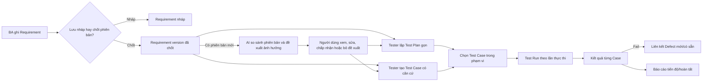
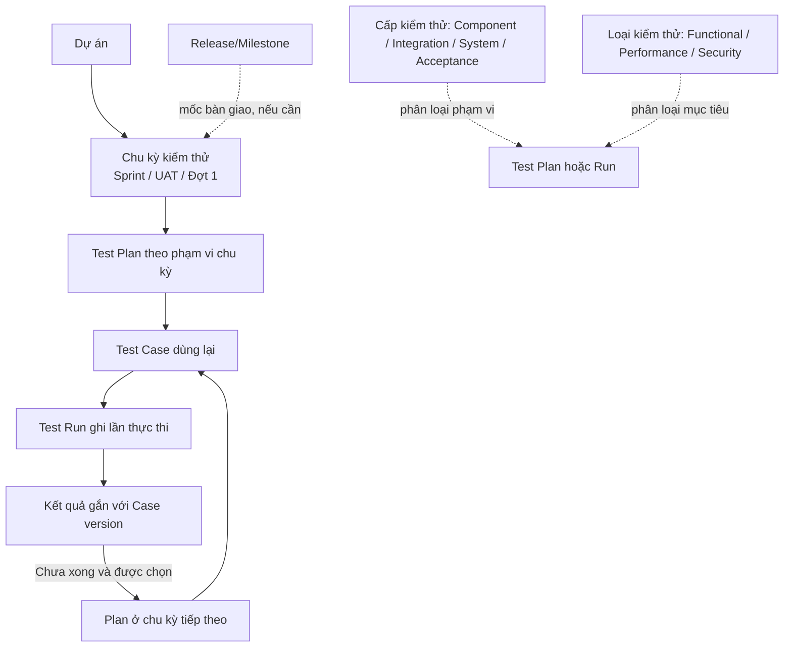
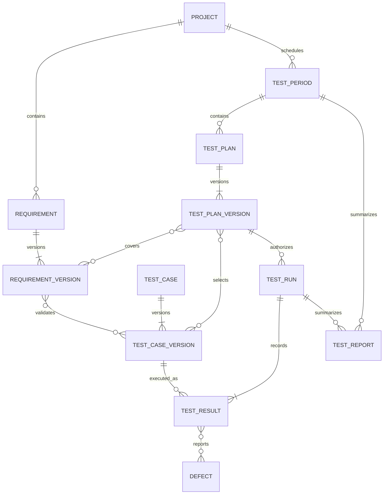
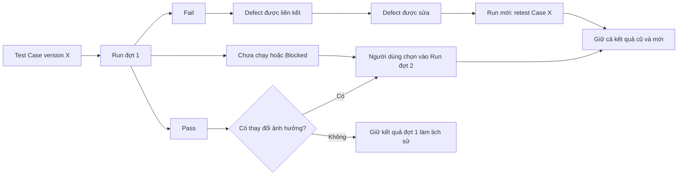
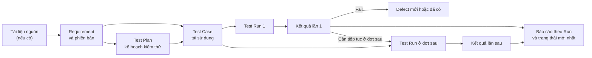

# Rà soát lại sản phẩm Veriq

**Trạng thái:** Khởi động lại phần phân tích nghiệp vụ. Tài liệu này chưa phải đặc tả đã được duyệt và chưa xác nhận chức năng nào đã hoạt động đúng.

**Nguyên tắc:** Code hiện tại chỉ dùng để tìm chỗ cần sửa, phụ thuộc và dữ liệu cần bảo toàn. Không suy ra nghiệp vụ đúng từ code đang có. Căn cứ nghiệp vụ gồm yêu cầu người dùng đã nêu, tài liệu ISTQB trong repo và tài liệu chính thức của ứng dụng tham khảo.

## 1. Mục đích sản phẩm nhìn từ người dùng

Veriq cần giúp một nhóm kiểm thử làm trọn các việc sau:

1. BA ghi yêu cầu và giữ được các phiên bản đã chốt.
2. Tester biết yêu cầu nào cần kiểm tra, tạo ca có thể thực hiện và truy được căn cứ.
3. Người phụ trách lập kế hoạch kiểm thử ngắn gọn, chọn phạm vi và điều kiện phù hợp.
4. Tester chạy các ca, lưu kết quả theo từng lần chạy, tạo hoặc nối lỗi khi cần.
5. Người xem biết phạm vi nào đã chạy, kết quả ra sao, còn ca hoặc lỗi nào chưa xử lý; có thể mở từ số liệu về dữ liệu gốc.
6. Khi yêu cầu đổi, người phụ trách biết Test Plan và Test Case nào cần xem lại; AI đưa đề xuất có căn cứ để người dùng quyết định.

Đây là mô tả nhu cầu sản phẩm suy ra từ các quyết định trong hội thoại, không phải kết quả khảo sát người dùng.

### Thứ tự dùng căn cứ khi có mâu thuẫn

1. Quyết định mới nhất mà người dùng đã chốt cho Veriq.
2. Nhu cầu và thao tác cần giải quyết trong luồng người dùng cụ thể.
3. ISTQB: dùng để kiểm tra thuật ngữ và nguyên tắc kiểm thử phù hợp ngữ cảnh; không biến mọi mục trong syllabus thành trường bắt buộc của sản phẩm.
4. Jira, Xray, TestRail: dùng làm ví dụ về cách giải quyết tác vụ; không sao chép toàn bộ mô hình hoặc mặc định mọi tính năng của họ đều cần cho Veriq.
5. Code và tài liệu nội bộ cũ: chỉ dùng để tìm dependency, dữ liệu, hành vi lệch và rủi ro khi sửa. Không dùng để quyết định nghiệp vụ đúng.

Tài liệu `LUONG_NGHIEP_VU_KIEM_THU.md` hiện có đề xuất nhập tài liệu thành Requirement, đưa Actor/Risk vào Requirement và dùng nhiều lớp tài sản kiểm thử. Các đề xuất đó mâu thuẫn với quyết định mới nhất ở mục 2. Chúng không được xem là yêu cầu hiện hành nếu chưa được người dùng xác nhận lại.

## 2. Những quyết định người dùng đã nêu

| Khu vực | Quyết định đang giữ làm căn cứ |
| --- | --- |
| Requirement | Không có Actor. Có lưu nháp và lưu yêu cầu. Tên, nội dung, AC, quy tắc nghiệp vụ và liên kết thiết kế/tài liệu thuộc phần tạo yêu cầu; AC, quy tắc và liên kết không được gọi là tùy chọn. Nhập danh sách bằng từng dòng có nút thêm/bớt. Ưu tiên và trạng thái nằm trong phần “Tùy chọn”. |
| Test Plan | Kế hoạch kiểm thử gọn cho dự án. Các phần mở rộng chỉ để tùy chọn khi có ích. Không thêm nội dung giải thích/tagline để lấp form. |
| Test Case | Không chia chế độ rút gọn/đầy đủ. Trường phụ để trong “Tùy chọn”. Không lặp Test Data hoặc Expected Result ở nhiều nơi. Luồng chính, thay thế và ngoại lệ là nội dung nhập; nếu không có thì để “-”. Không có trường rủi ro. |
| Test Run | Lưu kết quả theo lần chạy; khi Fail, có thể tạo Defect hoặc nối Defect có sẵn. Chạy lại phải giữ lịch sử lần trước. |
| Báo cáo | Có báo cáo tiến độ và hoàn tất; xuất PDF và Word. Mục Báo cáo đặt cạnh Thực thi kiểm thử. |
| Vai trò | BA, Tester, Admin. Không có Dev hoặc PM riêng. Admin/chủ dự án có toàn quyền và tự chốt nội dung do họ tạo theo quy tắc đã nêu. |
| AI | Giữ tóm tắt tài liệu và phân tích ảnh hưởng khi phiên bản Requirement đổi. Không tạo Requirement từ tài liệu; các luồng AI khác đã bị yêu cầu loại khỏi sản phẩm. |

Nếu tài liệu cũ hoặc code trái với bảng này, chúng là đối tượng cần rà, không phải căn cứ để tự khôi phục hành vi cũ.

## 3. Mô hình nghiệp vụ đề xuất

Đây là mô hình sản phẩm cần kiểm chứng với use case. Nó không được suy ra từ cách chia thư mục backend.

| Đối tượng | Việc người dùng cần làm | Ranh giới cần giữ |
| --- | --- | --- |
| Requirement và phiên bản | Ghi nội dung yêu cầu, lưu nháp hoặc chốt phiên bản, xem lịch sử. | Không có Actor. Tài liệu nguồn có thể đính kèm/tóm tắt; không tự biến nội dung tài liệu thành Requirement. |
| Test Plan | Ghi mục tiêu, phạm vi, các điều kiện và lựa chọn kiểm thử cần thiết. | Là tài liệu kế hoạch gọn. Không phải bảng điều khiển tiến độ hoặc nơi nhập lại kết quả đã chạy. Không có ô “Cách tiếp cận” chung chung. |
| Test Case | Mô tả kiểm tra có thể thực hiện lại, gồm bước và kết quả mong đợi, liên kết Requirement khi có căn cứ. | Là tài sản có thể dùng lại ở nhiều lần chạy hoặc phạm vi. Kết quả Pass/Fail không thuộc bản mô tả ca. |
| Test Run và kết quả | Chọn ca trong phạm vi, thực hiện tại một thời điểm/bối cảnh, ghi kết quả. | Mỗi lần chạy có dữ liệu riêng; không ghi đè kết quả cũ khi chạy lại. |
| Defect | Ghi nhận lỗi, trạng thái xử lý, mức độ và liên kết đến kết quả phát hiện lỗi. | Có mã và vòng đời riêng; Fail không bắt buộc tạo lỗi trùng. |
| Test Report | Tổng hợp theo phạm vi và thời điểm rõ ràng. | Số liệu phải lần được về Test Plan, Run, Case và Defect nguồn. |
| Tài liệu dự án | Lưu, đọc và tóm tắt nguồn tham khảo. | Là căn cứ cho người dùng; không tự tạo Requirement nếu người dùng chưa yêu cầu. |

## 3.1. Sơ đồ cần chốt trước khi build

Các sơ đồ sau là bản làm rõ nghiệp vụ để chuẩn bị thiết kế. Mũi tên là quan hệ cần có về mặt người dùng; chưa khẳng định API hay schema hiện tại đã đáp ứng.

### A. Luồng người dùng đầu-cuối



**Đã chốt:** lưu nháp/lưu chính cho Requirement, Test Plan, Test Case; kết quả Run giữ lịch sử; AI phân tích thay đổi đề xuất, không tự sửa tài liệu liên quan. **Cần đặc tả tiếp:** ai được chốt từng loại nội dung theo BA/Tester/Admin và trạng thái nào cho phép sửa sau khi chốt.

### B. Phân biệt các nghĩa của “giai đoạn”



**Nguyên tắc đề xuất:** Veriq phải hỗ trợ một đối tượng thực sự để lập kế hoạch kiểm thử theo chu kỳ, vì người dùng cần theo dõi phần việc giữa đợt 1, đợt 2. Gọi đối tượng đó là **Chu kỳ kiểm thử**; người dùng có thể đặt tên “Sprint 1”, “Giai đoạn UAT” hoặc tên phù hợp. Nó không tự mang đầy đủ luật Scrum. Cấp và loại kiểm thử là cách phân loại hoạt động, không phải chu kỳ thời gian.

### C. Quan hệ dữ liệu nghiệp vụ



`TEST_PERIOD` là đối tượng **Chu kỳ kiểm thử** có thật trong mô hình, không phải nhãn tự nhập trên Test Case. Một chu kỳ có tên bắt buộc; mục tiêu và ngày dự kiến có thể để trống. Chu kỳ chứa các Test Plan theo phạm vi kiểm thử của đợt đó; Test Run thuộc Test Plan nên tự biết chu kỳ. Dự án vẫn có thể chạy Plan độc lập khi chưa dùng chu kỳ. Veriq quản lý chu kỳ kiểm thử, không giả làm công cụ Scrum đầy đủ.

### D. Ví dụ phần chưa xong ở đợt 1



**Cách đọc:** ca Pass không tự chuyển đợt. Ca chưa chạy/Blocked có thể được chọn lại nếu vẫn nằm trong phạm vi. Ca Fail có Defect; sau khi sửa thì chạy lại cùng ca trong Run mới. Nếu thay đổi có thể ảnh hưởng ca đã Pass, người có trách nhiệm chọn thêm ca hồi quy. Không có thao tác nào xóa kết quả đợt 1.

### E. Bốn lớp dữ liệu không được nhập nhằng

| Lớp | Ví dụ | Câu hỏi nó trả lời |
| --- | --- | --- |
| Tài liệu chuẩn bị | Requirement, Test Plan, Test Case | Cần kiểm tra điều gì và dự định kiểm tra ra sao? |
| Tổ chức đợt | Sprint/Phase/Đợt, nếu dự án dùng | Công việc/hoạt động này thuộc đợt nào? |
| Thực thi | Test Run | Ai chạy ca nào, trên build/môi trường nào, vào lần nào? |
| Kết quả lịch sử | Test Result, Defect, Report | Lần chạy đó ra sao, lỗi nào phát sinh, tổng hợp theo phạm vi nào? |

Không đặt trạng thái Pass/Fail lên bản Test Case dùng lại; đó là trạng thái của kết quả trong một Run cụ thể.

### F. Ví dụ nghiệp vụ dùng để chốt cách xử lý đợt

Ví dụ này biến khái niệm “đợt 1/đợt 2” thành các quy tắc có thể kiểm tra. Nó là đề xuất để chuẩn bị build, không phải bằng chứng rằng code hiện tại đã làm đúng.

**Phạm vi:** một Test Plan đã chốt chọn 5 phiên bản Test Case cho một Requirement. Dự án tự đặt “Đợt 1” và “Đợt 2”; đây có thể là Sprint nếu nhóm dùng Scrum, hoặc chỉ là đợt kiểm thử nếu không dùng Scrum.

| Kết quả ở Run thuộc đợt 1 | Xử lý khi kết thúc đợt 1 | Có xuất hiện ở đợt 2 không? | Báo cáo phải thể hiện |
| --- | --- | --- | --- |
| 3 ca Pass | Giữ kết quả và phiên bản ca của Run 1. | Chỉ thêm lại nếu có lý do, như thay đổi liên quan cần regression. | Pass của Run 1; không tính thành kết quả Run 2. |
| 1 ca Fail, có Defect mở | Giữ Fail và liên kết Defect. Không coi ca đã đạt. | Khi có bản sửa, chọn cùng Test Case vào Run mới để retest; giữ liên kết đến Defect và Run nguồn. | Fail ở Run 1 và kết quả retest riêng ở Run 2; không ghi đè. |
| 1 ca chưa chạy | Giữ trạng thái chưa chạy của Run 1. | Người lập phạm vi Run 2 chọn lại nếu ca vẫn cần kiểm tra. | Chưa chạy ở Run 1; trạng thái mới chỉ đổi theo Run 2. |
| Ca bị Blocked (nếu có) | Giữ trạng thái, lý do và điều kiện chặn. | Chọn lại khi điều kiện chặn được xử lý; không tự chuyển khi chưa sẵn sàng. | Blocked theo Run nguồn và lần xử lý sau. |

**Quy tắc đếm:** báo cáo của Run 1 dùng đúng kết quả Run 1. Báo cáo của Run 2 dùng đúng kết quả Run 2. Tổng quan mới nhất theo Test Plan có thể dùng kết quả mới nhất của mỗi Test Case version, nhưng phải nói rõ đây là “mới nhất”, không cộng kết quả nhiều Run như thể đó là nhiều ca khác nhau. Báo cáo theo đợt tổng hợp các Run thuộc đợt ấy và vẫn cho mở chi tiết từng Run.

**Không làm trong phạm vi giai đoạn đầu:** tự động đưa toàn bộ Fail sang đợt sau; tự quyết định Pass Run 1 có cần regression không; tự gán ngày/Sprint theo lịch; quản lý backlog phát triển, velocity hoặc burndown kiểu Jira. Những việc này cần quy tắc dự án hoặc tích hợp riêng.

### G. Phạm vi tối thiểu có thể build cho “đợt”

| Câu hỏi sản phẩm | Hướng tối thiểu đề xuất | Vì sao |
| --- | --- | --- |
| Có xây giai đoạn không? | Có. Chu kỳ kiểm thử là đối tượng có thật trong sản phẩm. Cho phép Run độc lập cho kiểm tra ad hoc. | Người dùng cần lập kế hoạch theo đợt và biết phần nào tiếp tục ở đợt sau. |
| Chu kỳ nằm ở đâu? | Chu kỳ chứa một hoặc nhiều Test Plan; mỗi Test Plan thuộc tối đa một chu kỳ. | Chu kỳ thể hiện phạm vi thời gian; Test Plan mô tả kế hoạch cho phạm vi đó. |
| Test Case gắn với chu kỳ không? | Không gắn cứng. Test Plan chọn các Case cần dùng; cùng Case có thể xuất hiện trong nhiều Plan/chu kỳ. | Cho phép tái sử dụng và giữ lịch sử. |
| Một Test Plan cho mỗi đợt? | Có thể có nhiều Plan trong một chu kỳ, theo mục tiêu/phạm vi khác nhau. Khi sang chu kỳ mới, tạo Plan mới từ Plan cũ rồi rà lại. | Azure thường lập Plan cho Sprint/milestone; TestRail dùng Plan để gom nhiều Run/cấu hình. Không có một cấu trúc duy nhất cho mọi sản phẩm. |
| “Chuyển ca” nghĩa là gì? | Chọn lại phiên bản Test Case vào Run mới, có tham chiếu Run nguồn. Không xóa ca hoặc kết quả cũ. | Bảo toàn lịch sử và vẫn cho người dùng quyết định phạm vi. |
| Có tự chuyển ca chưa đạt sang đợt sau không? | Không. Khi đóng Sprint, người dùng quyết định ca nào cần chạy tiếp; hệ thống tạo/chọn Run mới và giữ kết quả cũ. | Jira/Azure chuyển work item chưa xong về backlog hoặc Sprint sau theo lựa chọn; không có nghĩa mọi Test Case Fail tự động chuyển. |
| Sprint Scrum có được quản lý không? | Không xây backlog, velocity hay burndown trong phạm vi hiện tại. Nếu cần Scrum đầy đủ thì phải có quản lý work item và quy tắc đóng Sprint riêng. | Chỉ có ô “Sprint 1” không tạo thành hỗ trợ Scrum. |

**Quyết định thiết kế:** xây Chu kỳ kiểm thử thành khu vực nhìn thấy được trong Thực thi kiểm thử. Chu kỳ chứa các Test Plan; Plan chọn Requirement và Test Case; Run ghi nhận lần chạy và thuộc Plan. Sang chu kỳ tiếp, người dùng tạo Plan từ chu kỳ trước, chọn lại Case cần tiếp tục và xác nhận. Run ad hoc không gắn chu kỳ vẫn được phép. Veriq không nhận là công cụ quản lý Scrum đầy đủ.



Sơ đồ thể hiện hướng nghiệp vụ được đề xuất. Đợt sau tham chiếu lại Test Case; nó không xóa ca hoặc kết quả của đợt trước. Cách tổ chức Đợt kiểm thử vẫn cần được chốt ở mục 4.

## 4. Mô hình giai đoạn kiểm thử cần xây

Yêu cầu cần giải quyết là lập kế hoạch kiểm thử theo từng chu kỳ, xem phần nào đã chạy/chưa chạy/bị chặn/lỗi, rồi quyết định phần nào tiếp tục ở chu kỳ sau. Đây là năng lực cốt lõi cần có trong Veriq. Không gắn chu kỳ vào Test Case vì cùng một ca có thể được dùng trong nhiều chu kỳ.

| Khái niệm | Nghĩa trong quy trình | Dữ liệu thường được tổ chức |
| --- | --- | --- |
| Giai đoạn dự án (Phase) | Một chặng lớn do dự án định nghĩa, có thể theo phạm vi hoặc mốc bàn giao. Không nhất thiết có Sprint. | Có thể có nhiều Requirement, kế hoạch và đợt kiểm thử. |
| Chu kỳ kiểm thử (Veriq) | Một khoảng lập kế hoạch/kiểm thử do dự án đặt tên, có thể tương ứng Sprint, iteration, UAT hoặc một mốc bàn giao. | Chứa Test Plan của chu kỳ; Plan chọn Requirement và Test Case trong phạm vi. Người dùng quyết định phần nào tiếp tục ở chu kỳ sau. |
| Sprint Scrum | Một Sprint theo Scrum có mục tiêu và phạm vi công việc của nhóm. | Veriq có thể ghi nhận tên/mốc Sprint cho kiểm thử, nhưng không quản lý backlog, năng lực hay velocity nếu chưa xây các chức năng Scrum tương ứng. |
| Cấp kiểm thử (Test Level) | Nhóm hoạt động theo đối tượng kiểm tra, như Component, Integration, System, Acceptance. Đây không phải số thứ tự Sprint hay giai đoạn dự án. | Test Plan/Run có thể ghi cấp kiểm thử nếu cần phân biệt phạm vi. |
| Loại kiểm thử (Test Type) | Mục tiêu chất lượng như Functional, Performance, Security. Có thể diễn ra ở nhiều cấp kiểm thử. | Gắn với kế hoạch hoặc hoạt động kiểm thử, không dùng làm tên giai đoạn. |
| Test Run / Test Cycle | Một hoạt động chạy tập ca trong một bối cảnh cụ thể. Retest là lần chạy mới sau thay đổi; không phải Sprint mới. | Ca được chọn, người thực hiện, môi trường/build và kết quả thời điểm đó. |
| Release/Milestone | Mốc bàn giao hoặc phiên bản sản phẩm. Có thể bao gồm nhiều đợt và nhiều Test Run. | Gom tiến độ, phạm vi và báo cáo theo mốc khi dự án cần. |

ISTQB phân biệt cấp kiểm thử với loại kiểm thử. Jira quản lý Sprint ở cấp work item; Azure hướng dẫn lập Test Plan cho Sprint/milestone và dùng lại Test Case ở chu kỳ tiếp; TestRail dùng Test Plan để gom nhiều Run/cấu hình; Xray tách Test Plan khỏi Test Execution. Những mô hình này cho thấy cần có cách tổ chức theo chu kỳ và giữ lịch sử, nhưng không cho thấy một cấu trúc duy nhất. Veriq chọn mô hình phù hợp với tác vụ người dùng: Chu kỳ kiểm thử → Test Plan theo phạm vi chu kỳ → Test Case dùng lại → Test Run và kết quả. [Jira: Sprints](https://support.atlassian.com/jira-software-cloud/docs/enable-sprints/), [Azure: Test Plans by sprint/milestone](https://learn.microsoft.com/en-us/azure/devops/test/create-a-test-plan?view=azure-devops), [Azure: end-of-sprint work](https://learn.microsoft.com/en-us/azure/devops/boards/sprints/end-sprint-activities?view=azure-devops), [TestRail: plans and runs](https://support.testrail.com/hc/en-us/articles/7076810203028-Introduction-to-TestRail), [Xray: test workflows](https://docs.getxray.app/space/XRAYCLOUD/44567832/Using%2BJira%2Bworkflows%2Bfor%2Btesting%2Bpurposes).

### Quyết định thiết kế đề xuất cho Veriq

1. Chu kỳ kiểm thử là chức năng chính thức trong Thực thi kiểm thử, không phải trường text ở Test Case. Tên chu kỳ do người dùng đặt; không bắt chọn Scrum/Waterfall.
2. Mỗi Test Plan thuộc tối đa một Chu kỳ kiểm thử. Plan được tạo trong chu kỳ; có thể bắt đầu từ Plan trước bằng thao tác “Tạo kế hoạch cho chu kỳ mới”, sau đó người dùng rà lại phạm vi và tiêu chí. Không tự sao chép kết quả.
3. Test Case được dùng lại qua các Plan/chu kỳ. Khi chuyển sang chu kỳ mới, tạo Plan mới cho phạm vi chu kỳ đó và chọn lại các Case cần kiểm tra; không di chuyển hoặc sửa lịch sử Case cũ.
4. Test Run được tạo từ Plan, lưu môi trường/build và kết quả của lần chạy. Retest sau khi sửa lỗi vẫn là Run mới trong chu kỳ hiện tại hoặc chu kỳ sau; không ghi đè kết quả cũ.
5. Khi kết thúc chu kỳ, hệ thống tổng hợp Case Pass, Fail, Chưa chạy, Blocked và Defect mở. Người dùng chọn từng Case cần tiếp tục; Pass chỉ đưa sang chu kỳ tiếp nếu cần hồi quy. Hệ thống chuẩn bị Plan mới và danh sách Case được chọn để người dùng xác nhận.
6. Nếu dự án cần quản lý Sprint Scrum thật, phải có backlog, Requirement/công việc thuộc Sprint, mục tiêu và luật đóng Sprint. Nếu chưa xây các phần đó, giao diện chỉ gọi là “Chu kỳ kiểm thử”, không tuyên bố quản lý Scrum.
7. Báo cáo lọc theo Chu kỳ → Test Plan → Test Run; luôn giữ kết quả từng Run và thể hiện riêng trạng thái mới nhất. Không cộng nhiều lần chạy thành nhiều Test Case khác nhau.

Luồng đề xuất: đóng Chu kỳ 1 → xem tổng hợp và lý do chưa hoàn tất → tạo Chu kỳ 2 → tạo Test Plan mới từ kế hoạch trước → chọn lại các Case cần tiếp tục → tạo Run mới. Kết quả Chu kỳ 1 giữ nguyên. Không thêm `phase` dạng text vào Test Case và không tự chuyển tất cả ca.

## 5. Đối chiếu tác vụ với ứng dụng đang có

| Tác vụ người dùng | Cách ứng dụng tham khảo giải quyết | Điều Veriq cần học | Điều không nên sao chép máy móc |
| --- | --- | --- | --- |
| Nối yêu cầu, ca kiểm thử và lỗi | Jira cho phép liên kết các work item với loại quan hệ rõ và xem liên kết từ hai phía. Xray nối Requirement với Test và kết quả. | Liên kết phải mở được, truy ngược được và giải thích được độ bao phủ/tác động. | Không cần tạo một trang “truy vết” riêng nếu người dùng chỉ cần xem quan hệ trong Requirement, Case hoặc Report. |
| Tách thiết kế ca với kết quả chạy | Xray để Test mô tả ca và Test Execution lưu hoạt động chạy. TestRail cũng tách Case, Run, Test Result. | Giữ định nghĩa Test Case tách khỏi Result của Run; chạy lại tạo Result mới. | Không thêm toàn bộ Test, Precondition, Test Set, Data Set và automation nếu use case Veriq không cần. |
| Gắn kiểm thử với Sprint/Iteration | Azure Test Plans có Test Plan, Test Suite và Test Case; suite có thể gom theo Sprint, Feature, Milestone hoặc Requirement. Requirement-based suite lọc work item theo Iteration Path. | Nếu Veriq cần Scrum thật, phạm vi Sprint nên lấy từ đối tượng Sprint/Iteration và Requirement/Work Item; không tạo trường Sprint nhập tự do ở Test Case. | Không sao chép cấu trúc nhiều tầng Plan/Suite nếu người dùng Veriq chỉ cần kế hoạch gọn và Run. |
| Chia hoạt động kiểm thử thành đợt | Zephyr dùng Test Cycle làm tập ca theo mục tiêu; cycle có thể nằm dưới Test Plan/release hoặc không gắn release, và lần thực thi lưu riêng để xem lịch sử. Một số bản Zephyr hỗ trợ chạy ad hoc không cần Cycle. | Một “Đợt kiểm thử” chỉ đáng có nếu cần nhóm nhiều Run, phân công hoặc báo cáo theo đợt; chạy lại vẫn là execution mới của cùng Test Case. | Không bắt buộc mọi thao tác tạo Cycle trước khi chạy test; không thêm cycle nếu một Run đáp ứng use case. |
| Chia phạm vi theo đợt | Jira chuyển work item chưa xong sang backlog/Sprint khác; Xray theo dõi Test qua nhiều Test Execution; TestRail có Milestone và Plan để nhóm Run theo những cách riêng. | Không xóa lịch sử Test Case/Result. Cần báo cáo được đợt trước và tiếp tục chọn Case trong Run đợt sau. | Không đồng nhất Phase/Sprint/Test Level/Test Type/Run; không bắt mọi dự án theo Scrum; không sao chép nguyên cấu trúc Plan của hãng khác. |
| Báo cáo | Xray/TestRail hiển thị trạng thái theo Plan/Run và cho lần từ tổng quan đến ca/lỗi. | Mỗi báo cáo ghi rõ phạm vi, thời điểm, kết quả chưa chạy/đang chặn/lỗi mở và đường về dữ liệu nguồn. | Không tạo nhiều dashboard/báo cáo nếu chúng lặp cùng một số liệu nhưng dùng phạm vi khác nhau. |

### Tài liệu tham khảo chính thức

- ISTQB, [CTFL Syllabus v4.0.1](https://www.istqb.org/wp-content/uploads/2024/11/ISTQB_CTFL_Syllabus_v4.0.1.pdf), đặc biệt mục 5.1.1–5.1.2 về Test Plan và iteration/release planning, cùng mục 5.3 về theo dõi và báo cáo.
- Atlassian, [Enable sprints and complete a sprint](https://support.atlassian.com/jira-software-cloud/docs/enable-sprints/).
- Microsoft, [Create and manage test suites in Azure Test Plans](https://learn.microsoft.com/en-us/azure/devops/test/create-test-suites?view=azure-devops) và [Test Plans overview](https://learn.microsoft.com/azure/devops/test/overview?preserve-view=true&view=azure-devops).
- Xray, [Test Sets vs Test Plans](https://docs.getxray.app/space/XRAY/301474179/Test%20Sets%20vs%20Test%20Plans), [Planning Tests](https://docs.getxray.app/space/XRAY/301403858), [Adopting Xray for Hardware Testing](https://docs.getxray.app/space/XRAYCLOUD/1853849616/Adopting%2BXray%2Bfor%2BHardware%2BTesting).
- Zephyr/SmartBear, [Test Cycles](https://support.smartbear.com/zephyr/docs/dc/test-cycles/), [Executing in Test Cycles](https://support.smartbear.com/zephyr/docs/essential-dc/executing-tests/executing-in-test-cycles/), [Zephyr test planning](https://support.smartbear.com/zephyr/docs/enterprise/zephyr-enterprise/zephyr-user-guide/test-planning/).
- TestRail, [Introduction to TestRail](https://support.testrail.com/hc/en-us/articles/7076810203028-Introduction-to-TestRail), [Test plans](https://support.testrail.com/hc/en-us/articles/30765296499604-Create-new-test-plans), [Test runs and results](https://support.testrail.com/hc/en-us/articles/32784099933844-Best-Practices-Guide-Test-Runs-and-Results).

## 6. Rà hiện trạng code — chỉ ghi lệch, không lấy làm yêu cầu

Các điểm dưới đây là vị trí cần điều tra/sửa. Chúng không chứng minh thiết kế hiện tại là đúng.

| Khu vực | Bằng chứng trong working tree | Vấn đề cần giải quyết từ góc nhìn người dùng |
| --- | --- | --- |
| Điều hướng | `navigation.js`, `AppShell.jsx`, `ProjectWorkspacePage.jsx` khai báo nhóm menu và route cho Requirement, Plan, Case, Run, Defect, Report, tài liệu; đồng thời còn route cho phân tích, dữ liệu, bộ kiểm thử, automation, giám sát, truy vết, release và cài đặt. | Người dùng có thể thấy nhiều khu vực hoặc vào được route cũ dù chức năng đã bị yêu cầu thu gọn. Cần chốt màn hình theo tác vụ rồi lần mọi đường vào, không chỉ ẩn một mục menu. |
| Requirement | Form trong `RequirementCreateModal.jsx` đánh dấu Tên, AC, quy tắc và liên kết tài liệu là bắt buộc; nội dung chưa có dấu bắt buộc. `RequirementCreate` còn `risk`, và `type` vẫn bắt buộc trong schema dù form không cho chọn (form tự đặt “Chưa phân loại”). Backend lưu chính hiện kiểm tra AC, quy tắc, liên kết; chưa kiểm tra nội dung rỗng. | Lệch giữa quyết định bỏ Risk, biểu mẫu, schema và validation. Cần làm rõ `type` chỉ là phân loại mặc định hay trường người dùng cần; bỏ Risk tận gốc sau khi rà caller/lịch sử; đồng bộ nội dung và dấu `*` với lưu chính. |
| Test Plan | `TestPlanEditor.jsx` có textarea `Cách tiếp cận`; một input môi trường tự do, ghi chú browser/device và Test Data, đồng thời có dropdown `Môi trường đã cấu hình` bị giấu trong phần Liên kết. Schema lưu cả text environment lẫn environment ID. Form còn có trường phase, lựa chọn Case, ca chuyển tiếp từ Run và gợi ý AI. Backend còn nhiều trường kế hoạch mở rộng. | Có dữ liệu môi trường nhập hai cách và thông tin lặp; dữ liệu test bị nhập ở Plan dù đã có trong Case; selector môi trường khó thấy; “Cách tiếp cận” mơ hồ và lặp với lựa chọn loại/kỹ thuật. Người dùng báo khó tìm Cài đặt dự án. Cần một selector môi trường duy nhất, dữ liệu môi trường cấu hình một lần và được chọn lại. Bỏ textarea riêng và Test Data Plan sau khi rà phụ thuộc. |
| Test Case | `TestCaseCreateForm.jsx` có Cách viết ca ở trước phần “Tùy chọn”; trong tùy chọn còn loại, ưu tiên, cấp kiểm thử, điều kiện, luồng, kỹ thuật và liên kết. Schema còn `risk`, `flow_type`, Test Data cấp ca và Expected Result cấp ca ngoài cấu trúc từng bước. | Có lệch rõ với vị trí Cách viết ca, yêu cầu bỏ Risk/enum luồng và tránh dữ liệu lặp. Xóa field chỉ sau khi rà generator, serializer, linter, query, transfer, import/export và dữ liệu lịch sử. |
| Test Run | `ExecutionPage.jsx`, `RunExecutionWorkspace.jsx` và `test_run.py` tạo Run từ Plan, lưu kết quả, tạo/nối Defect và có luồng chạy lại ca Fail. | Cần phân biệt tạo Run, chạy tiếp, chạy lại sau sửa và chuyển phạm vi sang giai đoạn mới. Không được dùng cùng một thao tác cho cả bốn việc. |
| Phase/carry-over | Schema/service có `phase` ở Plan, lưu phase vào snapshot Run, và cho thêm ca từ Run nguồn sang Plan khác. Một nhánh rerun riêng chỉ nhận ca Fail được chọn. | Hai luồng “chạy lại ca Fail” và “chuyển ca chưa xong sang phạm vi tiếp theo” đang khác nhau. Cần thiết kế lại quanh hành động người dùng và lịch sử; code hiện tại không phải đáp án nghiệp vụ. |
| Báo cáo | `ReportsPage.jsx` có Tổng quan và Báo cáo; báo cáo có tiến độ/trạng thái và hoàn tất. Backend còn workflow duyệt/xuất bản, AI soạn nội dung, residual risks, handover, lessons learned, improvement actions và nhiều chuyển trạng thái. | Có nền tảng vượt quá hai loại báo cáo đã chọn. Cần phân biệt dữ liệu tự tính với nội dung người dùng nhập, xác định phần nào cần cho PDF/Word; chỉ gỡ workflow sau khi rà quyền, snapshot, export và quyết định release đang phụ thuộc. |
| AI và tài liệu | Còn nhiều module/API/UI AI ngoài tóm tắt tài liệu và phân tích phiên bản; import Requirement từ tài liệu vẫn còn trong mã. | Cần call graph và dependency map trước khi gỡ tận gốc. Giữ đọc/tóm tắt tài liệu; không tạo Requirement từ tài liệu và không giữ AI phụ đã bị loại. |
| Quyền và vai trò | API giới hạn vai trò dự án ở `BA`, `TESTER`, `SYSTEM_ADMIN`; quyền cụ thể được nạp từ cấu hình DB. Chủ dự án và system admin được mở rộng quyền trong `project_membership_permissions`. Phê duyệt tự động dựa vào system admin/chủ dự án. Màn quản lý quyền đang liệt kê nhiều mã permission theo nhóm kỹ thuật; phần quyền chi tiết nằm trong một disclosure lồng nhau. | Tên quyền khó hiểu và không cho thấy ngay người dùng làm được việc gì. Cần lập ma trận theo tác vụ BA/Tester/Admin, kiểm tra từng API với ma trận đó và tách “vai trò”, “người chịu trách nhiệm” khỏi quyền kỹ thuật. Không nên chỉnh ma trận bằng cách đoán từ giao diện hoặc dữ liệu quyền cũ. |
| Tài liệu nội bộ | `LUONG_NGHIEP_VU_KIEM_THU.md`, `TOM_TAT_QUY_TRINH_VERIQ.md`, `FRAMEWORK_VERIQ.md` viết ở các thời điểm/phạm vi khác nhau. | Có mô tả AI, vai trò và quy trình cũ trái với lựa chọn mới. Phải đánh dấu lịch sử hoặc cập nhật; không trộn thành một quy trình bắt buộc. |

## 7. Kế hoạch làm lại để người dùng dùng được

### Bước 1 — Chốt mô hình nghiệp vụ và sơ đồ

Vẽ một sơ đồ duy nhất cho các đối tượng và vòng đời: Requirement/version → Test Plan/phạm vi giai đoạn → Test Case → Run/Result → Defect/Report. Ghi rõ đối tượng nào là tài liệu, đối tượng nào là lần chạy, quan hệ nào tái sử dụng, trạng thái nào cho phép chuyển tiếp.

**Điều kiện hoàn tất:** mỗi quan hệ trả lời được người dùng cần làm gì, dữ liệu thuộc đâu, ai cập nhật, lịch sử nào được giữ. Không thêm trường chỉ để khớp tên trong ISTQB hoặc ứng dụng khác.

### Bước 2 — Dựng lại luồng người dùng bằng ví dụ thật

Đi qua một ví dụ xuyên suốt: BA tạo Requirement; Tester lập kế hoạch cho phạm vi/giai đoạn 1; chọn và chạy Case; một số ca chưa chạy hoặc Fail; mở phạm vi/giai đoạn tiếp theo; chạy lại; xem báo cáo tiến độ và hoàn tất. Thêm ví dụ Requirement đổi phiên bản và xem tác động đến Plan/Case.

**Điều kiện hoàn tất:** người dùng biết bước tiếp theo ngay trên màn hiện tại; không phải nhập một dữ liệu hai lần; có đường đi cho nháp, lỗi, hủy, thử lại và dữ liệu chưa có.

### Bước 3 — Chốt hợp đồng backend và dữ liệu

Cho từng hành động, ghi route, permission, input/output, trạng thái trước/sau, validation, nguồn dữ liệu, snapshot/version, idempotency và migration. Lần tất cả caller, query, report, export, AI, worker và dữ liệu cũ trước khi xóa field/module.

**Điều kiện hoàn tất:** field nào cũng có chủ sở hữu; lưu nháp và lưu chính có quy tắc rõ; kết quả Run cũ không bị thay đổi; quyền BA/Tester/Admin nhất quán.

Riêng quyền truy cập, đặc tả cần dùng động từ nghiệp vụ dễ hiểu như “Tạo yêu cầu”, “Chốt yêu cầu”, “Soạn kế hoạch”, “Chạy ca kiểm thử”, “Ghi nhận lỗi”, “Xuất báo cáo”. Mã permission chỉ là cách thực thi ở backend, không phải nội dung chính trên màn hình người dùng. Phải xác định rõ System Admin toàn nền tảng, chủ dự án và thành viên có vai trò BA/Tester là các khái niệm nào; không gộp chúng thành một cột “Admin” nếu quyền và phạm vi khác nhau.

### Bước 4 — Sửa theo luồng đầu-cuối

Ưu tiên theo thứ tự người dùng làm việc: Requirement và phiên bản; Test Plan và chia phạm vi; Test Case; Run/Defect/chuyển tiếp; Report; quyền/tài liệu/AI. Với mỗi luồng, sửa backend contract, frontend, migration và tài liệu trong cùng lát cắt.

**Điều kiện hoàn tất:** màn hình, API và dữ liệu thể hiện cùng một workflow. Chỉ ẩn route không được tính là đã bỏ tính năng. Chỉ gỡ code sau khi không còn dependency và dữ liệu lịch sử vẫn đọc được.

### Bước 5 — Kiểm tra nghiệm thu

Sau khi người dùng yêu cầu kiểm tra, xác minh từng tác vụ đầu-cuối trên giao diện và API, gồm quyền, dữ liệu nháp, lưu chính, phiên bản, chuyển tiếp, rerun, defect, report/export và lỗi dịch vụ. Ghi kết quả quan sát được, không dùng test tự viết làm bằng chứng thay cho workflow thực.

## 8. Trạng thái chắc chắn hiện nay

- Đã xác định được những quyết định sản phẩm người dùng đã nêu và một số mâu thuẫn rõ giữa quyết định, tài liệu cũ và code.
- Đã đối chiếu CTFL v4.0 trong repo với tài liệu chính thức Jira, Xray, Azure Test Plans, Zephyr và TestRail về Test Plan, Sprint/Iteration, Cycle, Run, kết quả và chạy lại.
- Chưa hoàn tất kiểm kê mọi form/API/schema/worker, quyền, migration, report aggregation và hành vi giao diện đang chạy.
- Chưa có sơ đồ nghiệp vụ cuối cùng được duyệt; chưa sửa code trong lượt rà soát này.

**Không được kết luận sản phẩm đã dùng được hoặc đã sẵn sàng sửa hàng loạt.** Bản phân tích chỉ được coi là hoàn tất khi các phần còn thiếu trong Bước 1–3 có bằng chứng và mâu thuẫn được giải quyết trước khi triển khai.

## 9. Xác minh cách các công cụ xử lý giai đoạn

Đối chiếu tài liệu chính thức của ISTQB, Azure Test Plans, Zephyr, TestRail và Jira cho thấy không có một cấu trúc duy nhất gọi là “giai đoạn” áp dụng cho mọi dự án.

| Nguồn | Cách tổ chức được tài liệu mô tả | Bài học áp dụng cho Veriq |
| --- | --- | --- |
| ISTQB CTFL v4.0 trong repo | Phân biệt cấp kiểm thử, loại kiểm thử và kỹ thuật. Kiểm thử có thể kết thúc tại mốc release, cuối iteration hoặc khi hoàn tất một cấp kiểm thử; khi kết thúc, nhóm ghi nhận defect/backlog còn lại và báo cáo hoàn tất. | “Giai đoạn” theo thời gian không đồng nghĩa với Test Level. Tạo báo cáo ở mốc kết thúc là hợp lý; bắt mọi dự án theo cùng chuỗi giai đoạn thì không có căn cứ. |
| Azure Test Plans | Test Plan chứa Test Suite; suite có thể nhóm theo Requirement, Sprint/Iteration, Feature hoặc dùng bộ lọc. Test Case có thể được dùng lại; Test Run và kết quả lưu từng lần thực thi. | Với nhóm Scrum, Requirement/Work Item có thể nối với Iteration, còn Case gắn với Requirement và Run. Không cần gắn cứng Test Case vào duy nhất một Sprint. |
| Zephyr | Test Cycle là tập ca cho một mục tiêu thực thi; kết quả liên kết với cycle. Có thể tạo lần execution mới cho cùng ca và xem dữ liệu execution cũ. Một số luồng hỗ trợ thực thi ad hoc không cần cycle. | “Đợt kiểm thử” hữu ích để nhóm các lần chạy có kế hoạch, nhưng không nên bắt buộc cho chạy nhanh hoặc mọi dự án. |
| TestRail | Test Plan có thể nhóm nhiều Run/cấu hình; Milestone có thể đại diện mốc release. Tài liệu khuyên dùng Case cũ trong Run mới thay vì copy Case chỉ để chạy vòng khác. | Giữ Case ổn định, mỗi lần chạy có Result riêng. Test Plan của hãng là container Run, khác lựa chọn Test Plan gọn của Veriq. |
| Jira Scrum | Khi đóng Sprint, work item chưa hoàn tất được đưa về backlog hoặc Sprint khác. | Nếu Veriq hỗ trợ Scrum đầy đủ thì Sprint quản lý Requirement/công việc; không coi Test Case là work item để chuyển khỏi Sprint cũ. |

### Kết luận thiết kế cho Veriq

1. Chu kỳ kiểm thử là đối tượng cấp một và có khu vực riêng trong Thực thi kiểm thử. Mỗi chu kỳ gom các Test Plan theo mục tiêu/phạm vi của chu kỳ.
2. Test Plan trong chu kỳ xác định Requirement và Test Case cần kiểm tra. Với chu kỳ mới, tạo Plan mới từ Plan cũ để tái dùng liên kết và nội dung phù hợp; người dùng rà phạm vi trước khi lưu.
3. Test Case không thuộc độc quyền một chu kỳ. Cùng Case có thể được chọn trong nhiều Plan/chu kỳ mà không bị sao chép.
4. Test Run lưu một lần thực thi thuộc Plan; Test Result lưu kết quả theo Test Case version. Không nhập Pass/Fail vào bản Test Case dùng lại.
5. Khi kết thúc chu kỳ, hệ thống tổng hợp trạng thái; người dùng chọn ca chưa chạy/Blocked/Fail cần tiếp tục. Retest sau sửa lỗi vẫn tạo Run mới và liên kết Defect. Ca Pass chỉ chọn lại nếu cần regression.
6. Không tự chuyển ca hoặc tự tạo chu kỳ kế tiếp. Hệ thống có thể chuẩn bị danh sách đề xuất từ trạng thái cũ, nhưng người dùng xem và xác nhận Plan mới.

## 10. Luồng sản phẩm từ đầu đến cuối và giao diện đề xuất

Đây là bản thiết kế nghiệp vụ/UX để review trước khi code. Dấu `*` là trường chặn thao tác chính; trường khác được lưu khi có dữ liệu và không chặn luồng nếu dự án không dùng.

### 10.1 Điều hướng chính

```text
Dự án
├── Tổng quan
├── Yêu cầu
├── Kế hoạch kiểm thử
├── Ca kiểm thử
├── Thực thi kiểm thử
├── Báo cáo
├── Tài liệu
└── Cài đặt dự án (qua biểu tượng bánh răng, theo quyền)
```

- **Thực thi kiểm thử** chứa danh sách Đợt, Test Run, kết quả và Defect liên kết; không tách màn “Theo dõi” riêng.
- **Tài liệu** là nơi tải và đọc tài liệu; AI tóm tắt nằm ngay trong chi tiết tài liệu.
- **Cài đặt dự án** cần có lối vào nhìn thấy được từ tiêu đề dự án. Khu vực này giữ danh mục môi trường và thành viên; không để cấu hình môi trường nằm ở một route khó tìm hoặc trong Quản lý tài khoản nền tảng.
- **Phân tích ảnh hưởng** nằm trong trang phiên bản Requirement. Tạo phiên bản mới sẽ tự chạy so sánh văn bản; chỉ khi khác nội dung mới gọi AI. Kết quả gắn với đúng phiên bản, Plan, Case và bằng chứng nguồn. Người dùng quyết định có cập nhật tài liệu liên quan hay không.
- Không để menu riêng cho Test Analysis, Test Data, Test Scenario, AI Runs, Automation hay Traceability nếu các tác vụ đó không nằm trong phạm vi Veriq đã chốt. Truy vết cần thiết hiển thị ngay tại Requirement, Case, Run, Defect và Report.

### 10.2 Trang Yêu cầu

| Khu vực | Trường / thao tác | Quy tắc hiển thị |
| --- | --- | --- |
| Danh sách | Mã hệ thống, tên, trạng thái hiện hành, phiên bản, ưu tiên nếu có, người cập nhật | Tìm kiếm/lọc trong trang; không cần tách một trang truy vết. |
| Nội dung chính | Tên*; Nội dung* | Hai trường đủ để tạo yêu cầu dùng được. Không có Actor. |
| Tiêu chí chấp nhận | Danh sách dòng, nút `+` thêm và `−` xóa | Hiện ngay trên form, không giấu trong accordion “Tùy chọn”. Khi có tiêu chí thì từng dòng có thể truy vết và kiểm thử; không tự bịa tiêu chí. |
| Quy tắc nghiệp vụ | Danh sách dòng, `+`/`−` | Giữ riêng khi Requirement có quy tắc rõ; không gộp trùng vào nội dung. |
| Thiết kế/tài liệu liên quan | Chọn tài liệu hoặc nhập liên kết | Hiện ngay trên form để người viết bổ sung căn cứ; không tạo nguồn giả nếu không có. |
| Tùy chọn | Ưu tiên; trạng thái theo quy trình | Ưu tiên High/Medium/Low hoặc chưa đánh giá. Trạng thái do workflow quản lý, không phải chuỗi tự nhập. Không có Risk tại Requirement. |
| Lưu | `Lưu nháp`; `Lưu yêu cầu` | Nháp không trở thành baseline. Lưu yêu cầu tạo bản chính/đưa vào rà soát theo quyền; Admin/chủ dự án tự chốt nội dung của họ như người dùng đã chọn. |

**Điểm cần thể hiện rõ:** sau “Lưu yêu cầu”, trang phải nói chính xác trạng thái là “Đã chốt” hay “Chờ rà soát”; không được lưu thành nháp rồi gọi là bản chính.

AC, Quy tắc nghiệp vụ và Thiết kế/tài liệu liên quan phải hiện trực tiếp trên form, không nằm trong nhóm “Tùy chọn” và không có chữ “Tùy chọn” gắn cạnh tiêu đề. Chỉ Tên và Nội dung có `*` mặc định. Người viết thêm AC/quy tắc/link khi yêu cầu có thông tin tương ứng; không chặn lưu chỉ vì tài liệu nguồn không có AC hoặc không có link thiết kế.

### 10.3 Trang Kế hoạch kiểm thử

| Khu vực | Trường | Quy tắc |
| --- | --- | --- |
| Chính | Chu kỳ kiểm thử; Tên kế hoạch*; Mục tiêu*; Yêu cầu trong phạm vi* | Khi tạo trong Chu kỳ, chu kỳ được gắn tự động. Nếu tạo từ danh sách chung, chọn một Chu kỳ hoặc chọn “Không thuộc chu kỳ” cho kế hoạch ad hoc. Chọn Requirement version có sẵn làm phạm vi chính. |
| Mở rộng | Phạm vi ngoài | Chỉ ghi phần bị loại khỏi phạm vi, nếu có. |
| Phân loại (Tùy chọn) | Loại kiểm thử; cấp kiểm thử; kỹ thuật thiết kế test | Loại và kỹ thuật có thể chọn nhiều giá trị vì một kế hoạch có thể bao phủ nhiều mục tiêu/phương pháp. Hiển thị lựa chọn trực tiếp, không cho nhập tự do. Loại (Functional, Non-functional, White-box, Change-related) khác kỹ thuật cụ thể (Equivalence Partitioning, Boundary Value Analysis, Decision Table, State Transition, Statement/Branch Coverage, Error Guessing). Không có ô văn bản “Cách tiếp cận kiểm thử” chung chung; không bắt chọn đủ các trường. |
| Môi trường dự kiến | Chọn một hoặc nhiều môi trường đã cấu hình trong dự án | Không nhập tên môi trường, trình duyệt, thiết bị hoặc cấu hình bằng văn bản tự do ở đây. Môi trường được tạo một lần trong Cài đặt dự án và được chọn lại. Nếu chưa có môi trường, ô hiển thị `-` và vẫn dùng được; có đường dẫn tới nơi cấu hình nếu người dùng có quyền. |
| Điều kiện | Entry Criteria; Exit Criteria | Nội dung theo dòng, thêm/bớt khi cần. Không tự đặt tiêu chí Critical/High nếu kế hoạch không có. |
| Lịch và người phụ trách | Bắt đầu/kết thúc dự kiến; người phụ trách | Phần mở rộng, không bắt điền nếu nhóm chưa lập lịch. Mỗi nhãn và ô nhập ở dòng riêng, cùng chiều rộng hợp lý. |
| Rủi ro | Rủi ro ↔ Cách ứng phó | Phần mở rộng; thêm cặp dòng bằng `+`/`−`. Không dùng Risk ở Requirement hoặc Test Case. |
| Lưu | `Lưu nháp`; `Lưu kế hoạch` | Lưu chính tạo trạng thái dùng được hoặc chờ duyệt theo quyền; không hiển thị “đã duyệt” giả. |

Mình rút lại đề xuất có trường nhập riêng “Cách tiếp cận kiểm thử”. CTFL nêu test approach trong nội dung thường gặp của Test Plan, nhưng không bắt sản phẩm phải có một textarea riêng. Trong Veriq, mục tiêu, Requirement nằm trong phạm vi, lựa chọn loại/cấp/kỹ thuật và điều kiện mô tả kế hoạch đủ rõ hơn, không cần thêm một ô văn bản chung dễ lặp lại. [CTFL 4.0.1, mục 5.1](https://www.istqb.org/wp-content/uploads/2024/11/ISTQB_CTFL_Syllabus_v4.0.1.pdf), [Azure configurations](https://learn.microsoft.com/en-us/azure/devops/test/new-test-plans-page?view=azure-devops), [TestRail configurations](https://support.testrail.com/hc/en-us/articles/23043143013268-Configurations)

Danh mục loại kiểm thử và kỹ thuật lấy theo CTFL, không phải tên tự nhập. `White-box` là một trong các test types được syllabus dùng; `Black-box` không phải một loại riêng trong danh sách test types đó. Các kỹ thuật hiển thị bằng tên kỹ thuật cụ thể để tránh đưa checkbox “Black-box/White-box” vào cả hai nhóm. [CTFL 4.0, mục 2.2 và 4](https://www.istqb.org/wp-content/uploads/2024/11/ISTQB_CTFL_Syllabus_v4.0.1.pdf)

### 10.4 Trang Thư viện ca kiểm thử

| Khu vực | Trường / thao tác | Quy tắc |
| --- | --- | --- |
| Chính | Tiêu đề*; các bước*; kết quả mong đợi* | Data nằm cùng bước thực hiện để tránh lặp cột Test Data; kết quả mong đợi nằm ở bước tương ứng, không có bản thứ hai ở cuối form. |
| Luồng | Luồng chính; luồng thay thế; luồng ngoại lệ | Đều là nội dung nhập. Nếu không có luồng thay thế/ngoại lệ thì hiển thị `-`; không dùng dropdown chọn loại luồng. |
| Liên kết | Requirement/AC liên quan | Chọn nguồn đã có để biết ca này kiểm tra điều gì; không nhập lại nội dung Requirement. |
| Tùy chọn | Tiền điều kiện; hậu điều kiện; loại kiểm thử nếu ca đặc thù; cấp kiểm thử; ưu tiên; cách viết Manual/BDD; người phụ trách | Nằm trong một vùng “Tùy chọn” duy nhất. Chỉ giữ field có tác vụ sử dụng cụ thể. Không có Risk. |
| Mã và trạng thái | Mã ca do hệ thống định danh; trạng thái vòng đời của bản ca nếu dùng phê duyệt | Mã không phải ô nhập trong form. Pass/Fail/Blocked thuộc kết quả Run, không thuộc trạng thái định nghĩa Test Case. |
| Lưu | `Lưu nháp`; `Lưu ca kiểm thử` | Giữ bản nháp tách với phiên bản ca được dùng trong Test Run. |

### 10.5 Trang Thực thi kiểm thử — gợi ý bố cục

```text
Thực thi kiểm thử                         [+ Tạo lần chạy]

[Đợt kiểm thử ▼] [Kế hoạch ▼] [Trạng thái ▼] [Tìm ca / mã Run]

ĐỢT 2 · Kiểm thử đăng nhập bản 1.2                 [Mở đợt]
  RUN-08  Kế hoạch xác thực  ·  Staging  ·  8/10 hoàn tất  [Tiếp tục]
  RUN-09  Kiểm tra hồi quy       ·  Chrome   ·  5/5 hoàn tất  [Xem]

ĐỢT 1 · Phạm vi đăng nhập bản 1.1                   [Xem lịch sử]
  RUN-04  3 Pass · 1 Fail · 1 Chưa chạy                     [Xem]
```

**Tạo Chu kỳ kiểm thử:** tên chu kỳ*; mục tiêu/phạm vi ngắn; ngày bắt đầu/kết thúc dự kiến nếu đã biết. Không bắt chọn loại Scrum/Waterfall và không bắt đặt ngày. Trạng thái hiển thị `Sắp diễn ra / Đang thực hiện / Đã đóng`; lần chạy đầu đưa chu kỳ sang “Đang thực hiện”, còn “Đã đóng” chỉ xảy ra khi người dùng chủ động đóng sau bước rà soát. Quá ngày không tự đóng. Có thể liên kết Release/Milestone đã cấu hình nếu dự án dùng.

**Tạo Test Plan trong chu kỳ:** tên*; mục tiêu*; Requirement/phiên bản trong phạm vi; Test Case version được chọn; tiêu chí kiểm thử/hoàn tất. Với chu kỳ tiếp theo, nút `Tạo từ chu kỳ trước` sao chép phần khung và liên kết nguồn; người dùng phải rà rồi lưu Plan mới. Không sao chép kết quả Run.

**Đóng Chu kỳ:** hệ thống hiện tổng kết theo Plan/Run và nhóm ca `Pass`, `Fail`, `Chưa chạy`, `Blocked`, Defect đang mở. Người đóng chọn `Tạo chu kỳ tiếp theo` và chọn các ca cần tiếp tục. Ca Pass không được chọn sẵn; ca Fail chỉ đưa vào retest theo xử lý Defect; ca chưa chạy/Blocked được chọn sau khi rà nguyên nhân. Tạo bước tiếp theo sẽ tạo Chu kỳ và Plan mới ở trạng thái nháp, giữ liên kết tới chu kỳ/Run nguồn. Không di chuyển hoặc ghi đè kết quả cũ.

**Tạo Test Run:** tên Run*; Test Plan*; môi trường thực tế chọn từ môi trường đã cấu hình; build/release chọn từ danh mục nếu có; người chạy chọn từ thành viên đang hoạt động. Run nhận Chu kỳ từ Test Plan. Nếu danh mục chưa có giá trị thì hiển thị `-`, không khóa form và không bắt nhập nhãn thay thế. Danh sách Case kế thừa từ Plan; cho phép rà và bỏ/chọn ca trước khi tạo Run.

**Trong Run:** mỗi dòng hiển thị mã/tên Case, bước và kết quả mong đợi ở chế độ đọc, trạng thái thực thi, Actual Result và liên kết Defect. Khi Fail, cho `Tạo lỗi` hoặc `Liên kết lỗi có sẵn`; không tự tạo Defect trùng. Bằng chứng là phần mở rộng. Khi sửa lỗi xong, `Chạy lại ca` tạo execution mới, giữ execution trước đó.

### 10.6 Trang Báo cáo

Hai báo cáo đã được người dùng chọn: **Tiến độ** và **Hoàn tất**. Bộ lọc trên cùng: Chu kỳ kiểm thử, Test Plan, khoảng thời gian/Run. Nút xuất: PDF, Word.

| Báo cáo | Nội dung tối thiểu |
| --- | --- |
| Tiến độ | Phạm vi, số Case cần chạy, Pass/Fail/Blocked/Chưa chạy, tiến độ theo Run hoặc Đợt, Defect đang mở; mỗi số mở được danh sách nguồn. |
| Hoàn tất | Phạm vi và thời điểm chốt, Run được tính, kết quả, Defect còn mở, điều kiện Exit Criteria của Plan và kết luận. Nếu điều kiện chưa đạt, nêu rõ; không tự kết luận cho phép phát hành. |

Không tạo thêm báo cáo AI, tổng quan trùng số liệu hoặc luồng ký duyệt release mới nếu chưa có quyết định nghiệp vụ tương ứng.

### 10.7 Trang Tài liệu và AI

```text
Tài liệu
[Tải tài liệu lên]

Tên tài liệu | Loại | Ngày cập nhật | Trạng thái xử lý | Tóm tắt
```

Tải tài liệu không sinh Requirement. AI chỉ tóm tắt tài liệu và phân tích ảnh hưởng khi Requirement có phiên bản mới. Phân tích thay đổi chạy Text Diff trước; bỏ qua thay đổi chỉ do khoảng trắng/format; nếu nội dung đổi, tìm Plan/Case có liên kết trực tiếp rồi mới gọi AI. AI trả về đề xuất theo đối tượng, kèm phần Requirement đổi và căn cứ liên kết. Người dùng mở từng đề xuất để cập nhật hoặc bỏ; AI không tự ghi đè Plan/Case.

### 10.8 Ma trận vai trò ở mức tác vụ

Đây là ma trận ban đầu theo ba vai trò đã chốt; cần kiểm tra lại từng API và scope trước khi triển khai. Admin/chủ dự án có quyền toàn dự án theo quyết định của người dùng.

| Tác vụ | BA | Tester | Admin/chủ dự án |
| --- | --- | --- | --- |
| Tạo/sửa Requirement nháp | Có | Xem/nhận xét | Có |
| Chốt Requirement | Gửi rà soát | Xem/nhận xét | Chốt; nội dung do chính họ tạo được tự chốt |
| Tạo/sửa Test Plan | Xem/nhận xét | Có | Có và tự chốt nội dung mình tạo |
| Tạo/sửa Test Case | Xem/nhận xét | Có | Có và tự chốt nội dung mình tạo |
| Tạo Run, ghi kết quả | Xem | Có | Có |
| Tạo/liên kết Defect, retest | Xác nhận nghiệp vụ khi cần | Có | Có |
| Xem/xuất Report | Xem | Có | Có |
| Tải tài liệu/tóm tắt/impact | Theo quyền dự án | Theo quyền dự án | Có |

**Quy tắc chống tự duyệt:** Admin/chủ dự án được tự chốt nội dung của họ theo quyết định đã nêu. Tác giả BA/Tester không tự duyệt nội dung của chính mình nếu quy trình cần duyệt độc lập; nếu dự án không có người duyệt phù hợp thì trạng thái phải nói rõ đang chờ ai, không lặng lẽ cho tự duyệt.

### 10.9 Kiểm tra từng trường: chọn danh mục hay nhập nội dung?

| Dữ liệu | Cách nhập đúng | Không nên làm |
| --- | --- | --- |
| Môi trường | Select từ môi trường đã cấu hình trong dự án. Test Plan chọn môi trường dự kiến; Run ghi môi trường thực tế và có thể lấy mặc định từ Plan. | Hai ô trùng nghĩa “Môi trường” tự nhập và “Môi trường đã cấu hình”; bắt viết lại browser/device nếu đã nằm trong cấu hình. |
| Browser/device/platform | Chọn từ cấu hình đã đặt tên, chỉ khi cần chạy cùng ca trên nhiều nền tảng. Nếu không quản lý nhiều tổ hợp, chỉ chọn môi trường. | Nhập đoạn văn bản khác nhau ở mỗi Plan/Run, khiến báo cáo không lọc hoặc so sánh được. |
| Test Data | Ghi tại bước Test Case tương ứng. Nếu dùng lại dữ liệu bảo mật, tham chiếu kho được bảo vệ thay vì dán secret vào tài liệu. | Trường Test Data cấp Plan và trường thứ hai cấp Test Case cùng chứa một dữ liệu. |
| Build/Release | Select từ build/release đã đăng ký; giữ ID và snapshot tên vào Run. Nếu chưa có, hiển thị `-` và cho phép tiếp tục theo chính sách dự án. | Textbox tự do ở mỗi Run khiến cùng một build bị ghi bằng nhiều tên khác nhau. |
| Người phụ trách/người chạy | Select thành viên đang hoạt động trong dự án; chưa phân công thì `-`. | Nhập tên tùy ý, người ngoài dự án hoặc tài khoản không hoạt động. |
| Ngày | Date/time picker; kế hoạch ghi ngày dự kiến, Run giữ thời gian thực tế. | Nhập ngày tự do hoặc dùng một khoảng lịch chung thay cho thời điểm từng lần chạy. |
| Trạng thái | Chọn giá trị workflow được định nghĩa. Kết quả thực thi do Run cập nhật. | Một trạng thái nhập tay hoặc gộp Draft/Approved của tài liệu với Pass/Fail của Run. |
| Loại/kỹ thuật/cấp kiểm thử | Select từ danh sách chuẩn; chỉ chọn khi cần phân loại/lọc/báo cáo. | Textbox tùy ý tạo nhiều biến thể thuật ngữ; đưa Black-box/White-box ở hai trường mà không phân biệt cách dùng. |
| Requirement, AC, Test Case | Tìm và chọn object/version có sẵn, hiển thị ID và tên. | Nhập ID bằng tay hoặc chọn tên mà không cố định version nguồn. |

### 10.10 Những điểm cần sửa khỏi bản thiết kế trước

- Bỏ ô nhập tay Môi trường, ô ghi chú browser/device trùng cấu hình và ghi chú Test Data trên Test Plan. Dùng môi trường đã cấu hình; Test Data nằm ở bước Case.
- Bỏ textarea “Cách tiếp cận kiểm thử” riêng. Giữ bộ chọn loại/kỹ thuật/cấp nếu thật sự dùng; để trống nếu chưa xác định.
- Dùng Requirement version đã chọn làm phạm vi chính của Test Plan; tránh vừa gõ Phạm vi trong vừa chọn lại các Requirement đó.
- Bỏ checkbox cứng “0 lỗi Critical/High”; nếu nhóm muốn ngưỡng đó thì ghi thành Exit Criteria của đúng kế hoạch.
- Không bắt tạo Test Suite nếu nó chỉ là thư mục. Không chọn Suite lẫn toàn bộ Case con vào cùng Plan nếu gây đếm đôi.
- Môi trường, build, release, người dùng, trạng thái và liên kết nội bộ lấy từ danh mục. Nếu chưa có dữ liệu, hiện `-`; không disable ô hoặc buộc nhập nhãn thay thế.

### 10.11 Giao diện cấu hình và chọn môi trường

```text
Cài đặt dự án  >  Môi trường                       [+ Thêm môi trường]

Tên môi trường       Địa chỉ (nếu có)       Tình trạng
Test                 https://test.example   Sẵn sàng
UAT                  https://uat.example    Bảo trì
```

Từ tiêu đề dự án có biểu tượng cài đặt mở thẳng `Cài đặt dự án`; đây không phải trang “Quản lý tài khoản”. Trong cấu hình ban đầu chỉ cần tên môi trường*, URL nếu có và tình trạng chọn từ danh sách. Không bắt người dùng nhập JSON hoặc một chuỗi `environment_type` tùy ý. Chỉ thêm các chi tiết như hệ điều hành, thiết bị hay trình duyệt nếu một dự án thật sự cần lọc/chạy cùng Test Case trên các cấu hình đó. Khi cần nhiều biến thể, biểu diễn chúng thành các cấu hình có tên để chọn, không ghi thành văn bản tự do ở mỗi Run.

Trong form Test Plan, một bộ chọn `Môi trường dự kiến` có thể chọn nhiều cấu hình trực tiếp. Trong form Run, chọn đúng một `Môi trường thực thi`; nếu cần chạy cùng tập ca trên hai môi trường thì tạo hai Run trong cùng Đợt. Khi danh mục rỗng, select vẫn hoạt động và hiện `-`, kèm đường dẫn “Cấu hình môi trường” cho người có quyền. Không tự tạo sẵn Dev/Staging/Prod vì như vậy có thể bịa môi trường không tồn tại trong dự án.

Tài liệu công cụ xác nhận cách làm này: Azure gán cấu hình ở Test Suite và có thể để cấu hình ở cấp Test Case ghi đè; TestRail tạo nhóm cấu hình trong phạm vi dự án rồi chọn chúng cho Run; Zephyr quản lý Environment qua cấu hình và liên kết Environment với hoạt động test. Đây là bằng chứng để dùng danh mục chọn lại, không phải yêu cầu sao chép hết cấu hình nâng cao của họ. [Azure](https://learn.microsoft.com/en-us/azure/devops/test/new-test-plans-page?view=azure-devops), [TestRail](https://support.testrail.com/hc/en-us/articles/23043143013268-Configurations), [Zephyr](https://support.smartbear.com/zephyr/docs/cloud/configuration/advanced-customization-options/environments-labels-and-iterations/)

### 10.12 Rà thêm những điểm dễ làm giao diện rối

- Chỉ để một nhóm “Tùy chọn” cho mỗi form; không đặt thêm nhóm tùy chọn lồng bên trong.
- Mỗi quan hệ dữ liệu phải là picker có tìm kiếm và hiển thị mã + tên + phiên bản; không dùng input text để nhập ID.
- Danh mục chưa có dữ liệu phải hiện `-` và đường dẫn cấu hình phù hợp; người không đủ quyền vẫn xem được trạng thái nhưng không thấy nút quản lý.
- Tách “người phụ trách kế hoạch”, “người chạy Run” và “người được giao sửa Defect”; ba vai trò này là ba tác vụ khác nhau, nhưng đều chọn từ thành viên dự án.
- Tách trạng thái vòng đời tài liệu khỏi kết quả chạy; kết quả được lưu ở từng execution, không sửa Test Case gốc.
- Chỉ cho nhập tay dữ liệu người dùng thực sự định nghĩa như tên, mục tiêu, nội dung, bước test, actual result, lý do và ghi chú; các danh mục dùng chung phải được cấu hình một lần rồi chọn lại.
- Nếu một trường không giúp tạo, thực thi, truy vết, ra quyết định hoặc báo cáo thì bỏ khỏi màn hình; không giữ chỉ vì backend hiện có field đó.

### 10.13 Đối chiếu màn hình, hợp đồng API và quyết định trường

Phần này là kiểm tra trên các form và schema chính trong working tree. Nó trả lời trường đang xuất hiện ở đâu và phải xử lý thế nào. Schema cũ là bằng chứng có dữ liệu/phụ thuộc cần rà; không phải lý do giữ trường trên giao diện.

| Màn hình | Hiện trạng giao diện và API | Quyết định nghiệp vụ | Hành động thiết kế/backend |
| --- | --- | --- | --- |
| Tạo Requirement | `RequirementCreateModal.jsx`: Tên, Nội dung, AC và Quy tắc nghiệp vụ; AC, Quy tắc, liên kết tài liệu hiện bị `required`. Ưu tiên và Trạng thái theo dõi nằm trong Tùy chọn. API bắt `type`; model form hiện tự gán “Chưa phân loại”; contract còn nhận `risk`. | Tên và Nội dung là bắt buộc. AC, quy tắc và liên kết tài liệu phải hiện để BA nhập khi có, nhưng không chặn lưu nếu nguồn không có chúng. Không có Actor/Risk. Ưu tiên là lựa chọn; trạng thái thuộc workflow. | Bỏ `required` sai ở AC/quy tắc/link; thay textbox link bằng danh sách tài liệu/liên kết có nút thêm. Bỏ `risk` khỏi contract sau khi dò reader/report/migration. Không để `type` âm thầm thành “Chưa phân loại”: quyết định bỏ phân loại hoặc hiển thị selector có ý nghĩa; nếu giữ thì backend và nhãn người dùng phải thống nhất. |
| Chu kỳ kiểm thử | Chưa thấy entity/API riêng cho chu kỳ. `phase` hiện là chuỗi tự nhập ở `TestPlanEditor.jsx` và có cả trong `TestRunCreate`; các ca chuyển tiếp đang được nhét vào Plan. | Chu kỳ phải là đối tượng thật: tên; mục tiêu/phạm vi; ngày dự kiến khi biết; trạng thái qua vòng đời; Plan thuộc chu kỳ. Chu kỳ không phải Test Level hay Test Run. | Tạo collection/schema/API cho chu kỳ, quyền và vòng đời. Thay `phase: str` bằng quan hệ `test_period_id`; không suy diễn hoặc gộp chuỗi cũ khi chưa xác định duy nhất. Bước đóng chu kỳ phải tổng hợp rồi để người dùng chọn Case sang Plan mới. |
| Tạo Test Plan | `TestPlanEditor.jsx`: nhập Giai đoạn dạng text, phạm vi tự do rồi còn chọn Requirement version; môi trường text, ghi chú thiết bị/trình duyệt, Test Data và một selector môi trường cấu hình trong accordion; có textarea Cách tiếp cận, checkbox lỗi Critical/High, danh sách Suite/Case, carry-over, ước lượng/nhân sự/lịch/rủi ro. `TestPlanCreate` giữ gần hết các nhóm này. | Plan nằm trong Chu kỳ khi tạo theo chu kỳ. Phạm vi lấy từ Requirement version; Test Case được gắn vào Plan sau khi thiết kế. Kế hoạch có thể lưu nháp trước, nhưng chỉ gửi duyệt khi đã rà phạm vi và các Case cần chạy. Test Data nằm trong Case; môi trường lấy từ cấu hình. Không có ô “Cách tiếp cận” chung. | Thay `phase` bằng `test_period_id`; bỏ nhập scope trùng; bỏ môi trường text/notes và ghi chú Test Data; xóa checkbox Exit Criteria cố định; bỏ trường lặp/không dùng sau dependency audit. Tách “Tạo từ Plan trước” và chọn Case chuyển tiếp khỏi form thường. Giữ Risk↔Ứng phó nếu người dùng nhập. Khi duyệt, đóng băng Requirement version, Test Case version và tiêu chí; mọi sửa sau đó tạo bản nháp để rà lại. |
| Tạo Test Case | Form có Tên và Ước lượng ở phần chính, `Cách viết ca` cũng ở phần chính; Scenario còn có thể bị bắt buộc theo `scenarioRequired` và lại xuất hiện trong Tùy chọn. Khi dự án chưa có thang ưu tiên, form chuyển sang ô nhập tự do. Test Data/Expected nằm theo bước, nhưng contract còn thêm cấp ca `test_data`, `expected_result_doc`, `risk`, `flow_type`. | Cách viết ca ở Tùy chọn; ưu tiên chọn từ quy ước dự án, để `-` nếu chưa cấu hình. Tên và nội dung bước là phần chính. Không bắt Scenario; liên kết Requirement/AC chỉ chọn khi có. Test Data và Expected Result mỗi thứ có một nguồn. Không có Risk. Luồng chính nhập trực tiếp; thay thế/ngoại lệ có thể để `-`. | Đưa cách viết vào Tùy chọn hoặc để mặc định Manual; ưu tiên không chuyển thành textbox tự do; gỡ Scenario khỏi luồng bắt buộc/selector lặp. Xóa trường contract cấp ca bị trùng với dữ liệu theo bước; bỏ Risk và enum `flow_type` nếu không còn reader hợp lệ. Rà riêng BDD, import, generator, review và history trước khi bỏ schema. |
| Tạo Test Run | `ExecutionPage.jsx`: Test Plan bắt buộc trên form; chọn Case từ snapshot Plan; Release, Build, Environment và Suite ở accordion. `TestRunCreate` lại cho `test_plan_id` rỗng, có `phase`, cả text và ID của môi trường/release/build, và cho chọn Suite lẫn Case. | Run chính thức thuộc Test Plan của một Chu kỳ. Môi trường/build/release lấy từ danh mục; Run lưu snapshot tên để lịch sử không đổi. Case đến từ Plan, người dùng xác nhận phạm vi. Kết quả Pass/Fail thuộc execution. | Đồng bộ contract với form: bắt buộc `test_plan_id` ở luồng chính; chỉ giữ đường chạy độc lập nếu đã có use case được duyệt. Xóa `phase`; bỏ text trùng ID; chọn rõ nguồn Case để không cộng Suite và Case hai lần. Cycle lấy qua Plan. |
| Thực thi từng Case và Defect | `TestResultInput` lưu status, kết quả thực tế, kết quả từng bước, attachments và note; có API nối Defect. | Đây là dữ liệu động riêng của mỗi Run. Fail có thể tạo Defect hoặc nối Defect hiện có. Retest tạo execution mới. | Giữ kết quả theo Test Case version và Run; không ghi lên Test Case gốc. Đảm bảo nguồn retest/carry-over và Defect được truy ngược ở report. |
| Báo cáo | `ReportsPage.jsx` có báo cáo trạng thái/hoàn tất và các vùng dashboard/analytics cũ; backend còn monitoring, completion readiness và residual-risk. | Hai đầu ra đã chốt là Tiến độ và Hoàn tất, lọc theo Chu kỳ/Plan/Run; không tự thêm workflow chấp nhận rủi ro/release nếu không nằm trong phạm vi đã duyệt. | Tách nội dung nào tạo PDF/Word của hai báo cáo khỏi dashboard cũ. Dò API/route/permissions trước khi gỡ; xác nhận trường residual risk có thuộc báo cáo hoàn tất hay là workflow riêng trước khi quyết định xóa dữ liệu. |
| Cài đặt môi trường | `EnvironmentCreate` bắt `name` và `environment_type` dạng text; có URL, capabilities JSON, availability và secret refs. | Người dùng cấu hình môi trường một lần, rồi chọn trong Plan/Run. Không ép họ nhập JSON hoặc tự nghĩ ra loại môi trường. | Form cấu hình trước mắt chỉ cần Tên*; URL và tình trạng nếu có tác vụ. Rà secrets/capabilities với tích hợp thực tế; không xóa chúng chỉ khỏi schema trước khi biết có dịch vụ dùng không. |

#### Quy tắc trường sau khi đối chiếu

- Dấu `*` chỉ đặt ở trường chặn thao tác chính. Trường có thể thiếu theo nghiệp vụ thì không ép bằng HTML `required`, validator hoặc rule ẩn.
- Danh mục rỗng hiển thị `-`; cho phép tiếp tục nếu trường không bắt buộc. Có quyền thì hiện lối vào cấu hình ngay cạnh selector.
- ID liên kết không gõ tay. Backend nhận ID; giao diện hiển thị mã/tên/phiên bản. Tên snapshot chỉ dùng để giữ lịch sử.
- Không lưu cùng ý nghĩa ở nhiều cấp: Environment ID và text environment; Requirement links và scope text; Test Data/Expected Result theo bước và cấp Test Case; phase text ở Plan và Run.
- Khi một trường bị loại, trước tiên lập danh sách reader/writer: form, create/patch schema, service, database query/index, AI prompt/output, import/export, report, search, audit event, role permission và migration. Chỉ xóa tận gốc sau khi từng phụ thuộc có phương án thay thế hoặc được xác nhận không dùng.

#### Luồng Requirement → Chu kỳ → Plan → Case → Run cần có trước khi sửa code

```text
Tạo Requirement và chốt phiên bản
  → Tạo Chu kỳ 1
  → Tạo Test Plan nháp, chọn Requirement versions và tiêu chí
  → Thiết kế Test Case từ Requirement/Plan, chọn Case versions vào Plan
  → Gửi duyệt Plan, tạo Run, chạy Case và ghi Result/Defect
  → Đóng chu kỳ: xem tổng kết và tự chọn Case cần tiếp tục
  → Tạo Chu kỳ 2 và Plan mới từ Plan 1
  → Rà lại phạm vi, tạo Run mới, giữ nguyên toàn bộ lịch sử cũ
```

**Phần rà soát đã hoàn tất ở mức thiết kế:** đã đối chiếu các form chính của Requirement, Test Plan, Test Case, Test Run, Result/Defect, Report và Environment với schema/API tương ứng; đã ghi quyết định giữ/bỏ/chuyển và các phụ thuộc cần kiểm tra. **Chưa hoàn tất để bắt đầu xóa code:** chưa lần hết mọi reader/writer, worker, truy vấn báo cáo, quyền, import/export, index và dữ liệu lịch sử của từng trường. Đó là bước kiểm kê kỹ thuật tiếp theo, không được suy đoán từ form.

### 10.14 Kết quả rà phụ thuộc lần đầu

Tìm kiếm tham chiếu trong frontend/backend cho thấy một số trường chạm nhiều luồng. Không được xóa bằng cách chỉ bỏ input hoặc bỏ field khỏi schema.

| Trường/khái niệm | Nơi đang được đọc/ghi | Cách xử lý an toàn |
| --- | --- | --- |
| `phase` | Plan/Run schema; `test_plan.py` kiểm tra carry-over giữa phase và đưa phase vào snapshot; `test_run.py` kế thừa phase từ Plan; bảng Run hiển thị phase. | Thay bằng `test_period_id` sau khi có Cycle API; snapshot Run lưu `test_period_id` và tên/sequence tại thời điểm tạo. Chuyển dữ liệu cũ theo project + phase chuẩn hóa chỉ khi ánh xạ duy nhất; trường hợp trùng/không rõ phải giữ nguyên và cho quản trị xử lý. |
| `carry_over_items` | TestPlan form/schema/service, snapshot Plan, validation so sánh phase, và danh sách Case trong Plan. | Chuyển lựa chọn này sang bước “Đóng chu kỳ → tạo Plan tiếp theo”. Ghi `source_period_id`, `source_plan_id`, `source_run_id`, `source_result_id`, `test_case_version_id`, lý do và người xác nhận. Không còn buộc người tạo Plan nhập lại trạng thái lần chạy. |
| `risk` ở Requirement | Requirement schema và `requirement_records.py` còn lưu/đọc. Risk xuất hiện ở các luồng chuyển/import và có thể dùng trong phân tích. | Bỏ khỏi nội dung Requirement theo quyết định người dùng, nhưng rà importer, bản cũ, AI prompt, API response và report trước. Không áp quyết định này lên Risk Register của Test Plan hoặc residual risk của báo cáo nếu hai tác vụ đó vẫn được duyệt. |
| `risk` ở Test Case/Scenario | Test Case query/transfer/lifecycle/generation và monitoring snapshot còn đọc/ghi risk; Scenario có risk/priority bắt buộc trong schema và bộ lọc riêng. | Bỏ Risk khỏi form/schema Test Case theo quyết định trước; xác định Scenario có còn là thực thể trong sản phẩm hay sẽ bị gộp/bỏ. Nếu bỏ Scenario thì dọn toàn bộ risk/priority/actor/route/query của nó cùng luồng Scenario, không chỉ xóa field trên Test Case. |
| `risk_register` ở Test Plan | Plan snapshot/service/AI context; risk-register pair được dùng ở form Plan. | Giữ Risk ↔ Cách ứng phó ở Test Plan nếu đúng yêu cầu đã chốt. Không nhầm nó với Risk của Requirement/Test Case hoặc rủi ro còn lại ở báo cáo hoàn tất. |
| `test_data` và `expected_result` | Test Case có dữ liệu và kết quả theo từng step; đồng thời schema/transfer/generation còn field cấp Case và dataset/scenario riêng. Plan còn `test_data_notes`. | Giữ dữ liệu theo bước; bỏ Test Data notes ở Plan. Chỉ bỏ cấp Case sau khi transfer/import, generator, BDD và ca lịch sử được chuẩn hóa để không làm mất dữ liệu đang dùng. Dataset chỉ giữ nếu có thao tác tái sử dụng thực tế được xác nhận. |
| `environment` và `environment_id` | Plan/Run lưu cả text và ID; environment context và report filter dùng ID; snapshot cần hiển thị tên lịch sử. | Input chỉ chọn ID; service lấy tên từ cấu hình và lưu snapshot. Sau migration, bỏ text nhập tay khỏi write API; vẫn giữ snapshot label để kết quả cũ không đổi tên khi cấu hình được sửa. |
| `test_approach`, `scope_in`, `environment_notes` | Plan completeness hiện chặn duyệt nếu thiếu `test_approach` và `scope_in`; Plan snapshot, AI sinh Test Case, báo cáo và export đang đọc phạm vi/approach. | Bỏ ô “Cách tiếp cận” riêng nhưng phải thay gate duyệt bằng các căn cứ rõ: mục tiêu, Requirement version, Case version và tiêu chí bắt đầu/kết thúc theo workflow đã chốt. Report lấy phạm vi từ Requirement snapshot; AI không nhận lại ghi chú môi trường hay ô approach đã bỏ. Chuyển Plan cũ trước khi xóa DB field. |
| `test_suite_ids` cùng `test_case_version_ids` | Plan/Run nhận cả hai; service mở Suite thành các Case version rồi khử trùng lặp, kiểm tra Case nằm trong snapshot Plan. | Đây chưa phải lỗi đếm đôi ở service hiện tại. Nhưng UI không nên bắt người dùng chọn cả Suite lẫn Case. Chốt Suite có còn là thư mục hữu ích không; nếu bỏ thì giữ trực tiếp Case version và cập nhật API/export sau khi thay scope. |
| Báo cáo rủi ro/giám sát cũ | Monitoring snapshot tính risk coverage; Completion có residual-risk decisions; status report có period/evidence/review workflow. | Đây là các workflow tách biệt và đang rộng hơn hai báo cáo Tiến độ/Hoàn tất đã chốt. Trước khi dọn, xác định chính xác phần nào xuất hiện trong hai report và phần nào là màn/menu/API dư; bảo toàn dữ liệu đã tạo nếu còn được report đọc. |

Đây mới là **bản đồ phụ thuộc lần đầu**, không phải xác nhận có thể xóa ngay. Các vùng Scenario, Dataset, AI generation, Monitoring và Completion có luồng độc lập; phải rà route/API/permission và dữ liệu trước khi quyết định gộp hay bỏ. Các mục đang dùng field `phase` trong xử lý tài liệu AI là checkpoint nội bộ, không liên quan Chu kỳ kiểm thử và không được đổi nhầm.

## 11. Phạm vi build sau khi chốt UX

Thực hiện theo lát cắt đầu-cuối, không xóa module hàng loạt trước khi dò dependency:

1. **Requirement và phiên bản:** form, lưu nháp/lưu chính, quyền/trạng thái, lịch sử và AI impact từ Text Diff.
2. **Chu kỳ kiểm thử:** entity, API, quyền, vòng đời, trang danh sách/chi tiết và bước đóng/chọn chuyển tiếp; không lưu tên chu kỳ bằng text tự do ở Plan/Run.
3. **Test Plan:** form gọn theo Chu kỳ, validation khớp dấu `*`, phiên bản/snapshot và phạm vi Requirement/Case; tạo Plan mới từ Plan chu kỳ trước.
4. **Test Case:** thư viện, phiên bản, luồng và trường một nguồn dữ liệu; bỏ field bị lặp và trường không có người dùng.
5. **Test Run/Defect:** tạo Run từ Plan, gắn chu kỳ qua Plan, lưu Result theo lần, retest và Defect liên kết.
6. **Report:** hai báo cáo đã chọn, đối chiếu số liệu theo Chu kỳ/Plan/Run, xuất PDF/Word.
7. **Tài liệu và AI:** tóm tắt; dọn các luồng AI bị loại sau khi map call graph và bảo toàn dữ liệu cần thiết.
8. **Quyền/menu:** ma trận BA/Tester/Admin theo tác vụ; bỏ menu/API/route không còn dùng sau khi kiểm tra dependency.

Mỗi lát cắt phải ghi trước: thao tác người dùng, trường nhập và `*`, điều kiện lưu, trạng thái sau lưu, quyền, endpoint/data, lỗi có thể gặp, dữ liệu cũ cần đọc và tiêu chí nghiệm thu. Chỉ sau đó mới sửa backend và frontend cho lát cắt đó.

## 12. Đối chiếu thiết kế với toàn bộ luồng code và dữ liệu

### 12.1 Kết luận về mức hoàn tất

Đối chiếu thiết kế với các form và contract chính đã hoàn tất ở mức **bản đồ thay đổi đầu-cuối**. Rà phụ thuộc đã mở rộng tới service, API, snapshot, xuất báo cáo, điều hướng, quyền và khởi tạo chỉ mục. Đây vẫn là kiểm kê tĩnh từ source code; chưa chạy đối soát dữ liệu thật trong MongoDB và chưa thể coi là kế hoạch migration đã được nghiệm chứng trên bản sao dữ liệu. Không sửa nghiệp vụ hiện tại chỉ vì code đã có nó.

Các quyết định nghiệp vụ là căn cứ để thay đổi. Code hiện tại là bằng chứng cho biết phạm vi ảnh hưởng và dữ liệu nào cần xử lý.

### 12.2 Bản đồ phụ thuộc theo lớp

| Lớp | Hiện có | Thay đổi cần làm | Điều không được làm |
| --- | --- | --- | --- |
| Điều hướng dự án | navigation.js có Phân tích kiểm thử, Ca, Dữ liệu, Bộ kiểm thử, Kế hoạch, Lần chạy, Tự động hóa, Lỗi, Giám sát, Truy vết, Báo cáo, Nhật ký, Tài liệu, Cài đặt. | Hiển thị tác vụ theo mô hình đã chốt: Yêu cầu, Chu kỳ, Kế hoạch, Ca, Thực thi (Run/Defect), Báo cáo, Tài liệu, Cài đặt. Dữ liệu, Suite, Scenario và Automation chỉ còn menu nếu rà người dùng xác nhận chúng có tác vụ độc lập; nếu không, bỏ route, trang, quyền và API cùng nhau. Giám sát/truy vết không tạo khu vực điều hướng riêng nếu nội dung cần thiết đã nằm trong Run/Report. | Chỉ ẩn tab nhưng để route trực tiếp, API mồ côi hoặc quyền không dùng. |
| Trang workspace và phân quyền trang | ProjectWorkspacePage.jsx ánh xạ slug → page, kiểm tra quyền rồi redirect; Reports cho vào bằng nhiều quyền phân tích/báo cáo; Monitoring/Traceability là page riêng. | Cập nhật đồng thời slug, page map, guard, fallback redirect và link cũ. Mỗi route mới phải có một quyền xem phù hợp; thao tác ghi vẫn được backend kiểm quyền. Hai loại Report chỉ dùng quyền đọc/xuất Report cần thiết, không phụ thuộc quyền AI/analytics chung. | Bỏ kiểm tra UI mà quên guard backend; đổi URL mà để route cũ mở được. |
| Requirement | Form, RequirementCreate/patch, service ghi record/version, phân tích tác động, tài liệu nguồn, import và AI đều có thể đọc cùng record. | Giữ version, trạng thái nháp/chốt và liên kết tài liệu. Bỏ risk; sửa AC/rules/link thành nội dung thêm được nhiều dòng và không required. Giải quyết rõ type: bỏ khỏi form/schema nếu không dùng để lọc hoặc xử lý, hoặc định nghĩa danh mục thực sự thay vì giá trị giả “Chưa phân loại”. | Xóa field khỏi response khi AI impact, lịch sử version hay dữ liệu cũ còn cần nó. |
| Chu kỳ | Chưa có collection/API riêng. phase text đang đóng vai trò gần giống chu kỳ nhưng không định danh ổn định. | Thêm model, schema, service/repository, CRUD có kiểm soát trạng thái, route, permission, index và màn danh sách/chi tiết. Một chu kỳ có nhiều Plan; Plan có tối đa một chu kỳ; Run lấy chu kỳ từ snapshot Plan. | Chỉ thêm field test_period_id ở form mà không tạo lifecycle, quyền, index và màn quản lý chu kỳ. |
| Test Plan | Contract, test_plan.py, snapshot, completeness gate, self-review, approved snapshot, AI sinh Case và Report cùng dùng Plan. | Gắn Plan vào Chu kỳ; giữ mục tiêu, Requirement versions, Case versions, tiêu chí bắt đầu/kết thúc thực sự được dùng và Risk ↔ ứng phó nếu người dùng đã chốt. Bỏ phase text, scope trùng Requirement picker, Test Data cấp Plan, free-text environment, test_approach, gate cố định Critical/High và carry-over nhập ở form Plan. Thay readiness check bằng các trường và liên kết nghiệp vụ còn lại. | Xóa test_approach khỏi schema trước khi sửa plan_completeness, submit/approve, AI generation, completion source và report. |
| Quyền/chốt Plan | test_plan.py gọi require_independent_review; các endpoint submit/approve yêu cầu testplan.approve. Người dùng đã chốt Admin/chủ dự án toàn quyền và nội dung họ tự làm được tự chốt. | Phân biệt BA/Tester/Admin theo tác vụ; Admin/chủ dự án có thể tự chốt nội dung họ tạo. Không áp quy tắc tự duyệt độc lập cứng cho Admin/chủ dự án. Với BA/Tester, chỉ yêu cầu người khác chốt nếu thiết kế workflow thật sự có người được giao; nếu không có người đó, không được làm kẹt tài liệu. Sửa service/API và nhãn trạng thái cùng lúc. | Chỉ đổi checkbox ở UI hoặc thêm ngoại lệ Admin ở một endpoint. |
| Test Case/Scenario/Dataset | Case version và Case draft là nguồn cho Plan/Run; Scenario, Dataset, kỹ thuật, cấp độ và kiểu viết có route/API, bộ lọc, generator và các liên kết riêng. | Case giữ nội dung có thể thực thi: tên, bước kèm data, expected result, trạng thái kết quả ở Run. Đưa kiểu viết vào Tùy chọn; bỏ Scenario bắt buộc và trường cấp Case bị trùng bước. Quyết định riêng có căn cứ cho Scenario/Dataset/API artifact/Automation: nếu người dùng không có tác vụ cần chúng thì gỡ end-to-end; nếu còn thì nối vào Case/Plan thay vì để thành vùng rời. | Bỏ model Scenario/Dataset chỉ vì form đang rối; còn generator, import/export, selector, index, route hoặc dữ liệu tham chiếu thì sẽ vỡ. |
| Test Run/Result/Defect | Run tạo từ approved Plan snapshot, nhận danh sách Case từ Plan/Suite, giữ trạng thái/actual result theo execution; Defect có record, lifecycle, link và quyền riêng. | Run bắt buộc có Plan trong luồng chính; chu kỳ kế thừa Plan; giữ snapshot Case version và kết quả lịch sử. Fail cho tạo Defect hoặc liên kết Defect có sẵn. Retest tạo execution mới. Chuyển chọn Case carry-over sang đóng chu kỳ/tạo Plan kế tiếp, kèm nguồn và người xác nhận. | Thay kết quả cũ khi retest; tự tạo Defect cho mọi Fail; nhận phase tay từ Run tạo form không nhất quán. |
| Môi trường/build/release | Plan/Run nhận cả text và ID; run context, danh sách chọn, snapshot và report đọc các giá trị này. Cấu hình Environment có type/capabilities/secret. | Chọn ID từ danh mục đã cấu hình; ghi nhãn snapshot vào lần Run. Rà capabilities/secret và consumers; chỉ bỏ metadata không có tác vụ. Build/release dùng danh mục nếu đã tồn tại; nếu chưa có thì dấu gạch ngang. | Gỡ text field trước khi sửa snapshot, lọc, context và report; hoặc hiển thị cấu hình giả mặc định. |
| Report | simple_reports.py tạo Progress/Completion nhưng completion workflow, status report, monitoring, analytics và export PDF/Word cũ có nhiều nguồn. Completion đọc scope_in và test_approach; report đọc run snapshot, result, defect. | Xây đúng hai report đã chọn. Tính theo chu kỳ/Plan/Run và Case mới nhất theo Plan cho màn tổng hợp, nhưng giữ mọi execution trong lịch sử. Định nghĩa kỳ chốt trong báo cáo hoàn tất. Đổi phạm vi sang Requirement/Plan snapshot. Sau đó mới tháo màn monitoring/traceability/dashboard trùng số. | Dùng số lượt chạy để đếm số Case trong Plan; xóa bảng report cũ trước khi biết route, export, lịch sử và API nào còn đọc. |
| Database và migration | database.py là nơi bootstrap index và có nhiều collection liên quan chất lượng; chưa có collection Chu kỳ. Repo chưa thấy migration framework rõ ràng. | Thêm index dự án + chu kỳ; ràng buộc mã/thứ tự trong dự án nếu có; index trạng thái/sắp xếp danh sách. Viết migration idempotent, có log số bản ghi đã chuyển/bỏ qua. Backfill ID liên kết cho Plan/Run chỉ khi ánh xạ duy nhất; giữ snapshot cũ và báo các phase mơ hồ để xử lý. | Dùng index để tự gộp tên phase giống nhau mà không có kiểm tra; xóa field cũ ngay trong cùng đợt deploy đầu tiên. |
| Export/import | Import Requirement, import/export Case, AI/document ingestion và export Report/Defect đọc/ghi hợp đồng riêng. | Cập nhật định dạng import/export cùng schema; version và link phải dùng ID nội bộ được tra cứu/đối chiếu, không suy ra bằng tên đơn thuần. Tài liệu tải lên không tạo Requirement. | Chỉ cập nhật form/API CRUD mà bỏ import/export, AI context và template dữ liệu. |

### 12.3 Danh sách cần rà trước khi xóa từng khái niệm

| Định xóa/đổi | Reader/writer bắt buộc rà | Dữ liệu cần bảo toàn | Điều kiện cho phép xóa khỏi schema |
| --- | --- | --- | --- |
| phase | Plan/Run create+patch, snapshot, carry-over validator, list/filter, rerun, AI prompt, report/export, UI labels. Không nhầm phase nội bộ của document job. | Tên chu kỳ hiển thị trong snapshot Run cũ; tên phase cũ của Plan/Run. | Chu kỳ mới hoạt động; dữ liệu cũ đã ánh xạ hoặc được đánh dấu cần xử lý; reader cũ đã chuyển; route cũ không ghi lại phase. |
| carry_over_items | Plan create/update/approval, approved snapshot, Case membership, Run, form, close/reopen, report. | Nguồn Run/Result, Case version, lý do, người quyết định, thời điểm. | Flow đóng Chu kỳ/tạo Plan mới lưu đầy đủ lịch sử; không còn client/API gửi carry-over ở Plan thường. |
| test_approach và scope_in | Completeness gate, Plan snapshot/hash, AI generation, completion decision, status/completion report, export và API response. | Giá trị trong Plan cũ và phê duyệt/snapshot đã lưu. | Thay thế bằng Requirement versions/Case versions và tiêu chí rõ; các report cũ vẫn render từ snapshot tương thích. |
| Risk tại Requirement/Case/Scenario | CRUD, versioning, import/export, AI prompts, query/filter, generator, monitoring, completion, list/detail. | Giá trị rủi ro lịch sử nếu còn hiển thị báo cáo hoặc giải thích quyết định cũ. | Đã phân biệt risk register của Plan và residual risk; toàn bộ reader/writer đã chuyển hoặc có legacy adapter. |
| Scenario/Dataset/Automation/Analysis | Menu/route, API, quyền, service, index, Case editor/generator, import/export, Run, report. | Case/step và execution phụ thuộc; lịch sử đã tạo và liên kết. | Chốt từng module là tác vụ người dùng cần hay bỏ; nếu bỏ phải có chuyển đổi dữ liệu hoặc xác nhận loại bỏ có chủ đích. |
| Monitoring/Traceability/Changes/Review | Navigation, route guard, APIs, permissions, collections, reports, notifications, AI runs, background jobs. | Snapshot/decisions/audit và các report đã xuất. | Nội dung cần thiết đã vào Run/Report/Requirement; không consumer, scheduler hoặc link còn sử dụng. |
| environment_notes, test_data_notes, Case-level test_data/expected_result_doc | Plan/Run environment context, Case step parsing, BDD, generator, cloning, import/export, API schema. | Bản cũ phải đọc được; bước và expected result giữ nguyên thứ tự. | Một nguồn dữ liệu rõ ràng đã nhận đủ dữ liệu chuyển đổi; kiểm tra truy xuất không còn field cũ. |

### 12.4 Thứ tự đổi backend/frontend để không tạo trạng thái nửa vời

1. **Chốt contract và trạng thái:** định nghĩa Cycle/Plan/Case/Run/Result/Defect, trạng thái mỗi đối tượng, quy tắc chốt BA/Tester/Admin, và các ID snapshot. Không sửa form trước khi contract này rõ.
2. **Thêm Cycle tương thích ngược:** collection/index/API/quyền; đọc chu kỳ mới, đồng thời đọc được phase cũ. Chạy migration dry-run trên bản sao dữ liệu, lập danh sách phase ánh xạ duy nhất và phase mơ hồ.
3. **Chuyển Plan:** hỗ trợ test_period_id, snapshot Plan mới và kiểm tra duyệt mới. Trong giai đoạn chuyển, adapter đọc các Plan cũ; sửa AI/report/completion consumer trước khi bỏ scope/approach cũ khỏi write contract.
4. **Chuyển Case:** chuẩn hóa nội dung Test Data/Expected theo bước và phiên bản; giữ đọc lịch sử; bỏ Scenario/field lặp chỉ sau call graph và import/export đã chuyển.
5. **Chuyển Run/carry-over:** Run lấy Cycle từ snapshot Plan; giữ kết quả từng lần. Xây flow đóng Cycle và tạo Plan mới từ Case được chọn. Không viết đè kết quả Run.
6. **Chuyển Report và export:** lọc theo Cycle/Plan/Run, tính mỗi Case một lần theo quy tắc kết quả mới nhất; vẫn có trang lịch sử từng Run. Xuất PDF/Word từ cùng một payload đã kiểm tra quyền.
7. **Chuyển điều hướng/quyền:** đưa các tác vụ vào nhóm đã chốt; bỏ menu/page/API/permission cùng một thay đổi khi đã hết consumer. Backend luôn kiểm quyền độc lập với UI.
8. **Backfill rồi dọn field:** chạy migration idempotent, so sánh số lượng và liên kết trước/sau; chỉ gỡ compatibility reader sau khi không còn bản ghi/consumer cũ. Không xóa collection cũ nếu report/history còn tham chiếu.

### 12.5 Quy tắc cho dữ liệu cũ và rollback

- Migration phải có chế độ chỉ đọc/dry-run, báo tổng số Plan/Run theo phase, số chuỗi trùng sau chuẩn hóa, số không có phase và số không thể ánh xạ.
- Chỉ tự tạo Cycle khi nhóm phase trong cùng dự án ánh xạ rõ ràng và không có khác biệt ngữ nghĩa. Các tên như Sprint 1, Phase 1, Đợt 1 không tự gộp dù nhìn giống nhau.
- Ghi mapping nguồn → Cycle cùng thời điểm, nguồn, phiên bản migration; chạy lại không sinh Cycle/Mapping trùng.
- Tạo bản sao lưu trước migration có ghi dữ liệu. Rollback chuyển ứng dụng về reader cũ trước; không rollback bằng cách xóa Cycle đã sinh hoặc kết quả thực thi mới.
- Đối chiếu số Plan, Run, Result, Defect link, version và báo cáo trước/sau. Mọi chênh lệch phải giải thích được bằng bản ghi cụ thể.
- Mọi snapshot/phê duyệt lịch sử giữ nguyên nội dung đã chốt. Thay đổi mô hình mới không làm sửa lại snapshot cũ trong im lặng.

### 12.6 Tình trạng kiểm kê

| Phần | Trạng thái | Còn phải làm khi bước sang triển khai |
| --- | --- | --- |
| Thiết kế tác vụ, trường và luồng | Đã có bản đồ end-to-end trong mục 10. | Dùng làm căn cứ; chỉnh tài liệu nếu phát hiện mâu thuẫn mới. |
| Form và contract chính | Đã đối chiếu Requirement, Plan, Case, Run, Result, Environment, Report ở mục 10.13. | Mỗi PR kiểm lại hợp đồng thực tế vì working tree đang có thay đổi chưa commit. |
| Dependency backend/frontend | Đã rà đầu-cuối tới service, snapshot, permission, routes, indexes, AI/report consumers và migration concerns ở mục 12. | Trước khi code một field/module cụ thể, rà chi tiết call graph của chính field đó và các fixtures/import/export liên quan. |
| Dữ liệu đang chạy | Chưa đọc hoặc migration trên MongoDB; tài liệu code không đủ để kết luận dữ liệu thật có thể tự chuyển hết. | Chỉ chạy dry-run trên snapshot database khi chuẩn bị rollout. |
| Thay đổi code | Chưa bắt đầu theo mục tiêu của lượt này. | Bắt đầu bằng Cycle contract và migration plan sau khi bản đồ này được kiểm tra. |

**Kết luận:** mục đối chiếu thiết kế với code và danh sách thay đổi đầu-cuối đã xong ở mức thiết kế/nguồn mã. Bước tiếp theo là biến bản đồ thành contract Cycle + migration dry-run rồi mới triển khai theo luồng. Hiện chưa có đủ bằng chứng về dữ liệu MongoDB thực để cam kết migration tự động không cần xử lý thủ công.

### 12.7 Tệp code đã đối chiếu trong lượt này

Các điểm sau là nơi bắt đầu lần theo khi triển khai; chúng không thay thế việc rà lại theo symbol trước mỗi thay đổi:

| Tác vụ | Tệp nguồn chính đã thấy | Phụ thuộc cần sửa đồng bộ |
| --- | --- | --- |
| Điều hướng, route, guard | frontend/shared/components/layout/navigation.js; frontend/features/testing/pages/ProjectWorkspacePage.jsx; frontend/features/testing/routes.js | Menu item, slug, page map, permission guard, redirect URL và API router. |
| Requirement | frontend/features/testing/pages/workspace/requirements/RequirementCreateModal.jsx; backend/testing/src/schemas/contracts/requirements.py; backend/testing/src/modules/requirements/services/requirement_records.py; backend/testing/src/modules/requirements/api/requirements.py | Contract, lưu version, import, tài liệu nguồn, impact worker và list/detail. |
| Plan, snapshot, readiness, phê duyệt | frontend/features/testing/components/TestPlanEditor.jsx; backend/testing/src/schemas/contracts/planning.py; backend/testing/src/schemas/contracts/execution.py; backend/testing/src/modules/execution/services/test_plan.py | Snapshot/hash, completeness, carry-over validation, create/update/submit/approve, AI generation, completion, report. |
| Chu kỳ mới | backend/testing/src/core/database.py; backend/testing/src/modules/execution/router.py; backend/testing/src/core/auth.py; frontend/features/testing/routes.js; frontend/shared/components/layout/navigation.js | Cần bổ sung entity, index, service/API, permission, route/UI và migration vì hiện chưa thấy entity Chu kỳ. |
| Case và Scenario | frontend/features/testing/pages/workspace/test-design/TestCaseCreateForm.jsx; backend/testing/src/schemas/contracts/design.py; backend/testing/src/modules/design/services/test_case_records.py; test_case_lifecycle.py; test_case_transfer.py; test_case_query.py; test_scenario.py; generation.py | Draft/version, approve/review, copy/import/export, filters, Scenario link và AI generator. |
| Run, Result, Defect | frontend/features/testing/pages/workspace/ExecutionPage.jsx; frontend/features/testing/pages/workspace/execution/RunExecutionWorkspace.jsx; backend/testing/src/modules/execution/services/test_run.py; backend/testing/src/modules/execution/api/execution.py; backend/testing/src/modules/quality/services/defect_lifecycle.py | Tạo Run từ snapshot, selection từ Suite, Result mới theo mỗi lần chạy, defect create/link, retest, permissions. |
| Environment | backend/testing/src/schemas/contracts/environment.py; cấu hình dự án và execution context | Chọn ID, snapshot label, kiểm tra capability/secret và xử lý danh mục rỗng. |
| Report và menu theo dõi | frontend/features/testing/pages/workspace/ReportsPage.jsx; MonitoringPage.jsx; TraceabilityPage.jsx; backend/testing/src/modules/execution/api/simple_reports.py; services/test_monitoring.py; services/test_completion.py; services/test_completion_sources.py; modules/execution/router.py | Hai report đã chọn, export, scope cũ, report workflow, collection, router, permission và link cũ. |
| Index, snapshot và dữ liệu cũ | backend/testing/src/core/database.py; các repository/service nêu trên | Index riêng cho Cycle chưa có; phải thêm mapping/migration có thể chạy lại và giữ reader lịch sử. |

**Giới hạn kiểm kê:** tìm kiếm toàn repo không thể chứng minh vắng phụ thuộc được tạo động qua tên field, dữ liệu JSON, script vận hành ngoài repo hoặc dữ liệu MongoDB. Trước khi xóa module/collection phải rà thêm scripts, scheduled jobs, cấu hình triển khai, fixtures, export template và database snapshot tương ứng. Vì vậy bản đồ đủ để định phạm vi và thứ tự sửa; nó không phải xác nhận an toàn để chạy DROP field/collection ngay.
