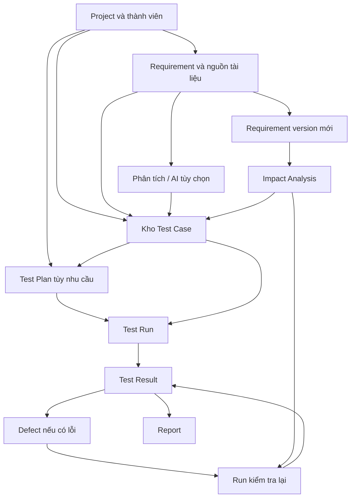

# VERIQ — KIỂM TOÁN VÀ TÁI THIẾT KẾ NGHIỆP VỤ TOÀN HỆ THỐNG

**Tài liệu giao việc cho AI lập trình (Codex/AI coding agent)**  
**Ngày:** 25/11/2026 — bản mở rộng V3: kiểm toán vi mô, liên nghiệp vụ và nghiệm thu toàn hệ thống  
**Repository:** https://github.com/MinTruqday/Veriq  
**Baseline tham chiếu:** `main`, commit `09a8e5385b897c06046dbd471ada9fc4efd505d6` (764 commit).  
**Mục tiêu:** biến Veriq thành sản phẩm quản lý kiểm thử có giá trị sử dụng, không phải hệ thống biểu mẫu mô phỏng toàn bộ giáo trình kiểm thử.

> Đây là prompt triển khai và hồ sơ phân tích ban đầu. Các tên trường, điều kiện backend và đường dẫn được ghi nhận từ baseline; đề xuất thay đổi là giả thuyết thiết kế cần kiểm chứng. Chưa chạy ứng dụng, chưa khảo sát người dùng hoặc có nội dung nhận xét chi tiết của giảng viên. Không coi mọi nhận định dưới đây là lỗi đã được xác nhận. Không coi mọi schema/API tồn tại là chức năng đang xuất hiện trên UI.

## 0. Vai trò, quyền hạn và cách làm việc

Bạn là Senior Business Analyst, Product Owner, Test Lead, UX Researcher và Software Architect. Nhiệm vụ là phân tích, phản biện rồi sửa Veriq trực tiếp trên workspace hiện tại. Không chỉ vẽ UI, không chỉ đề xuất lý thuyết, không chỉ đổi tên trường. Phải sửa logic nghiệp vụ thực sự, nhưng không phá hệ thống để chạy theo một thiết kế mới thiếu bằng chứng.

- Kiểm tra `git status`, branch, HEAD, cấu trúc và các thay đổi local. Nếu HEAD khác baseline, lấy source mới nhất trong workspace làm sự thật; ghi rõ khác biệt. Không reset, không ghi đè thay đổi của chủ dự án, không tự commit/push.
- Đọc toàn bộ source liên quan theo lớp: UI → service client → route/API → schema → authorization → service → repository → persistence → event/worker → report/AI → test. Tìm cả call site, dead code và route alias. Không chỉ đọc README hoặc tài liệu lịch sử.
- Không cố chứng minh thiết kế cũ đúng. Không tự bổ sung tác nhân, nghiệp vụ, quy tắc, ngoại lệ không tồn tại rồi báo là hiện trạng. Không xóa chức năng chỉ vì ít dùng trong một ví dụ.
- Không thêm microservice, database, AI framework, mode phức tạp hoặc dependency mới nếu code hiện tại giải quyết được. Không viết lại kiến trúc, không đổi stack, không mở rộng phạm vi khóa luận một cách vô ích.
- Được chủ động thực hiện các sửa đổi có thể kiểm chứng, theo thứ tự ưu tiên dưới đây; không dừng lại hỏi người dùng về từng chi tiết UI. Với quyết định khó đảo ngược, mất dữ liệu, thay đổi chính sách an ninh hoặc chưa đủ căn cứ, chọn giải pháp bảo toàn dữ liệu, ghi ADR và đánh dấu cần quyết định; tiếp tục phần còn lại.
- Không chạy migration phá hủy, không truy cập production, không dùng dữ liệu thật, không lộ token/secret. Không tắt kiểm tra quyền, isolation, audit, revision, provenance để làm demo chạy được.
- Tạo fixture riêng `DEMO_` hoặc `TEST_`; dùng môi trường local/DEV được phép. Mọi số liệu đánh giá phải từ lần chạy thật, không tự tạo PASS hay ảnh chứng minh giả.

## 1. Định vị lại bài toán và phạm vi sản phẩm

### 1.1 Đối tượng và công việc thực tế

Giả thuyết sản phẩm: nhóm phát triển/kiểm thử nhỏ và vừa, có tài liệu nghiệp vụ và nhiều lần thay đổi yêu cầu, muốn giảm thời gian thiết kế kiểm thử và tránh bỏ sót ca hồi quy. Đây là phạm vi đề xuất cho khóa luận, không phải kết luận đã khảo sát thị trường. Kiểm chứng với quy trình hiện tại, demo với ít nhất nhóm một QA và nhóm có QA lead/BA/Dev.

| Người sử dụng (persona, không phải role ID bắt buộc) | Công việc chính | Kết quả cần đạt |
|---|---|---|
| Quản trị nền tảng | Quản lý tài khoản, chính sách nền tảng | Người dùng có thể làm việc an toàn |
| Người quản lý dự án / QA lead | Xác định phạm vi, phân công, theo dõi chất lượng | Biết cần làm gì, ai phụ trách, có đủ điều kiện kết thúc không |
| BA / người phụ trách nghiệp vụ | Nhập, làm rõ và cập nhật yêu cầu | Requirement có nội dung và căn cứ rõ |
| QA / người thiết kế | Đọc yêu cầu, thiết kế và bảo trì ca | Ca kiểm thử dùng được, có phạm vi rõ |
| Tester / người thực thi | Chạy ca, ghi kết quả và lỗi | Không nhập lại nội dung đã có |
| Developer / người sửa lỗi | Tái hiện lỗi, cập nhật xử lý | Biết lỗi nào cần sửa và có bằng chứng |
| Người xem / người quyết định chất lượng | Xem tiến độ, kết quả, rủi ro | Ra quyết định dựa trên dữ liệu thật |

Một người có thể làm nhiều công việc. Role/capability là cơ chế phân quyền, persona là vai trò công việc; không đồng nhất hai khái niệm. Không bắt mọi dự án có đủ các persona.

### 1.2 Ba giá trị trọng tâm

1. Từ nguồn yêu cầu đến ca kiểm thử: đọc/trích xuất → xác nhận → sinh/thiết kế ca có căn cứ → rà soát nhanh.
2. Tổ chức và thực thi: kho ca dùng lại → chọn ca chạy → ghi kết quả → báo lỗi → báo cáo tự tổng hợp.
3. Khi yêu cầu đổi: xác định khác biệt → truy vết ảnh hưởng → đề xuất cập nhật và chạy lại có lý do → giữ lịch sử cũ.

Đây là trọng tâm cần chứng minh, không khẳng định khác biệt độc quyền so với sản phẩm thương mại. AI sinh ca không còn là tính năng hiếm. Giá trị khóa luận phải được đo bằng chất lượng, độ bao phủ, công sức giảm và khả năng truy vết khi thay đổi.

### 1.3 Nguyên tắc nghiệp vụ

- ISTQB mô tả hoạt động, không bắt buộc một chuỗi màn hình hoặc một chuỗi phê duyệt cứng. Planning, analysis, design, implementation, execution, completion có thể lặp và song song.
- Người dùng nhập thông tin một lần ở nơi sở hữu dữ liệu. Các nơi khác chọn tham chiếu hoặc nhận mặc định có thể ghi đè hợp lệ.
- Tách thực thể dùng lại (Requirement, Test Case, Test Suite) khỏi lần thực hiện (Test Run, Result). Tách định nghĩa ca khỏi kết quả của lần chạy.
- Bản nháp có thể chưa đầy đủ; điều kiện sẵn sàng chỉ kiểm tra tại đúng thời điểm sử dụng. Không ép người dùng đi qua mọi module.
- Quản lý linh hoạt không có nghĩa bỏ kiểm soát. Với dự án yêu cầu review độc lập, vẫn phải enforce ở server. Không giả người duyệt hoặc hạ quyền âm thầm.
- Sử dụng AI là tùy chọn. Thủ công phải chạy được khi AI lỗi/hết quota/chưa cấu hình.

## 2. Bằng chứng từ baseline và các vấn đề cần xử lý

Ký hiệu: **V** = đã nhìn thấy trong source/schema; **H** = giả thuyết bất cập cần kiểm tra bằng UI, runtime hoặc người dùng; **D** = đề xuất đích, chưa triển khai.

| ID | Bằng chứng V | Rủi ro H / hành động D | Ưu tiên |
|---|---|---|---|
| B01 | `test_case_lifecycle.py:201–234`: approve yêu cầu IN_REVIEW, independent review, steps, trace tùy settings, lint blocking | Nhóm một QA có thể bị kẹt. Kiểm tra khả năng cấu hình review; thiết kế chính sách nhẹ/nghiêm, không bypass tùy tiện | P0 |
| B02 | `test_plan.py:350–367`: nếu không save_as_draft, kiểm tra completeness; thông báo yêu cầu mục tiêu và ít nhất một requirement version | Plan có thể thiếu tài liệu yêu cầu nội bộ nhưng vẫn cần smoke/regression. Tách lưu nháp, kế hoạch sẵn sàng và phạm vi thực thi | P0 |
| B03 | `test_run.py:177–242`: `test_plan_id` tùy chọn; nếu có plan thì kiểm tra APPROVED, snapshot và phạm vi; nếu không có plan vẫn lấy case/suite | Không được nói backend ép mọi run phải có plan. Kiểm tra frontend có cung cấp đường chạy trực tiếp và context hợp lệ không | P0 |
| B04 | `test_case_records.py:481–551`: AI case yêu cầu liên kết và bằng chứng nguồn; các điều kiện kiểm tra version hiện hành | Giữ grounding cho AI, không áp dụng cứng yêu cầu bằng chứng AI lên case thủ công không có nguồn nội bộ | P0 |
| B05 | `TestCaseDraftCreate`: nhiều nhóm field về flow, step, BDD, taxonomy, trace, evidence, version | Rủi ro nhập trùng Use Case/Scenario/Case. Tách trường thực thi và metadata | P1 |
| B06 | `TestPlanCreate`, `TestRunCreate`, `TestPeriodCreate`, `ReleaseCreate`, `BuildCreate` cùng chứa scope hoặc lịch/context | Xác định chủ sở hữu dữ liệu, loại bỏ yêu cầu tạo nhiều thực thể chỉ để chạy một ca | P1 |
| B07 | `UserBase` có KYC/creator/donation/social/pinned/bookmarks/... | Có dấu hiệu legacy từ DocLib. Không kết luận còn dùng trên UI; kiểm tra reference, schema response và DB trước khi ẩn/ngừng dùng | P1 |
| B08 | `navigation.js` hiện có Test Analysis và Test Case; Test Scenario API vẫn có; legacy suite/template/import links có điều kiện | Kiểm tra route có người dùng thật, không phục hồi màn hình đã chủ động loại bỏ | P1 |
| B09 | `ProjectProgressPatch` cho phép `project_completion_percent` và note | Phần trăm dự án nhập tay có thể bị nhầm với tiến độ thực thi tự tính. Định nghĩa hai chỉ số tách biệt | P1 |
| B10 | Có service diff, impact, maintenance, regression và UI RequirementImpactPanel | Cần test thực tế độ chính xác và điều hướng; không tự nhận AI vượt sản phẩm thương mại | P1 |

File tham chiếu đều dưới `backend/testing/src/modules/` đối với B01–B04. Đọc hàm đầy đủ thay vì chỉ dựa vào vài dòng kiểm tra trên.

## 3. Luồng đích và quan hệ dữ liệu

Không tạo ba chế độ UI riêng nếu cấu hình và thao tác hiện có đủ dùng. Thiết kế một hệ thống có các đường đi linh hoạt:

### 3.1 Ba tình huống sử dụng phải chạy được

- **Kiểm thử nhanh:** tạo ca thủ công → đưa vào run trực tiếp → PASS/FAIL/BLOCKED theo enum thật → tạo/link lỗi nếu cần → xem kết quả. Không bắt tạo Requirement, Plan, Scenario, Dataset, Release, Build hoặc Period nếu không có quy định thật bắt buộc. Context chạy cần đủ thông tin tối thiểu và phân biệt được lần chạy.
- **Dự án thông thường:** nhập/tạo yêu cầu → làm rõ và xác nhận nguồn → Plan nháp có thể lập sớm → thiết kế case song song → chọn phạm vi case/version → review nếu policy yêu cầu → run → report.
- **Thay đổi yêu cầu:** chọn hai version → xác định thay đổi theo AC/BR/nội dung → phân tích ảnh hưởng → người dùng duyệt đề xuất cập nhật/giữ nguyên/ngừng hiệu lực → tạo version mới khi cần → chọn tập ca hồi quy → run mới → báo cáo. Không ghi đè lịch sử hoặc tự copy PASS/FAIL.

### 3.2 Quan hệ cần xác minh và hướng chuẩn hóa

| Thực thể | Vai trò | Quy tắc đích |
|---|---|---|
| Document / source version | Nguồn bằng chứng | Một nguồn dùng cho nhiều requirement; giữ version/hash, quyền truy cập |
| Requirement / version | Hành vi/ràng buộc sản phẩm | Version đã xác nhận bất biến; draft chỉnh được |
| AC / BR | Tiêu chí xác nhận và quy tắc nghiệp vụ | Có ID ổn định hoặc mapping rõ giữa version; không gộp hai loại thành một |
| Test Condition | Điểm cần kiểm tra/coverage obligation | Tùy nhu cầu, có thể phát sinh từ AC/BR; không tạo thủ công lại cùng nội dung |
| Scenario | Tình huống nghiệp vụ khái quát | Không bắt buộc có cho mọi case; chỉ giữ nếu có giá trị tổ chức hoặc thiết kế |
| Test Case / version | Định nghĩa cách kiểm thử | Có thể liên kết nhiều requirement/AC; một case dùng nhiều lần |
| Test Suite/Set | Nhóm ca dùng lại | Không sở hữu result; không ép mỗi case thuộc một suite duy nhất nếu mô hình hiện tại cho phép nhiều |
| Test Plan | Phạm vi, mục tiêu, nguồn lực, cách đánh giá | Có thể tham chiếu nhiều case/suite và nhiều run; khóa phạm vi tại mốc phù hợp |
| Test Period | Khoảng thời gian/cycle công việc | Chỉ dùng khi cần tổ chức nhiều plan/run theo đợt |
| Release / Build / Environment | Phiên bản sản phẩm, bản dựng cụ thể, nơi chạy | Không đồng nhất ba khái niệm; chọn/tái sử dụng context có sẵn |
| Test Run / execution / result | Phạm vi và lần chạy thực tế | Snapshot case version, context và người chạy; bảo toàn attempt cũ |
| Defect | Vấn đề cần xử lý | Có thể phát sinh từ result hoặc độc lập; liên kết khi có bằng chứng |
| Report | Góc nhìn tổng hợp | Tính từ dữ liệu nguồn; snapshot nếu xuất bản chính thức |

Đây là mô hình đích để đối chiếu, không tự nhận cardinality trên đã được implement. AI phải lập ERD hiện trạng và ERD đích từ dữ liệu thật.

## 4. Kiểm toán từng trường dữ liệu — yêu cầu bắt buộc

Lập bảng inventory **cho tất cả form đang dùng, schema Create/Patch/Transition, trường DB quan trọng và response**, kể cả trường lồng nhau. Các bảng dưới đây là định hướng ban đầu, không thay thế inventory đầy đủ.

Mỗi dòng inventory phải có: module, entity, field path, tên UI, kiểu dữ liệu, default, validator, required ở schema, required ở service theo trạng thái, required ở UI, nguồn giá trị, ai nhập, nơi đọc/ghi, ảnh hưởng downstream, đề xuất, bằng chứng file:dòng, migration/test. Nếu frontend không dùng ghi `API_ONLY`, nếu chưa rõ ghi `UNVERIFIED`.

Phân loại đích: **CORE** (cần để thực hiện công việc); **OPTIONAL** (chỉ khi có ích); **CONDITIONAL** (cần theo policy/context/trạng thái); **DERIVED** (hệ thống tự tính/điền); **TECH** (metadata nội bộ, không nhập tay); **DEPRECATE_CANDIDATE** (chỉ ngừng sau khi tìm hết dependency). Required của schema không đồng nghĩa bắt buộc người dùng gõ vào form. Không xóa field vì form dài.

## 4.0.1. Kiểm toán vi mô nghiệp vụ — bắt buộc trước khi quyết định sửa trường

Chủ dự án lưu ý: chỉ riêng cột **Người phụ trách** của Test Plan đã có nhiều vấn đề cần phân tích. Vì vậy không được coi inventory tên trường hoặc việc phân loại CORE/OPTIONAL là đã hoàn thành phân tích nghiệp vụ. Phải đi đến ngữ nghĩa, quyết định, ràng buộc, các biến cố trong vòng đời và hệ quả liên module của **từng trường**, từng nút, từng hành động, từng trạng thái, từng cột báo cáo. Không suy ra lỗi chỉ vì chưa tìm thấy nơi dùng trong một tệp. Một điểm không rõ là câu hỏi cần xác minh, không phải bug đã chứng minh.

### A. Mẫu bắt buộc cho mỗi trường và quan hệ

Mỗi trường có một mã ổn định (ví dụ `PLAN.owner_id`). Dùng inventory liên kết tới hồ sơ chi tiết; trường đơn giản có thể ghi gọn, trường ảnh hưởng nhiều nghiệp vụ phải có hồ sơ riêng. Không điền hàng loạt N/A mà không nêu lý do.

| Chiều phân tích | Câu hỏi phải trả lời |
|---|---|
| Giá trị công việc | Ai cần trường này? Họ dùng nó để thực hiện hành động/quyết định gì? Bỏ trường thì tác vụ nào không còn làm được? |
| Ngữ nghĩa | Định nghĩa một câu, đơn vị, phạm vi, ví dụ thật và phản ví dụ; phân biệt với trường gần nghĩa. |
| Chủ sở hữu dữ liệu | Entity nào là nguồn sự thật? Lưu trực tiếp, tham chiếu, snapshot hay tính từ nguồn khác? |
| Định danh và cardinality | Một hay nhiều, duy nhất trong scope nào, null/empty có nghĩa gì? Có trùng dữ liệu không? |
| Tạo mới | Nguồn giá trị, default, ai nhập/chọn, có thể lưu nháp khi thiếu không, kiểm tra khi nào? |
| Điều kiện hợp lệ | Kiểu, enum, range, format, ngữ nghĩa, liên hệ chéo trường, quan hệ cùng project, trạng thái và quyền đối tượng được tham chiếu. |
| Phân quyền | Ai xem/tạo/đổi/xóa giá trị? Capability và assignment có tác dụng gì? Phải kiểm tra server, không chỉ UI. |
| Vòng đời | Trường có thể đổi ở trạng thái nào? Khi nào khóa? Có cần lý do, duyệt lại, phiên bản mới hay chỉ audit metadata? |
| Biến cố bên ngoài | Thành viên rời dự án, tài khoản bị khóa/xóa, role bị đổi, artifact nguồn đổi phiên bản/lưu trữ, thời hạn qua đi: tác động gì? |
| Quan hệ và ưu tiên | Phụ thuộc hoặc mâu thuẫn với trường nào? Có kế thừa/override không? Nguồn nào thắng khi giá trị khác nhau? |
| Hành vi downstream | UI, danh sách công việc, tìm kiếm, lọc, thông báo, phân công, AI, index, report, export/import, audit; kiểm kê consumer thật. |
| Xử lý thất bại | Không có dữ liệu, không có người đủ điều kiện, bị từ chối quyền, stale revision, lỗi service, retry, hai thao tác đồng thời. |
| Lịch sử và migration | Dữ liệu cũ, null cũ, bản ghi tham chiếu mất hiệu lực, báo cáo lịch sử, backfill, rollback; không làm sai lệch lịch sử. |
| Kiểm chứng | Source file:line, ca chạy thật nếu có; phân biệt VERIFIED_CODE / VERIFIED_RUNTIME / HYPOTHESIS / UNVERIFIED. |
| Quyết định | KEEP / MERGE / DERIVE / OPTIONAL / CONDITIONAL / HIDE_TECH / DEPRECATE; lý do và trade-off, danh sách file cần sửa, tiêu chí nghiệm thu. |

Bắt buộc lập thêm danh mục ACTION (mỗi nút/API: người thực hiện, precondition, transition, side effect, lỗi, undo/retry); danh mục RULE (mỗi quy tắc có trigger, phạm vi, condition, consequence, invariant và test); danh mục RELATION (cardinality, nguồn sự thật, archive/delete, snapshot, cascade/restrict, truy vết); danh mục METRIC (định nghĩa, mẫu số, nguồn dữ liệu, version/time scope). Truy từ UI xuống API và ngược lại, rà cả route alias, background jobs và consumer không có giao diện. Đối chiếu form Create/Edit/Detail/List/Import/Export để tránh cùng một trường có nhiều định nghĩa khác nhau.

### B. Hồ sơ mẫu bắt buộc: PLAN.owner_id (Người phụ trách kế hoạch)

**Hiện trạng đã đọc ở baseline `09a8e538`:**

- `backend/testing/src/schemas/contracts/planning.py`: `TestPlanCreate.owner_id` là `str | None`, mặc định `None`.
- `frontend/features/testing/components/TestPlanEditor.jsx:544–566`: trường ở nhóm Nhân sự và thời gian tùy chọn; có option rỗng; lọc thành viên `ACTIVE` hoặc người đang được chọn. Cần kiểm tra trường hợp chủ cũ không còn active có còn lưu được khi sửa nội dung khác.
- `backend/testing/src/modules/execution/services/test_plan.py:230–264`: effort allocation và owner được kiểm tra riêng; `validate_plan_links` kiểm tra owner có membership ACTIVE khi owner khác null. Riêng hàm này không kiểm tra capability công việc của owner. Chưa kết luận các lớp khác không có kiểm tra bổ sung.
- Cùng tệp: khoảng dòng 348 (create), 570–573 (patch) có gọi kiểm tra liên kết; khoảng 496–500 kiểm tra trạng thái khi update, 619–682 xử lý review/approve và completeness. Có nhánh `can_auto_approve_project_content`; phải truy hàm và policy thật, không mặc định mọi dự án bắt buộc hai người.
- `frontend/features/testing/pages/workspace/ExecutionPage.jsx:912–913, 1691–1697`: lọc theo owner và render tên, fallback Chưa phân công. Chưa xác minh đầy đủ mọi consumer khác.

**Phải trả lời và quyết định tối thiểu các câu hỏi sau (không coi là lỗi đã chứng minh):**

1. Owner là người chịu trách nhiệm điều phối plan, người lập plan, người thực thi hay chỉ người liên hệ? Ai cần cột này và dùng để làm gì? Nếu không có hành vi nào ngoài lưu tên/lọc thì có thực sự cần không?
2. Tách rõ `created_by`, `owner_id`, người gửi rà soát, người duyệt, project owner/lead, `members`, `estimation.effort_allocations[].user_id`, assignee từng Test Run/Test Case và risk owner. Có thể trùng người nhưng không mặc nhiên trùng trách nhiệm; truy schema, service và policy thật để xác nhận từng trường.
3. Một plan có một owner hay nhiều? Có cần phân biệt accountable với contributors? Không thêm multi-owner chỉ để tăng tính năng. Một người được gán nhiều plan có hợp lệ không?
4. Ai có quyền chọn, tự nhận, đổi, bỏ gán? Owner có tự được cấp `testplan.update`, `testplan.approve`, quyền thực thi hoặc quyền xem nguồn riêng tư không? Đề xuất mặc định: assignment không tự nâng quyền; capability vẫn độc lập.
5. Ai đủ điều kiện làm owner? Chỉ active membership, hay cần thêm capability/trách nhiệm cụ thể? Kiểm tra cả account bị disable, project suspended, membership nhiều role, người không thuộc project. Không hard-code QA/BA nếu hệ thống dùng role động.
6. Có bắt buộc tại create draft, submit review, approve, start run hay không? Chọn null có ý nghĩa gì? Default người tạo chỉ khi phù hợp, không âm thầm gán sai; có cơ chế chọn người khác. Khi không có ai đủ điều kiện, đường xử lý nghiệp vụ nào hợp lý?
7. Có thể đổi khi DRAFT, READY, IN_REVIEW, APPROVED, ARCHIVED không? Đổi trách nhiệm điều phối có làm thay đổi baseline phạm vi không? Phân biệt metadata điều phối với nội dung plan đã duyệt; không tự sửa snapshot cũ. Kiểm tra có cần API chuyển giao riêng và audit hay không; ưu tiên giải pháp nhỏ nhất.
8. Người phụ trách rời dự án, bị vô hiệu hóa hoặc mất quyền: giữ tham chiếu lịch sử, đánh dấu cần chuyển giao hay bỏ gán? Ai được chuyển? Các plan đang thực thi có bị kẹt? Không tự động gán ngẫu nhiên hoặc xóa lịch sử.
9. Nếu gán owner A nhưng members không có A, effort allocation có B và run được giao C: có hợp lệ không? Định nghĩa rõ ba tầng trách nhiệm; tránh tự động lan truyền owner sang mọi case/run nếu không có chủ đích.
10. Khi gửi review, owner có phải reviewer không? Kiểm tra độc lập dựa trên tác giả/người sửa revision và policy thực tế, không chỉ so owner_id. Chuyển owner không được trở thành đường bypass self-review.
11. Khi được gán/chuyển giao, có thông báo, danh sách việc cần làm, quyền truy cập, deadline, escalation nào thực sự hữu ích? Tìm consumer đang có; nếu thiếu và giá trị chưa rõ, không tự xây workflow mới.
12. Lọc 'của tôi', 'chưa phân công', 'người không còn hoạt động', thống kê theo owner có phản ánh đúng trách nhiệm không? Tên lịch sử có mất khi membership rời dự án không? Không đồng nhất chưa tìm thấy tên với chưa phân công.
13. Hai người cùng đổi owner, hoặc thành viên bị vô hiệu hóa sau validation nhưng trước write: kiểm tra revision, atomicity và cách phục hồi. Không cho assignment cross-project.
14. Migration: plan cũ null hoặc có owner không còn hợp lệ; chuyển dữ liệu thế nào, có giữ snapshot tên hay identity lịch sử, có yêu cầu cleanup thủ công không? Không backfill người tạo nếu không có căn cứ trách nhiệm.

**Giả thuyết TO-BE để kiểm chứng:** nếu owner có công dụng rõ, định nghĩa là đầu mối chịu trách nhiệm điều phối kế hoạch, không phải người chạy tất cả ca hoặc reviewer mặc định. Có thể để trống ở draft; việc bắt buộc ở mốc cam kết phải dựa vào policy và nhu cầu thực tế. Người đủ quyền được chuyển giao theo cơ chế an toàn, không phá baseline. Nếu phân tích chứng minh chỉ cần người tạo hoặc project lead, xem xét bỏ trường qua migration thay vì giữ vô điều kiện. Không triển khai giả thuyết này trước khi xác minh các dependency.

**Nghiệm thu riêng cho owner (expected phải xuất phát từ policy đã chốt):**

| ID | Tình huống phải kiểm tra |
|---|---|
| OWN-01 | Tạo draft không có owner; mở lại, lọc và hiển thị đúng. |
| OWN-02 | Chọn thành viên hợp lệ; phân biệt owner với creator, members, run assignee. |
| OWN-03 | Gán user khác project, inactive, không đủ điều kiện; gọi API trực tiếp để xác minh. |
| OWN-04 | Người không có quyền đổi owner; kiểm tra UI và backend. |
| OWN-05 | Chuyển owner trước/sau khi duyệt; kiểm tra revision, snapshot, audit và công việc đang chạy. |
| OWN-06 | Owner rời dự án, khóa tài khoản, đổi role; chuyển giao và xem lịch sử. |
| OWN-07 | Cùng lúc cập nhật owner hoặc membership; không silent overwrite, không tạo liên kết sai. |
| OWN-08 | Owner trùng người tạo/người duyệt/người chạy; không mở rộng quyền trái policy. |
| OWN-09 | Lọc theo owner, null, owner cũ; báo cáo/export không biến owner thành người thực thi. |
| OWN-10 | Import/migration record cũ, rollback; bảo toàn trace và kết quả lịch sử. |

### C. Áp dụng cùng độ sâu cho toàn dự án, không chỉ owner

| Nhóm điểm giao nghiệp vụ | Các trường/quan hệ phải đào sâu tương đương |
|---|---|
| Account ↔ Project ↔ Role | Tài khoản active, verified, membership ACTIVE, project role, capability, owner/lead, user removal, quyền nhiều role, assignment, transfer và platform admin. |
| Document ↔ Requirement ↔ Version | Source authority, approval status, effective date, source ref, visibility, AI consent, trùng lặp, AC/BR, version hiện hành và baseline; thay nguồn không tự thay nghĩa yêu cầu. |
| Requirement ↔ Condition ↔ Scenario ↔ Case | Priority/risk/category/type, coverage_item, technique, objective, precondition/flow/step, trace; xác định đâu là dữ liệu độc lập, đâu là kế thừa, đâu là duplication; không bắt nhập một nội dung ở nhiều nơi. |
| Plan ↔ Period ↔ Suite ↔ Run | Scope, case version, plan snapshot, period, carry-over, test level/type, member/effort, schedule, entry/exit, risk, approval; plan có cần trước mọi run, suite có phải điều kiện chạy, bổ sung scope thế nào. |
| Release ↔ Build ↔ Environment | Phân biệt mã phát hành, mã build, version, commit, môi trường; nguồn mặc định và override; kết quả cũ phải gắn context cũ. |
| Case ↔ Run ↔ Result ↔ Defect | Definition owner vs executor vs defect assignee; status step/case/run, retry/rerun/retest, skipped/not applicable, actual vs expected, bằng chứng và defect lifecycle. |
| Change ↔ AI ↔ Regression | Version diff, source freshness, affected vs uncertain, proposal acceptance, provenance, duplicate, ca cũ và ca mới, phạm vi hồi quy, lịch sử execution. |
| Report ↔ Dashboard ↔ Audit | Mẫu số progress/pass/coverage, draft và archived, latest attempt, thời gian, filter, attribution, dữ liệu derived; không tính từ số bản ghi thô khi không đúng nghĩa. |

Mỗi nhóm phải kiểm tra các tình huống giao nhau: dữ liệu thiếu/trùng, thay đổi sau duyệt, người khác thực hiện, thiếu quyền, mất nguồn, đối tượng inactive/archive, thao tác hàng loạt, cập nhật đồng thời, nhập dữ liệu ngoài hệ thống, retry và lịch sử. Chỉ sinh tổ hợp kiểm thử khả thi dựa trên quy tắc; dùng phân lớp tương đương, bảng quyết định, chuyển trạng thái và pairwise/risk-based khi phù hợp, không tạo tích Descartes vô nghĩa.

### D. Kiểm soát độ bao phủ của chính cuộc kiểm toán

- Bổ sung `03A_FIELD_BUSINESS_RULES.csv` (field_id, dimension, observed_rule, trigger, actor, condition, outcome, source, evidence_level, issue_id, decision_id, test_id, status), `03B_ACTIONS_AND_TRANSITIONS.csv`, `03C_RELATIONSHIPS.csv` và `03D_OWNERSHIP_MATRIX.md`; liên kết sang `03_FIELD_INVENTORY.csv` và backlog hiện có.
- Tổng hợp số module/entity/field path/action/rule/relation phát hiện từ source; số đã kiểm toán, số chưa xác minh, số issue xác nhận, số giả thuyết, số đã sửa và có test. Đếm theo ID ổn định, không đếm trùng do alias hoặc nhiều UI cùng dùng một trường. Không tự ước lượng số lỗi hoặc tuyên bố 100% nếu còn thiếu.
- Với field liên quan quyền, trạng thái, ownership, số liệu, liên kết nguồn hoặc lịch sử, phải hoàn tất hồ sơ chuyên sâu như mẫu owner trước khi quyết định thay đổi. Các field kỹ thuật đơn giản có thể ghi gọn theo template nếu chứng minh đủ.
- Bắt đầu từ lát dọc Plan.owner_id để kiểm chứng phương pháp, sau đó mở rộng tới tất cả module. Hoàn tất inventory tổng thể và xác định các phụ thuộc P0 trước khi sửa nhiều module cùng lúc; sửa theo lát dọc có kiểm thử, không cần dừng toàn bộ vì một giả thuyết chưa giải được.
- Một issue chỉ được gọi là bug khi có rule mục tiêu có căn cứ và evidence vi phạm (static chắc chắn hoặc tái hiện). Mâu thuẫn thiết kế, thiếu định nghĩa, đề xuất cải tiến và lỗi triển khai là các loại riêng. Không tự viết use case ngoại lệ không tồn tại rồi báo là hiện trạng.
- Không giảm phạm vi phân tích vì số lượng lớn. Nếu giới hạn context, lưu tiến độ theo module, đánh dấu chưa hoàn thành, đọc tiếp từ hồ sơ đã lưu; không tuyên bố hoàn thành thay cho công việc thực tế.

### 4.1 Tài khoản và quản trị nền tảng

Nguồn: `backend/authentication/src/schemas/identity.py`, `platform.py`; API session/platform/platform_controls; frontend AccountPage, PlatformUsersPanel, PlatformControlsPanel.

| Field hiện có | Đề xuất nghiệp vụ |
|---|---|
| `email`, `full_name` | CORE; định danh và tên hiển thị. Chuẩn hóa, kiểm tra trùng, xác thực email theo flow hiện có |
| `slug` | DERIVED nếu chỉ là handle nội bộ; nếu còn URL/unique identity thì cho sửa có kiểm tra, không xóa |
| `password`, `current_password`, `new_password`, `password_hash` | CONDITIONAL/TECH; chỉ dùng trong auth, không trả hash. Giữ chính sách hiện tại, không giảm an toàn |
| `system_role`, `permissions`, `is_active`, `is_verified` | Quản trị theo quyền; không cho tự sửa role/quyền thông qua update profile |
| `locale`, `timezone`, `settings`, `avatar_url` | OPTIONAL; lấy mặc định hợp lý; không bắt cấu hình khi mời người dùng |
| `tos_accepted_at`, `agreed_to_terms`, `created_at`, `updated_at`, `last_password_change`, `last_read_date` | TECH hoặc ghi nhận hệ thống; giữ audit/đồng ý |
| `bio`, `social_links`, `pinned_documents`, `bookmarks`, `donation_link`, `kyc_status`, `creator_status`, `is_shadowbanned`, `is_kyc_verified`, `last_bank_update`, `blocked_users`, `welcome_message` | DEPRECATE_CANDIDATE; kiểm tra toàn bộ call site, DB, quyền cloud/content; không mặc định đây là tính năng còn hiện UI; tách legacy khỏi product nếu không dùng |
| `storage_limit` | CONDITIONAL/TECH; quản trị quota nếu cloud còn phụ thuộc |
| `reason`, `confirmation` | CONDITIONAL cho thao tác nhạy cảm: khóa/xóa/đổi quyền; không yêu cầu lý do cho mọi cập nhật hồ sơ thông thường nếu policy không cần |

Kiểm tra schema kế thừa `UserCreate(UserBase)` và response để tránh nhận trường đặc quyền từ client. Không kết luận mass assignment tồn tại khi chưa đọc service. Kiểm tra mời người dùng, kích hoạt, reset, vô hiệu hóa, xóa/anonymize có bảo toàn lịch sử và owner transfer.

### 4.2 Project, thành viên, phân quyền

Nguồn: `schemas/contracts/project.py`, `schemas/project_access.py`, `modules/projects/services/{project,effective_access,project_responsibilities,project_progress}.py`.

| Field | Đề xuất |
|---|---|
| `key`, `name` | CORE; key tự gợi ý, cho sửa trước khi tạo; unique theo phạm vi thật |
| `project_type` | OPTIONAL hoặc default; chỉ bắt buộc nếu ảnh hưởng template/policy thực sự |
| `description` | OPTIONAL |
| `project_owner_user_id`, `project_lead_user_id` | Phân biệt chủ sở hữu với người điều phối; cho mặc định theo người tạo nếu được quyền; chuyển giao có audit |
| `locale`, `timezone` | DERIVED từ người tạo/nền tảng, sửa được; tránh buộc nhập lại |
| `planned_start_at`, `planned_end_at` | OPTIONAL; kiểm tra thứ tự, không tự quyết tiến độ từ lịch |
| `settings` | TECH/ADVANCED; form cấu hình theo nhóm nghiệp vụ, không để người dùng sửa JSON tùy ý |
| `project_completion_percent`, `note` | Nếu giữ thì ghi rõ đây là tiến độ quản lý khai báo; không trộn với run completion. Note cần khi điều chỉnh có ảnh hưởng báo cáo |
| `user_id`, `project_role`, `project_roles`, `status` | Chọn thành viên/role từ danh sách; xác định quy tắc nguồn chuẩn giữa role đơn và đa role, ngăn xung đột; không nhập ID bằng tay |
| `capabilities`, `role_grants`, `setting_grants`, `read_only`, `responsibility`, `effect`, `enabled`, `schema_version`, `revision` | Cấu hình nâng cao/TECH; chuẩn hóa policy và hiển thị quyền hiệu lực. Không yêu cầu quản lý tự tick hàng trăm quyền để bắt đầu dự án |
| `expected_revision`, archive `reason` | TECH và CONDITIONAL; giữ optimistic concurrency và audit |

Đề xuất preset role theo công việc (quản lý, BA, QA, tester, dev, viewer) nếu phù hợp schema hiện tại; cho phép tùy chỉnh, không hard-code role ID trong service/UI. Kiểm tra least privilege, scope từng project, nhiều role, quyền bị revoke, tài khoản inactive, owner cuối cùng, quyền platform không mặc nhiên là quyền nghiệp vụ. Nếu muốn policy phê duyệt nhẹ/nghiêm, kiểm tra cấu hình hiện có và tái sử dụng, mặc định bảo toàn chính sách dự án cũ.

### 4.3 Tài liệu nguồn và Requirement

Nguồn: `schemas/contracts/requirements.py`, `schemas/document_source.py`, `modules/requirements/services/*`, RequirementCreateModal, RequirementImportModal, RequirementsPage, DocumentReaderPage, KnowledgePage.

| Field / nhóm trường hiện có | Đề xuất |
|---|---|
| `requirement_key`, `title`, `content_doc` | CORE khi sẵn sàng; mã tự sinh nhưng cho nhập nếu nhập từ hệ thống ngoài. Bản nháp có thể chưa hoàn chỉnh |
| `type`, `priority` | Phân loại có ý nghĩa; mặc định unassessed nếu chưa đánh giá; không AI tự gán chắc chắn |
| `acceptance_criteria[].key`, `content_doc`, `status`, `source_span` | AC là điều kiện có thể kiểm chứng; ID/key và source span tự sinh/giữ ổn định; không tự tạo tiêu chí thiếu căn cứ |
| `business_rules` | Quy tắc nghiệp vụ; có thể áp dụng nhiều AC/requirement. Không ép mỗi requirement có BR nếu không có. Xác minh cấu trúc dict/validator thật |
| `dependencies`, `source_refs`, `tags`, `owner_id` | OPTIONAL/CONDITIONAL; chọn từ danh sách, liên kết source tự động khi import; owner mặc định phù hợp |
| `details`, `section_states`, `custom_values` | Tách trường đặc thù loại requirement khỏi form chung; kiểm tra nơi sử dụng trước khi gộp hoặc ẩn |
| `save_as_draft`, `expected_revision`, `expected_current_version_id` | TECH; tự gửi theo context; giữ kiểm soát concurrent edit |
| `change_reason`, `review_note`, `review_reason_code`, `reason` | Yêu cầu đúng mốc thay đổi baseline/từ chối; không ép ghi lý do cho mọi lần lưu nháp |
| `filename`, `format`, `content`, `source_type`, `visibility`, `shared_with`, `ai_enabled`, `ocr_language`, `supersedes_document_id` | Upload tối thiểu tệp và quyền truy cập phù hợp; detect format; AI consent tách biệt, không mở mặc định trái chính sách; OCR nâng cao nếu cần |
| `duplicate_confirmed`, `duplicate_confirmed_document_ids`, `selected_indexes`, `separate_indexes`, `separate_reasons`, `accept_incomplete` | Nội bộ luồng preview/duplicate; gom quyết định cho cả lô, chỉ hỏi khi xung đột thật và người dùng có quyền đọc nguồn |
| `authority`, `approval_status`, `approved_by`, `approved_at`, `source_version`, `effective_from`, `external_source_id` | Thông tin nguồn đã phê duyệt ở bên ngoài. Không tự xác nhận nội bộ hoặc giả người duyệt; phân biệt khai báo và đã kiểm chứng |
| `module`, `component`, `product_area`, `release_id`, `owner_id`, `tags` | Metadata tùy nhu cầu; ưu tiên tái sử dụng taxonomy từ dự án, tránh ba cách phân nhóm tương đương |
| `source_hash`, parser/version, block/page/bbox, warnings, extraction status, table/image metadata | TECH/DERIVED, hiển thị cảnh báo và citation khi cần; không yêu cầu người dùng nhập |
| Template: `name`, `description`, `product_types`, `context` (objectives, scope, stakeholders, glossary, assumptions, constraints), `requirements`, `source_document_ids`, `source_template_ids` | Tính năng nâng cao; kiểm tra route còn được dùng. Không ép dùng template mới tạo requirement |

Luồng đích: upload nguồn → parse/read → người dùng xem và chọn trích xuất → preview Requirement/AC/BR → chỉnh sửa/xác nhận → lưu draft → publish/review theo policy. Giữ trạng thái parse, index, extraction, review độc lập. Tải thành công không đồng nghĩa đọc đủ hoặc AI đã sinh yêu cầu. Nếu nguồn đã được duyệt bên ngoài, hỗ trợ ghi provenance/acceptance phù hợp policy, không yêu cầu lặp mọi bước nếu không cần. Không tự merge, split hoặc discard nguồn khi phát hiện tương đồng; kiểm tra isolation trước khi hiển thị match cross-project.

### 4.4 Test Analysis và Test Condition

Nguồn: `schemas/test_analysis.py`, `modules/design/services/test_analysis*.py`, `TestAnalysisPage.jsx`, `TestConditionEditor.jsx`.

| Field | Đề xuất |
|---|---|
| `condition_key`, `title`, `description_doc`, `coverage_item` | Mã tự sinh; title mô tả điểm kiểm tra; kiểm tra trùng title/coverage_item/description, không bắt sao chép AC nguyên văn |
| `basis_refs` | CONDITIONAL khi condition có căn cứ; gắn tự động từ requirement/AC/BR được chọn, không nhập ID |
| `category`, `test_level`, `test_type`, `risk`, `priority`, `technique_candidates` | Dùng defaults/OPTIONAL theo ngữ cảnh; phân biệt risk và priority; chỉ chọn kỹ thuật khi có giá trị thiết kế |
| `testability_status`, `analysis_findings` | Ghi nhận điểm không thể kiểm thử hoặc mâu thuẫn; không mặc định đã kiểm thử được chỉ vì chưa có finding |
| `origin`, `ai_result_id`, `expected_revision`, `idempotency_key`, `source_event_id`, `source_event_revision` | TECH |
| Finding `artifact_type`, `artifact_id`, `artifact_version_id`, `category`, `severity`, `title`, `description`, `source_span`, `suggestion`, `owner_id` | Nguồn tự gắn; chỉ nhập tiêu đề/nội dung và phân công khi có phát hiện thật |
| `resolution`, `resolution_ref`, `note`, status | Dùng khi giải quyết/xác minh; cho phép chọn artifact liên quan thay vì nhập mã thủ công |

Không ép người dùng tạo Test Condition cho mỗi AC rồi tạo Scenario rồi tạo Case chỉ để được chạy. Nếu cần phân tích sâu, mở từ Requirement hoặc Case; cho tạo hàng loạt từ kết quả AI, xem phần thiếu phủ. Kiểm tra xem route và màn hình hiện tại có thực sự tạo thêm giá trị; nếu không, giữ backend nếu có dependency nhưng đưa chức năng vào ngữ cảnh phù hợp.

### 4.5 Test Scenario

Nguồn: `schemas/contracts/design.py: ScenarioCreate/ScenarioPatch`, `test_scenario.py`, `ScenarioCreateModal.jsx`, `ScenariosPanel.jsx`.

- CORE nếu giữ: `scenario_key` tự sinh, `title`, mô tả ngắn hoặc `objective`/`expected_outcome` đủ diễn đạt mục đích tình huống. Không bắt lặp mô tả tại nhiều trường.
- OPTIONAL: `category`, `risk`, `priority`, `description`, `actors`, `preconditions`, `business_flow`, `test_data_notes`, `test_level`, `test_kind`, `owner_id`, `tags`. Schema hiện có một số trường required (risk/priority/category); kiểm tra lý do và thay default an toàn nếu không cần.
- Liên kết `requirement_version_ids`, `acceptance_criterion_ids`, `test_condition_ids` tự điền theo context; `status`, `origin`, revision do hệ thống quản lý.
- Nếu scenario chỉ là bản sao requirement/case, không tạo một vòng review bắt buộc riêng. Giữ khả năng nhóm tình huống nếu cần; không xóa API và dữ liệu khi chưa rà dependency. Kiểm tra chức năng UI còn được đưa ra hay đã ẩn.

### 4.6 Test Case — ưu tiên cao nhất về trường dữ liệu

Nguồn: `TestCaseDraftCreate`, `TestCaseDraftPatch`, `TestStep`, `BddScenario`; `test_case_records.py`, `test_case_lifecycle.py`, `test_case_review.py`; `TestCaseCreateForm.jsx`, `TestDesignPage.jsx`.

| Field hiện có | Phân loại đích / xử lý |
|---|---|
| `test_case_key` | CORE hiển thị; hệ thống sinh, tùy chỉnh nếu cần |
| `title` | CORE khi tạo nháp |
| `objective_doc` | OPTIONAL; mô tả mục tiêu, không cần lặp title |
| `module_name` | OPTIONAL; chọn nhóm/module có sẵn hoặc nhập nếu cần, không tạo thêm một hệ taxonomy riêng |
| `type`, `test_level`, `test_kind`, `techniques` | OPTIONAL/CONDITIONAL; phân biệt functional/nonfunctional, level, technique; kiểm tra enum thật, tránh nhiều trường cùng ý nghĩa |
| `priority` | OPTIONAL có default unassessed hoặc giá trị trung lập theo policy; không tạo severity cho test case chỉ vì defect có severity |
| `duration_minutes` | OPTIONAL dùng cho ước lượng; không ép đoán thời gian mọi ca |
| `preconditions_doc`, `postconditions_doc` | OPTIONAL; chỉ điền điều kiện thực sự; không tự thêm cho đủ form |
| `steps[].id`, `steps[].order` | TECH; stable ID, sắp thứ tự tự động |
| `steps[].action_doc`, `steps[].expected_doc` | CORE khi sẵn sàng chạy case dạng step; lưu draft có thể chưa đủ; kiểm tra BDD tương đương nếu hỗ trợ |
| `steps[].test_data` | OPTIONAL theo từng bước; có thể tham chiếu dataset, không nhập lại toàn bộ dataset |
| `main_flow_doc`, `alternate_flows_doc`, `exception_flows_doc` | DEPRECATE_CANDIDATE/OPTIONAL; thường thuộc đặc tả Use Case hơn là một Test Case. Nếu cùng nội dung steps thì bỏ khỏi form mặc định, migrate không mất nội dung. Không tự sinh ngoại lệ không tồn tại |
| `bdd.feature`, `bdd.scenario`, `bdd.steps[].keyword/text/id` | CONDITIONAL khi chọn BDD. Không yêu cầu đồng thời gõ lại toàn bộ steps và BDD; xác định representation chính và cơ chế chuyển đổi rõ |
| `owner_id` | OPTIONAL; người bảo trì định nghĩa ca, không đồng nhất người thực thi run |
| `tags`, `attachments`, `data_set_version_ids` | OPTIONAL; chọn/tái sử dụng tài sản hiện có |
| `requirement_version_ids`, `acceptance_criterion_ids`, `coverage_item_ids`, `test_condition_ids`, `scenario_id` | CONDITIONAL; chọn requirement trước, hiện AC/condition thuộc nguồn tương ứng. Case thủ công độc lập có thể chạy nếu policy cho phép; báo coverage là chưa liên kết, không giả trace |
| `automation_status` | OPTIONAL/DERIVED theo artifact thực; kiểm tra alias kiểu `AIRunStatus` trong schema hiện có, không coi tên type là bug nếu enum hợp lệ |
| `origin`, `source_evidence`, `acceptance_criteria_snapshot_ids`, `evidence_refs`, `evidence_quotes`, `suite_signature` | TECH hoặc hiển thị read-only trong review AI; không bắt gõ tay; giữ nguồn và audit |
| `duplicate_reason`, `target_version_id`, `version_reason`, `expected_revision`, `save_as_draft` | CONDITIONAL/TECH; chỉ yêu cầu quyết định khi duplicate/update/version thực sự; tự điền metadata |
| `comparison_token`, `operation_id`, merge choices, batch acceptance | TECH; giữ optimistic locking và idempotency; UI chỉ hiện nội dung khác biệt cần quyết định |

**Form nhanh đích:** tên/mã, các bước và expected result (khi sẵn sàng), priority, liên kết nguồn khi cần. Mô tả, dữ liệu, tiền/hậu điều kiện và nâng cao có thể mở theo nhu cầu. Cho lưu nháp nhanh; không biến tất cả field thành bắt buộc. Đừng bắt người dùng chọn 5 kỹ thuật kiểm thử chỉ để tạo 1 case.

**Vòng đời:** draft → ready/approved theo policy → sử dụng trong run → thay đổi qua version → archive/obsolete. Tên trạng thái trên là đề xuất khái niệm, map vào enum hiện tại thay vì thêm status tùy tiện. Nếu bắt buộc review độc lập, thiếu reviewer thì hiện lý do và cách phân công. Không dùng AI để đóng vai reviewer. Nếu policy nhẹ cho phép người có quyền xác nhận case thủ công của mình, ghi audit đúng người và loại xác nhận; chính sách cũ không tự đổi.

### 4.7 Dataset, Test Suite, template, integration

| Field hiện có | Đề xuất |
|---|---|
| Dataset `name`, `variables` | CORE khi tạo bộ dữ liệu dùng lại; một ca đơn giản dùng test_data ở bước không cần dataset |
| `secret_refs` | TECH/CONDITIONAL; chỉ tham chiếu, không lưu plaintext trong case/report/AI |
| `generation_source`, `source_requirement_version_ids`, version fields | TECH/provenance, kiểm tra nguồn AI và bảo toàn version |
| Test Suite `name`, `suite_type`, `test_case_version_ids` | Tên và chọn ca là trọng tâm; loại có default nếu hợp lệ; kiểm tra cần nhóm theo current case hay pin version, không sửa snapshot run cũ |
| Template / API Artifact / Automation Script / JUnit | Đọc schema `test_case_template.py`, `contracts/automation.py`, API integrations. Inventory toàn bộ field, phân loại theo nhiệm vụ thật; ẩn khỏi flow manual nếu không cần |

Không buộc tạo dataset/suite/template/automation artifact mới được tạo ca. JUnit import phải kiểm tra mapping, chống nhập trùng và không ghi vào run khác project; báo cáo phải phân biệt manual và automation nếu thật sự có dữ liệu.

### 4.8 Test Plan — ưu tiên P0/P1

Nguồn: `schemas/contracts/planning.py`, `execution.py: TestPlanPatch`, `modules/execution/services/test_plan.py`, `TestPlanEditor.jsx`.

| Field hiện có | Đề xuất nghiệp vụ |
|---|---|
| `name`, `objective` | CORE; tên và mục tiêu ngắn, không yêu cầu viết một tài liệu dài |
| `project_id` | TECH từ route, không nhập lại |
| `requirement_version_ids` | CONDITIONAL nếu plan theo yêu cầu; hỗ trợ plan regression/smoke theo phạm vi ca nếu không có requirement nội bộ và policy cho phép |
| `scenario_ids`, `test_suite_ids`, `test_case_version_ids` | Phạm vi có thể xác định từ các nguồn khác nhau; không yêu cầu chọn cả ba; deduplicate, cho preview phạm vi thực sự |
| `scope_out` | OPTIONAL; chỉ nhập phần loại trừ có ý nghĩa |
| `owner_id`, `members` | Owner chịu trách nhiệm kế hoạch; members là người dự kiến tham gia. Không nhập lại team dự án hoặc đồng nhất assignee lúc chạy |
| `environment_id` | OPTIONAL ở plan nháp; lấy mặc định của project hoặc chọn tại run; không yêu cầu cấu hình lại |
| `entry_criteria`, `exit_criteria` | CONDITIONAL; dùng preset phù hợp, cho sửa. Tiêu chí có thể đo thì tính tự động; tiêu chí định tính yêu cầu xác nhận của người phụ trách. Không hard-code ngưỡng thiếu căn cứ |
| `test_types`, `test_techniques`, `test_level` | OPTIONAL; chỉ ghi chiến lược áp dụng thực sự, không tick đủ mọi loại kiểm thử để đạt completeness |
| `assumptions`, `constraints`, `dependencies` | OPTIONAL; gộp khu vực ghi chú nâng cao, không nhập lại nội dung requirement/project; kiểm tra consumers trước khi hợp nhất storage |
| `schedule.planned_start_at`, `schedule.planned_end_at` | OPTIONAL, kế thừa khoảng chu kỳ nếu có, phân biệt kế hoạch và thực tế |
| `estimation.method`, `planned_effort_hours`, `basis`, `effort_allocations[].user_id/planned_hours` | OPTIONAL; tính từ phân bổ khi có, không yêu cầu nhập cả tổng và từng người nếu tổng có thể suy ra; ghi rõ ước lượng và thời gian thực tế |
| `risk_register[].category`, `risk_id`, `title`, `description`, `probability`, `impact`, `exposure`, `response`, `owner_id`, `status`, `due_at` | Chỉ dùng khi có rủi ro; ID tự sinh, xác định scale xác suất/tác động trước khi tính exposure; không bắt điền số tùy ý; exposure DERIVED nếu dùng công thức thống nhất |
| `communication_plan.channel`, `status_report_frequency`, `recipients`, `escalation_roles` | OPTIONAL hoặc kế thừa cấu hình project; chỉ override nếu khác |
| `test_period_id`, `new_test_period`, `carry_over_items` (source_run/plan, case version, reason) | CONDITIONAL; chu kỳ và chuyển tiếp chỉ dùng khi có nhu cầu. Không yêu cầu tạo chu kỳ mới cho mỗi plan; không mang kết quả cũ thành kết quả mới |
| `save_as_draft`, `expected_revision`, suite snapshot fields | TECH; tự lưu context, giữ baseline và chống race |

**Form nhanh đích:** tên, mục tiêu, phạm vi, người phụ trách, thời gian dự kiến nếu cần. Các khu vực tiêu chí chất lượng, chiến lược, rủi ro, ước lượng và truyền thông là phần mở rộng theo policy. Plan nháp được phép chưa có ca; tại mốc sẵn sàng chạy, kiểm tra tập ca đã chọn hoặc để run trực tiếp nếu không dùng plan. Không hạ điều kiện của plan đã phê duyệt khi chưa có migration/policy rõ. Nếu cần bổ sung ca sau khi plan phê duyệt, tạo revision hoặc cơ chế bổ sung scope có audit; không sửa snapshot lịch sử.

### 4.9 Test Period, Release, Build, Environment

Nguồn: `schemas/contracts/test_period.py`, `environment.py`, `modules/execution/services/{test_period,execution_context}.py` và UI liên quan.

| Thực thể và field hiện có | Đề xuất |
|---|---|
| Period: `project_id`, `name`, `objective`, `planned_start_date`, `planned_end_date`, `source_period_id` | Chỉ tạo khi muốn nhóm công việc theo đợt; tên là chính, objective và lịch tùy nhu cầu; không đồng nhất sprint với release |
| Period close: `note`, `carry_over_items`, `expected_revision` | Chỉ chọn ca còn việc thật theo quy tắc hiện hành; ghi rõ kế hoạch/run nguồn, không sao chép kết quả |
| Release: `key`, `name`, `version`, `notes`, `planned_start_at`, `planned_end_at`, `scope_in`, `scope_out` | Quản lý phát hành khi nhóm cần; kiểm tra trùng tên/key/version. Scope tham chiếu requirement/plan nếu phù hợp, không bắt mô tả lại |
| Build: `identifier`, `version`, `release_id`, `commit_ref`, `notes`, `idempotency_key` | Định danh bản dựng cụ thể. Có thể chọn build đã tồn tại; không yêu cầu nhập cả identifier/version trùng nhau nếu quy trình chỉ có một mã build, nhưng giữ ý nghĩa riêng khi cần |
| Environment: `name`, `base_url`, `availability` | Tạo preset DEV/QA/STAGING nếu phù hợp; URL tùy nhu cầu; không cho thực thi tích hợp vào endpoint trái quyền, không tự giả build hoặc release |
| Các transition/revision fields | TECH và conditional; chỉ thao tác bởi người có quyền |

Xác định nguồn chuẩn cho release/build ID và các string `release`, `build` đang song song trong run/defect. Giữ fallback legacy nếu cần và migration đối chiếu; không để ID và label tham chiếu hai bản khác nhau. Nếu run nhanh không có build thì hiển thị rõ chưa ghi nhận, không tự chế build. Run chính thức có thể yêu cầu context đầy đủ theo policy.

### 4.10 Test Run, Test Execution, Test Result

Nguồn: `schemas/contracts/execution.py`, `modules/execution/services/test_run*.py`, `execution_state.py`, `ExecutionPage.jsx`, `RunExecutionWorkspace.jsx`.

| Field | Đề xuất |
|---|---|
| Run `name` | CORE; tự gợi ý tên theo phạm vi/ngày, sửa được |
| `project_id` | TECH từ context |
| `test_plan_id` | OPTIONAL đã được hỗ trợ ở backend; nếu có, enforce approved snapshot và phạm vi |
| `test_suite_ids`, `test_case_version_ids` | Chọn tập ca/suite, hiển thị số ca duy nhất; chỉ lấy version hợp lệ, pin tại thời điểm xác định |
| `environment_id`, `release`, `release_id`, `build`, `build_id` | Chọn/tái sử dụng context; kiểm tra ID-label, project và availability. Không bắt nhập lại thông tin đã có từ plan |
| `expected_test_plan_snapshot_hash`, `idempotency_key`, `expected_revision` | TECH; giữ an toàn concurrent/retry |
| Assignment `assignee_id`, `test_case_assignments` | Phân công chung và override từng ca; người chạy có quyền, không đồng nhất owner test case |
| Rerun `failed_only`, `test_case_version_ids` | Chọn ca cần chạy lại; tạo run/attempt mới và liên kết nguồn; không thay lịch sử |
| Result `status`, `step_results`, `actual_result_doc`, `attachments`, `note` | CORE là status thật; actual/evidence theo policy và tình huống, không gõ lại expected result; BLOCKED hoặc không áp dụng cần lý do nếu policy yêu cầu |
| Step result `step_id`, `status`, `actual_doc`, `attachments`, `note` | Gắn đúng step version; có thể ghi nhanh kết quả toàn ca khi hợp lệ, vẫn bảo toàn kết quả chi tiết khi dùng |
| Correction `status`, `reason` | Chỉ hiệu chỉnh có quyền và lý do; lưu lịch sử và audit |

Kiểm tra điều kiện begin/finish/cancel, cập nhật result sau hoàn tất, nhiều người chạy cùng ca, retry request, rerun khi version đã đổi, context bị archive giữa chừng, run không có case, blocked/not applicable. Không biến trạng thái case (draft/approved/obsolete) thành trạng thái execution (pass/fail). Khi FAIL, cung cấp nút tạo/link defect với thông tin tự điền. Không mặc định mọi FAIL là defect sản phẩm: có thể do dữ liệu/môi trường, ghi phân loại đúng thực tế.

### 4.11 Defect, retest và truy vết

Nguồn: `schemas/contracts/defects.py`, `modules/quality/services/defect*.py`, `DefectsPage.jsx`.

| Field | Đề xuất |
|---|---|
| `defect_key`, `title` | ID tự sinh, title CORE |
| `description_doc`, `steps_to_reproduce`, `actual_result_doc`, `expected_result_doc` | CORE theo mức độ đủ tái hiện; tự điền từ test result/case khi tạo từ run; cho sửa bản ghi lỗi mà không sửa case gốc |
| `severity`, `priority` | Hai ý nghĩa riêng: tác động và thứ tự xử lý. Có giá trị chưa đánh giá nếu được policy cho phép; không tự suy ra severity từ priority của test case |
| `environment_id`, `release/release_id`, `build/build_id` | Kế thừa từ run, cho bổ sung khi tạo độc lập; không yêu cầu nhập lại |
| `assignee`, `attachments` | Phân công theo thành viên hoạt động; evidence gắn từ run hoặc upload mới |
| `linked_test_result_id`, `linked_test_case_version_id`, `linked_requirement_version_ids` | Tự gắn từ result; hỗ trợ bug độc lập và bổ sung link khi biết nguồn; không buộc trace giả |
| Transition `to_status`, `reason`, `expected_revision` | Dùng workflow thật; quy định ai được chuyển trạng thái và lý do ở mốc cần thiết |
| Retest `test_result_id`, `note`, `idempotency_key` | Gắn result mới, không sửa PASS/FAIL cũ; kiểm tra version/build và quyền retest |
| Trace suggestion `ai_result_id`, `accepted_candidate_ids`, source event fields | TECH; AI chỉ đề xuất link có căn cứ, người có quyền xác nhận |

Phải kiểm tra workflow trạng thái đang có rồi mới đề xuất rút gọn. Khái niệm đích: mở → phân công/xử lý → chờ kiểm tra lại → đóng hoặc mở lại; các nhánh rejected/duplicate/deferred chỉ giữ nếu có căn cứ. Không tự thêm enum này vào DB. Kiểm tra lỗi bị đóng không retest, developer tự xác nhận khi policy yêu cầu độc lập, nhiều result cùng lỗi, lỗi trùng, lỗi bị reopen, phân công người đã rời dự án.

### 4.12 Report, dashboard, chỉ số chất lượng

Nguồn: `modules/quality/services/analytics.py`, `traceability.py`, `modules/execution/services/{test_plan_progress,report_document}.py`, `modules/projects/services/project_progress.py`, API reports, `DashboardPage.jsx`, `ReportsPage.jsx`, `SimpleTestReports.jsx`.

Không tự khẳng định công thức hiện tại. AI phải truy vết từng chỉ số đến dữ liệu, filter, trạng thái và denominator rồi ghi vào `METRIC_DICTIONARY.md`.

| Chỉ số đích | Định nghĩa đề xuất cần thống nhất |
|---|---|
| Run completion | Số execution có trạng thái kết thúc hợp lệ / số execution trong scope snapshot; quy định rõ blocked/skipped/not applicable |
| Pass rate | PASS / số kết quả đánh giá hợp lệ (ví dụ PASS + FAIL); báo riêng blocked/skipped. Chốt mẫu số theo mục đích, không đổi âm thầm |
| Requirement design coverage | Số requirement version trong scope có case link hợp lệ / tổng requirement version thuộc scope |
| AC coverage | Số AC trong scope có liên kết xác minh hợp lệ / số AC thuộc scope; không tính link stale, không suy ra đã chạy từ link thiết kế |
| Execution coverage | Số mục phạm vi có kết quả thực thi hợp lệ / tổng mục phạm vi; tách khỏi design coverage |
| Open defects | Đếm defect duy nhất theo trạng thái mở thực tế và scope; không đếm số lần FAIL thành số bug |
| Plan vs actual | Đối chiếu phạm vi/lịch/effort kế hoạch với thực tế đo được; không lấy phần trăm dự án nhập tay thay số liệu |
| Impact status | Số case version bị ảnh hưởng, cần review, đã cập nhật, chưa kiểm thử lại theo đúng phiên bản nguồn |

Nếu mẫu số bằng 0, hiển thị chưa có dữ liệu hoặc N/A, không tự cho 100%. Chọn quy tắc latest attempt hay mọi attempt theo chỉ số, luôn mô tả scope, thời điểm, version. Không tính archived/stale version là mới nhất. Khi export báo cáo cần bảo toàn snapshot và filter; report nháp có thể cập nhật tự động, report chính thức giữ lịch sử và người xác nhận. Không AI tự chế chỉ số hoặc quyết định phát hành.

Dashboard đích chỉ cần: việc của tôi, tiến độ thực thi, lỗi cần xử lý, yêu cầu thay đổi cần rà soát, kết quả gần nhất. Mọi số phải drill-down tới tập bản ghi đúng. Không thêm biểu đồ để trang trí hay trùng số liệu.

### 4.13 AI, RAG, phân tích phiên bản

Nguồn: `backend/ai/src/agents/runner/ai_run_graph.py`, `services/{ingestion,chunking,retrieval,inference}.py`, `store/vector.py`, `prompts/`, `tools/`, Testing `modules/quality/services/{requirement_version_diff,impact_analysis,impact_ai,maintenance_proposal,regression_recommendation}.py`, `RequirementImpactPanel.jsx`, `AIRunPanel.jsx`.

- Lập inventory từng AI capability: ai được chạy, điểm bấm, input, nguồn, output schema, validation, trạng thái job, khả năng retry/cancel, cost/token, kết quả có ghi DB không và ai xác nhận. Không dựng lại agent chỉ vì graph dài.
- Hợp nhất entry point theo tác vụ: trích xuất yêu cầu ở tài liệu; sinh ca ở requirement/case; phân tích thay đổi ở lịch sử version; hỗ trợ defect ở result. Không tạo một trang AI trung tâm bắt người dùng tự chọn pipeline kỹ thuật nếu không cần.
- Giữ nguyên quyền đọc nguồn, AI consent, provenance, tenant filter, prompt injection defenses, snapshot hash và kiểm tra trích dẫn. Không đưa secret/PII không cần thiết vào prompt.
- Đối với import: không tự sinh AC/BR/ngoại lệ không có bằng chứng. Nếu AI suy luận, đánh dấu đề xuất cần xác nhận, tách nội dung trích nguyên văn khỏi nội dung diễn giải.
- Đối với sinh ca: ưu tiên nguồn đã được xác nhận; hiển thị đề xuất theo AC/BR/coverage gap, tránh duplicate; review theo nhóm, chọn giữ/sửa/bỏ; không tự phê duyệt. Hỗ trợ người dùng không dùng AI.
- Đối với impact: đầu vào old/new requirement version, diff có cấu trúc, link case version và AC/BR. Tách direct trace với semantic candidate. Không dùng similarity score làm bằng chứng chắc chắn. Đánh dấu thiếu link/nguồn là bất định, không kết luận không ảnh hưởng chỉ vì không tìm thấy.
- Phân loại impact theo enum có thật (schema hiện thấy `STILL_VALID`, `POTENTIALLY_AFFECTED`, `NEEDS_UPDATE`, `OBSOLETE` trong ImpactOverrideItem). Mỗi đề xuất có lý do, nguồn, phạm vi, confidence nếu được hiệu chuẩn; người dùng override có audit. Không tự đổi case baseline hoặc kết quả cũ.
- Tạo bản cập nhật version từ proposal được xác nhận, giữ lịch sử. Regression selection dựa trên ảnh hưởng đã xác định và rủi ro; không tự chạy hoặc báo PASS nếu chưa thực thi. Nếu thiếu trace, đưa ra hướng bổ sung và không tuyên bố coverage đủ.
- Xử lý provider timeout, quota, job failed, incomplete parse, retry, trùng request, stale generation, đổi source trong lúc AI chạy. UI phải chỉ rõ đang ở bước gì và làm gì tiếp theo; không hiện stack trace cho người dùng.

**Ví dụ nghiệm thu** (dữ liệu giả lập): Requirement R1 v1 quy định hủy đơn trong 24 giờ, v2 đổi thành 12 giờ. Có case tại 11h, 12h, 13h, 24h và 25h. Định nghĩa rõ inclusive/exclusive và thời điểm bắt đầu tính theo tài liệu fixture; không tự giả định. AI phải chỉ ra case cần đổi expected, case vẫn đúng, case biên cần review, case không liên quan không bị đưa vào một cách tùy tiện. Người dùng tạo version mới và run lại; kết quả v1 vẫn truy xuất được.

### 4.14 Các module khác cần rà soát

Không bỏ qua notification, collaboration, comments, audit, attachments, cloud/content/version, operations, integration, settings, template, system controls chỉ vì không phải nghiệp vụ trọng tâm. Inventory tất cả form/field thực sự sử dụng. Với notification (events, channels, roles, digest, quiet hours, timezone, escalation) cung cấp preset, tùy chọn nâng cao và chống gửi trùng. Với audit, thông tin actor/time/action/scope là TECH, không cho sửa lịch sử. Với review comments, gắn anchor/artifact/version tự động; tránh ép người dùng nhập ID hoặc tạo comment để vượt gate. Với jobs, phân biệt trạng thái xử lý nền và trạng thái nghiệp vụ. Với upload/share, giữ quyền đọc/tải/AI riêng.

## 5. Quy tắc phân quyền và lifecycle cần phản biện

1. Lập ma trận persona → role ID hiện có → capability → scope → thao tác → trạng thái hợp lệ. Kiểm tra backend chứ không chỉ ẩn nút.
2. Cung cấp quyền mặc định có thể bắt đầu nhanh. Không tự cấp quyền approve cho mọi QA hay quyền dự án cho admin nền tảng.
3. Xem xét cấu hình review theo dự án hoặc loại artifact. Nếu cơ chế hiện có không hỗ trợ và cần bổ sung, dùng một policy nhỏ, rõ, có audit; mặc định dự án cũ giữ nguyên. Không nhân bản toàn bộ workflow thành ba bộ code khác nhau.
4. Chỉ chặn khi thật sự vi phạm invariant: thiếu quyền, sai project, version stale, thiếu dữ liệu để thực thi, dữ liệu không toàn vẹn hoặc quy định bắt buộc. Các cảnh báo chất lượng chưa nghiêm trọng nên là warning có hướng xử lý, nếu policy cho phép.
5. Lập bảng transition từ enum và service: trạng thái nguồn → action → quyền → điều kiện → side effect → trạng thái đích → lỗi. Kiểm tra yêu cầu độc lập, revision conflict, thay đổi quyền giữa lúc xử lý, archive/restore, rerun, idempotency và rollback.
6. Không xóa vật lý bản ghi có lịch sử execution/audit nếu làm gãy liên kết. Phân biệt xóa draft chưa dùng, archive, obsolete, vô hiệu hóa tài khoản. Nếu migrate field, giữ dữ liệu cũ, có mapping và rollback.

## 6. Backlog triển khai theo ưu tiên

| ID | Ưu tiên | Công việc / điều kiện hoàn thành |
|---|---|---|
| T00 | P0 | Chụp baseline: commit, route đang dùng, schema, test hiện có, chạy local nếu có cấu hình. Ghi blocker thật |
| T01 | P0 | Inventory toàn bộ field, trạng thái, dependency và quyền. Dựng AS-IS flow, ERD và danh sách vấn đề có evidence |
| T02 | P0 | Hoàn thiện đường kiểm thử nhanh thủ công; không yêu cầu thực thể không liên quan, giữ policy và lịch sử |
| T03 | P0 | Xử lý review/approval cứng theo chính sách dự án; thiếu reviewer có hướng xử lý; không bypass bảo mật |
| T04 | P0 | Requirement import và case AI/manual có thể dùng độc lập phù hợp; dữ liệu không trùng và source rõ |
| T05 | P1 | Rút gọn Test Case cả UI/schema/service; xử lý flow/BDD/taxonomy/trace và draft validation |
| T06 | P1 | Rút gọn Plan, period, release, build, environment; thống nhất ownership/default, chọn phạm vi dễ |
| T07 | P1 | Run/result/defect/retest end-to-end; tự điền context và bằng chứng; bảo toàn attempt |
| T08 | P1 | Impact analysis/version/regression có căn cứ và benchmark; kiểm tra stale/duplicate/thiếu trace |
| T09 | P1 | Định nghĩa chỉ số và sửa report/dashboard, drill-down chính xác |
| T10 | P1 | Giảm phức tạp cấu hình project/role; xử lý legacy tài khoản và field không dùng qua migration an toàn |
| T11 | P2 | Tinh chỉnh UI, accessibility, empty/error/loading state, điều hướng theo nhiệm vụ; không tạo màn hình mới vô ích |
| T12 | P0 liên tục | Regression, quyền, tenant isolation, data integrity, audit, migration, docs và chạy demo thực tế |

Triển khai theo lát dọc end-to-end, mỗi lát có test. Không đổi hàng loạt UI trước khi backend và model thống nhất. Nếu phát hiện vấn đề ngoài phạm vi, thêm backlog có evidence, không mở rộng dự án vô hạn.

## 7. Bộ nghiệm thu nghiệp vụ bắt buộc

Các case dưới đây là **test đích**, không phải kết quả đã chạy. Dùng role/capability, status và endpoint thật từ workspace. Bổ sung test case âm và biên khi thấy rule thực tế.

| ID | Tình huống | Kết quả mong đợi |
|---|---|---|
| U01 | Nhóm chỉ có một QA, policy nhẹ được cấp rõ | Tạo nháp, xác nhận theo quyền, chọn ca và chạy trực tiếp; không cần người duyệt giả |
| U02 | Dự án bắt review độc lập | Tác giả không tự duyệt; reviewer hợp lệ duyệt được; thiếu reviewer có thông báo và hướng xử lý |
| U03 | Case thủ công không có requirement | Nếu policy cho phép thì lưu và chạy; coverage báo chưa liên kết, không tạo trace giả |
| U04 | AI case thiếu căn cứ | Không công bố như case đã xác minh; hiện phần cần review hoặc chặn theo hợp đồng |
| U05 | Tạo plan nháp khi chưa có ca | Lưu được nếu hợp lệ; khi sử dụng chính thức kiểm tra phạm vi và điều kiện đúng mốc |
| U06 | Run không plan, chọn case trực tiếp | Thành công nếu quyền/context/policy hợp lệ |
| U07 | Run có plan nhưng chọn case ngoài snapshot | Bị từ chối rõ lý do; không ghi dữ liệu một phần |
| U08 | Chọn suite và case trùng | Không vô tình tạo execution trùng; nếu có chủ đích nhiều configuration thì phân biệt rõ |
| U09 | Fail một case và tạo defect | Tự điền steps/expected/actual/context/link; không nhập lại; lưu đúng actor |
| U10 | Developer sửa lỗi, tester retest | Tạo/link kết quả mới, giữ kết quả cũ, chuyển trạng thái đúng policy |
| U11 | Thay đổi requirement version | Có diff, impact và review proposal; không sửa baseline/result cũ |
| U12 | AI timeout hoặc hết quota | Có trạng thái lỗi/retry; manual path vẫn dùng được; không sinh dữ liệu trùng |
| U13 | Hai người sửa một bản nháp | Revision conflict rõ; không ghi đè âm thầm |
| U14 | User project A dùng ID của B | Không đọc/ghi/AI retrieve dữ liệu B; không rò metadata duplicate |
| U15 | Admin nền tảng không có quyền dự án | Không tự động thực hiện hành động nghiệp vụ trái quyền |
| U16 | Gỡ quyền khi AI/job đang chạy | Không cho publish/ghi dữ liệu trái quyền; xử lý theo hợp đồng job và audit |
| U17 | Archive case đã từng chạy | Run/report lịch sử vẫn đọc đúng version |
| U18 | Migration dữ liệu cũ có trường legacy | Nội dung và link còn nguyên; test rollback; không mất file/attachment |
| U19 | Báo cáo với mẫu số 0 và rerun | Không chia 0, không báo 100% giả; denominator và attempt rule rõ |
| U20 | Upload tài liệu lỗi, bảng/ảnh chưa đọc | Hiện cảnh báo, không coi trích xuất đầy đủ; có manual fallback |
| U21 | Revoke AI consent hoặc nguồn đổi version | Truy xuất và publish theo quyền/version hiện hành; proposal cũ đánh dấu stale |
| U22 | Tạo draft rồi bỏ qua phần nâng cao | Không lỗi validation vì field tùy chọn; bắt buộc đúng khi chuyển ready |
| U23 | Tạo plan/ca/run từ dữ liệu có sẵn | Không nhập lại owner/context/source/expected trừ khi chủ động override |
| U24 | Người dùng mới mở dashboard | Thấy việc cần làm và đi thẳng tới bản ghi; không phải tìm qua nhiều tab |
| U25 | API, UI, report, worker và AI dùng field đã sửa | Không mismatch schema; integration và regression pass hoặc ghi blocker rõ |

## 8. Đánh giá thiết thực và so sánh sản phẩm

Đừng đánh giá theo số lượng module hoặc số trường đã bỏ. Đo trước/sau trên cùng fixture, cùng người dùng hoặc điều kiện kiểm soát tương đương. Nếu chưa có người dùng thật, ghi rõ là walkthrough giả lập, không gọi là nghiên cứu UX đã hoàn tất.

- Thời gian, số click, số trường phải nhập tay, số lần nhập trùng để hoàn thành: tạo ca → chạy → báo lỗi; nhập yêu cầu → tạo ca; thay đổi requirement → chọn regression.
- Tỷ lệ hoàn thành nhiệm vụ không cần trợ giúp; lỗi thao tác, lý do bị chặn, thời gian chờ AI, số proposal phải sửa.
- AI: trên bộ requirement/version có ground truth do người có chuyên môn xác định, đo precision/recall của case bị ảnh hưởng, tỷ lệ trích dẫn hợp lệ, số thiếu/duplicate/unsupported cases, token/time/cost nếu có. Không chỉ dựa vào similarity hoặc AI tự chấm AI. Không tự đặt ngưỡng vượt trội khi chưa có baseline.
- So sánh manual, AI generation và AI impact theo cùng task; cho biết phần nào có lợi và phần nào chưa tốt. Sản phẩm thương mại có AI và workflow review; không tuyên bố Veriq là duy nhất.

### Nguồn tham khảo nghiệp vụ đã đối chiếu (25/11/2026)

- ISTQB CTFL v4.0.1, mục 1.4.1: https://tbok.istqb.org/search?q=FL-1.4.1 — các hoạt động có thể lặp/song song; chọn quy trình theo bối cảnh.
- Qase Test Runs: https://docs.qase.io/en/articles/5563702-test-runs — chọn case riêng, suite hoặc plan để chạy.
- Qase Test Cases: https://docs.qase.io/en/articles/5563704-test-cases — tạo nhanh trong repository.
- Qase AI Test Designer: https://docs.qase.io/en/articles/9653096-ai-test-designer — sinh case từ requirement và review kết quả; AI sinh ca không phải điểm khác biệt độc quyền.
- TestRail Adding test cases: https://support.testrail.com/hc/en-us/articles/14438119644692-Adding-test-cases — tạo case nhanh mà không cần nhập tất cả trường.
- TestRail API use cases: https://support.testrail.com/hc/en-us/articles/15758177606676-API-uses-cases-intro — case tái sử dụng qua run; plan tổ chức các run.
- TestRail Create new test plans: https://support.testrail.com/hc/en-us/articles/30765296499604-Create-new-test-plans — vai trò plan và cấu hình run.

Tham khảo cách giải quyết công việc, không sao chép UI hay áp đặt mô hình dữ liệu của họ. Không gọi bất kỳ lựa chọn thiết kế nào là bắt buộc theo ISTQB nếu tài liệu không quy định.

## 9. Deliverables AI phải tạo trong repository

Dùng thư mục `docs/business-redesign/` (hoặc thư mục tài liệu hiện tại nếu có quy ước tốt hơn, ghi rõ lý do). Không chỉ trả lời chat.

| File | Nội dung |
|---|---|
| `00_BASELINE.md` | Commit, phạm vi đọc, route đang sử dụng, test baseline, blocker |
| `01_AS_IS_BUSINESS.md` | Persona, use case, luồng thật, dependency, quy tắc và evidence path:line |
| `02_ISSUES_AND_DECISIONS.md` | Mỗi issue: observed/ hypothesis, ảnh hưởng, P0/P1/P2, phương án, quyết định và lý do |
| `03_FIELD_INVENTORY.csv` | Mỗi trường một dòng, đầy đủ các cột tại mục 4, có cả nested fields; không gộp field trong CSV |
| `04_TO_BE_BUSINESS.md` | Luồng mới, policy, state transitions, ma trận quyền, ERD, ownership, optionality, invariants |
| `05_FIELD_MIGRATION.md` | Mapping old/new, default, compatibility, migration, rollback, trường không dùng |
| `06_IMPLEMENTATION_BACKLOG.md` | Task theo lát dọc, source files, acceptance criteria, trạng thái thực tế |
| `07_METRIC_DICTIONARY.md` | Công thức, nguồn, scope, status, denominator, thời điểm, ví dụ và test |
| `08_ACCEPTANCE_AND_REGRESSION.md` | Test cases, lệnh đã chạy, kết quả thật, lỗi/blocked, evidence |
| `09_BENCHMARK_AND_USABILITY.md` | Bộ dữ liệu, quy trình đo, kết quả trước/sau, hạn chế |
| `10_FINAL_CHANGE_REPORT.md` | Những gì đã sửa, file thay đổi, migration, vấn đề còn lại, demo script |

Cập nhật tài liệu use case/kiến trúc đang dùng sau khi code và test xác nhận; không đưa tính năng TO-BE vào tài liệu AS-IS. Không tự đánh số UC theo suy đoán nếu đã có quy ước hiện tại.

## 10. Definition of Done

Một task chỉ được đánh dấu DONE khi có source sửa thực sự (nếu task yêu cầu), test và evidence phù hợp; không chỉ có đề xuất. Chạy các lệnh có thật trong repo (frontend format/lint/build, backend lint/test, Docker compose health nếu có môi trường và dependency). Không tạo lệnh giả. Kiểm tra cả đường thành công, lỗi quyền, validation, concurrency và regression liên quan. Nếu không chạy được do thiếu môi trường/API key, ghi rõ lệnh, lỗi, phần chưa xác minh và tiếp tục phần có thể kiểm tra. Không khẳng định toàn bộ dự án chạy tốt khi chỉ static review.

### Lệnh giao việc cuối cùng cho AI

Bắt đầu từ T00–T01, xác minh lại toàn bộ nghiệp vụ và trường hiện có. Sử dụng các phân tích trong tài liệu này như checklist phản biện, không coi chúng là sự thật bất biến. Tạo deliverables AS-IS/TO-BE và backlog, sau đó triển khai ưu tiên P0 và P1 theo từng lát dọc, cập nhật inventory khi quyết định thay đổi field. Không dừng ở việc tạo thêm một tài liệu. Tự kiểm tra lại code, chạy nghiệm thu, ghi lại những gì đã làm thật. Khi gặp blocker, chọn giải pháp an toàn và tiếp tục các phần khác; không bịa kết quả, không bỏ qua lỗi, không phá kiến trúc hay mất dữ liệu chỉ để luồng demo chạy.

Kết quả mong muốn: Veriq phục vụ công việc kiểm thử thực tế, giảm nhập liệu và thao tác dư thừa, cho phép quy trình linh hoạt, kiểm soát đúng quyền và dữ liệu, đồng thời có giá trị AI đo lường được khi yêu cầu thay đổi.

## 11. Phụ lục V3 — mở rộng phạm vi, không thay thế V1/V2

Toàn bộ yêu cầu trước đó vẫn có hiệu lực. Các mục sau bổ sung phương pháp phát hiện vấn đề chưa được nêu và giải quyết đến nguyên nhân gốc. Không giới hạn số vấn đề, số field, số test hoặc độ dài hồ sơ. Mọi ví dụ là câu hỏi kiểm toán hoặc tình huống nghiệm thu đề xuất, không phải kết luận về bug hiện tại. Không chỉ giải quyết những ví dụ được liệt kê. Phải tìm các trường, quy tắc, luồng và tính năng mới xuất hiện ở HEAD thực tế. Không biến checklist thành lý do để phát triển thêm hàng loạt tính năng không cần thiết.

### 11.1. Phân biệt bảy loại vấn đề trước khi sửa

| Loại | Cách xác định | Hành động |
|---|---|---|
| Sai triển khai | Có quy tắc đã xác nhận nhưng code/runtime vi phạm | Sửa, test tái hiện và regression |
| Mâu thuẫn nghiệp vụ | Hai quy tắc hợp lý riêng lẻ nhưng không thể cùng thỏa mãn trong tình huống hợp lệ | Xác định quy tắc ưu tiên và sửa cả chuỗi |
| Thiếu định nghĩa | Không biết ai chịu trách nhiệm, trạng thái có nghĩa gì, nguồn nào là chuẩn | Chốt định nghĩa có căn cứ trước khi sửa |
| Thiếu năng lực sử dụng | Người dùng không hoàn thành công việc hợp lệ | Xác định đường ngắn nhất từ dữ liệu hiện có, chỉ thêm nếu có giá trị |
| Dư thừa / ma sát | Nhập trùng, duyệt lại vô ích, bước trung gian không tạo giá trị | Đo chi phí, gộp hoặc tự động hóa an toàn |
| Sai mô hình dữ liệu | Trộn người thực hiện với người chịu trách nhiệm, definition với execution, snapshot với dữ liệu hiện tại | Chuẩn hóa ngữ nghĩa và migration |
| Rủi ro / giả thuyết | Có dấu hiệu nhưng chưa có đủ bằng chứng | Xác minh hoặc ghi UNVERIFIED, không gắn nhãn bug tùy tiện |

Tạo issue riêng nếu nguyên nhân hoặc quyết định sửa khác nhau. Nhiều biểu hiện từ cùng một nguyên nhân dùng một root-cause ID và liên kết các triệu chứng. Đánh giá severity theo thiệt hại nghiệp vụ (mất lịch sử, sai kết quả, không làm được việc, tốn thao tác), priority theo giá trị, rủi ro, phụ thuộc và chi phí; không lấy số lượng issue làm thước đo chất lượng.

### 11.2. Khám phá đầy đủ nghiệp vụ từ hai hướng

- Top-down: từ persona, mục tiêu, sự kiện kích hoạt, đầu vào, quyết định, kết quả, người nhận kết quả đến toàn bộ tác vụ phải làm. Tìm cả tình huống người dùng không dùng AI, không có tài liệu, đã có tài liệu ngoài, không có reviewer độc lập, nhiều dự án song song và bảo trì sản phẩm cũ.
- Bottom-up: quét thực thể DB, schema request/response, enum, route, policy, form, cột list, nút, menu, filter, sort, bulk, job, event, report/export, prompt, tool, template, cấu hình, test. Đối chiếu mọi thứ với tác vụ top-down. Tìm orphan feature (có code nhưng không phục vụ tác vụ), dead field (không consumer), missing bridge (hai module không kết nối đúng), duplicate concept (cùng nghĩa khác tên).
- Lập sơ đồ capability thực sự truy cập được theo role và dữ liệu. Một route được đăng ký không chứng minh người dùng nhìn thấy hoặc dùng được; một nút hiện không chứng minh backend cho phép; một trường trong schema không chứng minh người dùng phải nhập.
- Với code không truy cập được, dependency ngoài, job không chạy được, ghi blocker cùng tác động. Không đánh dấu hoàn thành do đọc tên file.

## 12. Kiểm toán ngữ nghĩa chuyên sâu các nhóm trường xuyên suốt

Các nhóm dưới đây bổ sung cho mẫu PLAN.owner_id. Mỗi field thực tế vẫn phải có hồ sơ riêng theo mục 4.0.1, không được đánh dấu đã kiểm toán chỉ vì thuộc một nhóm trong bảng.

| Nhóm | Câu hỏi và quyết định phải kiểm chứng | Bài kiểm tra đặc trưng |
|---|---|---|
| Mã nghiệp vụ (`key`, `*_key`, identifier) | Sinh ở server hay client; unique theo project hay hệ thống; mã do người dùng nhập/import có thể đổi không; khi clone/import xung đột xử lý thế nào; URL và liên kết dùng ID hay mã; không tái sử dụng mã làm sai lịch sử | Hai người tạo cùng lúc; trùng mã giữa project; import mã cũ; đổi mã nếu được phép; archive rồi tạo lại |
| Tên/tiêu đề/mô tả/mục tiêu | Tên để nhận diện, mô tả để hiểu, mục tiêu để xác định kết quả; nếu hai trường luôn giống nhau thì xem xét gộp; rich text có nội dung thực sự hay chỉ HTML rỗng; độ dài/locale/search | Chỉ khoảng trắng, rich text rỗng, trùng tên hợp lệ, nội dung dài, tìm kiếm tiếng Việt |
| User reference | Creator, owner, assignee, reviewer, approver, executor, reporter, resolver, risk owner là các trách nhiệm khác nhau; danh sách lựa chọn theo effective capability và phạm vi; điều kiện nhận/chuyển giao/bỏ gán; không tự tăng quyền | User mất role/disable/rời project; đổi người giữa chừng; lịch sử giữ tên đúng; hai người sửa cùng lúc |
| Priority / Severity / Risk | Priority là thứ tự ưu tiên của đối tượng cụ thể; severity là mức tác động lỗi; risk là khả năng và tác động bất lợi theo mô hình đã chọn; không coi các enum giống nhau là cùng ý nghĩa; kế thừa chỉ như gợi ý nếu đúng nghiệp vụ | Case ưu tiên cao nhưng bug severity thấp; risk chưa đánh giá; cập nhật priority không làm đổi kết quả lịch sử |
| Type / category / level / kind / technique | Tách phân loại mục tiêu, cấp kiểm thử, loại kiểm thử, kỹ thuật và hình thức automation; xem enum thực, khả năng nhiều giá trị và loại trừ; tránh trùng `type`, `test_kind`, `test_level`; chỉ dùng taxonomy có consumer thật | Functional và integration có thể cùng tồn tại theo các trục khác nhau; không ép chọn technique cho ca không áp dụng |
| Status / flags / timestamps | Trạng thái độc lập: artifact lifecycle, review, job, execution, defect, membership, freshness; ai được chuyển, điều kiện, trạng thái kết thúc, undo, reopen; cờ nào suy ra được; timestamp nào là kế hoạch/thực tế/sự kiện | Case APPROVED nhưng lần chạy FAIL; job SUCCESS nhưng output chưa duyệt; archive không biến lịch sử thành FAIL |
| Date/time/duration | Đơn vị phút/giờ/ngày, timezone, planned vs actual, lịch làm việc nếu có, mốc bắt đầu/kết thúc, null và thời gian tương lai; không suy ra effort từ elapsed time nếu chưa có cơ sở | Cùng ngày khác timezone; kết thúc trước bắt đầu; chạy qua nửa đêm; thời hạn qua nhưng chưa thực thi |
| Scope/link/version | Scope do chọn requirement, suite, case hay rule; union/intersection và thứ tự ưu tiên; link đến entity logic hay revision cụ thể; version hiệu lực tại mốc nào; xóa/lưu trữ/relink | Suite đổi khi plan đã duyệt; một case nằm nhiều suite; requirement thay version; run cũ không đổi |
| Số lượng/phần trăm/threshold | Đơn vị, mẫu số, distinct ID, thời điểm chốt, null vs 0, làm tròn, ngưỡng có thể cấu hình; không dùng giá trị nhập tay thay dữ liệu hệ thống | Scope rỗng; case chưa chạy; chạy lại; thêm/bỏ case; kiểm tra UI, API và export thống nhất |
| Ghi chú/lý do/bằng chứng | Chỉ yêu cầu reason tại quyết định có tác động; phân biệt note tự nguyện, evidence, review finding và audit; dùng lại dữ liệu đã có, không bắt viết lý do hình thức | Lưu nháp nhiều lần; từ chối có lý do; correction có audit; file evidence hết quyền đọc |
| Nguồn tài liệu/metadata | Authority, trạng thái phê duyệt ngoài hệ thống, provenance, quyền đọc, quyền AI, source version, effective date; không biến tuyên bố nguồn thành xác nhận nội bộ | Tài liệu mới hơn chưa hiệu lực; nguồn riêng tư; revoke AI; OCR thiếu đoạn; trùng file khác project |
| Kỹ thuật nội bộ | Revision, hash, operation ID, idempotency key, index generation, trace ID, timestamps hệ thống phải tự quản lý; client không được giả danh actor hoặc chỉnh trường có thẩm quyền | Retry cùng request; gửi revision cũ; thay payload cùng idempotency key; nhập ID ngoài scope |

### 12.1. Test Plan: phân tích sâu hơn các trường bên cạnh owner

- `members` và `estimation.effort_allocations`: thành viên được dự kiến, được phân công thật và có quyền thực thi khác nhau thế nào? Có cần mọi người được phân bổ nằm trong members không? Nếu một người được thêm hai lần hoặc tổng giờ không bằng tổng từng người, nguồn nào chuẩn? Có cho nhiều plan cùng người chồng thời gian không; nếu chưa quản lý lịch nguồn lực thì không tự tuyên bố quá tải. Không xây thuật toán phân nhân sự AI chỉ vì có giờ ước lượng.
- `objective`, `scope_out`, `requirement_version_ids`, `scenario_ids`, `test_suite_ids`, `test_case_version_ids`: mục tiêu khác phạm vi; ngoài phạm vi không được tính thiếu coverage. Quyết định người dùng chọn requirement trước hay case trước, và nếu chọn cả hai mà mâu thuẫn thì cảnh báo hay chặn. Khi chưa có ca, plan nháp có thể tồn tại theo policy; khi scope đã chốt, làm rõ thêm/bỏ ca cần revision hay amendment.
- `entry_criteria`, `exit_criteria`: mỗi tiêu chí là kiểm tra tự động, xác nhận thủ công hay hướng dẫn? Ai xác nhận; tại lúc tạo, bắt đầu, kết thúc run/period hay phát hành? Kết quả không đạt dẫn đến block, warning, waiver hay tiếp tục có lý do; không tạo một cổng phê duyệt thứ hai nếu trùng với readiness. Thay ngưỡng giữa chừng phải bảo toàn báo cáo cũ. Chốt mẫu số, status, đơn vị cho từng key thực tế.
- `risk_register`: phân biệt risk sản phẩm và rủi ro tổ chức kiểm thử; xác suất 0–1 hay 1–5, impact cùng scale nào; exposure có được nhập tay không; response, owner, due, status cần khi nào; risk đã xử lý có còn ảnh hưởng lựa chọn test không. Không tạo risk giả để lưu plan.
- `schedule`, `test_period_id`, `carry_over_items`: ngày kế hoạch có phải nằm trong chu kỳ, có được vượt khi kéo dài, xử lý period đóng nhưng plan còn chạy thế nào. Carry-over là công việc còn lại hay toàn bộ ca? Dùng version cũ hay hiện hành, ai chọn, kết quả cũ chỉ tham chiếu hay có tác dụng gì. Không cộng PASS lịch sử vào tiến độ đợt mới.
- `communication_plan`: kế hoạch truyền thông là thông tin tài liệu hay thực sự điều khiển notification? Nếu chỉ mô tả thì không hứa tự gửi; nếu có cấu hình notification khác nhau, chốt precedence; role recipients có thể thay đổi sau khi duyệt. Không ép nhập nếu team đã có kênh ngoài.
- `test_types`, `test_techniques`, `test_level`: chiến lược dự định không đồng nghĩa tất cả ca thực tế phải mang cùng giá trị. Xác định tác dụng đối với coverage, report và AI; nếu không có tác dụng vận hành thì có thể ghi tùy chọn, không ép checklist đầy đủ để đạt trạng thái READY.
- `environment_id`: môi trường kế hoạch có phải yêu cầu cứng hay gợi ý cho Run; nếu thay đổi môi trường khi chạy thì có cần tạo lượt khác, có ảnh hưởng kết quả và báo cáo không. Không ép URL nếu kiểm thử mobile hoặc offline.

### 12.2. Requirement và nguồn: những quyết định không thể giải bằng rút gọn form

- Định nghĩa requirement, AC, BR, dependency, source span, condition, scenario và case bằng ví dụ có thật từ fixture; một BR có thể áp dụng nhiều hành vi; một AC có thể cần nhiều ca; không biến mỗi câu văn thành một requirement hoặc coi mỗi AC là đúng một ca.
- Làm rõ ID ổn định của AC/BR khi đổi nội dung, đổi thứ tự, tách/gộp, xóa, chuyển version. Truy vết vào phiên bản cũ phải tiếp tục được. Không dùng vị trí mảng làm identity nếu reorder làm đổi liên kết.
- Requirement đã được duyệt ở bên ngoài có thể lưu provenance và trạng thái khai báo, nhưng xác nhận nội bộ là một quyết định riêng. Không tạo reviewer giả để chuyển trạng thái. Quy tắc nhập requirement từ Jira/tệp/nhập tay phải tương thích hoặc ghi rõ chưa hỗ trợ định dạng đó.
- Khi sửa nguồn tài liệu, không âm thầm sửa baseline requirement. Khi tài liệu bị thu hồi quyền hoặc obsolete, vẫn giữ metadata lịch sử theo policy mà không cho người không còn quyền xem nội dung. Kiểm tra Qdrant cache/index và dữ liệu AI proposal cũng tuân thủ.
- Requirement dependency: hướng phụ thuộc, cycle có hợp lệ không, dependency khác project có được phép không, hành vi khi đầu mối archive; thay đổi dependency có kích hoạt impact hay chỉ là link thông tin.
- Duplicate: phân biệt bản sao kỹ thuật, yêu cầu trùng nghĩa, yêu cầu khác context và bản cập nhật. Không tự gộp vì similarity cao; không rò tên project/file khi người dùng không có quyền. Tách/gộp không làm mất lineage và case links.
- Phân loại phát hiện AI: thiếu chi tiết, mâu thuẫn, không kiểm thử được, câu hỏi mở; người có trách nhiệm trả lời, nơi lưu kết luận, điều kiện giải quyết hoặc chấp nhận rủi ro. Không tạo câu trả lời hoặc BR từ suy đoán.

### 12.3. Test Case, Test Analysis, Dataset và Suite

- Case definition phải dùng lại được qua nhiều run. Định nghĩa nào được version hóa: steps, expected, data binding, precondition, postcondition, BDD, link nguồn; metadata nào có thể đổi mà không làm thay nghĩa case (ví dụ assignment nếu policy cho phép). Nếu thay expected thì cần version mới; kết quả lịch sử không được trỏ sang expected mới.
- Luồng chính/thay thế/ngoại lệ và danh sách steps: xem chúng là mô tả bổ sung hay hai biểu diễn của cùng case. Nếu giữ cả hai thì xác định nguồn chuẩn và tránh nhập hai lần. BDD và step mode cần quy tắc chuyển đổi, không làm mất thông tin; không yêu cầu cả hai.
- Test condition, coverage item, scenario: kiểm tra giá trị độc lập và đường tạo trực tiếp từ requirement hoặc case thủ công; bỏ bước bắt buộc không đồng nghĩa xóa thực thể hữu ích cho truy vết. Khi condition chưa duyệt hoặc không có condition, rule nào chặn và tại mốc nào?
- Dataset: schema biến, placeholder, giá trị rỗng, row identity, số tổ hợp, giới hạn dữ liệu; phân biệt dữ liệu thiết kế, dữ liệu chạy thật, secret reference. Một case chạy nhiều bộ dữ liệu cần cách nhận diện execution riêng nếu hỗ trợ; nếu chưa hỗ trợ không giả có. Không đưa secret vào report/AI. Version dataset thay đổi không làm đổi dữ liệu đã thực thi.
- Suite: bộ ca tổ chức/tái sử dụng, không đồng nhất scenario hoặc plan; kiểm tra một case thuộc nhiều suite, suite rỗng, archive, đổi version membership. Nếu có nested suite thì kiểm tra cycle; không tự bổ sung nested suite nếu không có nhu cầu.
- AI-generated draft, import và clone: giữ origin và evidence, phân biệt tạo mới vs version mới vs duplicate hợp lệ. Clone không sao chép kết quả, reviewer hoặc audit của bản cũ. Nếu AI gợi ý case không có nguồn đầy đủ, người dùng có thể bỏ hoặc hoàn thiện thủ công theo policy; không tự nâng thành verified.

### 12.4. Test Run, Result, Defect, Retest và Release

- Run scope: case version, dataset version nếu có, build, môi trường, người thực hiện, plan snapshot. Tạo run phải rõ số execution thực sự; chọn nhiều suite có ca trùng không tự nhân số execution. Nếu chạy cùng ca trên hai configuration có chủ đích, phải tách kết quả theo context.
- Phân công run tổng và phân công từng ca: khi khác nhau ai được ghi kết quả? Chuyển người khi đang chạy, ai nhận công việc và ai được ghi nhận đã thực hiện? Không sửa tên actor của kết quả cũ khi đổi assignee.
- Status của step và case: nếu một step fail mà người dùng chọn PASS tổng, hệ thống cảnh báo/chặn theo rule nào; có cho chạy tiếp step còn lại; blocked và not applicable có lý do riêng; không suy ra PASS từ chưa có lỗi. Case không có step chỉ được dùng nếu mode thực tế cho phép và có cách đánh giá rõ.
- Actual result, evidence, note: nhập nhanh khi PASS nếu policy cho phép; khi FAIL, yêu cầu thông tin đủ tái hiện theo ngữ cảnh. Tạo lỗi từ kết quả phải tái sử dụng version, step, actual, expected, context; tách bản ghi lỗi khỏi dữ liệu gốc để chỉnh sửa không làm đổi lịch sử.
- Run start/finish/cancel/reopen: xác định hành vi khi chưa phân công, scope rỗng, còn case chưa chạy, người dùng mất quyền, build không sẵn sàng; phân biệt run đóng với mọi case đạt. Retry HTTP không tạo thêm attempt; rerun chủ động tạo attempt mới. Không ghi dữ liệu nửa chừng khi transaction thất bại.
- Defect: phân biệt một lỗi có nhiều kết quả thất bại và nhiều lỗi trong một kết quả nếu model hỗ trợ; duplicate liên kết tới bản chính, không xóa evidence. Developer cập nhật sửa lỗi, retest phải dựa trên kết quả phù hợp build/version; xác định quyền đóng/reopen/chấp nhận rủi ro. Không tự đóng lỗi khi ca PASS ở context không liên quan.
- Release readiness: báo cáo chất lượng là bằng chứng, không đồng nhất quyết định phát hành. Xác định đúng người có quyền, rule cứng, warning và override có audit nếu hệ thống hỗ trợ. Không mở quyền release khi chỉ được phân công test.

## 13. Rà soát liên chức năng bằng bảng quyết định và tình huống biến cố

Mỗi hàng là một bài toán phải truy từ trigger đến tất cả consumer thật; không tự động thiết kế cascade hoặc thêm tính năng nếu không có căn cứ. Bổ sung tất cả biến cố phát hiện từ source.

| Biến cố | Các đối tượng cần kiểm tra | Câu hỏi quyết định |
|---|---|---|
| Thành viên bị gỡ hoặc khóa | Project, role, ownership, reviewer, run assignment, defect, AI job, notifications | Công việc chưa hoàn thành thuộc ai; lịch sử giữ thế nào; chặn hành động mới ở đâu; tránh tự gán sai |
| Đổi role/policy | Permission cache, navigation, API, job, report, review | Quyền có hiệu lực khi nào; nháp đang chờ có kẹt không; không dùng quyền cache hết hạn để publish |
| Tạo/sửa requirement version | AC/BR, case links, condition, scenario, plan, run, AI index, impact, reports | Cái gì stale, cái gì immutable, ai xác nhận; không tự đổi phạm vi đã cam kết |
| Archive/restore artifact | Search, dropdown, list, active scope, historical run, report, export | Không cho chọn mới nếu không hợp lệ; vẫn đọc lịch sử đúng quyền; restore có quay lại current không |
| Suite đổi thành viên | Plan snapshot, new run, existing run, coverage | Dữ liệu live vs snapshot; preview có còn đúng; tránh scope tăng âm thầm |
| Thay môi trường/build | Run, result, defect, release, retest | Giữ context thực tế; không ghi đè lịch sử; xác định lần chạy nào đủ căn cứ |
| Đóng kỳ kiểm thử | Plan/run chưa xong, carry-over, reports | Được đóng khi nào; xử lý việc còn lại; không tạo kết quả hoàn thành giả |
| AI hoàn tất sau khi nguồn đổi | Job, output draft, evidence, proposal, permission | Stale output có được xem lại không; ngăn publish sai nguồn; retry dùng snapshot mới có thông báo |
| Import trùng hoặc nửa lô lỗi | Documents, requirements, cases, source links, index | Atomic toàn lô hay từng mục; hiển thị kết quả từng mục; retry không nhân bản |
| Xóa/tải lại tệp | Attachment, evidence, audit, cloud, content, index | Quyền, retention, lineage; không làm mất bằng chứng đã dùng; không trả dữ liệu đã mất quyền |
| Sửa kết quả đã chốt | Result, report, defect status, coverage, audit | Correction thay đổi view hiện hành nhưng vẫn bảo toàn kết quả trước; report chính thức có revision nếu cần |
| Project archive/suspend | API, background workers, notifications, search, membership | Đọc lịch sử vs quyền ghi mới; xử lý tác vụ đang chạy; restore theo policy thật |

Bắt buộc dùng decision table cho các rule nhiều điều kiện (ví dụ approval, assign, start run, result correction, release readiness). Cột tối thiểu: policy, actor capability, membership, assignment, artifact state, source freshness, required data, expected revision, allow/deny/warn, error code, side effect. Mỗi nhánh có evidence/test hoặc lý do không khả thi. Không tạo tổ hợp vô hạn; dùng risk-based và kiểm thử biên cho điều kiện quyết định, ưu tiên những nhánh có thể mất dữ liệu, sai quyền hoặc kẹt luồng.

## 14. Kiểm toán toàn bộ hành động, cột, tìm kiếm và dữ liệu xuất nhập

- Mỗi nút (tạo, sửa, lưu nháp, gửi duyệt, duyệt, từ chối, nhân bản, gộp, tách, archive, restore, delete, import/export, phân công, ghi kết quả, chạy AI, retry, cancel) phải có mục đích, đối tượng, quyền, input tối thiểu, điều kiện enable, hành vi server, side effects, rollback/retry, feedback, điều hướng sau thao tác và test. Nếu action không có trên HEAD, ghi không áp dụng với evidence, không tự thêm.
- Mỗi cột list phải trả lời người dùng dùng nó để quyết định gì, có thể sort/filter không, nguồn dữ liệu nào, null có nghĩa gì, quyền hiển thị, tên cũ sau khi người dùng rời dự án, trạng thái stale, tổng số khi phân trang. Không giữ cột chỉ vì DB có field.
- Với bulk action, xử lý đối tượng có trạng thái/quyền khác nhau; preview số hợp lệ và số bị loại; xác định all-or-nothing hay partial; feedback từng mục, idempotency và audit. Không gửi cả danh sách qua API nếu người dùng chỉ chọn trang hiện tại mà không nói rõ.
- Với search, filter, sort và pagination: truy query backend, không lọc trên một trang rồi gọi đó là toàn bộ kết quả; cùng điều kiện giữa count/list/export, reset filter rõ, không rò dữ liệu qua count hoặc autocomplete. Phân biệt rỗng do không có dữ liệu, không có quyền, filter và lỗi tải.
- Với form: create/edit/detail/import có thể có hợp đồng khác nhau có chủ đích; required phải đồng bộ mốc; giữ dữ liệu đã nhập khi lỗi; validate ở server; message nói rõ cách sửa, không chỉ mã lỗi. Default có căn cứ và cho thấy khi được dùng, không giả thông tin chưa biết.
- Với export/import: mapping field, enum, timezone, rich text, nested steps, source version, owner lookup, duplicate, partial import, quyền và dữ liệu nhạy cảm. Nếu format không hỗ trợ round-trip thì ghi rõ phần mất; không khẳng định import Excel/CSV hay tích hợp ngoài khi chưa có code.

## 15. Kiểm toán báo cáo và các quyết định của người quản lý

Ngoài metric dictionary, lập một hồ sơ cho mỗi câu hỏi người quản lý thực sự cần trả lời: đang trễ ở đâu, phạm vi còn lại, yêu cầu nào chưa được kiểm thử, lỗi nào chặn chất lượng, thay đổi nào cần xử lý, ai đang chịu trách nhiệm, có đủ bằng chứng kết thúc không. Liên kết câu hỏi với metric, scope, drill-down và hành động tiếp theo. Metric không phục vụ quyết định nào thì xem xét bỏ khỏi dashboard hoặc chuyển báo cáo chi tiết.

Bộ fixture tính tay bắt buộc (số liệu minh họa để test, không phải dữ liệu Veriq thật): một project có 5 requirement versions trong scope; 3 có liên kết case hợp lệ, 1 chỉ có link stale, 1 không link. Run A có 10 execution với 4 PASS, 2 FAIL, 1 BLOCKED, 1 SKIPPED, 2 chưa chạy. Run B chạy lại 2 ca FAIL, một PASS một FAIL, cùng hoặc khác build theo hai biến thể. Một bug liên kết cả hai kết quả FAIL, bug khác đã đóng. Plan có 2 suite với một case version giao nhau. AI phải chốt công thức theo mục đích từng báo cáo rồi tính tay expected và so UI/API/export; không áp đặt một mẫu số duy nhất lên mọi metric. Nếu schema HEAD không có status ví dụ, thay bằng status thật và ghi mapping, không thêm enum chỉ để fixture chạy.

- Phân biệt tiến độ dự án khai báo, tiến độ thực hiện plan, execution completion, pass rate, design coverage, execution coverage và readiness. Không dùng một phần trăm thay tất cả.
- Báo cáo hiện hành và báo cáo lịch sử phải ghi phạm vi, version/build/env, thời điểm, dữ liệu nguồn; khi sửa dữ liệu nguồn, xác định báo cáo nào tính lại và báo cáo nào giữ snapshot.
- Kiểm tra số liệu theo người phụ trách: attribution có nghĩa là chủ sở hữu hay người thực hiện? Không đánh giá năng suất người dùng bằng số bug hoặc số case thô, không biến owner thành người thực hiện mặc định.
- Phân tích quyền xem tổng hợp và quyền drill-down; không lộ tài liệu riêng qua report/AI summary, cache, export hoặc tên người/đối tượng bị hạn chế.

## 16. Kiểm toán nghiệp vụ AI theo từng capability, không chỉ chất lượng prompt

Với mỗi capability thực tế tìm thấy trong agent registry, tool, route, UI và worker, lập hợp đồng: công việc người dùng muốn làm; có cách thủ công nào; đầu vào tối thiểu; nguồn được phép; hành vi khi thiếu dữ liệu; output có cấu trúc; chỗ cần người xác nhận; thao tác ghi DB; quyền lúc chạy và lúc publish; phiên bản/hash; thời gian và chi phí; tiêu chí giá trị. Tách các chức năng kỹ thuật (embedding, retrieval, index) khỏi tính năng người dùng. Không bắt người dùng cấu hình thuật toán vector để tạo ca thông thường.

- Đo chất lượng trích xuất AC/BR theo từng nguồn và loại tài liệu; tách thông tin có bằng chứng khỏi suy luận. Khi AI không chắc phải có trạng thái cần làm rõ, không tự bịa business rule. Không ép số ca tối thiểu nếu nguồn không đủ.
- So sánh AI tạo ca, QA tạo tay và QA chỉnh ca AI; đánh giá thời gian tổng gồm đọc, chờ, sửa, review, reject, chạy lại. Nếu AI tăng việc hơn giảm việc, ưu tiên giảm ma sát/đổi capability hoặc cho tắt; không cố bảo vệ mọi tính năng AI.
- Impact: có tập expected affected, unaffected, uncertain được gán nhãn độc lập; case có trace, thiếu trace, AC đổi biên, đổi wording không đổi nghĩa, thêm/xóa rule, thay dependency, nhiều version đồng thời. Đánh giá false negative quan trọng hơn việc sinh nhiều đề xuất. Không lấy điểm similarity làm độ chắc chắn.
- Kiểm tra kết quả AI bị sửa, bị từ chối, được chấp nhận một phần, retry, job timeout, stale, mất quyền, provider thay đổi; lưu provenance và audit nhưng không tự sao chép output lỗi. Người dùng có đường làm thủ công và không bị lock vì AI không sẵn sàng.
- Dữ liệu riêng tư, nguồn bị revoke, malicious instructions trong tài liệu, prompt injection, truy xuất cross-project, secret trong input: bảo toàn isolation, kiểm tra cả retrieval lẫn tool write. Không chạy thử gây hại môi trường thật.

## 17. Đánh giá sản phẩm bằng tình huống công việc thực tế

Không chỉ demo một happy path với dữ liệu đã chuẩn bị sẵn. Tạo fixture riêng cho các tình huống sau; nếu không thể chạy do giới hạn môi trường thì ghi BLOCKED. Chỉ chọn bước cần thiết cho công việc; so sánh số thao tác, dữ liệu nhập tay, số lần chờ người khác và thời gian tổng trước/sau.

| ID | Bối cảnh / nhiệm vụ | Tiêu chí kết quả |
|---|---|---|
| J01 | Nhóm 1 QA kiểm thử chức năng đăng nhập theo tài liệu ngắn | Có thể tạo ca và thực thi hợp lệ mà không cần dữ liệu hoặc người duyệt giả; nếu policy nghiêm thì mô tả ràng buộc và cách thiết lập hợp lệ |
| J02 | Nhóm có BA, QA, tester và developer | Từ requirement đến lỗi được sửa và retest; mỗi người biết việc, đủ quyền nhưng không vượt quyền |
| J03 | Nhận bộ requirement đã xác nhận bên ngoài | Nhập nguồn, giữ provenance, tái sử dụng dữ liệu, không nhập lại nhiều lần hoặc làm giả xác nhận nội bộ |
| J04 | Kiểm thử hotfix không có plan chi tiết | Chọn ca phù hợp, thực thi và báo cáo ngắn theo policy; không buộc tạo thực thể vô nghĩa |
| J05 | Dự án có nhiều plan/run chạy song song | Scope, assignment, context và progress riêng; không đếm trùng ca hoặc nhầm báo cáo |
| J06 | Requirement thay đổi trong khi run đang thực thi | Run cũ giữ version; impact và proposal có căn cứ; phạm vi hồi quy mới rõ ràng |
| J07 | Người phụ trách hoặc tester rời dự án giữa kỳ | Có đường xử lý công việc hợp lệ, lịch sử đúng actor, không còn quyền mới trái policy |
| J08 | AI hoặc dịch vụ chuyển đổi lỗi | Người dùng hiểu lỗi, retry an toàn hoặc chuyển thủ công; không duplicate và không mất dữ liệu |
| J09 | Dữ liệu cũ được nâng cấp | Mở được project/plan/run/report lịch sử; migration giữ nội dung và tham chiếu, có rollback được kiểm tra |
| J10 | Người quản lý xem báo cáo cuối kỳ | Từ số liệu tìm được bằng chứng, ca chưa chạy, lỗi còn mở và lý do; không bị đánh lừa bởi phần trăm |
| J11 | Người dùng không có quyền xem một tài liệu | Không lộ qua AI, search, duplicate warning, báo cáo, thông báo hoặc export |
| J12 | Nhiều người cùng sửa/duyệt/phân công | Conflict rõ và phục hồi được, không ghi đè, không duyệt nhầm revision |

Nếu có người dùng thật và được chủ dự án cho phép, thực hiện walkthrough theo task không hướng dẫn trước, ghi nhận điểm không hiểu và lỗi hoàn thành. Không dựng feedback người dùng hoặc gán kết luận cho giảng viên khi chưa có phát biểu của họ. Nếu chưa khảo sát, hồ sơ phải ghi `SIMULATED_WALKTHROUGH` và tách kết quả thực nghiệm kỹ thuật với bằng chứng nhu cầu người dùng. Đối chiếu công cụ thương mại bằng tài liệu chính thức hiện hành theo cùng task; ghi URL/ngày truy cập, phân biệt chức năng có thật và đề xuất. Không sao chép tính năng vì đối thủ có.

## 18. Hồ sơ quyết định, xử lý mâu thuẫn và kế hoạch triển khai an toàn

Mỗi issue có mã, bước tái hiện hoặc bằng chứng code, AS-IS, tác động tới người dùng, nguyên nhân gốc, rule hiện tại, rule mục tiêu, các phương án (giữ nguyên cũng là một phương án), lý do lựa chọn, rủi ro, field/action/relation/metric/permission bị ảnh hưởng, acceptance criteria, migration, test và trạng thái. Nếu policy chưa chốt, chọn phương án bảo toàn hiện trạng và dữ liệu hoặc sửa phần chắc chắn; không tự biến giả thuyết thành yêu cầu cứng.

- Bắt đầu bằng các nguyên nhân hệ thống có ảnh hưởng nhiều module: ownership, role/capability, lifecycle, source of truth, version/snapshot, requiredness, taxonomy, scope, metric, error recovery. Không sửa riêng mỗi cột nếu cùng một khái niệm phải thống nhất toàn dự án.
- Lập dependency graph issue và kế hoạch theo lát dọc. Sửa hợp đồng backend/schema, client, UI, consumer, migration, test trong cùng lát. Tránh đổi giao diện hàng loạt trước khi quyết định ngữ nghĩa. Không duy trì hai nguồn dữ liệu trái nhau chỉ để tương thích; nếu cần transitional alias, định nghĩa precedence và thời điểm bỏ sau khi an toàn.
- Data migration: kiểm kê bản ghi thiếu/trùng/orphan/legacy bằng dry-run đọc; không suy diễn giá trị không có căn cứ. Kiểm tra số bản ghi trước/sau, version links, attachment, quyền và báo cáo; backup/rollback ở môi trường test. Không xóa dữ liệu cũ hoặc hạ kiểm soát bảo mật để làm demo.
- Có test fail trước sửa nếu tái hiện được, pass sau sửa; nếu chỉ refactor hoặc improvement thì đo acceptance mới. Không sửa test để chấp nhận hành vi sai. Không tự tạo log PASS.
- Khi gặp giới hạn token/context, ghi checkpoint vào repo: HEAD, file đã đọc, inventory đã thu được, quyết định đã chốt, issue đang xử lý, test đã chạy, bước tiếp theo. Tiếp tục theo checkpoint; không tóm tắt mất chi tiết, không tuyên bố hoàn thành do hết context. Không tự commit/push, không ghi đè thay đổi local.

## 19. Bằng chứng bao phủ của cuộc kiểm toán (audit of the audit)

Tạo thêm các deliverable sau trong cùng thư mục mục 9. Tất cả có liên kết ID với inventory/backlog/test; không cần một báo cáo lớn lặp lại mọi nội dung nếu CSV/MD chi tiết đã có.

| Tệp | Nội dung bắt buộc |
|---|---|
| `00A_SOURCE_MANIFEST.csv` | Path, commit/blob hash nếu lấy được, module, file category, phạm vi liên quan nghiệp vụ, trạng thái đọc, lý do loại trừ, evidence; không đếm binary/vendor/generated asset như nghiệp vụ mới |
| `01A_USER_TASK_MAP.md` | Persona, task, trigger, dữ liệu vào, kết quả, dependency, đường UI/API, ma sát, alternative flow; ghi rõ đâu là giả thuyết người dùng |
| `03E_UI_API_DB_RECONCILIATION.csv` | Field/action ID, màn hình, request/response schema, service, persistence, policy, consumer, mismatch, evidence |
| `03F_STATE_DECISION_TABLES.md` | Enum thật, transition, decision table, precondition, side effect, deny reason, retry, test |
| `03G_EVENT_IMPACT_MATRIX.csv` | Biến cố, producer, consumer, invariant, snapshot/current, permissions, xử lý lỗi, issue/test |
| `03H_ACTION_AND_COLUMN_VALUE.csv` | Nút/cột/filter, mục tiêu công việc, source, quyền, hành vi, edge case, quyết định keep/change/drop |
| `04A_BUSINESS_GLOSSARY.md` | Định nghĩa thuật ngữ và từ gần nghĩa; một khái niệm có nguồn chuẩn, scope và ví dụ/ phản ví dụ |
| `04B_DECISION_LOG.md` | Quyết định, phương án, trade-off, evidence, owner quyết định nếu có, điều chưa chốt, điều kiện đảo ngược |
| `08A_TRACEABILITY_MATRIX.csv` | User task → field/action/rule/relation/metric → issue → decision → implementation → test → evidence |
| `08B_CROSS_MODULE_JOURNEYS.md` | Các tình huống J01–J12 và biến thể phát hiện thêm, bước chạy, expected, actual, screenshots/log nếu có |
| `09A_EXTERNAL_COMPARISON.md` | So sánh theo task với tài liệu chính thức, thời điểm truy cập, khác biệt, cái nào phù hợp/không phù hợp Veriq |
| `10A_AUDIT_COVERAGE_AND_OPEN_ITEMS.md` | Mẫu số kiểm kê, số đã đọc/xác minh, loại trừ có lý do, unknown, blocker, issue theo loại và ưu tiên, residual risk |
| `10B_CONTINUATION_CHECKPOINT.md` | Tiến độ thật để tiếp tục sau context limit, task/file/ID tiếp theo, lệnh và kết quả gần nhất |

### 19.1. Quy tắc thống kê không được làm đẹp số liệu

- Tập mẫu số phải được xác định từ HEAD và manifest, không lấy số ví dụ trong prompt. Tổng field gồm nested fields, inherited fields, derived fields quan trọng và dynamic/custom fields theo cấu trúc có thể xác minh; alias có mapping rõ. Field có nhiều consumers chỉ đếm một identity nhưng kiểm kê đầy đủ consumers.
- Báo riêng coverage inventory, semantic audit, verified code, verified runtime, test execution, issue resolution, acceptance journey. Không cộng các tỷ lệ khác đơn vị. Coverage = số ID hoàn tất tiêu chí của tập / số ID thuộc tập xác định; mẫu số 0 là N/A.
- Trạng thái tối thiểu: DISCOVERED, ANALYZED, VERIFIED_CODE, VERIFIED_RUNTIME (có thể là cờ độc lập), DECIDED, IMPLEMENTED, TESTED_PASS/TESTED_FAIL, BLOCKED, NOT_APPLICABLE có lý do. Không coi ANALYZED là đã sửa, không coi test unit pass là E2E pass. Issue có thể CLOSED_NO_CHANGE khi chứng minh không cần thay đổi và có evidence.
- Không được tuyên bố hoàn tất toàn hệ thống nếu inventory còn mục chưa xác minh, blocker nghiệp vụ nghiêm trọng, migration chưa kiểm tra, flow chính chưa chạy hoặc chưa có căn cứ về giá trị người dùng. Có thể báo hoàn tất phạm vi xác định rõ, kèm các điều chưa biết. Không hứa hệ thống không còn bất kỳ lỗi nào.

## 20. Tiêu chí nghiệm thu cuối cùng và lệnh giao việc V3

Checklist này bổ sung mục 10, dùng để rà soát chất lượng công việc chứ không thay thế test thật.

- [ ] Mọi module và file liên quan nghiệp vụ được kiểm kê; phạm vi loại trừ có lý do; không bỏ qua API-only hoặc worker/AI consumer.
- [ ] Mỗi task người dùng có luồng đầu-cuối và kết quả rõ; các bước phụ có giá trị hoặc điều kiện áp dụng.
- [ ] Mỗi field có ngữ nghĩa, nguồn chuẩn, quyền, requiredness theo mốc, lifecycle, downstream, quyết định và test tương ứng.
- [ ] Mỗi nút/cột/filter có mục đích, quyền, nguồn và hành vi khi lỗi; backend được kiểm tra độc lập với UI.
- [ ] Mỗi trạng thái và transition có bảng quyết định; xử lý thiếu người, stale, archive, role revoke, concurrency và idempotency.
- [ ] Các quy tắc dùng chung nhất quán giữa Requirement, Plan, Case, Run, Defect, Report, AI; không tạo dữ liệu giả để vượt workflow.
- [ ] Các biến cố liên module có kết quả rõ và bảo toàn dữ liệu lịch sử; không lộ dữ liệu ngoài scope.
- [ ] Các metric được tính tay trên fixture và đối chiếu UI/API/export; không báo coverage/pass/progress sai nghĩa.
- [ ] AI có hợp đồng capability, benchmark độc lập, manual fallback, nguồn và quyền kiểm chứng; không tự phê duyệt hoặc tự ghi kết quả giả.
- [ ] Quyết định giữ/bỏ/gộp/sửa có căn cứ, source map, migration an toàn, test và rollback phù hợp.
- [ ] Thay đổi triển khai thực tế theo backlog; kiểm thử regression và các journey có evidence thật, blocker được nêu rõ.
- [ ] Đánh giá trước/sau về số bước, thời gian, nhập trùng, tỷ lệ hoàn thành; feedback thật được tách khỏi mô phỏng.
- [ ] Đối chiếu yêu cầu khóa luận, tài liệu use case và source sau sửa; không ghi tính năng chưa có như hiện trạng.
- [ ] Báo cáo cuối có mẫu số audit, issue đã xử lý, chưa xử lý, residual risk và checkpoint; không kết luận “hết vấn đề” chỉ vì checklist đã tick.

**Lệnh thực hiện:** Đọc toàn bộ tài liệu V3, sau đó kiểm tra HEAD thật của workspace. Bắt đầu bằng inventory top-down và bottom-up, dùng PLAN.owner_id làm lát dọc mẫu và áp dụng cùng độ sâu cho mọi trường có ý nghĩa nghiệp vụ. Phát hiện vấn đề mới ngoài prompt; phân loại, nối nguyên nhân gốc, chốt rule mục tiêu và sửa đồng bộ theo priority. Đối với quyết định chưa có đủ căn cứ, ghi rõ phương án và giữ an toàn, tiếp tục phần có thể làm. Không dừng lại ở phân tích hoặc chỉnh CSS. Không giới hạn số lượng vấn đề hoặc dòng tài liệu; không tự thêm tính năng vô ích chỉ để đạt checklist. Kết thúc bằng các deliverable, kết quả chạy thật, bằng chứng và phạm vi còn tồn đọng. Chỉ công nhận cải tiến có căn cứ, có thể kiểm chứng và giúp người dùng hoàn thành công việc tốt hơn.
